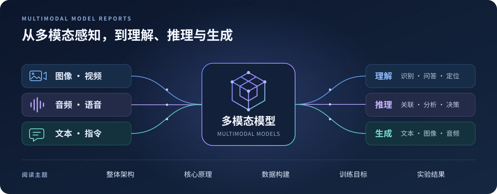

# 多模态大模型技术报告

**Multimodal Model Reports**

多模态大模型的中文图文详解 · 架构 · 原理 · 数据 · 训练 · 实验

[开始阅读](reports/paper-reading-guide.md) · [模型系列](reports/model-family-index.md)

---

聚焦多模态大模型的整体架构、核心原理、数据与训练，结合原文图表解读实验结果。支持按论文阅读，也可按模型系列比较不同版本。

| 中文详解 | 模型系列 | 原文图表 |
|:---:|:---:|:---:|
| **271 篇** | **183 个** | **1,516 个** |

## 阅读导航

| 阅读方式 | 入口 |
|---|---|
| 按发表时间阅读中文详解（由早到晚） | [全部 271 篇逐篇论文详解 →](reports/paper-reading-guide.md) |
| 按模型系列比较不同版本 | [183 个模型系列完整索引 →](reports/model-family-index.md) |

## 模型家族索引

点击下方系列查看论文列表，更多系列见[完整索引](reports/model-family-index.md)。

| 模型系列 | 模型系列 | 模型系列 | 模型系列 |
|---|---|---|---|
| [Qwen](papers/qwen/README.md) | [DeepSeek](papers/deepseek/README.md) | [InternVL](papers/internvl/README.md) | [MiniCPM-V / MiniCPM-o](papers/minicpm/README.md) |
| [LLaVA（官方研究谱系）](papers/llava/README.md) | [Kimi](papers/kimi/README.md) | [GLM / VisualGLM](papers/glm/README.md) | [Seed](papers/seed/README.md) |
| [Gemini](papers/gemini/README.md) | [GPT](papers/gpt/README.md) | [Claude](papers/claude/README.md) | [Llama](papers/llama/README.md) |
| [BLIP / xGen-MM](papers/blip/README.md) | [Emu](papers/emu/README.md) | [mPLUG](papers/mplug/README.md) | [VideoLLaMA](papers/videollama/README.md) |
| [VITA](papers/vita/README.md) | [VILA / NVILA](papers/vila/README.md) | [InternLM-XComposer](papers/internlm-xcomposer/README.md) | [MiMo](papers/mimo/README.md) |

## 逐篇论文详解

每篇详解包含以下七部分：

| 内容 | 主要回答的问题 |
|---|---|
| **01 · 论文信息与模型定位** | 谁提出了模型？面向什么任务？与前代或相关工作是什么关系？ |
| **02 · 快速概览** | 主要贡献是什么？有哪些模型规格与能力边界？ |
| **03 · 整体架构** | 各模态如何编码、连接、融合与输出？结合原文模型图说明。 |
| **04 · 核心创新与数学原理** | 关键机制如何工作？相关公式与设计动机是什么？ |
| **05 · 数据构建与处理** | 数据来自哪里？如何清洗、合成、配比与预处理？ |
| **06 · 训练流程与目标** | 分哪些阶段？训练哪些参数？优化目标与损失如何设计？ |
| **07 · 实验设置与主要结果** | 如何评测？主要结果、消融实验和适用范围是什么？ |
