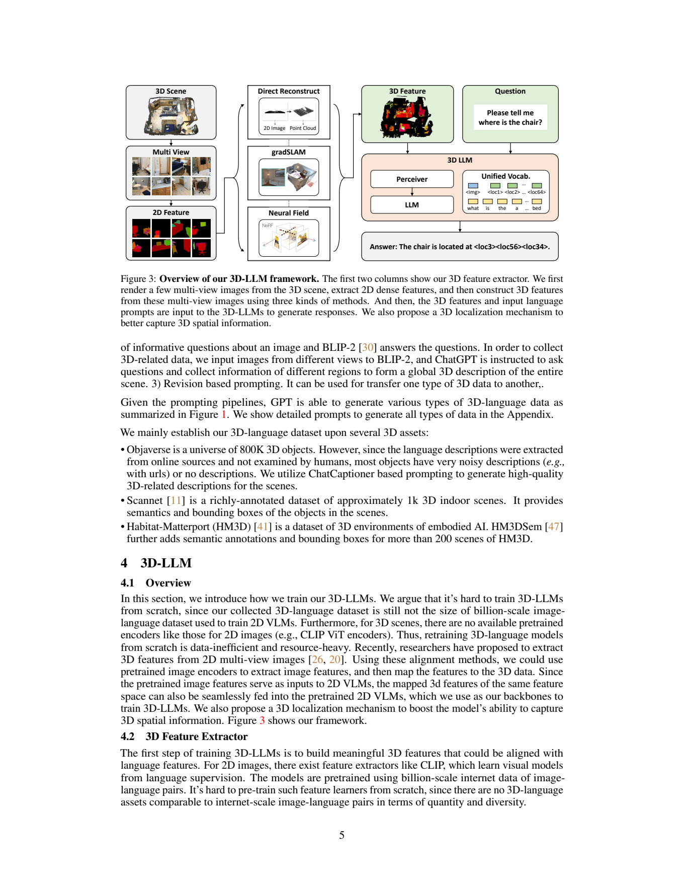
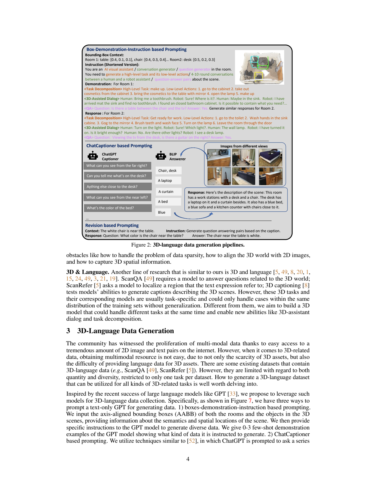
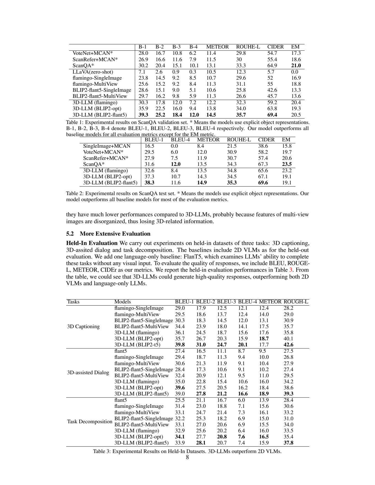

[返回模型家族](../README.md) · [返回仓库](../../../README.md)

# 3D-LLM：把多视角视觉知识映射到三维场景，再交给语言模型

> 本文依据 [arXiv:2307.12981v1](https://arxiv.org/pdf/2307.12981v1)。图像为该版本原文页面截图，保留原图、表头与上下文。未重新运行模型；补充公式明确标为解读表达。

## 1. 论文信息与模型定位

| 项目 | 内容 |
|---|---|
| 论文题名 | 3D-LLM: Injecting the 3D World into Large Language Models |
| 作者与机构 | Yining Hong 等；UCLA、上海交通大学、华南理工大学、UIUC、MIT、MIT-IBM Watson AI Lab、UMass Amherst 等，按原文署名 |
| 版本 | 2023-07-24，采用 arXiv v1 |
| 家族 | 3D-LLM，三维场景理解与具身语言任务 |
| 基础模型 | Flamingo 9B；BLIP-2 ViT-g + OPT-2.7B；BLIP-2 ViT-g + FlanT5-XL；这些是骨干名称，非统一精确总参数量 |
| 输入与输出 | 带语义特征的三维点及文字提示 → 自然语言回答、描述、分解计划或离散位置 token |
| 官方资源 | [项目页](https://vis-www.cs.umass.edu/3dllm/) · [代码](https://github.com/UMass-Foundation-Model/3D-LLM) |

3D-LLM 将整片场景的空间表示作为语言模型的视觉上下文。论文关注场景描述、物体定位、三维问答、对话与任务分解；输出“去柜子拿衣服”等计划，不意味着报告已经验证真实机器人能够闭环执行全部动作。其区别在于模型可以同时利用场景中多个视角覆盖的对象与关系，而不是每次只看一张局部照片。[§1、§4、§5](https://arxiv.org/pdf/2307.12981v1#page=3)

## 2. 快速概览

直接从零训练三维语言模型存在两道门槛：大规模三维资产及其语言标注远少于互联网图文数据；现成二维语言视觉模型期待的是已与语言对齐的图像特征。作者选择先借用二维编码器的语义空间，将渲染后的多视角密集特征映射回三维点，再用现成 BLIP-2 或 Flamingo 接收这些点特征。这样需要新学的是三维输入的读取与空间定位，而非重新学习全部视觉语义和语言生成。

数据也不是照搬已有单一任务问答。作者用 ChatGPT、BLIP-2 和场景边界框构造超过 30 万条三维语言样本，覆盖描述、问答、位置、对话和计划；再给点特征附加三维位置编码，并把位置坐标离散为可生成 token。模型因而能够在同一输出空间内回答“是什么”和“在哪里”。

实验对两种泛化口径作了区分：自建任务的留出样本属于 held-in；ScanQA 等数据集未参与基础模型训练，属于 held-out，但在评测前会进行该数据集微调。因此 ScanQA 结果不能写成零样本成绩。BLIP-2-FlanT5 版本在验证集 BLEU-1 为 39.3，高于 ScanQA 基线的 30.2；但 EM 为 20.5，略低于基线 21.0。三维输入改善了许多文字匹配指标，仍没有在每个指标上全面领先。[§5、Table 1](https://arxiv.org/pdf/2307.12981v1#page=7)

## 3. 整体架构

> 原文 Figure 3，v1 PDF 第 5 页；[原页](https://arxiv.org/pdf/2307.12981v1#page=5)。本资产为完整页面截图。

读图时从左往右：三维场景首先渲染为多个相机视角，二维编码器为每幅图产生像素对齐的密集特征；中间三条路径将这些特征归并到三维表示；右侧用 Perceiver 或 Q-Former 将可变数量的点特征压缩为语言模型可读取的表示，并与用户问题联合生成答案。图中 `<loc…>` 是新增位置 token，体现空间定位被纳入语言输出。

| 模块 | 输入输出与选择 | 作用 |
|---|---|---|
| 多视角密集特征提取 | 渲染图像 → 与像素对齐的二维特征 | 复用预训练视觉语义，减少从零建立三维语义空间的负担 |
| 三维特征构建 | 多视角特征、深度及相机信息 → N×Dv 点特征 | 将不同视角中的观察放入统一三维位置 |
| Perceiver / Q-Former | 可变长度点序列 → 固定大小潜在表示 | 处理点数变化，复用现成 VLM 的连接模块 |
| 语言骨干与位置词表 | 提示与三维表示 → 文本或坐标序列 | 统一描述、问答、定位和任务分解 |

三维构建有三种适用条件不同的方案。Direct Reconstruction 使用可靠 RGB-D 与相机矩阵，直接把像素特征投回重建点；Feature Fusion 利用 gradSLAM 融合深度、颜色和特征，更适合带噪深度或相机信息；Neural Field 使用神经体素场，在缺少深度、只有 RGB 渲染的情形下，让射线上的三维特征与二维像素特征以 MSE 对齐。它们不是同时必经的三层网络，而是针对数据条件的不同构建路径。[§4.2](https://arxiv.org/pdf/2307.12981v1#page=6)

BLIP-2 版本的输入特征为 1408 维，与其 EVA-CLIP 表示一致；Flamingo 版本为 1024 维，与对应 CLIP 表示一致。空间特征维度相容是接入条件，语义与任务匹配仍需训练，不能仅凭形状相同推断三维表示已完美对齐。多视角图像拼接基线也能看到较广场景；论文试图说明，统一三维位置组织有利于利用这些观察，而不仅是增加照片数量。

## 4. 核心创新与数学原理

**将二维语义搬到三维几何。** 点特征保存“这个地方像什么”，点坐标保存“它在场景哪”。以 RGB-D 直接重建为例，可用标准投影的逆过程解释：若像素齐次坐标为 u、深度为 z、相机内参为 K，则相机坐标点满足 `p_camera=z K⁻¹u`，再经外参变换到世界坐标。此式是读者理解 §4.2 的标准几何补充，不是论文编号公式。利用已知映射，像素对应的语义向量也随点搬到三维空间；同一表面由不同视角观察到时，需要融合重复与带噪特征。

**固定大小潜在表示读取任意点数。** 不把所有点直接塞进语言模型，而由少量可学习查询对点特征做交叉注意力。其标准解读形式是：

$$
Z=\operatorname{softmax}(QK_F^\top/\sqrt d)V_F.
$$

F 是点特征序列，Q 是潜在查询，K_F、V_F 为投影后的键和值。输出长度由查询数决定，输入点数变化不会直接使语言序列同幅度增加。论文复用不同骨干中的 Perceiver/Q-Former，而不是为所有版本规定同一查询数或同一层配置；上式省略其多层交互，只说明压缩读取机制。[§4.3.1](https://arxiv.org/pdf/2307.12981v1#page=6)

**空间信息既写入输入，也写入输出。** 原文为 x、y、z 三个维度分别构造 sin/cos 位置编码，每个维度的编码大小为 Dv/3；三个轴的编码拼接后，再与点语义特征拼接。采用空间编码，是为了让相似物体的特征仍能由所在位置区分。这里应按原文理解为拼接，不应改写成只对语义向量相加。

输出端把 AABB 表为六个角坐标 `xmin,ymin,zmin,xmax,ymax,zmax`，将连续坐标均匀离散到 voxel 整数并加入词表。可用如下解读表达概括，不指定原文未统一说明的场景归一化细节：

$$
b=\big[q(x_{\min}),q(y_{\min}),q(z_{\min}),q(x_{\max}),q(y_{\max}),q(z_{\max})\big].
$$

q 是均匀量化函数，b 对应六个位置 token。原图示例回答只给出三个位置 token，用于展示位置表达；正文 §4.3.2 对框说明的是六坐标序列，两者不能混成“所有框都只有三个 token”。离散化让定位监督可以使用语言预测损失，代价是坐标精度受到量化分辨率限制，词表中的序号本身也不自动具有连续空间度量。

## 5. 数据构建与处理

> Figure 2，PDF 第 4 页；[原页](https://arxiv.org/pdf/2307.12981v1#page=4)。页面上半部分展示合成管线。

图的上部用房间和物体边界框提供空间语义，再配 0–3 个示范及任务指令，让 ChatGPT 生成任务分解、4–10 轮人机对话或场景问答。中部不是让文本模型直接“看懂点云”，而是由 ChatGPT 主动提问、BLIP-2 查看不同视角并回答，再汇总为场景描述。下部 Revision 将既有描述改写成问答等另一任务格式。三条路径提供的信息强度不同：边界框有几何位置，多视角回答有外观属性，改写只继承已有文本中包含的事实。

| 三维资产 | 原文说明的源规模 | 使用方式 |
|---|---:|---|
| Objaverse | 约 80 万个三维对象的资产库 | 对原有噪声或缺失描述，用多视角问答生成描述 |
| ScanNet | 约 1,000 个室内三维场景 | 使用语义与物体边界框支持空间任务 |
| HM3D / HM3DSem | HM3DSem 给超过 200 个场景增加语义和框 | 生成与具身场景相关的语言任务 |

上表是底层资产库口径，并非论文实际全部训练场景数。最终三维语言数据超过 30 万条，按 8:1:1 划分 train/val/test，并在基础训练中混合任务。作者还在附录展示类别分布，但正文未完整列出所有类别的最终数量、清洗阈值或逐条人工核验比例。生成文本可能继承 BLIP-2 的识别错误与 ChatGPT 的推断；几何框也不足以确定颜色、材质或物体内部内容，因此不能将合成问答全部视为实测真值。[§3、§5；附录 A](https://arxiv.org/pdf/2307.12981v1#page=4)

## 6. 训练流程与目标

训练先构建可输入的三维特征，再将现成 VLM 的输入从二维特征换成三维特征，用混合三维语言任务继续训练；随后针对 held-out 下游任务微调。输出描述、回答或位置 token 均使用标准语言建模损失。其解读式为：

$$
\mathcal L=-\sum_t\log p_\theta(y_t\mid F_{3D},s,y_{<t}),
$$

s 是任务提示，F3D 是场景表示，y 是目标文本/位置序列。对 FlanT5 骨干应按其条件生成结构理解，此式概括输出 token 概率，不表示它被替换为纯 decoder-only 网络。[§5](https://arxiv.org/pdf/2307.12981v1#page=7)

| 骨干分支 | 更新模块 | 保持冻结的主要部分 |
|---|---|---|
| BLIP-2 | Q-Former，以及新增位置 token 的输入/输出 embedding 权重 | OPT 或 FlanT5 的绝大部分权重 |
| Flamingo | Perceiver、gated cross-attention、新增位置 token 的输入/输出 embedding | 其余预训练主干参数 |

附录 B.1 给出了不同分支的实际训练设置。BLIP-2 分支训练 100K 步，每 1K 步验证；使用 8 个节点，每节点 8 张 V100、每节点 batch 为 16；AdamW 的 β1/β2 为 0.9/0.999、weight decay 为 0.05。前 1K 步学习率由 10⁻⁸ 线性升到 10⁻⁵，此后余弦衰减到 0。Flamingo 分支使用 8 张 A100、batch 16；梯度全局 norm 裁剪为 1，Perceiver 不做 weight decay，其余可训练参数 decay 0.1；前 5,000 步学习率从 0 升到 10⁻⁴，此后恒定。不能把这两组配置混成一个统一训练配方；报告没有给出全部步骤的完整耗时或费用。[附录 B.1，PDF 第 13–14 页](https://arxiv.org/pdf/2307.12981v1#page=13)

## 7. 实验设置与主要结果

> Table 1–3，PDF 第 8 页；[原页](https://arxiv.org/pdf/2307.12981v1#page=8)。先按任务和切分选表，再在同一指标列比较。

ScanQA 使用语言生成相似度指标 BLEU、METEOR、ROUGE-L、CIDEr，以及 exact match。它们衡量的不是同一属性：较长但语义接近的回答可能获得较高匹配分数，却因字符串不完全一致而在 EM 上失败。表中带 `*` 的基线使用显式物体表示；3D-LLM 使用整体点特征。单图、多视角 VLM 基线也经过相应训练及 ScanQA 微调；LLaVA 行则是随机单图输入的零样本设置，可比条件不同。

| ScanQA 条件与指标 | ScanQA 基线 | 3D-LLM BLIP2-FlanT5 | 解读 |
|---|---:|---:|---|
| 验证 BLEU-1 | 30.2 | 39.3 | 增加 9.1 分数点，不是相对增长 9% |
| 验证 CIDEr | 64.9 | 69.4 | 增加 4.5 分数点 |
| 验证 EM | 21.0 | 20.5 | 略低于专门基线 |
| 测试 BLEU-1 | 31.6 | 38.3 | 增加 6.7 分数点 |
| 测试 BLEU-4 | 12.0 | 11.6 | 没有超过基线 |
| 测试 EM | 23.5 | 19.1 | 仍有明显差距 |

验证集 BLIP2-FlanT5 多视角输入 BLEU-1 为 29.7，同骨干 3D-LLM 为 39.3，说明在这组实验中三维组织比直接拼接多视角更有效。Held-in 描述任务的 BLEU-4 从多视角版本 14.1 提升到 20.1；对话 ROUGE-L 从 29.5 到 39.3。但任务分解的各指标并非全部由同一分支最高，自建合成数据的留出测试也不能替代真实机器人成功率。

附录 Table 7 的 Perceiver 消融进一步限制了结论：加入该模块后 BLEU-1 从 29.2 到 30.3，ROUGE-L 从 30.4 到 32.3，但 BLEU-4 从 7.4 到 7.2、EM 从 20.6 到 20.4。它支持连接模块对部分生成质量指标有帮助，不支持所有指标都受益。总体上，本文展示了复用二维语义与三维空间组织的可行性；性能仍受渲染质量、特征融合、合成语言监督和坐标量化限制。[§5、附录 B.4](https://arxiv.org/pdf/2307.12981v1#page=16)
