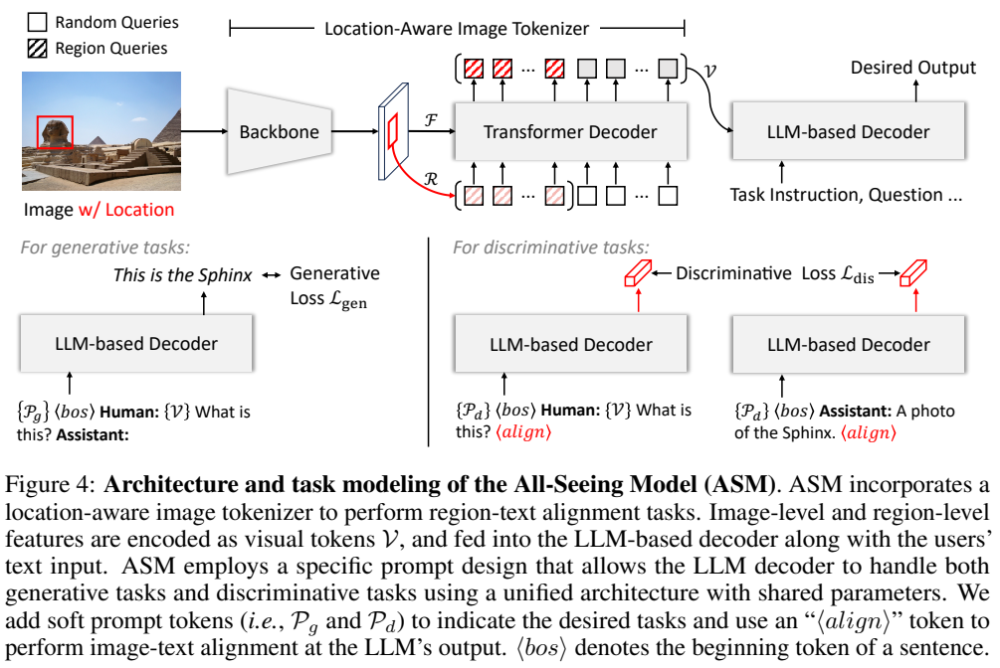
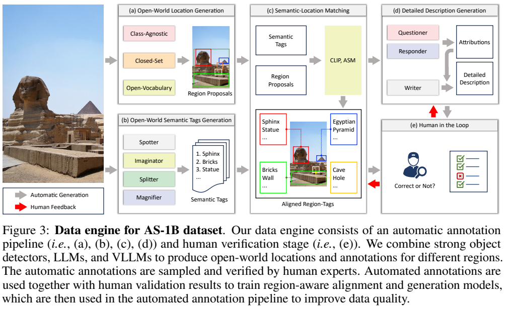
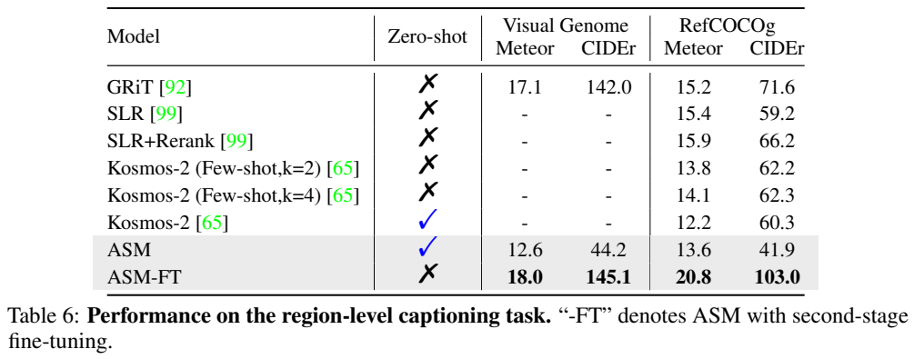
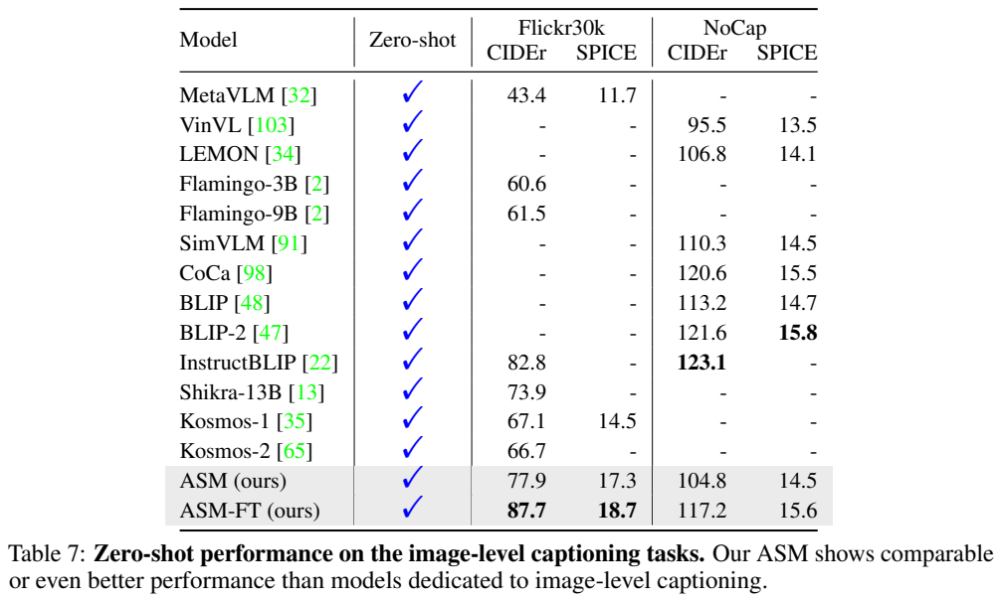
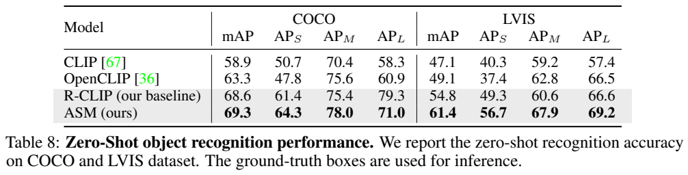
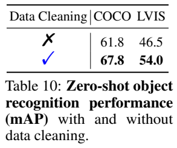
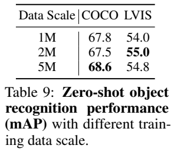
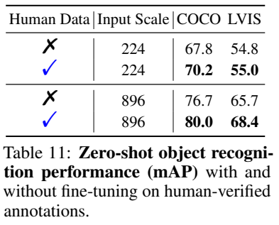

[返回 All-Seeing 家族](../README.md) · [返回项目](../../../README.md)

# All-Seeing：用区域数据引擎统一视觉识别与语言生成

> 固定解读 [arXiv:2308.01907v1](https://arxiv.org/abs/2308.01907v1)。本文的图表为原 PDF 图表裁图，保留图例、原表头及必要注释；补充数学表达单独注明为解读公式。

## 1. 论文信息与模型定位

| 项目 | 内容 |
|---|---|
| 原题 | The All-Seeing Project: Towards Panoptic Visual Recognition and Understanding of the Open World |
| 团队 | 以上海人工智能实验室 OpenGVLab 为核心的联合研究团队，论文列有复旦、华中科技、哈工大、南京大学等机构 |
| 版本 | 2023-08-03 提交的 arXiv v1，本文不混用后续 All-Seeing V2 |
| 研究产物 | AS-1B 区域语义数据集与 All-Seeing Model（ASM） |
| 模型基础 | ViT-g/14 视觉骨干、位置感知视觉 tokenizer、Husky-7B 语言解码器 |
| 输入输出 | 整图与框、掩码或点等区域位置，加文字提示；输出区域标签匹配、检索结果或文字描述、问答 |
| 官方链接 | [论文 PDF](https://arxiv.org/pdf/2308.01907v1) · [代码](https://github.com/OpenGVLab/all-seeing) |

论文中的“panoptic”是面向画面里不同对象和区域的全面理解目标，不能直接等同于已经完成端到端全景分割系统。其核心是：当用户或检测器给出感兴趣的区域时，模型既能判断该区域对应什么文字概念，又能用语言说明属性和上下文。论文的区域识别主实验使用真实框，测的是给定位置后的语义识别能力，并未同时评估框是否能被准确检测出来。[原文 §1、§4、§6.3](https://arxiv.org/pdf/2308.01907v1#page=18)

## 2. 快速概览

整图描述容易回答“这是一张什么场景的图片”，但对于一张画面中的小物体、部件或罕见类别，整图表示未必能保留充分信息。直接裁剪后送给多模态模型又可能丢失上下文：吊在天花板上的灯罩，孤立看可能像杯子。All-Seeing 同时从数据和模型处理这个问题：先把大量图像变成带区域位置的语义、问答和描述；再让模型以区域为条件从整图特征中提取表示。

数据侧不是一次性调用大模型生成标签，而是让检测器、图文模型、语言模型和人工验证相互配合。检测器提出“可能在哪里”，语言侧扩展“可能是什么”，匹配模块筛选相符概念，问答模块补充属性，人工抽检纠正偏差，再将经过校正的模型投入下一轮标注。这个闭环构成主要的数据工程贡献。

模型侧把识别与生成放进同一个 LLM 解码器。描述任务按下一个 token 预测；匹配任务在末尾增加专用的 `<align>` token，以其隐藏表示计算区域和文字的相似度。因此 ASM 并不是每次都先生成一段说明再从中抽取类别，而是保留一条可用于判别与检索的表示路径。

主要结果也要分开看：给定真实框，ASM 在 COCO/LVIS 上的区域识别 mAP 为 69.3/61.4，高于论文 CLIP 基线的 58.9/47.1；区域描述经过二阶段微调后明显改善。另一方面，零样本 ASM 在 Visual Genome 的区域描述 CIDEr 只有 44.2，远低于相关数据微调后的 145.1，说明海量自动标签与特定描述任务之间仍有距离。[原文 Table 6、8](https://arxiv.org/pdf/2308.01907v1#page=18)

## 3. 整体架构

*来源：原文 Figure 4 与公式 (1)，PDF 第 11 页；[原页](https://arxiv.org/pdf/2308.01907v1#page=11)。*

先看 Figure 4 上半部：骨干提取整图特征，红色连线从指定区域取出局部信息；区域查询和随机查询一同进入 Transformer Decoder，形成视觉 token，再送入语言解码器。图例中斜线填充方块是 Region Queries，空白方块是 Random Queries。局部与全局信息在这一阶段汇合，而不是将整图和区域视为互不相关的两张图片。

视觉骨干得到 $F\in\mathbb R^{H\times W\times D}$。给定一个框，RoIAlign 从 $F$ 中取出区域特征 $R\in\mathbb R^{H_r\times W_r\times D}$，展平并经两层全连接得到 $Q_r\in\mathbb R^{G\times D_q}$。$G$ 表示一个查询组中的 token 数量，$D_q$ 是查询维度；它与随机初始化查询组 $Q'$ 形状一致。对于 $N$ 个区域，将各区域查询和一个随机查询组合，得到 $(N+1)G$ 个位置感知查询，经 12 层 Transformer 解码器提取输出，最终投影到语言维度 $D_t$。这里的 $N$ 是输入区域数，不是文本长度，不能把所有输入统一理解为固定数量视觉 token。

原文在 §4.2 描述框、掩码和点条件，但明确展开的是用 RoIAlign 提取区域特征的路径。没有指定区域时，以整张图像的框作为区域，保持同一接口。本文不额外补造掩码或点到 RoI 的实现细节。

下半部是共享语言解码器的两种使用方式。左侧生成任务加生成提示 $P_g$，输出回答；右侧判别任务加 $P_d$，分别编码视觉输入和文字输入，用最后的 `<align>` 表示匹配。文字分支不含视觉 token，避免它看到目标图像后造成检索信息泄漏。两条判别分支共享提示和对齐 token，生成任务使用另一组提示；原文给出任务提示长度 $M=5$。[原文 §4.2–4.3，第 11–12 页](https://arxiv.org/pdf/2308.01907v1#page=11)

## 4. 核心创新与数学原理

第一项机制是**让视觉查询带有区域内容**。普通固定查询只学习如何整体压缩图像；这里 $Q_r$ 来自区域特征，因而在进入查询解码器之前就明确了关注对象。局部查询仍能读取完整特征 $F$，从而结合目标外观与周围环境。可用解读式概括为：

$$
Q_r=\operatorname{FC}_2\!\left(\operatorname{FC}_1(\operatorname{Flatten}(\operatorname{RoIAlign}(F,b)))\right),\quad
V=\operatorname{Proj}(\operatorname{Decoder}([Q_r;Q'],F)).
$$

这是对 §4.2 数据流的整理，省略激活和内部注意力细节，不是新增的原文编号公式。$b$ 是指定框，$V$ 是语言端可接收的视觉提示。与重新裁图编码相比，使用整图特征也为保留背景关系提供条件；但论文没有给出单独消融来定量证明每种局部上下文设计的增益。

第二项机制是**通过任务提示统一生成与对齐**。原文公式 (1) 明确为：

$$\mathcal L_{\mathrm{total}}=\mathcal L_{\mathrm{gen}}+\mathcal L_{\mathrm{dis}}.$$

生成损失是下一个 token 预测；判别损失使用 CLIP 风格对比学习，把每个区域当作一条视觉样本。若第 $i$ 个区域和第 $i$ 条文字互为正例，标准单向对比项可以写成以下辅助解读式：

$$
\mathcal L_{r\to t}=-\frac1B\sum_i\log\frac{\exp(s(v_i,t_i)/\tau)}{\sum_j\exp(s(v_i,t_j)/\tau)}.
$$

$v_i,t_i$ 分别由 `<align>` 隐藏表示得到，$B$ 是批大小，$s$ 为相似度，$\tau$ 为温度；CLIP 风格还包括反向文字到视觉项。原文只指明采用该类损失，没有在公式 (1) 附近逐项给出温度或归一化实现，不能把这个解释式当作完整复现配置。其作用是使正确标签的相似度高于批内其他文字，同时语言生成路径保持区域描述能力。

第三项机制是**跨模型提议的区域合并**。SAM、闭集检测器与 grounding 模型的置信分数尺度不同，直接按统一分数进行 NMS 不可靠。原文算法 (1) 以已有区域为参照，计算新框与旧框的最大 IoU；超过阈值就删除重复新框，同时把其语义标签加入旧框，否则保留新区域。IoU 衡量交集面积占并集面积的比例。这里去掉的是重复位置，保留的是不同模型提供的语义候选，避免“删框”顺带丢失可用类别信息。[原文 §3.2、第 6–7 页](https://arxiv.org/pdf/2308.01907v1#page=6)

## 5. 数据构建与处理

*来源：原文 Figure 3，PDF 第 6 页；[原页](https://arxiv.org/pdf/2308.01907v1#page=6)。*

Figure 3 的灰箭头表示自动生成，红箭头表示人工反馈。先独立得到区域提议和语义候选，再匹配，最后生成细节描述；右侧人工环节把错误反馈给后续模型更新。读图时不能把右下的人工审核理解为人工逐一标完全部十亿级区域，论文采用的是抽样核验和模型再标注。

AS-1B 使用 SA-1B 的 1,100 万张图像，最终含 12 亿区域、350 万不同语义标签、33 亿 VQA 对和 12 亿描述；问题、回答、描述的 token 量分别为 34.6B、55.4B、42.2B，合计 132.2B。这是数据文本统计，不是 ASM 的已训练 token 总数。v1 Figure 1 图注存在与正文不一致的数量写法，本文采用正文 §3、§5 及 Table 1/4 的详细统计。[原文第 4、12–14 页](https://arxiv.org/pdf/2308.01907v1#page=14)

区域来自 SAM、InternImage-H、EVA-02 和 GLIP，分别贡献 36.4%、20.5%、22.5%、20.6%。标签生成分成四种角色：Spotter 用整图描述和 OCR 列出显著对象；Imaginator 用场景描述及语言知识补充可能存在的对象；Splitter 把物体拆成部件；Magnifier 裁区域并用 BLIP 描述，补充整图漏掉的小对象。想象得到的类别只是候选，需要后续视觉匹配，不能直接作为真实存在的标签。

第一次匹配使用 CLIP，但可能把带背包的人框匹配成“背包”。作者用 CLIPSeg 的候选掩码面积调节相似度，使框内主要对象更有机会被选中。自动流程初始产生 2.14B 区域，再按不同尺度的高分区域筛选与候选重排序，压缩到 1.2B。不同提议和多个区域会共享同一图像，因此这些区域并不都是互相独立的视觉场景。

细节描述先由 Questioner 根据标签提出三个属性问题，Responder 结合区域回答，Writer 再整合成描述。这样把“需要知道哪些属性”与“图中是否能回答”分开处理，然而任何一步错误都会传到下一步。论文的自动问答抽检中，正确回答只占 47.1%，错误回答 18.6%，不可回答问题 19.0%，错误语义 15.3%。自动标签 top-1 准确率为 54.8%，候选标签准确率为 47.0%。这些数据说明“标注规模大”不能被理解为“所有自动标注可靠”。[原文 §5.3、Table 5](https://arxiv.org/pdf/2308.01907v1#page=14)

人工验证按概念频次采样，增加稀有概念的覆盖；50 名标注者筛除错误标签、纠正问答或给出拒绝回答，另由 10 名专家复核。每组 100 个区域的包低于 95% 准确率时退回复验。这个阈值是人工审核包的质量要求，不是整个 AS-1B 的已保证准确率。通过经人类验证的数据更新 ASM，再用于重排标签、重新生成回答与描述，形成迭代闭环。[原文 §3.5–3.6，第 9–10 页](https://arxiv.org/pdf/2308.01907v1#page=9)

## 6. 训练流程与目标

ASM 的多任务训练使用区域语义标签训练判别对齐，区域问答和描述训练生成；同时加入 LaionCOCO 整图描述，保持整体图像理解。训练并非只看区域裁剪，模型结构和数据同时包含整图与局部信息。

| 设置 | 原文 ASM 配置 |
|---|---|
| 初始化 | Husky 权重，视觉结构采用 ViT-g/14 |
| 优化器 | AdamW，$\beta_1=0.9,\beta_2=0.999$，weight decay=0 |
| 批大小 | 生成任务 256；区域文本对齐 32,768 |
| 学习率 | 预训练初始 $5\times10^{-4}$，前 10% 步线性 warmup，再 cosine decay 至 0 |
| 训练长度 | 原文训练 1 epoch，默认图像分辨率 224×224 |
| 二阶段微调 | 学习率 $5\times10^{-5}$，模型标为 ASM-FT |

二阶段加入 MiniGPT-4、LLaVA-150k、COCO caption 等整图生成数据，以及 Visual Genome、RefCOCOg 和人工核验区域数据。原文没有在 §6.1 逐模块列清 ASM 的冻结配置、GPU 数量和总成本，本文不依据其学习率或初始化方式推断哪些模块冻结。[原文 §6.1，第 15 页](https://arxiv.org/pdf/2308.01907v1#page=15)

还要区分两套实验：R-CLIP 是作者为数据工程分析建立的区域感知 CLIP 基线，以 OpenCLIP ViT-L/14 加 RoIAlign，训练 10,000 步；它不是 ASM 的另一种语言模型档位。针对 R-CLIP 的人工校正实验，用 40k 人工语义标签、batch 1024、学习率 $5\times10^{-4}$ 微调四轮，并将人工判错候选作为困难负例。不能把这些四轮或 40k 配置写成整个 ASM 的主训练配置。[原文 §6.1、§6.4，第 15、20 页](https://arxiv.org/pdf/2308.01907v1#page=20)

## 7. 实验设置与主要结果

*来源：原文 Table 6、7，PDF 第 18 页；[原页](https://arxiv.org/pdf/2308.01907v1#page=18)。先读 Zero-shot 列，ASM-FT 在区域任务使用相关训练数据，不能作为纯零样本结果。*

| 任务与指标 | ASM | ASM-FT | 阅读依据 |
|---|---:|---:|---|
| Visual Genome 区域描述 Meteor | 12.6 | 18.0 | Table 6 |
| Visual Genome 区域描述 CIDEr | 44.2 | 145.1 | Table 6 |
| RefCOCOg 区域描述 Meteor | 13.6 | 20.8 | Table 6 |
| RefCOCOg 区域描述 CIDEr | 41.9 | 103.0 | Table 6 |
| Flickr30K 整图描述 CIDEr | 77.9 | 87.7 | Table 7 |
| NoCaps 整图描述 CIDEr | 104.8 | 117.2 | Table 7 |

零样本 RefCOCOg 的 Meteor 高于 Kosmos-2 的 12.2，但 CIDEr 41.9 低于其 60.3，不能概括为两个指标都更好。整图 NoCaps 上，ASM-FT 117.2 仍低于 InstructBLIP 的 123.1，表明区域能力增强并未带来每个整图基准的最优成绩。Meteor、CIDEr、SPICE 用不同方式衡量参考文本匹配，不是准确率百分比；长描述也可能因措辞和长度与人工参考不同而影响分数。

*来源：原文 Table 8–11，PDF 第 19 页；[原页](https://arxiv.org/pdf/2308.01907v1#page=19)。表 8 比较模型，表 9–11 使用 R-CLIP 分析数据处理，请勿跨表当成同一个 ASM 配置。*

Table 8 的 COCO/LVIS mAP 依次为 CLIP 58.9/47.1、OpenCLIP 63.3/49.1、R-CLIP 68.6/54.8、ASM 69.3/61.4。区域文字监督对两类模型都有效，而 ASM 在 LVIS 的增益更明显。所有模型拿到真实框，因此分数不包含漏检或框定位误差，也不是完整开放词汇检测系统的端到端 mAP。

数据工程消融比单看主表更能解释贡献。清洗把 R-CLIP 的 COCO/LVIS 从 61.8/46.5 提到 67.8/54.0。224 分辨率下人工校正使 COCO 从 67.8 到 70.2；896 分辨率下从 76.7 到 80.0。分辨率本身也改变成绩，比较人工数据时必须固定输入尺度。数据量从 1M、2M 到 5M 图像时，COCO 为 67.8、67.5、68.6，LVIS 为 54.0、55.0、54.8，并非每次扩展都单调上升；这进一步说明数据量与质量要一起讨论。

论文还进行人工偏好评估，但只有五名参与者、每个所选数据集 20 个样例，应作为补充证据。整体而言，原文充分支持区域监督、数据清洗和少量人工校正的重要性，也展示共享解码器能兼顾识别与生成；不支持把十亿规模标注视为无噪声知识，或宣称已经解决任意开放世界视觉任务。本文未运行模型，以上均为原报告结果解读。[原文 §6.5，第 20 页](https://arxiv.org/pdf/2308.01907v1#page=20)
