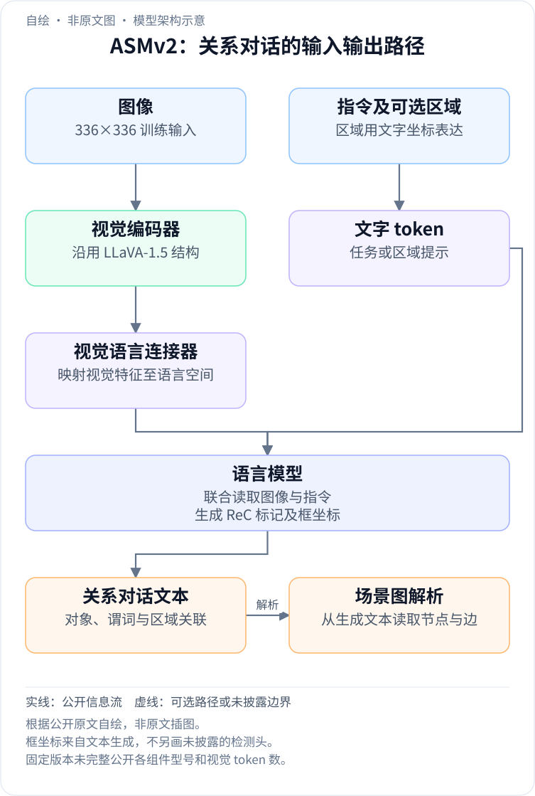
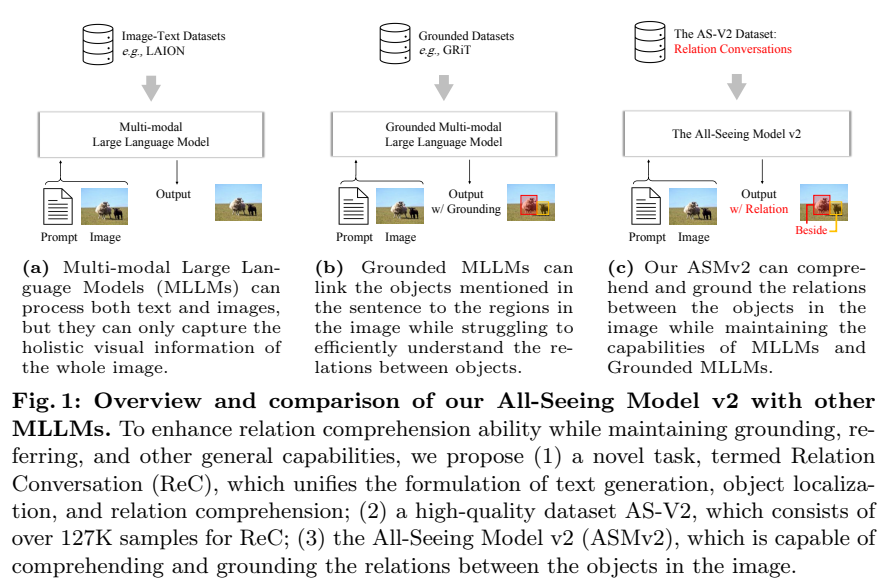
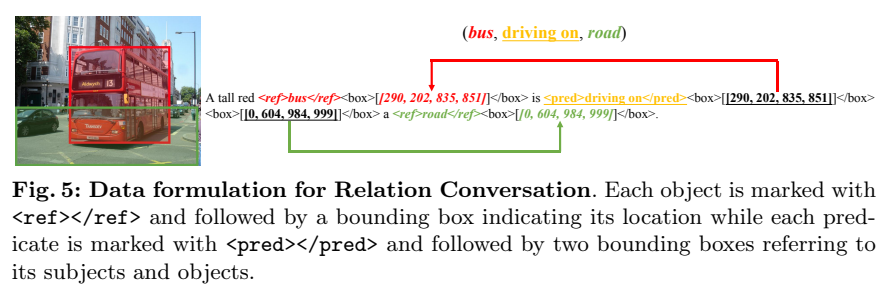
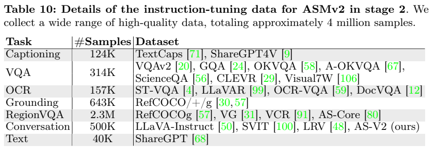
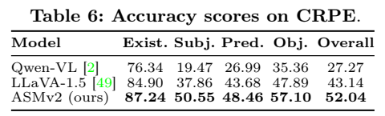

<!-- article-header:start -->
[项目首页](../../../README.md) › [模型系列](../../../reports/model-family-index.md) › [All-Seeing](../README.md)
<!-- article-header:end -->

# ASMv2：把对象、关系与位置统一为关系对话

> 采用 [arXiv:2402.19474v1](https://arxiv.org/pdf/2402.19474v1)。配图为原文图表区域裁切；本文的解释性数学表达均单独注明。

<!-- article-toc:start -->
<a id="article-toc"></a>

**本篇目录** · [论文定位](#paper-info) · [快速概览](#overview) · [整体架构](#architecture) · [核心原理](#principles) · [数据构建](#data) · [训练流程](#training) · [实验结果](#experiments)
<!-- article-toc:end -->

<a id="paper-info"></a>

## 1. 论文信息与模型定位

| 项目 | 内容 |
|---|---|
| 原文题名 | The All-Seeing Project V2: Towards General Relation Comprehension of the Open World |
| 作者与机构 | Weiyun Wang 等；OpenGVLab 上海人工智能实验室、复旦大学、清华大学、香港中文大学、南京大学、哈尔滨工业大学及商汤研究等合作机构，以第一页署名为准 |
| 发表与版本 | 2024-02-29；采用 arXiv v1，共 29 页 |
| 家族与模型 | All-Seeing；All-Seeing Model v2，简称 ASMv2 |
| 规模口径 | 原文明确沿用 LLaVA-1.5 三模块架构，未在模型介绍和实现附录明确列出 ASMv2 的精确总参数量，不据对照模型规模反推 |
| 输入与输出 | 输入图像、文字，以及用框表达的区域提示；输出自然语言、对象框和主谓宾关系，可解析为场景图 |
| 任务定位 | 对象关系理解、关系对话、开放式场景图生成；兼顾一般视觉问答、区域描述和指代表达定位 |
| 官方资源 | [论文](https://arxiv.org/pdf/2402.19474v1) · [项目代码](https://github.com/OpenGVLab/all-seeing) |

这里的“关系理解”指识别某个具体对象对之间的动作、空间或语义联系。例如“女孩拿着披萨”不只是识别女孩和披萨，还要判断谁是持有者，并把关系两端绑定到正确区域。ASMv2 的主要变化是任务表达、数据和训练安排，不能把它理解成另起一种视觉主干或一个独立关系分类器。[原文 §1、§4](https://arxiv.org/pdf/2402.19474v1#page=8)

<a id="overview"></a>

## 2. 快速概览

已有图文模型能描述整幅图像，带定位的模型还能指出某个名词位于哪里，但二者都可能把关系“猜对语言、看错对象”。在有多个相似对象的场景中，生成一个合理句子并不能证明模型识别了真实关系。论文因此提出 Relation Conversation（ReC）：回答中每个对象不仅带框，每个谓词也带其主语框和宾语框，让描述、定位和关系三者互相约束。

围绕这一表达，作者用 COCO 图像及描述、框和关系标注，借助 GPT-4V 构建 127K 条 AS-V2 关系对话数据；再与一般图文和区域数据混合训练 ASMv2。与此同时，论文构建 CRPE 基准，将关系拆成主语、谓词、宾语三个测试方向，并用选项循环评测减少答案位置偏好。模型在 CRPE 关系总体准确率上达到 52.04，LLaVA-1.5 为 43.14，但这仍表示有大量关系问题未能稳定答对。[原文 §3、Table 6](https://arxiv.org/pdf/2402.19474v1#page=14)

这项工作的核心价值是把“说出关系”改成“说出关系并交代两端证据”。开放词汇生成允许模型输出未预设的关系词，也带来了词形变化、近义表达与严格评测不一致的问题；其优势与代价都应在场景图结果中一起阅读。

<a id="architecture"></a>

## 3. 整体架构

<!-- derived-architecture:start -->


*自绘模型架构示意（非原文图）。依据下述公开资料归纳；方框表示功能组件，不代表逐层实现。*

依据：[§4–4.1、Appendix C.2；PDF 第8–9、28页](https://arxiv.org/pdf/2402.19474v1)。
<!-- derived-architecture:end -->



> 来源：原文 Figure 1，v1 PDF 第 2 页，图表区域裁切。[原图所在页](https://arxiv.org/pdf/2402.19474v1#page=2)。从左向右看输出形式如何从文字扩展到对象框，再扩展到带两端定位的关系。

模型沿用 LLaVA-1.5 的视觉编码器、视觉语言连接器、语言模型三段式结构。图像经编码器形成视觉表示，连接器将其转换成语言模型可接收的特征，语言模型在图像条件下生成回答。框坐标被写进文本序列，因此模型通过生成方式表达区域与关系，不需要在这份报告中另假设一个检测头。

使用时可提出整图问题、给定区域问题，或直接要求场景图。对场景图而言，对象框与名称形成节点，谓词及其主语框、宾语框形成有向边；只找到框却没找到语义标签的节点被标为 Unknown。这样同一生成接口覆盖关系问答、开放场景图生成和给定对象标签及位置的谓词分类，而一般描述、定位和区域问答仍可作为相同模型的任务。[原文 §4–4.1，第 8–9 页](https://arxiv.org/pdf/2402.19474v1#page=8)

这里应区分“表达的统一”和“能力的统一”：序列格式让多类任务能使用同一模型接口，但格式本身不能保证框准确、主宾顺序正确或关系真实。后面的训练数据提供监督，实验再分别检验这些能力。

| 模块 | 输入与输出 | 公开机制 |
|---|---|---|
| 视觉编码器 | 336×336 图像 → 视觉特征 | 沿用 LLaVA-1.5 路径；第二阶段保持冻结 |
| 视觉语言连接器 | 视觉特征 → 语言输入表示 | 第一阶段建立跨模态对齐，第二阶段与语言模型共同训练 |
| 语言解码器 | 图像条件及指令 → ReC 文字序列 | 同时生成自然语言、对象标记、谓词标记与整数坐标 |
| ReC 解析器 | 对象框、谓词及两端框 → 有向场景图 | 以框坐标匹配对象名称；无法匹配名称的节点标为 Unknown |

[模块依据：§4–4.1，PDF 第8–9页](https://arxiv.org/pdf/2402.19474v1#page=8)。

<a id="principles"></a>

## 4. 核心创新与数学原理

### 4.1 关系序列：把谓词明确绑定到两个区域

定位信息不仅跟在名词后面，还跟在谓词后面重复出现。重复坐标的用途是建立可解析的引用：语言上相隔较远的实体仍能通过同一组框坐标关联。模型因此需要同时维持语言流畅性和坐标一致性；开放词表扩大可表达的谓词范围，也增加了同义词归一化与重复对象匹配的难度。[§4.1，PDF 第8–9页](https://arxiv.org/pdf/2402.19474v1#page=9)。

**关系对话的对象与谓词绑定。** ReC 用 `<ref>...</ref>` 标记对象名称，随后给出一个对象框；用 `<pred>...</pred>` 标记谓词，随后依次给出主语与宾语的两个框。坐标规范化为 `[0,1000)` 的整数，并按 `<box>[[x1,y1,x2,y2]]</box>` 输出。必须保留两端顺序，因为“人骑马”和“马骑人”使用相同实体名称，却表达完全不同的关系。[原文 §4.1](https://arxiv.org/pdf/2402.19474v1#page=9)



> 来源：Figure 5，v1 PDF 第 9 页，图表区域裁切。[来源](https://arxiv.org/pdf/2402.19474v1#page=9)。红色框对应 bus，绿色框对应 road；谓词后重复的两个框确定关系方向。

### 4.2 从 ReC 到图：输出结构与解析规则协作

解析分两遍完成：先建立“框→对象名称”的映射，再读取每个谓词后的主语框与宾语框并查表。Unknown 是找不到语义标签时的保底节点，不是新训练出的未知类别分类头。只生成正确的关系词仍不充分；若两端坐标不能对应已有节点，图结构就可能丢失语义连接。这也说明场景图质量不能仅用回答文本是否通顺判断。[§4.1，PDF 第9页](https://arxiv.org/pdf/2402.19474v1#page=9)。

读图时先看对象标记与坐标，再看谓词后的两组坐标。解析器把坐标作为匹配键，找到名称 bus 与 road，从而恢复 `(bus, driving on, road)`。与只在名词后放框的方式相比，谓词自身也显式指定区域，降低了读者或解析器猜测它修饰哪两个实体的需要。这是表示方式的作用解释；论文没有单独量化每一个特殊标记的贡献。

可将这一过程概括为解释性结构：

```math
G=(V,E),\qquad V=\{(b_i,c_i)\},\qquad E=\{(b_s,p,b_o)\}.
```

$`b_i`$ 是框，$`c_i`$ 是对象名称，$`p`$ 是关系词；两个端点框共同决定有向关系。此式是对原文解析规则的整理，不是原文编号公式。相比固定类别分类，关系词以自然语言生成，因而具有开放表达空间；但同义词会造成匹配困难，输出坐标不一致也可能干扰节点合并。论文讨论了语义上相近的 people/person 被严格匹配判错的情况。

### 4.3 循环评测：区分关系知识与位置偏好

同一问题轮换选项顺序后，视觉内容和正确关系均不改变，变化的只是答案在选项中的位置。因此四轮全对的规则同时检验关系判断与对选项位置的稳定性。原文还按主语和宾语各自的条件频率限制干扰谓词，让干扰项在单边语义上合理；模型必须结合两个对象及图像证据，而不能只靠某个名词的常见搭配排除答案。[§3.2，PDF 第7–8页](https://arxiv.org/pdf/2402.19474v1#page=7)。

**CRPE 的循环评测。** 基准为四选一，每题循环移动选项四次，只有每次都答对才计为正确。若以 $`a_k`$ 表示第 $`k`$ 次回答是否正确，则判定可解释为 $`\prod_{k=1}^4 a_k=1`$；这只是规则的数学表达，不是论文新增损失函数。它排除了“只在固定选项顺序下碰巧答对”的一部分情况，所以不能把 CRPE 分数直接与普通单次四选一准确率等同。

CRPE 四类问题分别询问对象存在性、关系主语、谓词与宾语。谓词干扰项须满足原文条件 $`P(p\mid s)\gt 0`$ 且 $`P(p\mid o)\gt 0`$，即该关系至少分别在相关主语或宾语条件下出现过，减少完全荒谬的干扰词。异常关系数据则选取较小的 $`P(p\mid s,o)`$，生成罕见但可理解的场景，以检查模型是否过度依靠常见搭配。[原文 §3.2，第 7–8 页](https://arxiv.org/pdf/2402.19474v1#page=7)

<a id="data"></a>

## 5. 数据构建与处理

AS-V2 并非单纯让 GPT-4V 自由编写图像故事。提示同时提供任务描述、待标图像、已有图像描述、对象框、主谓宾关系三元组和人工种子示例。图像描述帮助理解场景，框固定实体身份，关系标注提供主宾结构，示例约束输出格式。作者指出，虽然图像描述不是生成的必要条件，但加入后可减少合成幻觉。这里说的是构建者的观察，不能把合成模型的每个输出都视为人工核实真值。[原文 §3.1，第 5–6 页](https://arxiv.org/pdf/2402.19474v1#page=5)

| AS-V2 数据类型 | 数量与单位 | 监督重点 |
|---|---:|---|
| 整图详细描述 | 42K 条 | 在完整描述中定位对象并标注谓词两端 |
| 区域描述 | 63K 条 | 理解框提示，描述指定区域及其关系 |
| 对话 | 22K 条对话、总计 90K 轮 | 多轮问答、计数、动作、位置及关系，包含错误关系的负指令 |
| 合计 | 127K 条样本 | 三种类型共同提供关系对话监督 |

127K 是样本数，90K 是对话部分的轮次数，两者不应相加当成总样本。负指令包含错误关系，期望模型识别错误，而不是总顺从提问的前提。这对“某对象是不是做了某动作”的问题尤其重要。



> 来源：Table 10 与 Appendix C.2，v1 PDF 第 28 页，图表区域裁切。[来源](https://arxiv.org/pdf/2402.19474v1#page=28)。表中 RegionVQA 的 2.3M 是主要组成，AS-V2 包含在 Conversation 来源中。

训练并不只使用 127K 新数据。第二阶段指令集约 4M，包含 124K 描述、314K VQA、157K OCR、643K 定位、2.3M 区域问答、500K 对话和 40K 纯文本。这些类别帮助保持一般能力，同时把新关系任务置于较丰富的区域监督中。表中数值为近似统计，不能要求它们按未经舍入的数字精确相加。

CRPE 的人工核查与训练合成要分开看：基准会确保关系两端的对象标签在图像中可明确指认，再过滤问题和选项歧义；异常关系通过 DALL-E 3 生成后，人工过滤不符合指定关系的图像。训练数据和评测数据的处理目的不同，后者强调可判定性和反常关系，前者强调覆盖与监督量。[原文 §3.2](https://arxiv.org/pdf/2402.19474v1#page=8)

<a id="training"></a>

## 6. 训练流程与目标

作者采用两个大阶段，每阶段均有预训练和指令训练。先获得整图理解，再扩展区域与关系理解，不能把它简化成只加 AS-V2 的一次微调。[原文 §4.2、Appendix C.2](https://arxiv.org/pdf/2402.19474v1#page=10)

| 阶段 | 数据与规模 | 更新模块 | 原文训练设置 |
|---|---|---|---|
| 第一阶段预训练 | LLaVA 过滤的 CC3M，595K | 仅视觉语言连接器 | batch 256，学习率 1e-3，1 epoch |
| 第一阶段指令训练 | LLaVA-Mix，665K；区域样本改成 ReC 格式 | 连接器和语言模型 | batch 128，学习率 2e-5，1 epoch |
| 第二阶段预训练 | 5M CC12M、10M AS-1B、15M GRiT 过滤样本 | 连接器和语言模型；视觉编码器冻结 | batch 512，学习率 2e-3，5000 steps |
| 第二阶段指令训练 | 约 4M 混合数据，含 AS-V2 | 连接器和语言模型；视觉编码器冻结 | batch 512，学习率 2e-3，1 epoch |

第二阶段的 2e-3 按 v1 附录原值记录，不能擅自按常见微调经验改成 2e-5。第一阶段优化器为 AdamW，β1=0.9、β2=0.999、权重衰减 0，前 3% 步数线性 warmup，随后余弦衰减至 0；附录表示第二阶段其余设置沿用第一阶段指令训练。图像分辨率为 336×336。原文没有在这些说明中完整披露硬件数量、训练总成本及精度配置。

任务目标是在图像和指令条件下生成正确的 ReC 序列：普通词、标签、框坐标和关系端点都要可预测。报告没有列出一个额外的关系专用损失公式，也没有给出单独框回归头的优化配方，因此本文只按生成监督机制解读，不补造分类、检测或对比损失。训练阶段的可更新模块是复现关键：连接器先对齐，随后语言端学习关系格式；视觉编码器冻结并不意味着模型完全不适应图像任务，连接器与语言模型仍在更新。

<a id="experiments"></a>

## 7. 实验设置与主要结果

所有主要评测使用同一检查点，覆盖整图问答、区域定位与描述、开放场景图和 CRPE。各任务单位不同：MME 是评分总量，CRPE 是循环判定下的准确率，PSG 是三元组 Recall/mRecall，不能合成一项总性能。



> 来源：Table 6，v1 PDF 第 14 页，图表区域裁切。[来源](https://arxiv.org/pdf/2402.19474v1#page=14)。Overall 是 Subject、Predicate、Object 三项平均，**不包含 Existence**。

| CRPE 模型 | Existence | Subject | Predicate | Object | Overall |
|---|---:|---:|---:|---:|---:|
| Qwen-VL | 76.34 | 19.47 | 26.99 | 35.36 | 27.27 |
| LLaVA-1.5 | 84.90 | 37.86 | 43.68 | 47.89 | 43.14 |
| ASMv2 | 87.24 | 50.55 | 48.46 | 57.10 | 52.04 |

ASMv2 对象存在性明显高于关系分项，说明“能认出对象”仍比“稳定解释对象间关系”容易。相对 LLaVA-1.5，关系 Overall 增加 8.90 个百分点，主语和宾语项提升尤其明显，但谓词项仍不到一半；新监督没有消除关系错误。

整图结果中，Table 1 的 MMBench 为 74.4，VILA-13B 为 70.3，MME 为 1621.0 对 1570.1；TextVQA 为 60.2，低于 VILA-13B 的 66.6。带星号的 VQAv2、GQA、ScienceQA-IMG 表示训练时见过该数据集训练图像，必须保留这一条件。定位 Table 2 的八个拆分平均为 87.42，高于 Qwen-VL-7B 的 85.73。区域描述 Table 3 的 RefCOCOg CIDEr 为 114.7，ASM-FT 为 107.8，但 METEOR 为 21.7，略低于 21.8，不能只按单个指标断言所有描述质量更高。[原文 Tables 1–3，第 11–12 页](https://arxiv.org/pdf/2402.19474v1#page=11)

开放场景图在 PSG 上采用严格标签匹配，主语和宾语框均须 IoU>0.5。Table 5 中 ASMv2 平均生成 9.2 个三元组，Recall 14.2、mRecall 10.3；TextPSG 生成 100 个时 Recall 为 5.5。更多候选通常利于召回，因此 ASMv2 用更少三元组取得较高开放生成召回是有意义的。不过闭集 PSGFormer 的 mRecall 为 16.7，高于 ASMv2，开放生成并非所有场景图指标最佳。开放同义词与严格匹配的冲突也限制了结论。[原文 §5.3、Table 5](https://arxiv.org/pdf/2402.19474v1#page=13)

这些结果支持最终系统兼顾一般视觉任务与更强的关系理解，但数据来源、训练量和任务表达同时变化，主要比较没有把每个新增因素的因果贡献独立分开。对于真实应用，还应分别检查框准确度、关系方向与输出解析，而不能只靠一个总体关系分数选择模型。

<!-- article-footer:start -->
---

[← 上一篇：GROUNDHOG](../../groundhog/arxiv-2402.16846/README.md) · [按发表时间浏览](../../../reports/paper-reading-guide.md#year-2024) · [下一篇：Claude 3 →](../../claude/document-d746d75f8685/README.md)

[返回本篇目录](#article-toc) · [返回模型系列](../README.md)
<!-- article-footer:end -->
