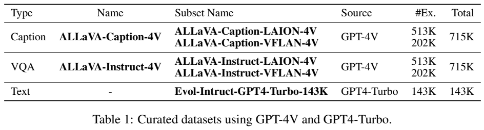
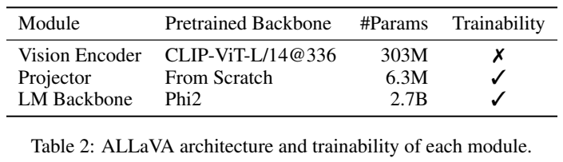
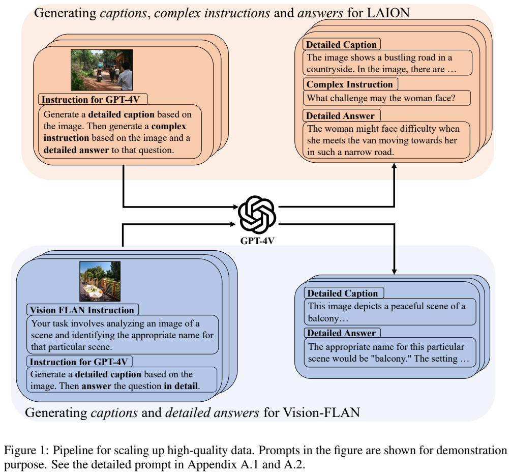
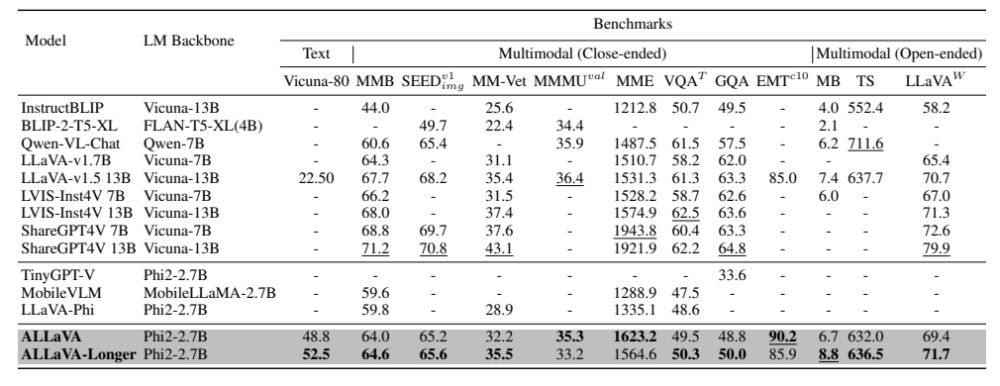

<!-- article-header:start -->
[项目首页](../../../README.md) › [模型系列](../../../reports/model-family-index.md) › [ALLaVA](../README.md)
<!-- article-header:end -->

# ALLaVA：用细粒度描述与复杂问答补偿小模型容量

> 解读固定采用 [arXiv:2402.11684v1](https://arxiv.org/pdf/2402.11684v1)。配图为原文图表裁图，原表数字保留。本文没有运行模型；数学表达为原理解释，不是原论文编号公式。

<!-- article-toc:start -->

**本篇目录** · [论文定位](#paper-info) · [快速概览](#overview) · [整体架构](#architecture) · [核心原理](#principles) · [数据构建](#data) · [训练流程](#training) · [实验结果](#experiments)
<!-- article-toc:end -->

## 1. 论文信息与模型定位

| 项目 | 内容 |
|---|---|
| 题名 | ALLaVA: Harnessing GPT4V-synthesized Data for A Lite Vision-Language Model |
| 作者与机构 | Guiming Hardy Chen、Shunian Chen、Ruifei Zhang 等；深圳大数据研究院、香港中文大学（深圳） |
| 日期与版本 | 2024-02-18，采用 arXiv v1 |
| 模型分支 | 轻量图像语言助手；ALLaVA 与多训练一轮的 ALLaVA-Longer |
| 组件规模 | CLIP-ViT-L/14@336：303M；Projector：6.3M；Phi-2：2.7B，来自原文 Table 2 |
| 输入输出 | 图像与文字指令 → 自然语言回答；也支持纯文本任务 |
| 官方资源 | [代码](https://github.com/FreedomIntelligence/ALLaVA) · [权重](https://huggingface.co/FreedomIntelligence/ALLaVA-3B) · [合成数据](https://huggingface.co/datasets/FreedomIntelligence/ALLaVA-4V) |

ALLaVA 的研究重心是训练数据。它沿用 LLaVA-v1.5 的视觉编码器、投影器、语言模型组合，选择较小的 Phi-2 骨干，以 GPT-4V 产生的详细描述、问题和回答提高视觉任务表现。论文希望缩小小模型与较大模型的差距，实际支持的是特定评测上的竞争力；文中讨论移动部署潜力，但没有给出 ALLaVA 在手机上的端到端实测延迟或内存曲线。[§3、§4.1](https://arxiv.org/pdf/2402.11684v1#page=4)

## 2. 快速概览

传统网络图文对往往描述过短，细节与复杂关系监督不足；视觉问答数据还常有短答案和固定问题模式。对容量有限的语言骨干而言，仅增加低质量条目不一定能改善能力。作者把数据合成改成一次会话内的“先描述、再提问、再回答”：GPT-4V 首先列出图像细节，为后续推理提供显式文字上下文；然后生成需要检查图像的问题，并给出较完整答案。对已经有任务问题的 Vision-FLAN，保留原问题，只重新生成描述与答案。

论文得到 715K 描述条目和 715K 问答条目，合计约 1.43M 视觉监督条目，但它们来自 715K 图像，不能说是 143 万张不同图片。训练还加入 GPT4-Turbo 再生成的文本指令，减少视觉微调时对语言能力的损害。两个训练阶段都更新投影器和语言骨干、冻结 CLIP；这与一些 LLaVA 实现第一阶段只训练连接器的设置不同，阅读时必须按本篇说明。

结果包含 1 个纯文本与 11 个多模态基准。延长指令训练改善 MM-Vet 等指标，也使 MMMU、MME 等指标下降。最有信息量的证据是数据消融：缺少充分描述对齐时，单独加入大量问答会明显变差；两类数据联合使用更有效。因此本篇经验不是“越多复杂问答越好”，而是描述对齐与指令学习需要匹配。[Table 1–4、6](https://arxiv.org/pdf/2402.11684v1#page=7)

## 3. 整体架构

> 原文 Table 1、Table 2，v1 PDF 第 7 页；[原页](https://arxiv.org/pdf/2402.11684v1#page=7)。本资产是图表区域裁切；中部 Table 2 给出实际模块和可训练状态。

模型的信息流为“图像 → CLIP 视觉特征 → Projector → 与文本共同输入 Phi-2 → 逐 token 回答”。Projector 从头初始化，用来把 CLIP 表示映射到语言模型的输入空间；语言模型读到视觉表示之后，根据问题决定描述、识别或推理的输出。报告明确架构与 LLaVA-v1.5 相同，并未提出另一个新视觉编码器。

| 模块 | 原文配置 | 训练状态与含义 |
|---|---|---|
| Vision Encoder | CLIP-ViT-L/14@336，303M 参数 | 两阶段均冻结；保留已有图像语义空间 |
| Projector | 从头训练，6.3M 参数 | 两阶段训练；学习视觉表示与语言输入的接口 |
| LM | Phi-2，2.7B 参数 | 两阶段训练；同时学习数据中的描述与指令表达 |

表中勾叉是 trainability，而不是是否参与推理：冻结 CLIP 依然需要前向计算。`@336` 指视觉编码器的输入规格，不能从“下载图像短边至少 512”推断模型推理分辨率也固定为 512。数据采集质量门槛与实际模型视觉输入是两个处理环节。原文未详细列出 projector 每层尺寸或视觉 token 数，本介绍不将其他版本 LLaVA 的实现细节补写为该版本报告事实。

这套结构中，缩小语言骨干能降低参数存储及部分生成计算，但视觉编码、图片预处理与长答案生成仍有成本。数据质量改进不改变计算结构的量级；它主要改变同一规模参数能够学到的映射与输出习惯。[§4.1、Table 2](https://arxiv.org/pdf/2402.11684v1#page=7)

## 4. 核心创新与数学原理

**Captioning-then-QA。** GPT-4V 同时接收图像，先生成细粒度描述 c，再给出问题 q 与答案 a。用概率分解的解读表达说明流程：

$$
p(c,q,a\mid I)=p(c\mid I)\,p(q\mid I,c)\,p(a\mid I,c,q).
$$

I 是图像。这是用于解释生成顺序的数学表达，论文没有给出这条公式，也没有额外优化一个名为该式的新损失。描述 c 为教师生成答案提供明确上下文；它不会自动成为学生推理时必须额外输入的人工描述，更不等于对图像所有属性的正确标注。若教师先描述错，错误也可能影响后续提问与答案。

**增加问题覆盖而非重复提问模式。** LAION 图像没有现成任务问题，因此提示先产生五个不同方面的问题，再随机挑选一个回答。可以把它理解为对候选集做抽样，减少教师始终选择最容易问题的倾向。论文未给出随机种子、各问题难度分布或严格覆盖率，不能将该机制描述成理论保证的均匀任务采样。Vision-FLAN 则保留原有 191 种任务、101 个数据集中的问题，不重复生成新问题。[§3.2–3.3](https://arxiv.org/pdf/2402.11684v1#page=4)

**详细答案与文本保留联合学习。** 作者认为短答案可能削弱语言表达与复杂指令响应，因此重新生成完整答案，并混入纯文本数据。训练可用标准条件语言建模说明：

$$
\mathcal L_{\rm gen}=-\mathbb E_{(I,s,y)}\sum_t\log p_\theta(y_t\mid E(I),s,y_{<t}).
$$

E(I) 是经过投影的视觉表示，s 是任务指令；纯文本样本不含图像表示。该式为标准解读，论文未披露完整标签 mask 规则。更长的输出会提供更多监督 token，但也提高训练和推理成本；长答案的完整性不代表每句都正确。文章把这些改变视为数据策略，没有提出独立的强化学习奖励或教师学生 logits 蒸馏目标。

## 5. 数据构建与处理

> Figure 1，PDF 第 2 页；[原页](https://arxiv.org/pdf/2402.11684v1#page=2)。上部 LAION 路径合成描述、问题与答案，下部 Vision-FLAN 路径保留任务问题。

图中两条箭头都经过 GPT-4V，但输出内容不同。LAION 路径能扩充网络场景与问题形式；Vision-FLAN 路径继承任务多样性，同时将原来的简短回答转成完整表达。它们共享图像来源，因此 Caption 与 Instruct 两份数据并非独立采集的两组图像。

| 数据 | 规模和单位 | 构建或使用方式 |
|---|---:|---|
| LAION-4V | 513K 图像，各产生一条描述和一条问答 | 下载短边至少 512 的图像，合成细节描述、复杂问题和答案 |
| VFLAN-4V | 202K 图像/任务实例，各产生描述和问答 | 保留原指令，GPT-4V 再生成回答 |
| ALLaVA-Caption-4V | 715K 描述条目 | 用于第一阶段；与 80K ShareGPT4V 描述合并为 795K |
| ALLaVA-Instruct-4V | 715K 问答条目 | 与 657K llava_instruct 数据合并为 1,372K |
| 纯文本数据 | 143K Evol-Instruct 加 6K OpenChat，共 149K | 前者由 GPT4-Turbo 重新回答，训练时混入图文数据 |

ShareGPT4V 原有 SAM 相关 20K 描述未使用，是作者下载图像遇到网络问题，留下 80K；不能将这项处理写成按质量评分剔除。提示中还要求避免泄露个人信息和偏见，但报告没有公开逐条安全过滤通过率或完整自动事实核验流程。作者只说明检查了少量再生成答案；这比“所有合成数据均经人工确认”弱得多。[Table 1、3；§3.4–3.5](https://arxiv.org/pdf/2402.11684v1#page=7)

## 6. 训练流程与目标

| 阶段 | 数据混合 | 更新模块 | 主要目标 |
|---|---|---|---|
| 第一阶段：描述对齐 | 一份 795K caption + 两份 149K 纯文本数据，随机抽样 | Projector 与 Phi-2；CLIP 冻结 | 学习视觉描述，同时使基础语言骨干学习指令响应 |
| 第二阶段：视觉指令微调 | 一份 1,372K VQA + 一份 149K 纯文本数据 | Projector 与 Phi-2；CLIP 冻结 | 扩展任务响应，并保留纯文本表达 |
| Longer 版本 | 第二阶段多训练一个 epoch | 延续第二阶段设置 | 检验延长训练的收益与退化 |

“两份文本”描述抽样总体中的复制权重，不是两倍不同的文本条目；按这些数值第一阶段抽样池约 1,093K，第二阶段约 1,521K，但报告没有因此宣称总训练步数等于池中条目数。第一阶段同时训练语言骨干，是本篇针对 Phi-2 基础模型学习指令能力的选择，不能套用“对齐阶段只训练投影器”。[§4.1](https://arxiv.org/pdf/2402.11684v1#page=7)

附录 Table 9 给出两阶段都用 AdamW、weight decay 0、DeepSpeed ZeRO Stage 1、BF16、余弦退火与线性 warmup；warmup ratio 为 0.03，最大/最小学习率 2×10⁻⁵ / 2×10⁻⁶。第一阶段 global batch 256，第二阶段 128。正文关于小模型训练时间随参数缩减的讨论是动机估算，不能替代该模型的实测全流程成本；报告未列出完整 GPU 数量、训练耗时与 API 合成费用。[附录 C、Table 9，PDF 第 19 页](https://arxiv.org/pdf/2402.11684v1#page=19)

## 7. 实验设置与主要结果

> Table 4，PDF 第 9 页；[原页](https://arxiv.org/pdf/2402.11684v1#page=9)。粗体是约 3B 模型中的最佳值，下划线是表内所有规模最佳，二者含义不同。

Vicuna-80 由 GPT-4 比较模型回答与 LLaMA2-7B-Chat 锚点答案，报告 win rate；这不是知识题准确率。MMBench、SEED 图像子集、MMMU 等采用各自基准分数，MME 是汇总分数，不能当成百分比。Table 4 同时列出大模型与小模型，而训练数据和视觉输入设置不同，规模相近也并非严格控制变量实验。

| 指标（Table 4） | ALLaVA | ALLaVA-Longer | 相关比较 |
|---|---:|---:|---|
| Vicuna-80 win rate | 48.8 | 52.5 | 该表 LLaVA-v1.5-13B 为 22.5 |
| MMBench | 64.0 | 64.6 | LLaVA-Phi 为 59.8 |
| MM-Vet | 32.2 | 35.5 | LLaVA-v1.5-13B 为 35.4 |
| MMMU val | 35.3 | 33.2 | 延长训练下降 2.1 分数点 |
| MME | 1623.2 | 1564.6 | 原版反而更高 |
| GQA | 48.8 | 50.0 | LLaVA-v1.5-13B 为 63.3，仍有差距 |

这张表支持小模型在部分基准接近较大模型，不支持“只有四分之一参数便全面等价”。例如 Longer 的 MM-Vet 接近 13B 基线，但 GQA 明显落后。原文 Table 6、7 的部分 GQA/MM-Vet 数字与主表存在差异，本文主结果按 Table 4 保留，不混用其他表修正主表值。

Table 6 的数据消融更能解释方法：不使用两类新数据时 MM-Vet 为 25.8；只加 Instruct 降为 12.1；只加 Caption 升为 30.0；两者都加为 32.2。大量问答在欠对齐条件下可能伤害能力，细粒度描述和指令数据存在依赖。它仍是特定设置下的结果，不能断言全部模型都应采用完全相同的配比。本文的主要价值是让数据质量、训练阶段和小模型容量成为一个联合问题，而不是仅依赖扩大语言骨干。[§4.5、Table 6，PDF 第 11 页](https://arxiv.org/pdf/2402.11684v1#page=11)

<!-- article-footer:start -->
---

[← 上一篇：Gemini 1.5](../../gemini/document-1855460a9712/README.md) · [按发表时间浏览](../../../reports/paper-reading-guide.md#year-2024) · [下一篇：AnyGPT →](../../anygpt/arxiv-2402.12226/README.md)

[返回本篇目录](#article-toc) · [返回模型系列](../README.md)
<!-- article-footer:end -->
