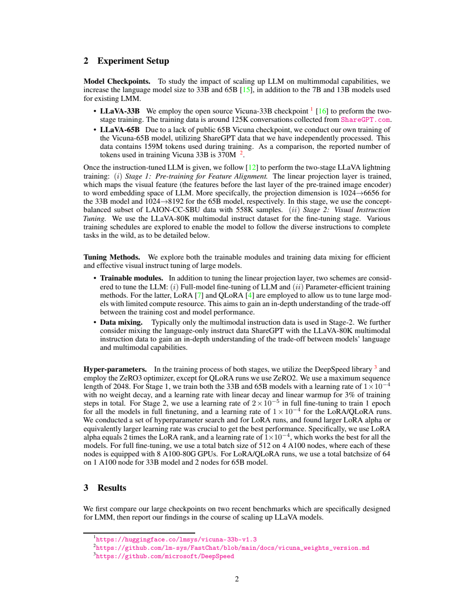
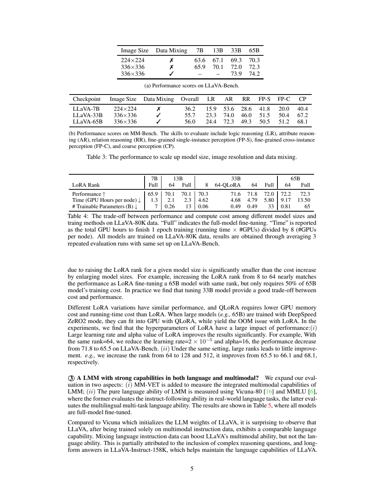
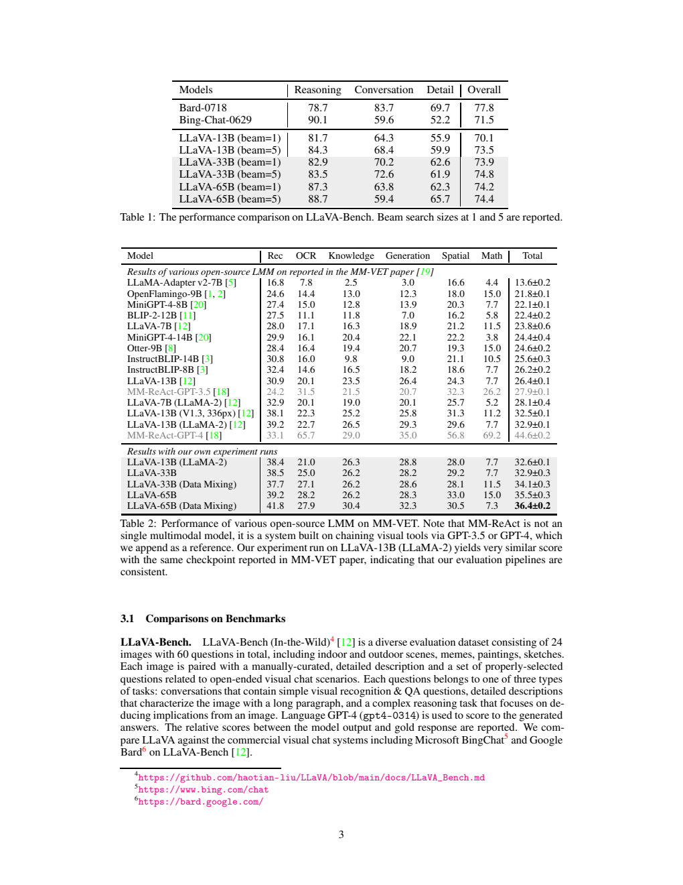
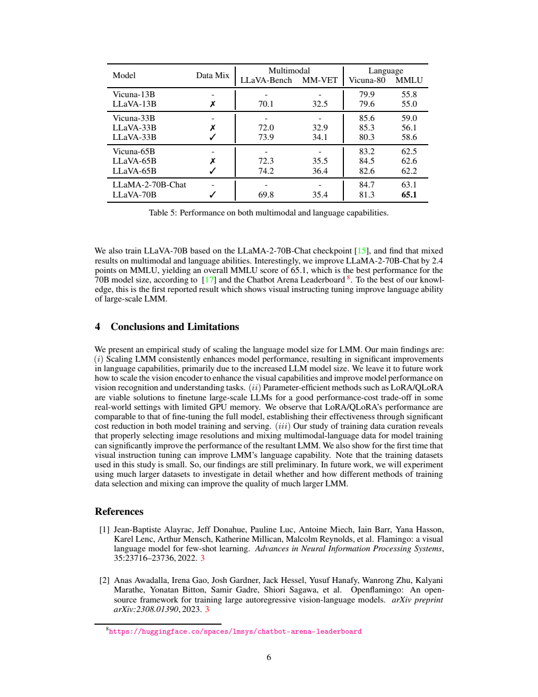

[返回所属家族](../README.md) · [返回项目](../../../README.md)

# 大规模视觉指令微调：LLaVA 的 33B、65B 与参数高效训练研究

> 对应 **An Empirical Study of Scaling Instruction-Tuned Large Multimodal Models**，采用 [arXiv:2309.09958v1](https://arxiv.org/abs/2309.09958v1)。原文是短篇实证报告，没有独立架构图；本文使用原始实验与训练页面，不把后续 LLaVA-1.5 配方混入本篇。

## 1. 论文信息与模型定位

| 项目 | 内容 |
|---|---|
| 作者 | Yadong Lu、Chunyuan Li、Haotian Liu、Jianwei Yang、Jianfeng Gao、Yelong Shen |
| 机构 | Microsoft Azure AI、Microsoft Research、Wisconsin–Madison |
| 日期 | 2023-09-18，v1 |
| 研究对象 | LLaVA-33B、65B，另考察基于 LLaMA-2-70B-Chat 的 70B |
| 主要任务 | 单图视觉对话、细节描述、视觉推理和纯语言评估 |
| 贡献类型 | 规模、分辨率、数据混合与 LoRA/QLoRA 的实证研究 |
| 固定来源 | [论文 PDF](https://arxiv.org/pdf/2309.09958v1) |

作者把当时以 7B/13B 为主的开源视觉助手扩大到 33B 和 65B，关注大语言端是否确实带来多模态收益，以及有限显存下如何训练。本文的“扩大”主要指语言模型，并没有同时训练一个更大的视觉骨干。因此识别精度、OCR 与语言推理的变化需要分别观察，不能把所有能力变化归因于视觉表征增强。[原文 §1–2](https://arxiv.org/pdf/2309.09958v1#page=2)

## 2. 快速概览

研究发现三种相对独立的因素值得重视。更大语言模型通常改善总体视觉对话；在固定视觉模型家族下，把输入从 224×224 增至 336×336，在四种语言规模上带来约两到三分增益；将 ShareGPT 纯语言指令加入视觉指令，可进一步改善多模态成绩。它们是这组小数据、既有预训练组件上的经验结论，并不是描述从零预训练的普遍缩放定律。

训练方面，LoRA/QLoRA 可接近全量微调，但较大的 rank 本身不足以保证好结果。作者发现学习率与 alpha 很关键：33B、rank=64 时，低学习率与小 alpha 配置只得 65.5，较合适配置为 71.8。实验也显示仅仅把 rank 加到 128/512，不能完全弥补不佳超参。需要同时检查优化强度、成本与实际验证成绩。

纯语言结果提供另一层边界：视觉指令训练未必破坏语言能力，有时还能提高 MMLU，但混入语言指令也不总提高语言成绩。65B 混合后视觉成绩上升，Vicuna-80 和 MMLU 却略降；70B 的 MMLU 提高、视觉对话又弱于 65B。模型族、原有指令调优、数据覆盖都影响结果，不能从几个点推出“参数越大每项越好”。[原文 §3.2、Table 5](https://arxiv.org/pdf/2309.09958v1#page=6)

## 3. 整体架构

*来源：PDF 第 2 页 §2，[原页](https://arxiv.org/pdf/2309.09958v1#page=2)。原文没有结构图，此页列出真实组件连接与训练配置；中部的 1024→6656/8192 是投影维度，不能当模型参数总量。*

系统沿用早期 LLaVA：预训练 CLIP ViT 提取倒数层视觉特征，线性投影把图像特征映射至语言模型词嵌入空间，再由因果语言模型生成回答。33B 映射 1024→6656，65B 映射 1024→8192。这里是线性连接器，没有本篇提出的两层 MLP、视觉 token 重采样器或分割解码器。

33B 使用现成 Vicuna-33B；当时没有公开 Vicuna-65B，作者先用自己处理的 ShareGPT 训练相应语言模型。因而 33B/65B 不是在完全相同语言数据下只改变宽度的严格实验：65B 语言调优用 159M token，而引用的 33B 调优统计为 370M token。差异对后面“规模收益”的解释有实际影响。

高分辨率实验比较输入为 224 和 336 的 CLIP ViT 变体。视觉端不产生图像输出，主要保留视觉条件供文字解码使用。更高分辨率让更多空间细节进入系统，也增加视觉序列及注意力开销；本篇没有报告任意分辨率分块、多图对话或视频方案，不补写这类能力。[原文 §2、§3.2](https://arxiv.org/pdf/2309.09958v1#page=4)

## 4. 核心创新与数学原理

本篇没有新型数学目标或缩放方程，其贡献来自控制与比较训练选择。用说明式可把视觉接入写成 $z_i=W_v x_i$，把回答训练写成

$$\mathcal L_{\rm answer}=-\sum_t\log p_\theta(y_t\mid Z,q,y_{<t}).$$

这只是沿用框架的机制解释，原文没有给它独立公式编号或完整 token masking 规则。第一阶段重点学习 $W_v$ 让视觉条件可被语言端解释；第二阶段同时更新连接器，并以全量或适配器方式调整语言端。

LoRA 的常用解释是将权重变化限制在低秩乘积：

$$W'=W+\frac{\alpha}{r}BA,\qquad A\in\mathbb R^{r\times d_{in}},\ B\in\mathbb R^{d_{out}\times r}.$$

原文采用该已有方法，并未把此式作为新推导。rank $r$ 控制可训练增量容量，$\alpha/r$ 控制相对尺度；因此提高 rank 与提高更新强度是不同操作。本文实验设置 alpha=2r，配合 $10^{-4}$ 学习率。QLoRA 又让基础权重采用量化表示，在较低显存下训练增量；报告没有逐层列出量化精度和所有适配器挂载位置，不能从名称补造配置。

*来源：原文 Table 3/4，PDF 第 5 页，[原页](https://arxiv.org/pdf/2309.09958v1#page=5)。上表需要横向固定设置看模型规模，纵向固定规模看输入/数据；下表时间单位是除以八卡后的 node-equivalent hours。*

Table 3 的 224→336 对照，在 7B、13B、33B、65B 上分别为 63.6→65.9、67.1→70.1、69.3→72.0、70.3→72.3。再混入语言指令，33B/65B 到 73.9/74.2。这比直接比较“7B 旧模型”和“65B 新配方”更能看出每项改动，但仍不足以把多项改动组合后的收益线性相加，或预测所有未来模型。

Table 4 中 33B 的 rank8 为 70.3，rank64 为71.8，全量为72.0；65B rank64 为72.2，全量72.3。接近并不意味着所有能力、稳定性和部署开销相同。即使只训练少量参数，前向仍经过整个基础模型，反向也需传播到适配器位置；所以算力不按“可训练参数少多少”同比降低。这正是原文发现总模型规模比 rank 对训练成本影响更大的原因。

## 5. 数据构建与处理

视觉语言对齐使用概念平衡的 LAION-CC-SBU 子集，共 558K 样本；视觉指令阶段使用 LLaVA-80K。部分实验再加入 ShareGPT 语言指令以维持或扩大文字任务覆盖。这两个视觉阶段的条目数不包含 CLIP 或 LLaMA/Vicuna 的原始预训练语料。

33B 直接使用公开 Vicuna checkpoint，其已有语言调优资料约125K ShareGPT 对话。65B 则由作者独立处理 ShareGPT，训练中用159M token。报告给了 token 规模，但未完整披露这次处理的去重、语言比例、敏感内容过滤、混合采样比例与所有提示模板，因此不能写成已公开可完全复现的数据清洗流水线。

视觉指令资料包含复杂推理与长回答，作者用这一性质解释为什么只做视觉指令训练也可能保住语言能力。这是对既有 LLaVA 数据的解释，不是本篇重新让 GPT-4V 看图采集标注。数据混合也不应被理解成提高图像预训练量：新增的是文字指令，可能通过语言端的回答方式与知识组织影响多模态表现。

实验使用的数据较小，论文结论自己标为初步。较大模型更能拟合有限指令，加入不同任务数据可能改变过拟合与回答习惯；但本篇没有污染审计或大规模数据量扫描，不声称已排除评测记忆、重叠图像或所有语言知识来源。[原文 §2、§3.2、§4](https://arxiv.org/pdf/2309.09958v1#page=6)

## 6. 训练流程与目标

第一阶段只训练视觉到语言的线性投影，学习率 $10^{-4}$，weight decay=0，线性衰减、总步数3%的线性 warmup。第二阶段全量语言微调学习率 $2\times10^{-5}$，训练一轮；LoRA/QLoRA 使用 $10^{-4}$。最大序列长度均2048。原文第一阶段未单列 epoch、所有模型 step 和完整 optimizer 参数，不能自行推算为公开配置。

| 配置 | 全量微调 | LoRA/QLoRA |
|---|---|---|
| 总 batch | 512 | 64 |
| 设备 | 4节点，各8张A100-80G | 33B为1节点，65B为2节点 |
| DeepSpeed | ZeRO3 | LoRA通常ZeRO3，QLoRA ZeRO2 |
| 第二阶段学习率 | $2\times10^{-5}$ | $10^{-4}$ |
| 适配器 | 无低秩限制 | rank8/64主要对照，alpha=2rank |

主成本表是在 LLaVA-80K 上完成一轮训练，而不是所有基础训练的总成本。Table 4 定义 Time 为运行时间乘GPU数，再除以每节点8卡。因此65B全量13.50对应108 GPU hours，33B rank64的4.79对应38.32 GPU hours；这两个换算是依据单位的算术，不是论文新增测量。不同实验节点数不同，不能把13.50直接称墙钟13.50小时。

33B QLoRA rank64成绩71.6，时间4.68；普通LoRA rank64为71.8、4.79，全量72.0、5.80。差异需要在同一表条件下理解。作者提到65B在ZeRO2下普通LoRA出现OOM、QLoRA可放入，证明特定配置的显存可行性，没有提供所有模型的峰值显存曲线。文中按当时Azure节点价格举例估算费用，属于历史价格，本文不把它当当前报价。

## 7. 实验设置与主要结果

*来源：原文 Table 1/2，PDF 第 3 页，[原页](https://arxiv.org/pdf/2309.09958v1#page=3)。Table 1列beam1/5，Table 2把作者自己的实验与引用结果分组；工具系统MM-ReAct作为参考，不是同类单模型。*

LLaVA-Bench In-the-Wild只有24张图、60道题，涵盖对话、细节和推理，由GPT-4-0314按参考回答评分；结果是相对分数，不能解释为准确率百分比。MM-Vet含200图、218题，测试识别、OCR、知识、生成、空间和数学的组合，由GPT-4-0613评价开放回答。小测试集与自动评判的波动使微小差距不宜被写成统计显著结论。

| 模型/设置 | LLaVA-Bench | MM-Vet |
|---|---:|---:|
| 33B，不混语言数据 | 72.0 | 32.9±0.3 |
| 33B，混合 | 73.9 | 34.1±0.3 |
| 65B，不混语言数据 | 72.3 | 35.5±0.3 |
| 65B，混合 | 74.2 | 36.4±0.2 |
| 70B，混合 | 69.8 | 35.4 |

Table 1进一步看beam：13B为70.1/73.5，33B为73.9/74.8，65B为74.2/74.4，分别对应beam1/5。搜索改动对不同任务效果不一致，例如65B对话子项63.8→59.4而细节62.3→65.7。不能只引用总体增加就说每种输出都更好。原表Bard总体77.8仍高于33B/65B，并非所有商业系统都被超越。

*来源：原文 Table 5，PDF 第 6 页，[原页](https://arxiv.org/pdf/2309.09958v1#page=6)。先比较相同语言初始化下是否视觉微调，再比较是否数据混合；跨模型行同时变化了基础checkpoint。*

33B混合后Vicuna-80从85.3到80.3，MMLU从56.1到58.6；65B混合后84.5→82.6、62.6→62.2。这说明视觉收益与语言收益不会自动一致。70B基于LLaMA-2-70B-Chat，MMLU63.1→65.1，报告为提高2.4，但按表中数值实际差2.0，本文保留63.1/65.1而不复制错误减法。其视觉结果弱于65B，更说明原语言训练与数据配方是重要混杂因素。

总体证据支持：在当时这组模型和资料中，提高语言规模、图像尺寸及适当数据混合有实际价值，低秩方法是可行的成本选择；它没有建立通用闭式缩放规律，也没有证明视觉编码器扩展无用。本介绍未运行模型或重训，所有成绩来自固定v1原表。
