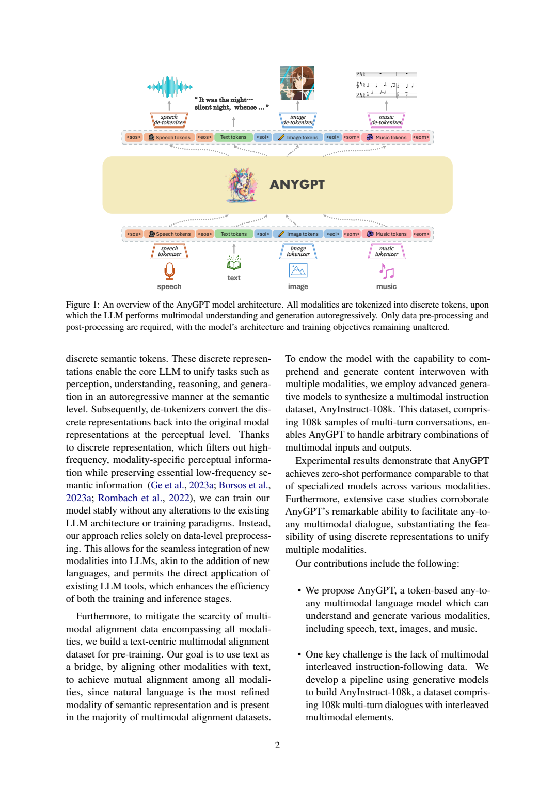
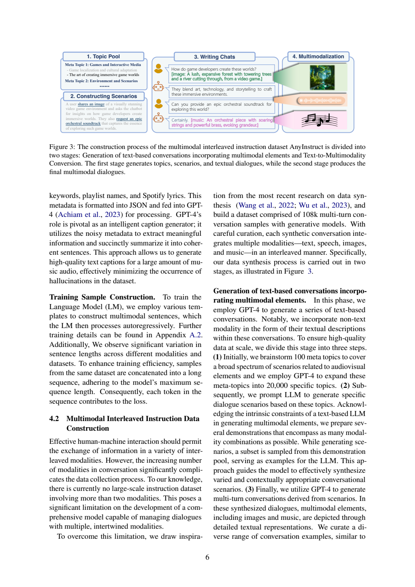
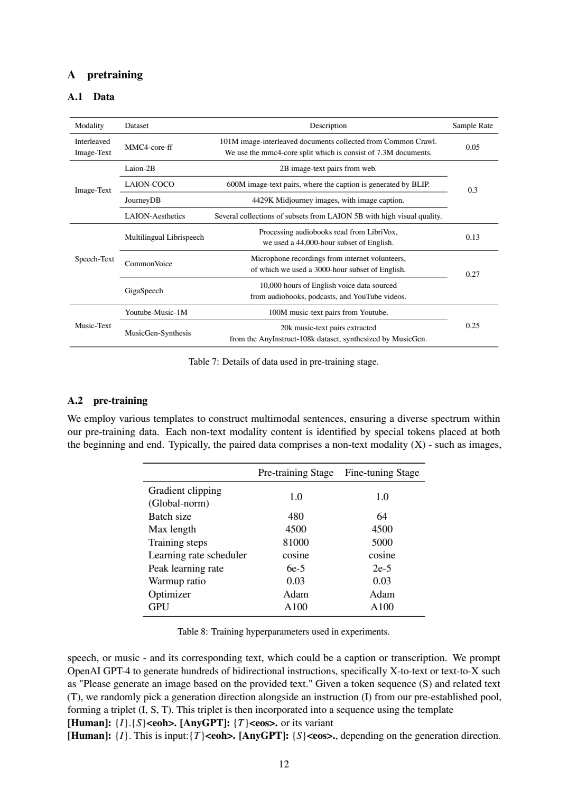
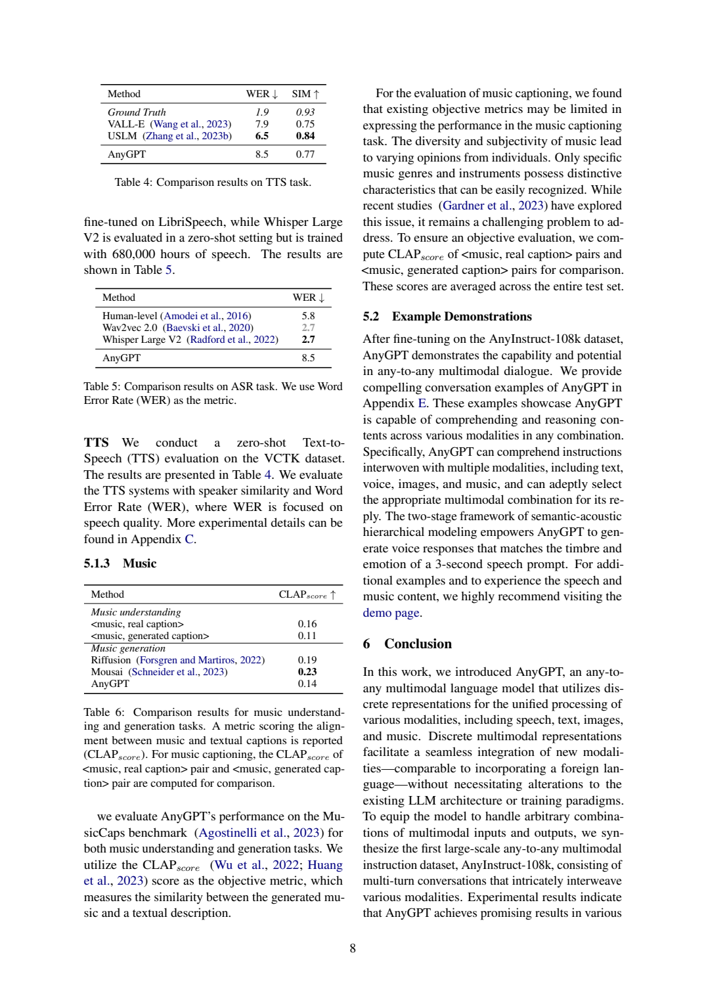

[返回 AnyGPT 家族](../README.md) · [返回仓库](../../../README.md)

# AnyGPT：用离散序列统一图像、语音、音乐与文字

> 采用 [arXiv:2402.12226v1](https://arxiv.org/pdf/2402.12226v1)。配图为原文整页截图；本文说明原报告中的个别统计不一致，不自行修订数值。

## 1. 论文信息与模型定位

| 项目 | 内容 |
|---|---|
| 论文题名 | AnyGPT: Unified Multimodal LLM with Discrete Sequence Modeling |
| 作者与机构 | Jun Zhan、Junqi Dai、Jiasheng Ye 等；复旦大学、Multimodal Art Projection Research Community、上海人工智能实验室 |
| 发表与版本 | 2024-02-19；采用 arXiv v1，25 页 |
| 家族 | AnyGPT，统一多模态理解与生成模型 |
| 模型规模 | LLaMA-2-7B 作为骨干；结果表称 AnyGPT (8B)，不把二者当成同一精确总参数口径 |
| 输入与输出 | 文本、图像、语音、音乐；支持交错输入与交错输出 |
| 定位 | 利用现有模态 tokenizer/de-tokenizer，把多模态任务转换成一个自回归离散序列建模问题 |
| 官方资源 | [论文](https://arxiv.org/pdf/2402.12226v1) · [代码](https://github.com/OpenMOSS/AnyGPT) · [演示](https://junzhan2000.github.io/AnyGPT.github.io/) |

“any-to-any”在这篇论文中指已接入的四类模态之间的组合，不是未经训练就能处理任意新模态。模型输出的非文本内容由对应解码器恢复；语言骨干负责语义 Token 生成，不直接逐像素画图或逐采样点生成波形。[原文 §3](https://arxiv.org/pdf/2402.12226v1#page=3)

## 2. 快速概览

将视觉编码器接到语言模型上通常能让模型看图回答，却不一定能让同一模型输出图像或声音。AnyGPT 选择对称的离散接口：输入内容被编码成 Token，输出也先生成同类 Token，再还原为相应模态。这样文字和非文字可以交错放在同一序列中，骨干仍使用下一 Token 预测。

训练数据分两层。第一层以文字为桥梁，用图文、语音转录、音乐描述及交错图文做双向对齐；第二层合成 AnyInstruct-108k 多轮对话，把图像、声音与音乐组合进实际指令流程。论文还将语音的语义与声学细节分开：LLM 预测较短的语义序列，SoundStorm 补充声学 Token，再由解码器生成音频。

实验的主要贡献是证明这一统一接口可用：一个模型同时执行图像描述与生成、语音识别与合成、音乐描述与生成。但它并未在所有指标上超过专用模型，音乐输出限制为 5 秒，多模态完整对话主要以案例展示。应把“多模态组合能力”与“每项任务的最佳质量”分开评估。[原文 §5 与 Limitations](https://arxiv.org/pdf/2402.12226v1#page=7)

## 3. 整体架构

> 来源：Figure 1，v1 PDF 第 2 页，整页截图。[来源](https://arxiv.org/pdf/2402.12226v1#page=2)。从底部的各模态 tokenizer 向上读，经共享 AnyGPT，再看顶部 de-tokenizer 恢复内容。

框架包括多模态 tokenizer、语言骨干、de-tokenizer 三部分。每种非文本模态有起止标记，图中 `<soi>/<eoi>` 对应图像，`<sos>/<eos>` 对应语音，`<som>/<eom>` 对应音乐。标记使语言模型知道正在接收或输出何种代码序列；代码的整数值对应相应模态词表项，不与文本单词简单混用。

| 模态路径 | 离散化与序列组织 | 恢复方式 |
|---|---|---|
| 图像 | SEED：224×224 RGB 经 ViT、Causal Q-Former 得到 32 个嵌入；8192 项码本量化为 32 个 Token | MLP 转为与 unCLIP Stable Diffusion 对齐的生成嵌入，再由扩散解码器生成图像 |
| 语音 | SpeechTokenizer：8 层 RVQ，每层 1024 项，50 Hz；LLM 只建模第一层语义 Token | SoundStorm 根据语义 Token 与声音提示补齐声学层，再经 SpeechTokenizer 解码 |
| 音乐 | Encodec：32 kHz 单声道，50 Hz，四层 RVQ；按每帧四个代码逐帧展开 | Encodec 解码器恢复音乐波形 |
| 文字 | 保留语言模型原有文字序列 | 直接输出文字 |

以十秒语音为例，完整 tokenizer 结果为 500×8 个代码，但语言模型只处理其中 500 个第一层语义 Token，余下细节交给后级模型。音乐五秒为 250×4，即 1000 个代码，序列增长比单张图片的 32 个 Token 快得多。因此，不同模态虽然使用同一骨干，实际上下文成本差异很大。[原文 §3.1–3.3，第 3–5 页](https://arxiv.org/pdf/2402.12226v1#page=3)

v1 在音乐词表上存在内部不一致：Table 1 写 4096，§3.1 正文写每层 2048、四层共 8192。本文保留这一差异，不能在没有进一步实现依据时任选一个数字当作无争议配置。模型规模也类似：骨干 7B 与评测表的 8B 名称不应混用成精确参数统计。

## 4. 核心创新与数学原理

**用扩展词表统一理解与生成。** 非文字代码加入骨干词表，输入嵌入矩阵与输出预测层同步扩展，新加入参数随机初始化，其余语言模型结构保持不变。原文 §3.2 给出词表总量表达 $V=\sum_{i=1}^{n}V_i$，$V_i$ 表示第 $i$ 个模态词表大小。这里统一的是模型接口和训练目标，不代表各 tokenizer 共享一个码本，或一个图像 Token 与一个语音 Token 具有相同物理含义。

对于交错序列 $z_1,\ldots,z_T$，下一 Token 目标可用标准解释性表达：

$$
\mathcal L=-\sum_{t=1}^{T}\log p_\theta(z_t\mid z_{<t}).
$$

这是对报告所述 next-token prediction 的数学说明，不是报告给出的编号公式。$z_t$ 可为文字、模态标记或离散代码。模型从上文学习输出“哪个模态”和“该模态的哪些内容”，而无需为每一对输入输出模态另设计一个回归头。[原文 §3.2](https://arxiv.org/pdf/2402.12226v1#page=4)

**语义建模与感知恢复分工。** 高保真图像或声音包含大量细节，若全部塞入 LLM 自回归生成，会扩大序列。AnyGPT 让语义代码承担主要内容，再用后级模型恢复感知细节。语音路径尤为清楚：第一层 RVQ 捕获语义，后七层补充副语言信息；SoundStorm 是非自回归的掩码语言模型，利用语义代码预测后级声学代码。报告使用在 MLS 数据上训练的变体，并用约三秒声音提示提供说话人条件。

这可以解释为什么“LLM 输出语音”不等于“LLM 自身独立产生全部音色细节”。语义序列可能决定说什么，而实际音色、情绪和保真度还受到提示与声学生成器影响。图像路径同样依赖 SEED 与扩散模型，最终图像质量不能只归因于骨干的下一 Token 能力。[原文 §3.3，第 4–5 页](https://arxiv.org/pdf/2402.12226v1#page=4)

**文字作为跨模态桥梁。** 大规模三四模态同步数据稀缺，而图文、语音转录、音乐描述较容易得到。作者通过分别学习文字与各模态的双向联系，期望共享语义空间建立间接联系，再用交错对话监督组合任务。这个策略减少对全模态同时配对数据的需求，但间接对齐并不自动保证任意组合正确；完整对话的定量评测缺口正是论文承认的限制。

关于效率，长序列会增加注意力和逐步解码成本，但不能照搬原文“随长度指数增长”的措辞作为标准复杂度结论；常规注意力交互项是二次增长，自回归还受生成步数影响。本文只据具体 Token 量解释预算，没有给出未经实验测量的延迟收益。

## 5. 数据构建与处理

| 用途 | 数据来源与原文口径 | 处理方法 |
|---|---|---|
| 图文对齐 | LAION-2B、LAION-COCO，过滤后约 300M 高质量图文对；另补 LAION-Aesthetics、JourneyDB | 文本质量、长宽比、CLIP 分数过滤；图像理解与生成双向模板 |
| 交错图文 | MMC4-core，7.3M 文档 | 按文档顺序用图像 Token 替换原图，保持文字与图像交错 |
| 语音文字 | 英语 MLS 44,000 小时、CommonVoice 3000 小时、GigaSpeech 10,000 小时，合计 57,000 小时 | 同时构建识别和文字到语音方向 |
| 音乐文字 | 从网络收集超过一百万音乐视频；获取标题、描述、关键词等元信息 | 用 Spotify API 匹配歌曲，用 GPT-4 将噪声元信息整理为描述 |
| 多模态指令 | AnyInstruct-108k，108K 多轮对话；约 205K 图像、503K 声音记录、113K 音乐片段 | 先生成文字场景与描述，再转换成真实模态内容 |

> 来源：Figure 3，v1 PDF 第 6 页，整页截图。[来源](https://arxiv.org/pdf/2402.12226v1#page=6)。左侧主题和情境进入中央对话，右侧把图像、声音和音乐描述替换为实际内容。

指令合成先从 100 个总主题扩展出 20,000 个具体主题，再由 GPT-4 写场景、多轮对话，并用示例引导模态组合。对话中的非文本内容先以详细描述出现，随后由 DALL-E 3 生成图像、MusicGen 生成音乐、Azure TTS 生成讲话。过滤后得到 108K 对话；作者还从适合朗读的纯文字指令集补出 100K 声音对话。108K 是对话条目，图像与音频统计是其中的内容数量，不能相加成单一数据规模。[原文 §4.2，第 6–7 页](https://arxiv.org/pdf/2402.12226v1#page=6)

这种两步方法能系统覆盖跨模态请求，但也继承各生成器的偏差：图片是否符合描述、音乐是否符合意图、转成语音后是否仍保留内容，都影响监督正确性。论文说明进行了过滤，却未在上述正文给出完整可复用阈值和逐项保留率，不能把“高质量”替代为已知的误标率。

附录 Table 7 对 Youtube-Music-1M 写“100M music-text pairs”，与正文“超过一百万音乐视频”的口径不一致。本文记录其矛盾而不扩写成一亿首独立音乐。采样率也需按原表分组阅读：MMC4 0.05、图文 0.3、MLS 0.13、CommonVoice/GigaSpeech 分组 0.27、音乐分组 0.25。数据混合用 Token 数衡量并对较少模态过采样，不等价于原始样本占比。[原文 Figure 2、Table 7](https://arxiv.org/pdf/2402.12226v1#page=12)

## 6. 训练流程与目标

非文字内容先离散化，加入模态起止标记，然后与文字组合成序列。图文、语音文字、音乐文字样本随机选择 X-to-text 或 text-to-X 方向，并加相应指令；交错文档按自然顺序替换图像。来自相同数据集的短样本连接到最大长度，预训练时各 Token 参与损失。这是统一目标的重要操作细节，不能默认所有训练只对回答部分计算损失。[原文 §4.1、Appendix A.2](https://arxiv.org/pdf/2402.12226v1#page=12)

> 来源：Tables 7、8，v1 PDF 第 12 页，整页截图。[来源](https://arxiv.org/pdf/2402.12226v1#page=12)。Table 8 的左右列分别是预训练和微调，勿把 batch 或步数混用。

| 设置 | 预训练 | 微调 |
|---|---:|---:|
| Batch size | 480 | 64 |
| 最大长度 | 4500 | 4500 |
| 训练步数 | 81,000 | 5000 |
| 峰值学习率 | 6e-5 | 2e-5 |
| warmup 比例 | 0.03 | 0.03 |
| 全局梯度裁剪 | 1.0 | 1.0 |
| 优化器及调度 | Adam、cosine | Adam、cosine |
| GPU 类型 | A100 | A100 |

预训练后作者还用较高质量的图文数据与 AnyInstruct 音乐样本继续预训练 4000 步，以降低网络噪声对生成的影响。该额外安排写在 Appendix A.2，Table 8 只给基础阶段步数，本文不自行推断它是否包含在 81,000 内。随后指令微调使模型学习多轮交错请求及输出选择。[原文 Appendix A.2，第 13 页](https://arxiv.org/pdf/2402.12226v1#page=13)

论文明确扩展嵌入与预测层并训练语言骨干，但没有在 Table 8 逐个列出所有 tokenizer、生成器的冻结与联合更新配置，因此不能把整个系统描述成一次全部端到端训练。GPU 数量、完整训练时间与成本也未在表中披露。第 4 节的统一损失只解释 LLM 目标，不能代替 SEED、SpeechTokenizer 或 SoundStorm 各自的预训练配方。

## 7. 实验设置与主要结果

定量结果主要评估预训练基础模型的 X-to-text 和 text-to-X 能力；指令微调后的复杂交错对话以案例展示为主。图像描述使用 COCO 2014 Karpathy 测试集 CIDEr；图像生成使用随机 30K COCO 验证图像对应描述的 CLIP 分数；语音识别在 LibriSpeech test-clean 上算 WER；语音合成在 VCTK 上用说话人相似度和 WER；音乐任务使用 MusicCaps 的 CLAP 分数。[原文 §5.1](https://arxiv.org/pdf/2402.12226v1#page=7)

> 来源：Tables 4–6，v1 PDF 第 8 页，整页截图。[来源](https://arxiv.org/pdf/2402.12226v1#page=8)。WER 越低越好，相似度与 CLAP 越高越好；TTS 和 ASR 各有 8.5，不能将两张表合并为一项结果。

| 任务 | AnyGPT | 原文对照 | 结果解读 |
|---|---:|---|---|
| 图像描述 CIDEr | 107.5 | SEED-LLaMA 123.6、Emu 112.4 | 可以完成描述，仍存在质量差距；原表灰色行标明见过训练样本的模型 |
| 图像生成 CLIP | 0.65 | SEED-LLaMA 0.69、Emu 0.66 | 语义相似度接近部分对照，不能直接换算为主观图像质量 |
| ASR WER | 8.5 | Whisper Large V2 2.7、Wav2vec 2.0 2.7 | 本模型错误率更高；基线训练设置不同 |
| TTS WER / SIM | 8.5 / 0.77 | VALL-E 7.9 / 0.75、USLM 6.5 / 0.84 | 音色相似与内容可懂度的结论不同，非全面领先 |
| 音乐生成 CLAP | 0.14 | Riffusion 0.19、Mousai 0.23 | 生成可用性展示存在，但对齐指标低于两项对照 |
| 音乐描述 CLAP | 0.11 | 真描述与音乐为 0.16 | 是生成描述与原音乐的语义相似比较，不是分类准确率 |

VCTK 的说话人不与训练集重叠，测试为每位说话人抽取三秒提示；SIM 用 WavLM-TDNN 嵌入余弦相似度，生成语音 WER 用 Whisper medium 转录后计算。它检验给定声音提示下的合成，而不是无提示就复现任何说话人。评测解码也有差异：文字 beam size=5；图像和语音 top-p=0.7；音乐 top-p=1.0、重复惩罚 1.15。[原文 Appendix C、Table 9，第 13–14 页](https://arxiv.org/pdf/2402.12226v1#page=13)

报告没有建立覆盖全部模态组合的统一对话定量基准，因此案例不能证明每个组合都同等可靠。最终结论是离散语义接口确实支持一个骨干处理四类模态，同时单模态质量、tokenizer 信息上限、五秒音乐长度和长上下文仍构成限制。论文提出扩展模型或改进 tokenizer 的未来方向，但这些不是已经验证的改进结果。
