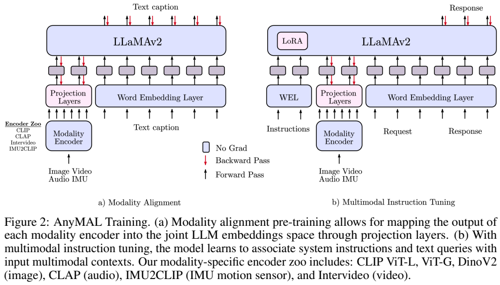
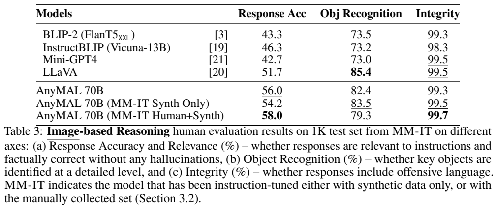
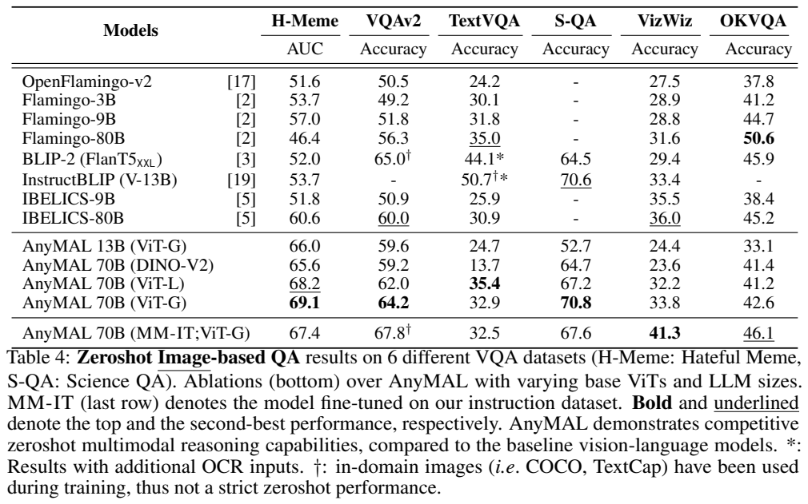
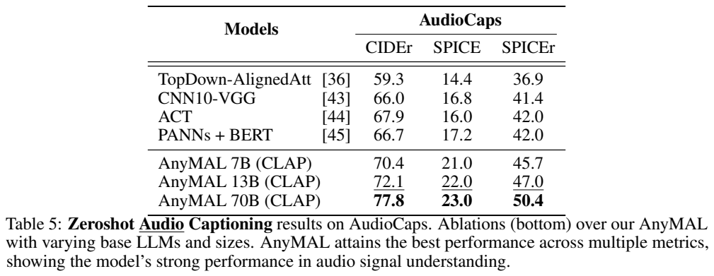
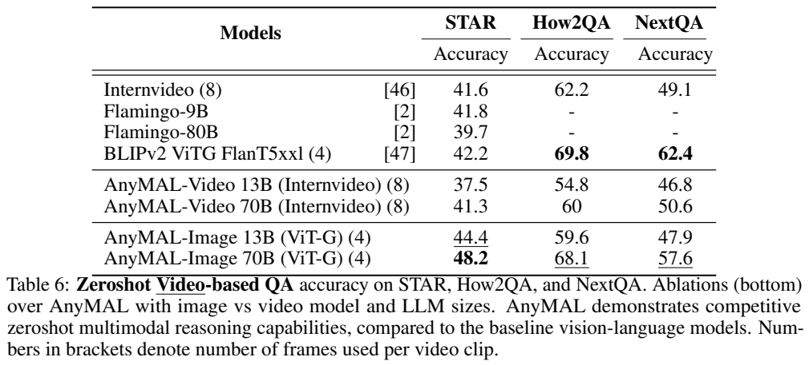

<!-- article-header:start -->
[项目首页](../../../README.md) › [模型系列](../../../reports/model-family-index.md) › [AnyMAL](../README.md)
<!-- article-header:end -->

# AnyMAL：让图像、音频、视频与运动传感器共享语言模型入口

> 依据 [arXiv:2309.16058v1](https://arxiv.org/pdf/2309.16058v1)。配图使用原文图表裁图；区分论文原公式与补充解读，实验数值为作者报告，本文未运行模型。

<!-- article-toc:start -->

**本篇目录** · [论文定位](#paper-info) · [快速概览](#overview) · [整体架构](#architecture) · [核心原理](#principles) · [数据构建](#data) · [训练流程](#training) · [实验结果](#experiments)
<!-- article-toc:end -->

## 1. 论文信息与模型定位

| 项目 | 内容 |
|---|---|
| 原题 | AnyMAL: An Efficient and Scalable Any-Modality Augmented Language Model |
| 作者与机构 | Seungwhan Moon、Andrea Madotto、Zhaojiang Lin、Tushar Nagarajan 等；FAIR, Meta & Meta Reality Labs |
| 日期与版本 | 2023-09-27，采用 arXiv v1 |
| 家族 | AnyMAL，多种输入模态增强语言模型 |
| 语言骨干 | LLaMA-2 / LLaMA-2-chat，实验包含 7B、13B、70B，不同模态的版本配置不同 |
| 输入输出 | 文字、图像、视频、音频及 IMU 运动信号 → 文字回答 |
| 官方来源 | [固定版本论文](https://arxiv.org/pdf/2309.16058v1)；源码地址沿用仓库目录记录，具体方法以本版本论文为依据 |

AnyMAL 的“任意模态”指设计可通过编码器与投影模块扩展输入，不意味着任何未知传感器无需训练即可接入，也不意味着模型能生成图像或音频。报告展示的输入编码器集合有明确范围；IMU 是头戴设备记录的运动信号，并不是通常只含视觉帧的“视频模态”。统一后的输出仍是文本。[摘要、§3](https://arxiv.org/pdf/2309.16058v1#page=1)

## 2. 快速概览

论文希望把语言模型已有的知识、推理与对话能力连接到多种感知输入，同时避免从零训练整套大模型。作者为每个模态选用预训练编码器，再训练轻量投影模块，把感知特征转成语言模型 embedding 空间中的一小组 token；这些 token 可与普通文字交错输入同一个 LLaMA-2。这样，图像、音频和 IMU 共享的是语言侧接口，而非必须共享原始信号编码网络。

训练分两步。模态对齐阶段用感知信号与文字描述配对数据，冻结语言模型和图中的模态编码器，训练投影模块；指令微调阶段加入人工构建的 MM-IT 及合成指令，进一步训练投影器，并研究 LoRA 更新语言行为。大规模对齐还使用低比特语言权重节省显存，推理时恢复原始精度，因此“单张 80GB GPU 能训练”专指冻结语言主干的量化设置，不能推广为 70B 全参数训练。

实验不只测短答案问答，还用人工评审衡量开放回答的正确性、物体识别及冒犯内容。人工与合成指令联合训练使 Response Accuracy 从 56.0 提高到 58.0，却使详细 Object Recognition 从 82.4 降到 79.3；作者将其与更简洁的回答风格联系起来。统一接口带来能力扩展，但不同任务仍可能存在输出习惯和指标之间的取舍。[Table 3、§3–4](https://arxiv.org/pdf/2309.16058v1#page=7)

## 3. 整体架构

> Figure 2，v1 PDF 第 3 页；[原页](https://arxiv.org/pdf/2309.16058v1#page=3)。配图仅保留 Figure 2；原文 Eq. (1)、(2) 见同页文字。

左图从底部 Modality Encoder 开始，将输入编码为特征，再经 Projection Layers 成为语言模型输入；目标是输出文字描述。右图加入指令与用户请求，并在语言主干中加入 LoRA。图例蓝色框表示无梯度参数，粉色表示可更新模块；黑色箭头是前向，红色是反向。冻结的 LLaMA-2 仍需计算及向输入传梯度，并不意味着省去了语言模型前向。

| 输入 | 编码器与连接方式 | 接口特点 |
|---|---|---|
| 图像 | CLIP ViT-L / ViT-G；也消融 DINOv2；Perceiver Resampler | 以学习查询读取视觉特征并输出固定数量 token |
| 视频 | InternVideo 与 Resampler；另一分支用图像编码器逐帧处理 | 视频与逐帧图像方案是不同实验配置 |
| 音频 | CLAP + 线性投影 | 将音频语义特征映射到语言输入 |
| IMU | IMU2CLIP + 线性投影 | 表达运动状态，输出文字描述或建议 |

正文描述固定模态表示长度，列出 64–256 范围；附录 Table 12 的具体设置则为图像 64 个、音频/视频/IMU 32 个。本文采用具体表中数值，同时保留这个正文与附录的口径差异，不将所有模态硬写成 64 个 token。图像输入可变特征数通过 Resampler 压缩，固定输出长度减少语言侧序列增长，但也可能限制细节保留。[§3.1、附录 B.3](https://arxiv.org/pdf/2309.16058v1#page=20)

多模态交错时，每个信号先经过自己的编码器和投影器，再把所得 token 与文字组合。原文展示图像+IMU 等推理案例，但没有因此证明所有模态组合在训练或评测中都有同等充分覆盖。共享 embedding 接口提供联合计算的条件，跨模态关系是否学到仍依赖数据与提示。

## 4. 核心创新与数学原理

**模态对齐使用描述生成，而非只做向量距离匹配。** 原文 Eq. (1) 为：

$$
p(X_{\rm text}\mid X_{\rm modality})
=\prod_{i=1}^{L}p_\theta\big(X_{\rm text}^{[i]}\mid Z_{\rm modality},Z_{\rm text}^{[1:i-1]}\big).
$$

Xmodality 是感知信号，Xtext 是描述，L 是文本长度。模型根据模态表示与此前文字逐 token 生成目标描述。训练负对数似然时，语言模型权重保持冻结，但投影器可通过语言模型的梯度知道哪些输入表示有利于描述生成。这里“对齐到语言空间”是由生成任务定义，不等于直接把 CLIP 文本 embedding 当成 LLaMA 的词向量。

原文 Eq. (2) 定义：

$$
Z_{\rm modality}=\mathrm{Projection}_\theta\big(h_{\rm latents},g(X_{\rm modality})\big).
$$

g 是模态编码器，hlatents 表示学习潜在查询。图像 Resampler 利用查询压缩输入；线性投影分支不必具有相同注意力结构。论文利用已经与文本语义对齐的 CLIP、CLAP、IMU2CLIP 减少接口训练难度，DINOv2 消融则用于检验不同视觉预训练方式的影响。[§3.1](https://arxiv.org/pdf/2309.16058v1#page=3)

**用量化控制冻结主干的存储成本。** 作者比较 4-bit/8-bit 量化与 FSDP，并指出量化训练损失持续略高，但生成质量未受明显损害，最终推理仍使用原语言模型全精度。节省的主要是大规模冻结权重存储；不能由此说中间激活、梯度和全部投影计算都变成 4-bit。报告的单 GPU batch 4 是局部可行配置，与附录 global batch 2,048 也不是同一单位。

**LoRA 改变任务行为而保留主干基础权重。** 作为标准解读，线性层可表达为 `W'=W+(α/r)BA`，A、B 是低秩增量，W 不做普通全参数更新。附录取 r=64、α=16，将 LoRA 加到所有线性层；这里的 r 是适配秩，不是“64 个模态 token”。报告也对比仅训练 projection 与加入 LoRA 的策略，未声称所有模态主干都进行全量微调。[§3.2、附录 B.3](https://arxiv.org/pdf/2309.16058v1#page=20)

## 5. 数据构建与处理

| 用途 | 数据来源 | 原文规模与处理 |
|---|---|---|
| 图像对齐 | LAION-2B 清洗子集 | 摘要/贡献列 200M 图像；CAT 过滤并模糊可检测人脸 |
| 音频对齐 | AudioSet、AudioCaps、CLOTHO | 分别约 2.1M、46K、5K 样本；不能把三者合计直接当成同等高质量完整描述 |
| IMU 对齐 | Ego4D | 正文列 528K 信号与文字配对，摘要概括约 500K |
| 视频对齐 | 视频数据 | 贡献部分列 28M 视频；该处未完整披露全部清洗及采样配比 |
| 人工 MM-IT | 图像、视频、音频 | 收集 60K 高质量指令样本，覆盖创作、详细描述、开放推理等 |
| 合成指令 | 图像文字表征 → LLaMA-2-70B | 150K 图像-指令-回答对；输入描述、框和物体信息 |

MM-IT 标注强调问题必须依赖配套感知内容，避免一个只读问题的语言模型也能轻易回答。纯视觉事实问答之外，创作、解释、信息提取会更依赖语言模型的指令表达能力。人工标注提供这样的任务分布，合成数据则拓展领域与问题类型。合成教师使用开源 LLaMA-2，不是 GPT-4；其输入是图像的文字表示，不等于教师直接查看原图。

MM-IT 同时充当训练来源与评测来源，因此要保留训练/测试划分与人工评测 1K 测试集的含义。论文特别注明部分指令数据含公开基准的域内图像，如 COCO；经过 MM-IT 的行不能一概称严格零样本。相同图像来源不一定意味着相同答案泄露，但仍改变了“从未见该数据域”的条件。[§3.2、§4.1](https://arxiv.org/pdf/2309.16058v1#page=5)

## 6. 训练流程与目标

对齐阶段冻结基础语言模型和模态编码器，训练 projection，以 Eq. (1) 的目标描述概率优化模态接口。指令阶段将指令、模态 token 和请求组织成输入，以参考回答训练 resampler 与 LoRA；论文的主要后训练方案不是 RLHF，附录将利用人工反馈进行 RLHF 写成后续探索。

| 模态/阶段（附录 Table 12） | Batch | 初始 LR | 步数 | 表示与连接器 |
|---|---:|---:|---:|---|
| 图像 13B/70B | 2048 | 2×10⁻⁴ | 100K | 64 token，6 层 Resampler |
| 音频 13B/70B | 128 | 10⁻⁴ | 1K | 32 token，1 层 Linear |
| 视频 13B/70B | 1024 | 10⁻⁴ | 20K | 32 token，4 层 Resampler |
| IMU 7B | 256 | 10⁻⁴ | 2K | 32 token，1 层 Linear |
| MM-IT 微调 | 128 | 10⁻⁵ | 3K | Resampler + LoRA，r=64、α=16 |

硬件使用数量不等的 NVIDIA A100，报告没有给出每个版本完整 GPU 数量和统一训练耗时。不同模态的步数差异很大，不能将图像的 100K 步和 200M 规模套给所有输入。图像消融 Figure 4 以 2 层 Resampler、64 token、batch 2048 为比较起点，最终附录配置是 6 层；前者是消融默认值，后者是所列训练配置。加大 batch 或 token 数收益有限，增加 resampling 层数更明显降低损失，但损失下降也不自动等于每项下游结果提升。[Figure 4、附录 B.3–B.4](https://arxiv.org/pdf/2309.16058v1#page=20)

## 7. 实验设置与主要结果

> Table 3、4，PDF 第 7 页；[原页](https://arxiv.org/pdf/2309.16058v1#page=7)。下表脚注 `†` 表示用过域内图像，`*` 表示额外 OCR 输入，比较必须保留。

| 图像实验 | 原始 70B ViT-G | MM-IT 后 70B ViT-G | 结论 |
|---|---:|---:|---|
| VQAv2 Accuracy | 64.2 | 67.8† | 增加 3.6 分数点，但后者不是严格零样本 |
| ScienceQA Accuracy | 70.8 | 67.6 | 指令微调出现下降 |
| VizWiz Accuracy | 33.8 | 41.3 | 在此任务上改善较大 |
| OKVQA Accuracy | 42.6 | 46.1 | 改善，但仍低于 Flamingo-80B 50.6 |

人工评测 Response Accuracy 从原版 56.0 到 Human+Synth 58.0，而 Object Recognition 从 82.4 到 79.3。合成数据单独训练的 Response Accuracy 为 54.2，低于未指令微调的 56.0，说明人工数据的重要性不能用“任意合成指令都有效”替代。Integrity 大多接近 99%，这个单一测试集上的高分不是跨所有场景的安全保证。

图像描述 Table 2 中 13B 的 COCO CIDEr 为 99.5，高于 70B 的 95.9；作者认为后者更啰嗦，与 COCO 的短描述评测不匹配。较大语言骨干在推理上可能受益，描述相似度却未必单调提高。TextVQA 的 ViT-L 为 35.4，高于 ViT-G 的 32.9；作者联系到 336×336 与 224×224 分辨率差异，不能把所有变化归于参数量。

> Table 5、6，PDF 第 8 页；[原页](https://arxiv.org/pdf/2309.16058v1#page=8)。Table 6 括号内是视频帧数。

AudioCaps 的 70B CLAP 分支 CIDEr 77.8、SPICE 23.0，高于表内 ACT 的 67.9、16.0。原文把 Table 5 称为 zero-shot，但 §3.1 同时列 AudioCaps 为对齐来源，因此不能凭表题断言从未使用 AudioCaps 数据；应结合训练/测试划分理解作者口径。

视频实验反而是逐帧图像分支在部分任务更强：70B ViT-G 用 4 帧的 STAR/How2QA/NextQA 为 48.2/68.1/57.6，InternVideo 70B 用 8 帧为 41.3/60.0/50.6。前者 NextQA 仍低于表内 BLIP2 的 62.4。输入编码、预训练数据与帧数同时变化，这不是仅改变“是否时间编码”的纯消融。IMU held-out 测试报告 CIDEr 52.5、ROUGE-L 23.2，展示运动描述可行，但没有覆盖全部真实传感器条件。整体证据支持模块化接口扩展多模态输入，同时提醒开放回答、细节识别和评测格式可能具有不同最优设置。[§4、Table 2–8](https://arxiv.org/pdf/2309.16058v1#page=8)

<!-- article-footer:start -->
---

[← 上一篇：InternLM-XComposer](../../internlm-xcomposer/arxiv-2309.15112/README.md) · [按发表时间浏览](../../../reports/paper-reading-guide.md#year-2023) · [下一篇：LanguageBind →](../../languagebind/arxiv-2310.01852/README.md)

[返回本篇目录](#article-toc) · [返回模型系列](../README.md)
<!-- article-footer:end -->
