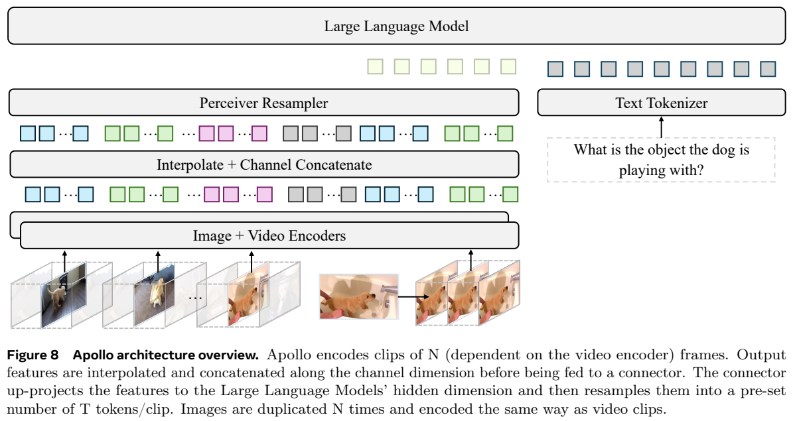
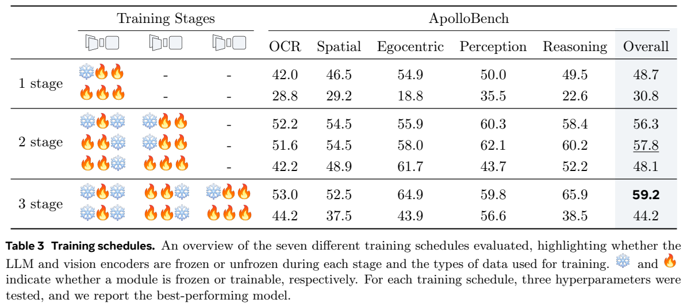
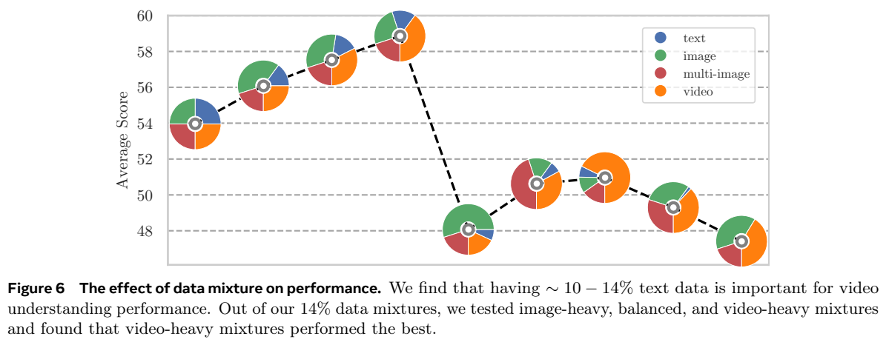
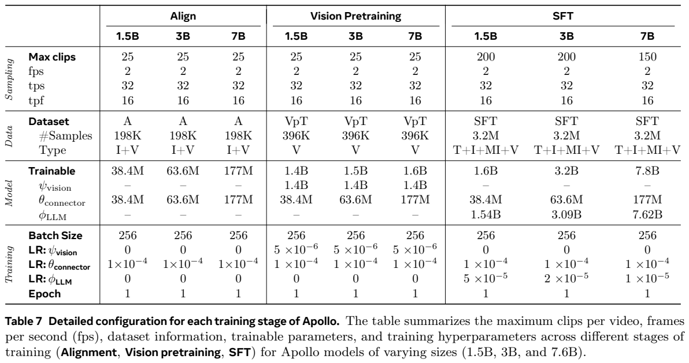
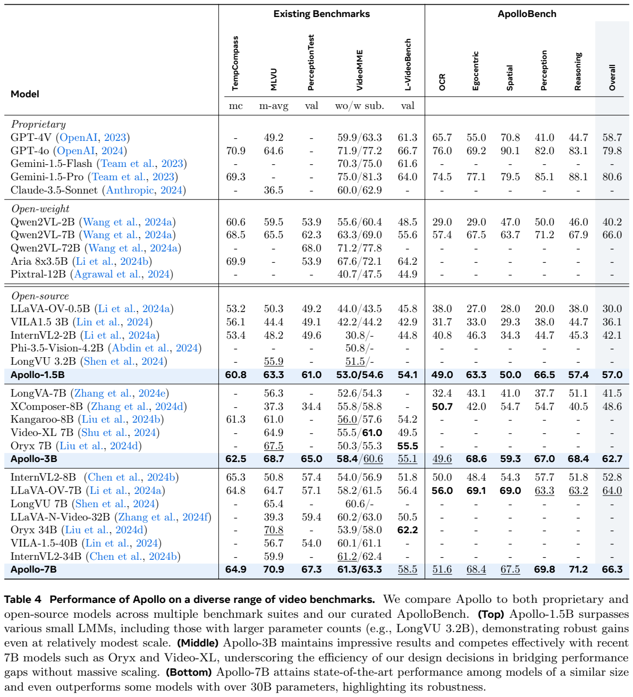

<!-- article-header:start -->
[项目首页](../../../README.md) › [模型系列](../../../reports/model-family-index.md) › [Apollo](../README.md)
<!-- article-header:end -->

# Apollo：用视频设计实验建立高效长视频理解模型

> 对应 **Apollo: An Exploration of Video Understanding in Large Multimodal Models**，固定版本 [arXiv:2412.10360v1](https://arxiv.org/abs/2412.10360v1)。本文依据主文与训练附录，区分设计探索的小模型和最终 Apollo 配方。

<!-- article-toc:start -->

**本篇目录** · [论文定位](#paper-info) · [快速概览](#overview) · [整体架构](#architecture) · [核心原理](#principles) · [数据构建](#data) · [训练流程](#training) · [实验结果](#experiments)
<!-- article-toc:end -->

## 1. 论文信息与模型定位

| 项目 | 内容 |
|---|---|
| 作者/机构 | Orr Zohar 等，Meta GenAI 与 Stanford |
| 首次提交 | 2024-12-13；报告首页另标 December 16 |
| 模型 | Apollo-1.5B、3B、7B，语言骨干为 Qwen2.5 |
| 视觉组件 | SigLIP-SO400M 与 InternVideo2，Perceiver Resampler |
| 输入输出 | 图片、视频与文字，生成文字回答 |
| 研究主题 | 视频采样、编码、token压缩、训练阶段、数据混合与有效评测 |
| 官方资源 | [PDF](https://arxiv.org/pdf/2412.10360v1) · [项目页](https://apollo-lmms.github.io) |

Apollo 不只是公布一个视频助手，而是先做系列受控实验，再把较好的设计组成模型。视频输入的独特难点是时间轴：固定取若干帧可能让不同长度视频以不同“播放速度”进入模型；保留所有空间特征又很快耗尽上下文。因此论文同时考虑时间采样与每帧信息压缩，而不是把多张图简单串接就视为解决视频理解。[原文 §1、§4](https://arxiv.org/pdf/2412.10360v1#page=6)

## 2. 快速概览

第一条主线是降低探索成本。作者用21种设计、四种语言规模训练84个模型，发现约2–4B以上的小模型可较好预测7B中设计选择的相对表现；4B与7B的 $`R^2=0.938`$，数据规模约500K后设计相关性开始饱和。这里预测的是一组选项的表现关系，不是从零训练的损失缩放定律，更不是“小模型已经具备全部大模型能力”。0.5B的关系弱，不能任意把原型规模缩小。

第二条主线是视频结构。固定fps的短clip保留局部时间尺度，图像编码器提供空间与语义信息，视频编码器补充动态信息；两路特征对齐、通道拼接后用Perceiver压缩。时间戳文本将不同clip分隔，让文字端知道每段时间位置。最后采取三阶段训练，视频编码器只在视频资料阶段更新，混合指令阶段冻结视觉端。

第三条主线是评测。许多视频问题只看中心帧，甚至只读题目也能答对。作者据此挑出更依赖视频的ApolloBench，避免把文字知识的增益全部误认成时间理解。最终3B在MLVU为68.7、LongVideoBench为55.1；7B的Video-MME无/有字幕为61.3/63.3。数字仍受采样、字幕和具体评测版本影响。[原文 §2–3、Table 4](https://arxiv.org/pdf/2412.10360v1#page=13)

## 3. 整体架构

*来源：原文 Figure 8，PDF第21页，[原页](https://arxiv.org/pdf/2412.10360v1#page=21)。从底部沿箭头读：clip→两种编码器→空间插值与通道拼接→Perceiver→语言模型；右侧单图复制为clip。*

InternVideo2处理每段4帧，SigLIP对相应图像帧提供图像语义特征。不同编码器输出的空间网格经插值对齐，沿通道而不是序列轴拼接，使同一位置的静态和动态信息能被后续注意力一起读取。连接器匹配Qwen2.5的hidden dimension，Perceiver用预定数量的latent压缩视觉特征，降低语言端看到的视觉token数量。

图片也走同一套路径：复制4次，作为静止clip送入编码器。这并不会为静止图凭空创造运动，而是统一接口，帮助共享投影与数据训练。附录Table 8中共享路径总体56.8，分离路径56.2；共享方案更简单，但分离路径空间等个别子项更好，不能说共享在每项都严格占优。

视觉和文字整合用 `clip from {MM:SS}-{MM:SS}:` 加视觉token。短视频按固定fps组成连续clip；视频超过clip上限时，均匀拉开clip之间的距离，仍保持每个clip内部fps。于是局部动作速度相对稳定，但超长视频并不是全部帧无损进入语言模型：片段间仍有空隙，需要明确采样覆盖限制。

固定v1有token配置冲突：§6称最终重采样32 tokens/frame，Table 7却逐阶段列2fps、32tps、16tpf，三者彼此一致。本文分来源记录，不把32tpf和32tps视为同一个量，也不擅自认定实际发布实现采用哪一项。[原文 §6、附录C.1、Table 7](https://arxiv.org/pdf/2412.10360v1#page=26)

## 4. 核心创新与数学原理

固定帧数采样的主要问题可用时间间隔解释。视频长为 $`D`$、取 $`N`$ 帧时，相邻间隔约 $`D/(N-1)`$；同样的动作在不同长度视频中对应不同采样速度。固定fps $`f`$ 则在局部clip保持 $`\Delta t\approx1/f`$。这两个表达是本文的机制说明，原文没有提出独立时间数学模型。超过token预算时只扩大clip间隔，可以保住局部动态，却不能保证捕捉所有瞬时事件。

设每帧压缩后有 $`k`$ token，连续采样的视觉预算近似满足

$$\mathrm{tps}=f\,k.$$

这与原表fps/tpf/tps定义一致，忽略时间戳文字等额外开销。提高fps会覆盖更多时间细节，提高k会保留更多空间内容；固定预算下两者不能同时无限增加。实验认为8–32tpf是较有效区间，OCR与空间问题对过强空间压缩更敏感。它不是跨编码器、分辨率与任务永远最优的常数。

Perceiver可用标准交叉注意力说明：令视觉特征为 $`X`$、latent查询为 $`Q`$，

$$Z=\mathrm{softmax}\!\left(\frac{Q(XW_K)^\top}{\sqrt d}\right)XW_V.$$

查询数量决定输出长度，各latent从全部输入特征选择信息，较均值池化更有表达空间。此式为已有模块的简化解读，并非本篇新损失。拼接两种编码器后，它还能在压缩时联合读取通道互补信息；压缩仍有信息瓶颈，不保证小字或小物体全部保留。

重采样Table 1总体：2D卷积池化44.7、MLP池化53.2、Perceiver55.5。但是原文文字声称Perceiver所有指标更好，表中Reasoning却为MLP61.5、Perceiver55.4，不能照搬“每项都胜出”。时间整合Table 2直接串接55.5、学习分隔符56.7、文本时间戳56.8，两者合用56.2，说明简单时间标识已有效，堆叠标识不一定更优。[原文 §4.3–4.4、Table 1/2](https://arxiv.org/pdf/2412.10360v1#page=10)

Scaling Consistency通过不同配置的成绩相关性来判断设计可迁移；$`R^2`$高只说明这批点拟合关系强，不能证明每个细小优劣都稳定，也不能直接推断72B实测效果。主实验Qwen2/Qwen1.5，后续设计探索Qwen2.5-3B、750K样本，最终3.2M SFT，需要分开这些统计口径。

## 5. 数据构建与处理

训练数据使用公开与许可来源，涵盖文字、图文、多图和视频。作者排除不满足其许可要求的来源，例如依赖ChatGPT生成的部分常用数据；这会改变与其它系统的数据公平性，不能只按总条目比较。生成视频多轮对话时，Qwen2VL-7B等模型先产生描述，再由LLaMA3.1-70B转成对话。后者主要整理描述中的语言内容，不能被误写为单独看完整原视频作精确动态标注。

对齐阶段198K，为图片/视频描述50:50；视觉预训练396K，全部视频描述；SFT共3.2M，多模态指令混合。最终Figure 7的模态比例为图片33.0%、多图16.6%、文字14.4%、视频36.0%。它是样本构成，不等于各模态token数或训练算力份额。视频annotation包含对话、推理、时间感知、第一视角和OCR，长短视频分布也不均匀，不能由“支持小时视频”推断训练主要是小时片段。[原文 §6、C.3](https://arxiv.org/pdf/2412.10360v1#page=26)

*来源：原文Table 3、Figure 6，PDF第11页，[原页](https://arxiv.org/pdf/2412.10360v1#page=11)。雪花代表冻结、火焰代表训练；下图各饼图是不同数据混合，纵轴是平均成绩，不是样本规模。*

配比探索支持保留适量文字、剩余部分稍偏视频：附录Table 13中15%文字、25%图片、20%多图、40%视频的总体59.0；25%各模态均衡为54.1，零文字配置47.5。正文概括约10–14%文字，附录候选实际含15%、最终为14.4%，本文保留近似结论，避免声称精确14%阈值已经被完整扫描证明。作者解释文字资料可能缓解遗忘，但没有独立证明唯一因果机制。

ApolloBench不是新增训练指令。它从现有选择题集合出发，分别给十个模型完整视频、中心帧、纯文字；过滤在文字或单帧条件下超过半数模型答对的问题，再人工分为Temporal OCR、Egocentric、Spatial、Perception、Reasoning。最后按区分模型的熵挑选高区分度问题并人工验证，附录说明最终400题；这里不是每类400，原文未列各类精确数量，不能补造等量分类表。[原文 §2.3、B.3](https://arxiv.org/pdf/2412.10360v1#page=24)

## 6. 训练流程与目标

*来源：原文Table 7，PDF第26页，[原页](https://arxiv.org/pdf/2412.10360v1#page=26)。三大列对应对齐、视觉预训练、SFT，每一大列再分模型大小；“—”表示该模块此阶段不训练。*

| 阶段 | 样本 | 更新模块 | 最大clip |
|---|---:|---|---|
| Alignment | 198K图/视频描述 | 只更新连接器，视觉与LLM冻结 | 25 |
| Vision pretraining | 396K视频描述 | 视觉编码器和连接器，LLM冻结 | 25 |
| SFT | 3.2M混合指令 | 连接器和LLM，视觉冻结 | 1.5B/3B为200，7B为150 |

三阶段batch256、各一轮、2fps；Table 7列16tpf/32tps。连接器学习率始终 $`10^{-4}`$，第二阶段视觉 $`5\times10^{-6}`$；SFT语言端1.5B/3B/7B分别 $`5\times10^{-5}`$、$`2\times10^{-5}`$、$`10^{-5}`$。原文说明调整语言学习率参考模型相对大小平方根，但应以具体表值为准，不能从这句话为其它模型推算超参。

训练使用128张A100，AdamW、梯度裁剪1、warmup0.03、cosine schedule，多数实验用ZeRO2；支持ZeRO3不等于本篇全部实验都用ZeRO3。优化目标仅为自回归文字生成交叉熵。机制写法为 $`-\sum_t\log p(y_t\mid V,q,y_{<t})`$，没有额外视频重构、对比损失或RL奖励。已有视觉骨干的原始预训练目标与Apollo联合训练目标需要区分。

三阶段探索总体59.2，相比只同时更新连接器/语言的单阶段48.7更好；混合数据中同步更新视觉端反而明显变差。这个证据支持本实验的渐进适配，而不是多阶段数量越多越好。报告没有给最终训练墙钟时长、总GPU hours、所有峰值显存或weight decay细节，本文不补造成本数字。长视频由clip限额控制，不能直接把200clip等同固定200帧或保证连续一小时2fps完整覆盖。[原文 §5、C.4](https://arxiv.org/pdf/2412.10360v1#page=27)

## 7. 实验设置与主要结果

*来源：原文Table 4，PDF第13页，[原页](https://arxiv.org/pdf/2412.10360v1#page=13)。Video-MME两数依次无/有字幕；所有“—”是未报告，不能当零。模型组划分反映作者当时的资源分类。*

| 指标 | 1.5B | 3B | 7B |
|---|---:|---:|---:|
| TempCompass MC | 60.8 | 62.5 | 64.9 |
| MLVU m-avg | 63.3 | 68.7 | 70.9 |
| PerceptionTest val | 61.0 | 65.0 | 67.3 |
| Video-MME无/有字幕 | 53.0/54.6 | 58.4/60.6 | 61.3/63.3 |
| LongVideoBench val | 54.1 | 55.1 | 58.5 |
| ApolloBench Overall | 57.0 | 62.7 | 66.3 |

3B在MLVU高于Oryx7B的67.5，也比部分7B视频模型在Video-MME更强。7B的MLVU70.9略高于Oryx34B70.8，但LongVideoBench58.5低于Oryx34B62.2；Qwen2VL7B的Video-MME63.3/69.0也高于Apollo7B61.3/63.3。故原文概括“优于所有7B”不能按所有资源组、所有指标无条件复述。ApolloBench7B66.3略高于Qwen2VL7B66.0，但GPT-4o79.8、Gemini1.5Pro80.6仍显著更高。

固定v1还存在正文7B Video-MME无字幕61.2与Table 4的61.3差异，本表按主结果表61.3记录。不是将不同版本成绩平均。ApolloBench报告约41倍更快，与原有多个基准成绩相关，但来自同一批候选题和参考模型，不能视为覆盖所有开放对话、视频定位、实时场景的万能评测。

作者没有探索记忆库、主动帧检索或问题条件Q-Former，将多轮时需重复采样作为潜在问题而非实际证明这些方法无效；选择题也不足以评估真实对话。小时视频支持、成绩领先及高相关性的边界都应从采样与测评设置理解。本文未执行模型，数值和结论均来自固定原文。

<!-- article-footer:start -->
---

[← 上一篇：InternLM-XComposer2.5-OmniLive](../../internlm-xcomposer/arxiv-2412.09596/README.md) · [按发表时间浏览](../../../reports/paper-reading-guide.md#year-2024) · [下一篇：DeepSeek-VL2 →](../../deepseek/arxiv-2412.10302/README.md)

[返回本篇目录](#article-toc) · [返回模型系列](../README.md)
<!-- article-footer:end -->
