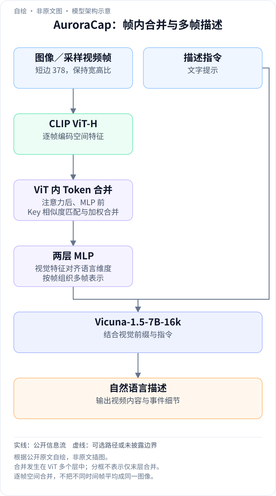
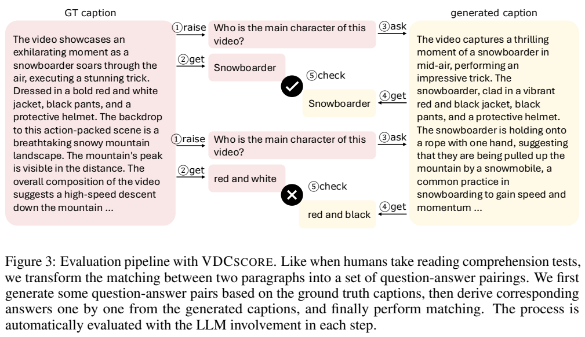
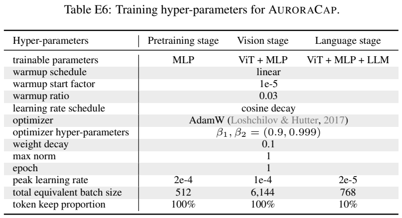
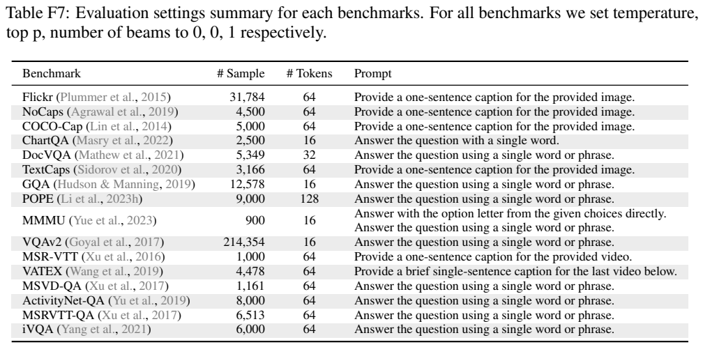
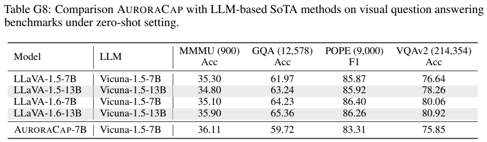
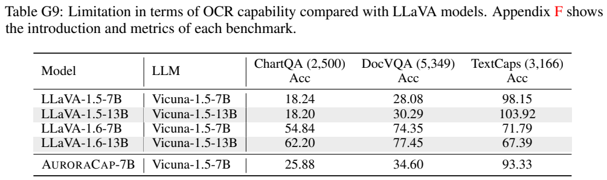
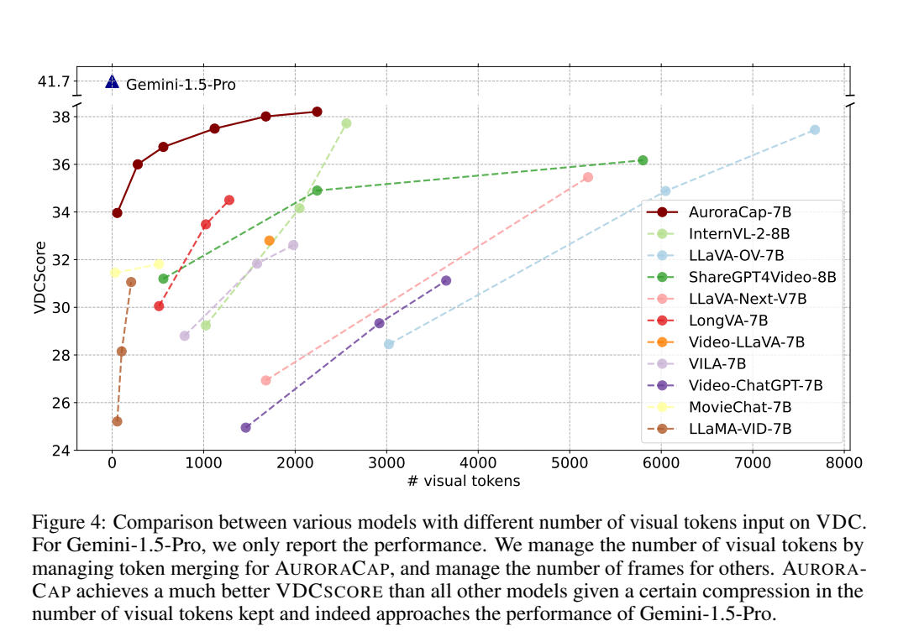
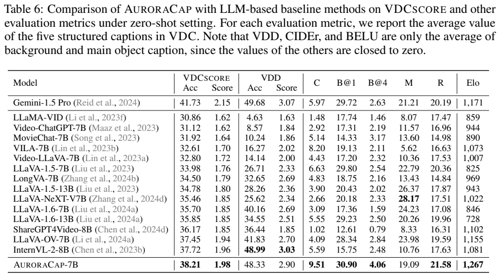
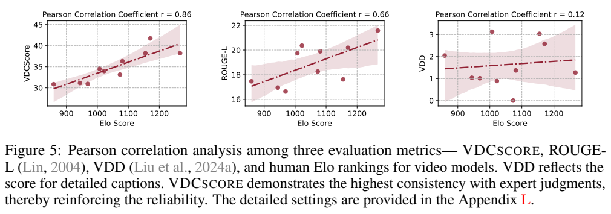
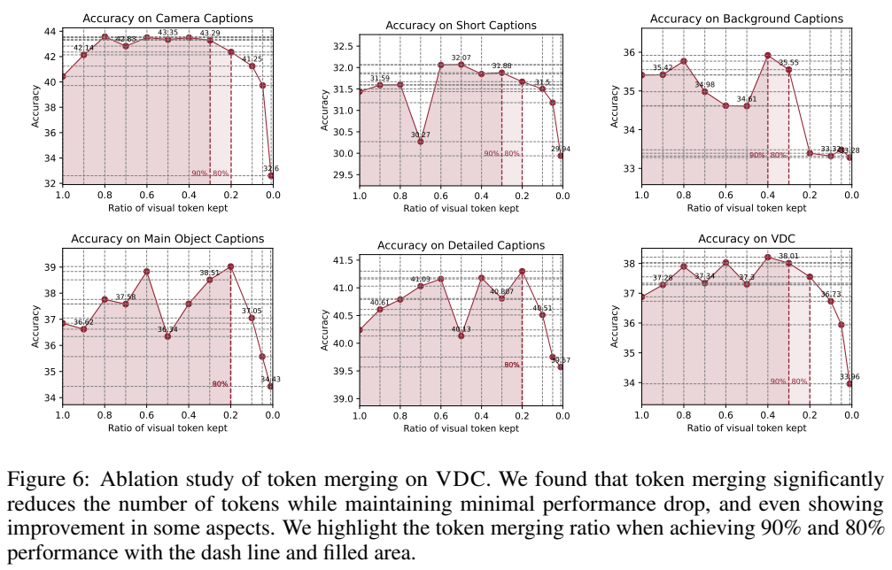

<!-- article-header:start -->
[项目首页](../../../README.md) › [模型系列](../../../reports/model-family-index.md) › [AuroraCap](../README.md)
<!-- article-header:end -->

# AuroraCap：以 Token 合并提高视频详细描述效率

> 采用 [arXiv:2410.03051v1](https://arxiv.org/pdf/2410.03051v1)。图表为原文图表区域裁切。论文同时提出模型、VDC 数据集和 VDCScore 指标，三者的贡献分别说明。

<!-- article-toc:start -->
<a id="article-toc"></a>

**本篇目录** · [论文定位](#paper-info) · [快速概览](#overview) · [整体架构](#architecture) · [核心原理](#principles) · [数据构建](#data) · [训练流程](#training) · [实验结果](#experiments)
<!-- article-toc:end -->

<a id="paper-info"></a>

## 1. 论文信息与模型定位

| 项目 | 内容 |
|---|---|
| 论文题名 | AuroraCap: Efficient, Performant Video Detailed Captioning and a New Benchmark |
| 作者与机构 | Wenhao Chai、Enxin Song、Yilun Du 等；华盛顿大学、Pika Lab、斯坦福大学、哈佛大学、纽约大学 |
| 发表与版本 | 2024-10-04；采用 arXiv v1，41 页 |
| 模型档位 | AuroraCap-7B；语言端使用 Vicuna-1.5-7B-16k，视觉端使用 DFN5B CLIP ViT-H-14-378 |
| 参数口径 | 7B 是语言骨干档位；Table D2 给视觉端 632M，不把 7B 当成完整系统精确参数总量 |
| 输入与输出 | 输入图片或采样视频帧与文字；生成文字描述或回答，不生成视频 |
| 核心定位 | 长而细的视频描述，兼顾图片描述与视频问答 |
| 官方资源 | [论文](https://arxiv.org/pdf/2410.03051v1) · [项目代码](https://github.com/rese1f/aurora) |

详细描述关注的不只是“谁在做什么”，还包括动作变化、对象属性、背景与镜头运动。论文认为短字幕的指标难以充分衡量这些信息，因此模型设计与新评测共同围绕详细描述展开。模型本身仍是视觉编码器、MLP 连接器和语言模型的简单组合，没有额外添加可训练时间建模模块。[原文 §1–2](https://arxiv.org/pdf/2410.03051v1#page=3)

<a id="overview"></a>

## 2. 快速概览

把视频视作多张图片并逐帧送进语言模型，架构很直接，视觉 Token 却会随帧数增加。AuroraCap 用逐帧 Token Merging 压缩视觉表示，在 ViT 层内把相似 Token 合并，尽量保留信息而减少后续处理长度。语言模型接收的是合并后的特征，所以节省不仅作用于 ViT，也改变语言端视觉前缀规模。

训练采用三阶段：先只训练连接器做对齐，再冻结语言端改进视觉端，最后全部模块联合训练高质量图文与视频指令。最终阶段只保留 10% 视觉 Token，作者通过消融选择这种成本与效果折中，而非仅在推理时临时删除大部分表示。

另一贡献是 VDC：约一千段视频，每段有短描述、主对象、背景、镜头和详细描述五类标注，详细描述平均约 501 个英文单词。VDCScore 把参考描述拆成问答，再从模型描述中找答案，分别评价正确性与质量。模型在表内开放模型中表现较好，但 VDCScore 仍低于 Gemini 1.5 Pro，部分视频问答与 OCR 也较弱。[原文 §§2–3](https://arxiv.org/pdf/2410.03051v1#page=5)

<a id="architecture"></a>

## 3. 整体架构

<!-- derived-architecture:start -->


*自绘模型架构示意（非原文图）。依据下述公开资料归纳；方框表示功能组件，不代表逐层实现。*

依据：[§2.1、Appendix D/E；PDF 第3、28–29页](https://arxiv.org/pdf/2410.03051v1)。
<!-- derived-architecture:end -->

输入图像或视频帧先经过 CLIP ViT-H。模型在视觉 Transformer 的注意力与 MLP 之间实施合并，用当前注意力 Key 特征计算相似度。合并后的视觉序列经两层 MLP 映射到 Vicuna 的词嵌入空间，语言模型结合提示生成描述。视频按帧处理空间 Token，原文称为 frame-wise token merging；这不等价于把不同时间帧直接平均成一张图。[原文 §2.1](https://arxiv.org/pdf/2410.03051v1#page=3)

| 模块 | 输入与输出 | 公开机制 |
|---|---|---|
| 视觉编码器 | 按宽高比处理的图像/帧 → 空间 Patch 表示 | DFN5B CLIP ViT-H-14-378（632M）；Transformer 层内进行压缩 |
| 逐帧 Token Merging | 当前层 Key 与 Token 大小 → 更短序列 | 交替二分、余弦匹配、选择 r 对加权合并；大小 s 累加 |
| 比例注意力 | 合并查询/键及 s → 注意力权重 | softmax 前加 log s，校正一个 Token 代表多个 Patch 的权重 |
| 两层 MLP | 视觉序列 → Vicuna 词嵌入维度 | 投影视觉前缀，不新增单独时间编码网络 |
| Vicuna-1.5-7B-16k | 多帧视觉前缀与提示 → 详细描述/回答 | 按帧顺序读取视觉信息；训练逐阶段解冻 |

预处理将图片或视频帧短边缩到 378，保留原始宽高比，使用双线性位置嵌入插值而不做中心裁剪；视频训练以 2 FPS 均匀抽帧。378 是短边处理规则，不代表所有样本强制变成 378×378。附录的效率测试则单独采用 378×378 和 8 帧，两个场景不能混用。[原文 Appendix E、第 29 页；Appendix D、第 28 页](https://arxiv.org/pdf/2410.03051v1#page=29)

模型没有专门新增时间模块，时间关系主要依赖帧顺序、多帧表示与视频语言监督。这样减少模块复杂度，却不能直接保证准确时间定位或任意长视频记忆。论文主要评价描述和问答，没有证明它具备无限上下文或持续流式理解。

[模块依据：v1 §2.1–2.2，PDF 第3–4页；§3.2.1 第7页](https://arxiv.org/pdf/2410.03051v1)。

<a id="principles"></a>

## 4. 核心创新与数学原理

### 4.1 二分匹配与比例注意力如何共同压缩

 在每个视觉 Transformer block 内，先交替划分 Token 为大小近似的 A、B 两组；对 A 的每个 Token，用 Key 特征与 B 中候选计算余弦相似度；采用二分软匹配选取最相似的 r 对，再按权重平均合并，记录每个合并 Token 代表多少 Patch，最后拼回序列。r 是单层选择合并的对数，而最终保留比例 Rvtk 是经过多层后留下的序列长度比例，二者不应当成同一个参数。

原文 Equation (1) 为：

```math
A=\mathrm{softmax}\left(\frac{QK^\top}{\sqrt d}+\log s\right).
```

Q、K 是查询与键，d 是相应特征维度，s 是某个 Token 合并后代表的 Patch 数，广播到对应的注意力列。log s 调整让一个代表多个原始 Patch 的 Token 在归一化注意力中保留相应权重，而不是与单 Patch Token 完全同权。把该项理解成“所有合并 Token 被进一步削弱”会与公式方向冲突。

加权平均的机制可用解释性表达 $`x_{new}=(s_ax_a+s_bx_b)/(s_a+s_b)`$，新的大小为 $`s_a+s_b`$。这只是对原文加权合并步骤的展开，不是报告另一条编号公式。合并会损失空间细节，因此 r 或 Rvtk 需要依据任务选择；计数、细小文字和关系区分可能比冗余背景更依赖细粒度 Token。[原文 §2.1 与 Appendix D](https://arxiv.org/pdf/2410.03051v1#page=27)

匹配发生在注意力之后、MLP 之前，因此当前层已计算出的 Key 同时承担相似度度量，合并后更短的序列才进入后续计算。保留的 Token 不只是选出的某个 Patch，而是带累计大小的代表向量；log s 将这种代表性显式带进后续注意力。节省来自后续层和语言输入都变短，而不是声称当前层此前已经计算的注意力可以被追溯省掉。 [§2.1、Eq.(1)，PDF 第3页](https://arxiv.org/pdf/2410.03051v1)

### 4.2 详细描述为何需要信息级而非整段匹配

 VDCScore 避免只对整段文字直接打一个笼统分数。先由 GPT-4o 从参考描述生成开放问题与简短正确答案，再要求裁判只依据预测描述回答问题，最后比较“问题、正确答案、预测答案”三元组，给出正确性和质量评分。问题集预先固定，避免不同模型被不同问题集合评估。[原文 §3.2.1](https://arxiv.org/pdf/2410.03051v1#page=7)



> 来源：Figure 3，v1 PDF 第 7 页，图表区域裁切。[来源](https://arxiv.org/pdf/2410.03051v1#page=7)。滑雪者身份在左右描述中匹配，衣服颜色不同则判错；读图应跟随“提问—取答案—比较”的箭头。

长描述中同一句可同时含主体、动作、颜色和环境，整段相似度容易掩盖局部事实错误。VDCScore 的问答分解把“说得像不像”改成若干可核查的信息项，图中滑雪者颜色就是这一粒度的示例；但问题仍来自参考描述，因此没有被参考或问题集覆盖的真实细节，不会自动得到充分奖励。 [§3.2.1、Figure3，PDF 第7页](https://arxiv.org/pdf/2410.03051v1)

这使指标更直接检查具体信息是否被描述覆盖，但裁判主要比较两段文字，不独立回看视频纠正参考标注。参考描述的遗漏、生成问题的选择和裁判偏好都会影响结果。因此它是辅助评测，相关性证据不能当作完全无偏的质量证明。

### 4.3 三阶段解冻为何区分视觉知识与表达质量

视觉阶段解冻 ViT、冻结 LLM，理由是用于强化方向、位置和数量知识的视觉任务往往只有几个词的标签；若直接同时更新语言模型，可能削弱长篇表达。语言阶段再用高质量图像、视频、描述和指令共同端到端训练。这里冻结策略服务于监督文本质量的差异，不是把更高分辨率或更多帧误当成唯一改进来源。 [§2.2，PDF 第3–4页](https://arxiv.org/pdf/2410.03051v1)

<a id="data"></a>

## 5. 数据构建与处理

| 阶段或用途 | 数量与来源 | 构建重点 |
|---|---|---|
| 对齐预训练 | 1.3M 图像描述；LAION-CC-SBU、ShareGPT4V、ALLaVA、DenseFusion | 让 MLP 对齐视觉与语言空间 |
| Vision stage | 6.6M；描述、对象中心任务、分类、推理、VQA、生成与中文数据 | 多种视觉任务扩展视觉表征；M3IT 处理若干任务格式 |
| Language stage | 原文 Table E5 约 15.0M；图像描述 1779K、视频描述 1659K、图像指令 9742K、视频指令 268K、纯文本 143K | 图文与视频任务混合；重复视频描述与指令数据以加强视频监督 |
| VDC 评测 | 原文总数 1027 段、约 29,001 秒，平均 28.18 秒 | 五类结构化描述；详细描述平均 500.91 个英文单词 |

Language stage 视频来源包括 MiraData、LLaVA-Hound、ShareGPT4Video 和 Private Data。因此虽然大量资料公开，不能声称全部训练数据都来自可下载公开集。Table E5 的分项与总量为概约数字，且包含重复采样说明，不应把它们直接理解为完全去重后的独立视频数。[原文 Tables E3–E5，第 32 页](https://arxiv.org/pdf/2410.03051v1#page=32)

VDC 从 Panda-70M、Ego4D、Mixkit、Pixabay、Pexels 取视频，尽量平衡来源并分段、密集抽帧。作者明确 VDC 视频未用于 AuroraCap 训练。先由 GPT-4o 按短、主对象、背景、镜头、详细描述生成结构化标注，再用第二轮提示整合详细内容，要求不要新增实体或关系；最后人工纠正幻觉和补足遗漏。[原文 §3.1](https://arxiv.org/pdf/2410.03051v1#page=5)

这类生成加人工修订的参考描述信息更丰富，但不等于每个细节都具有无误真值。v1 的 Table 5 各来源计数与总数还存在两条差额，本文沿用作者明确的总口径 1027，不重新声称分项精确相加。正文部分时长文字亦不与图中比例一致，因此这里只采用原表平均时长，不扩写未经核准的占比分布。

<a id="training"></a>

## 6. 训练流程与目标

三阶段策略先建立接口，再改变视觉表征，最后共同学习高质量语言生成。Vision stage 的许多标签只包含短词或短语，作者担心同期更新 LLM 会损害语言能力，因此冻结语言端；Language stage 再用较高质量的描述与指令放开全部组件。[原文 §2.2](https://arxiv.org/pdf/2410.03051v1#page=4)









> 来源：Table E6，以及同页 Tables F7、G8、G9，v1 PDF 第 33 页，图表区域裁切。[来源](https://arxiv.org/pdf/2410.03051v1#page=33)。E6 三列依次为对齐、视觉、语言阶段，不能用 LLaVA 通常的冻结方式替代这里的设置。

| 设置 | Pretraining | Vision | Language |
|---|---|---|---|
| 更新参数 | MLP | ViT＋MLP | ViT＋MLP＋LLM |
| 峰值学习率 | 2e-4 | 1e-4 | 2e-5 |
| 等效 batch | 512 | 6144 | 768 |
| 视觉 Token 保留比例 | 100% | 100% | 10% |
| epoch | 1 | 1 | 1 |

共同使用 AdamW，β=(0.9,0.999)，权重衰减 0.1，全局 max norm=1；线性 warmup 起始因子 1e-5、比例 0.03，再余弦衰减。语言阶段最终选择 Appendix D 的 Setting C，即全部模块更新且 Rvtk=0.1。测试过只更新语言端、首帧保留全部 Token、全部保留视觉 Token等安排，最终配置考虑了质量与训练成本。

训练仍以语言生成任务组织标签和回答，不另增加可训练时间模块。原文没有在这些表中给出完整损失掩码、分布式设置、总训练墙钟时间和所有阶段 GPU 数量，不能把单 H100 的推理测试配置转写成完整训练硬件。训练成本比较采用 H100 hours，衡量的是指定消融配置，不能随意拿某个图的最高数值作为最终模型训练费用。[原文 Appendices D–E](https://arxiv.org/pdf/2410.03051v1#page=28)

<a id="experiments"></a>

## 7. 实验设置与主要结果

图片描述结果使用专门去掉视频训练数据的 image-based AuroraCap；其余主要结果使用视频版本。Table 2 在表头说明右上角数字是 few-shot 数，GPT-4V 的 55.3 带 8-shot、Gemini 的 82.2 带 4-shot，因此摘要中与它们的对比不能被复述成完全同条件零样本比较。AuroraCap 自身 Flickr CIDEr 为 88.9，NoCaps 111.4，COCO-Cap 120.8。[原文 Table 2，第 4 页](https://arxiv.org/pdf/2410.03051v1#page=4)

视频短字幕 Table 3 的 MSR-VTT、VATEX CIDEr 分别为 33.1、33.8；问答 Table 4 中 ActivityNet-QA 准确率 61.8、iVQA 55.2，而 MSVD 为 62.6、MSR-VTT 为 43.5，低于部分视频问答模型。描述能力强并不等于所有问答也最佳。作者观察到某些问题在先要求详细描述后能得到正确信息，但仍将指令遵循弱点列为后续研究方向。





> 来源：Figure 4、Table 6，v1 PDF 第 8 页，图表区域裁切。[来源](https://arxiv.org/pdf/2410.03051v1#page=8)。图横轴为输入视觉 Token 数；AuroraCap 调整合并比例，其他模型主要调整帧数，这不是完全相同的压缩实验。

| VDC 模型 | VDCScore Acc | VDCScore Score | 人工 Elo |
|---|---:|---:|---:|
| Gemini-1.5 Pro | 41.73 | 2.15 | 1171 |
| LLaVA-OV-7B | 37.45 | 1.94 | 1155 |
| InternVL-2-8B | 37.72 | 1.96 | 1081 |
| AuroraCap-7B | 38.21 | 1.98 | 1267 |

VDCScore 列按五类描述平均，VDD、CIDEr 和 BLEU 的汇总在原表另有限定，只对背景和主对象平均，不能把所有列看成同一内容集合。AuroraCap 的人工 Elo 高于表内对照，VDCScore 却低于 Gemini，表明指标与人工判断不是完全一致。Figure 5 中 VDCScore 与人工 Elo 的 Pearson r=0.86，ROUGE-L 为 0.66，VDD 为 0.12，支持该样本比较中更高相关性，不证明任何场景都成立。





> 来源：Figures 5、6，v1 PDF 第 10 页，图表区域裁切。[来源](https://arxiv.org/pdf/2410.03051v1#page=10)。Figure 6 横轴从左侧 1.0 向右侧 0.0，保留量越少不总越好；中间比例有时优于全量，极端压缩会退化。

论文确有压缩比例、slowfast、训练阶段与骨干消融。不同任务对压缩敏感度不同，GQA 比 COCO 短描述需要更高 Token 保留；首帧全量并未一致改善描述。能力边界也清楚：Table G9 中 DocVQA 为 34.60，低于 LLaVA-1.6-7B 的 74.35。最终支持的结论是，该配置以较低视觉 Token 数提供有竞争力的详细描述，而非对精细 OCR、所有问答或所有视频长度均无损压缩。

<!-- article-footer:start -->
---

[← 上一篇：Emu3](../../emu/arxiv-2409.18869/README.md) · [按发表时间浏览](../../../reports/paper-reading-guide.md#year-2024) · [下一篇：Modality Integration Rate →](../../modality-integration-rate/arxiv-2410.07167/README.md)

[返回本篇目录](#article-toc) · [返回模型系列](../README.md)
<!-- article-footer:end -->
