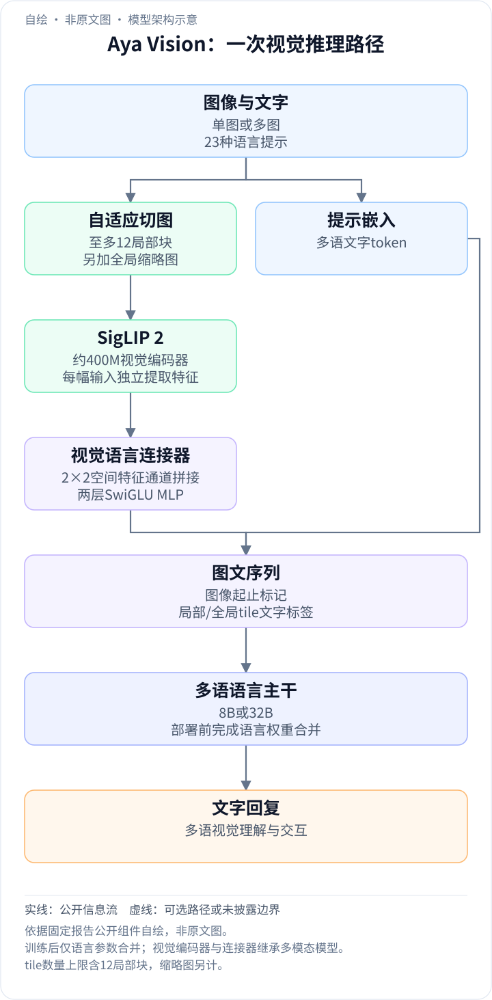
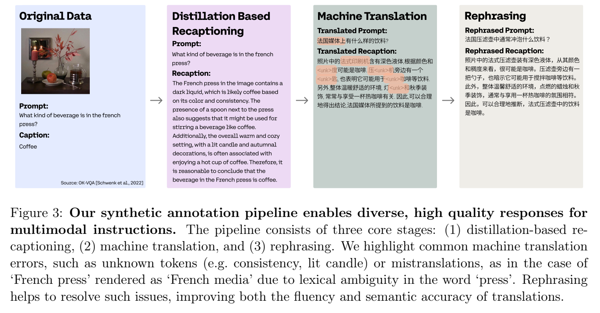
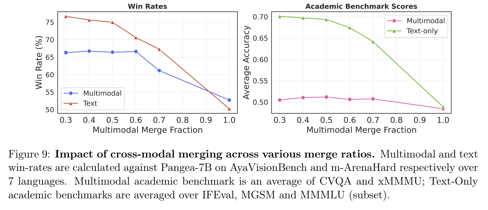
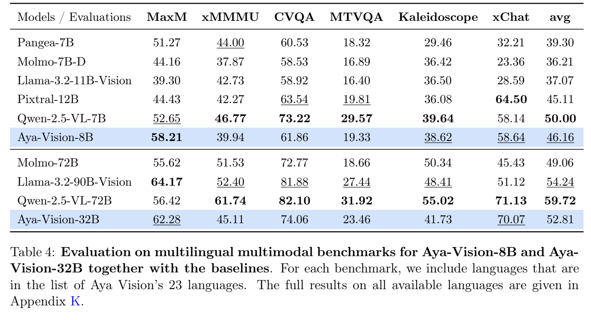

<!-- article-header:start -->
[项目首页](../../../README.md) › [模型系列](../../../reports/model-family-index.md) › [Aya Vision](../README.md)
<!-- article-header:end -->

# Aya Vision：多语视觉指令数据与跨模态模型合并

> 解读 Cohere Labs / Cohere 的 **Aya Vision: Advancing the Frontier of Multilingual Multimodality**，固定采用 arXiv **2505.08751v1**。论文同时研究图像理解、多语言自然回复与纯文本能力保持，不能把偏好评估中的优势理解为每项视觉学术测试均领先。

<!-- article-toc:start -->
<a id="article-toc"></a>

**本篇目录** · [论文定位](#paper-info) · [快速概览](#overview) · [整体架构](#architecture) · [核心原理](#principles) · [数据构建](#data) · [训练流程](#training) · [实验结果](#experiments)
<!-- article-toc:end -->

<a id="paper-info"></a>

## 1. 论文信息与模型定位

| 项目 | 内容 |
|---|---|
| 题名 | Aya Vision: Advancing the Frontier of Multilingual Multimodality |
| 团队 | Cohere Labs、Cohere |
| 日期 | arXiv 首次提交 2025-05-13；报告首页标注 preprint release 2025-05-14 |
| 模型 | Aya-Vision-8B、Aya-Vision-32B |
| 输入与输出 | 单图/多图与文字输入，23 种语言的文字回复 |
| 技术主线 | 合成重标注、翻译后改写、视觉指令训练与训练后语言权重合并 |
| 官方资源 | [固定报告](https://arxiv.org/pdf/2505.08751v1) · [8B 模型卡](https://huggingface.co/CohereLabs/aya-vision-8B) · [32B 模型卡](https://huggingface.co/CohereLabs/aya-vision-32B) · [AyaVisionBench](https://huggingface.co/datasets/CohereLabs/AyaVisionBench) |

它希望回答两个彼此关联的问题：如何让多语视觉回答自然且忠于图像，以及如何避免增加视觉后损坏已有语言能力。其主要训练与评估围绕 23 种语言，不等于对全球所有语言提供同等质量。[§1、§4，PDF 第 2–4、12–13 页](https://arxiv.org/pdf/2505.08751v1#page=12)

<a id="overview"></a>

## 2. 快速概览

Aya Vision 使用 SigLIP 2 视觉编码器、空间降采样和 SwiGLU MLP 连接器，将图像表示送入经过多语后训练的语言模型。大图会拆成最多 12 个局部 tile，加一幅全局缩略图，兼顾细节与整体语境。

数据侧先以正确答案约束教师重写英文短回复，再做关键词与语义过滤；多语部分采用 NLLB 翻译，再由多语 LLM 修订生硬表达或词义错误。模型训练分连接器对齐与视觉指令微调，最后只合并语言主干的权重，视觉编码器和连接器保留多模态模型版本。

这种设计把“学会看图”和“保持文本交互”分成可以检查的步骤。跨模态合并无需再次训练，但此前的对齐、微调和数据生产都需要训练或模型推理；论文并没有提出完全免训练的视觉模型。

<a id="architecture"></a>

## 3. 整体架构

<!-- derived-architecture:start -->


*自绘模型架构示意（非原文图）。依据下述公开资料归纳；方框表示功能组件，不代表逐层实现。*

依据：[§4.1 PDF12–13; Appendix B PDF39–40](https://arxiv.org/pdf/2505.08751v1#page=12)；[§3.2 Eq1; §7.1 PDF21–22](https://arxiv.org/pdf/2505.08751v1#page=11)。
<!-- derived-architecture:end -->

| 模块 | 输入与输出 | 公开机制 |
|---|---|---|
| 自适应切图 | 原图 → 最多 12 局部块 + 全局缩略图 | 选择尽量保持宽高比的受支持尺寸，再按编码器输入大小独立编码 |
| SigLIP 2 | 每块图像 → patch 特征 | 两种规模均为约 400M 视觉组件；8B 初始化自 patch14-384，32B 自 patch16-512 |
| 空间降采样 | 2×2 相邻 patch → 单个拼接特征 | 在通道维堆叠，空间 token 数减少 4 倍；保留聚合块的局部特征 |
| 视觉语言连接器 | 降采样特征 → LLM 嵌入 | 两层 SwiGLU MLP；8B/32B 连接器约 190M/428M 参数 |
| 序列组织 | 每个 tile 的表示 → 图文输入序列 | 图像起止标记，加普通文字 TILE_1…TILE_N 与 TILE_GLOBAL 标签 |
| 多语语言主干 | 图文序列 → 逐 token 回复 | 8B 使用 Command-R7B 系模型再按 Aya Expanse 配方后训练；32B 使用 Aya-Expanse-32B |
| 合并后的部署权重 | 语言合并权重 + 多模态视觉路径 → 同一推理模型 | 只在训练完成后插值语言参数，不在每次请求同时调用两个完整模型 |

一次推理按“切图/缩略图→视觉编码→2×2 通道堆叠→MLP→带 tile 标签的图文序列→语言生成”执行。附录 Table 6 给出语言主干 8B/32B 的 32/40 层、4096/8192 隐藏维度，视觉主干为 27 层、1152 维。连接器压缩空间序列，并不意味着只保留四分之一的原图像素。[§4.1、附录 B，PDF 第 12–13、39–40 页](https://arxiv.org/pdf/2505.08751v1#page=12)

8B 的初始化 checkpoint 名含 384，但 Table 6 的 Image Size 列为 364×364；本文区分初始化名称和表内实际输入。原文最大图像 token 为 2,197/3,328，与 13 幅输入各产生 169/256 个降采样视觉 token 一致；不把“最多 12 tile”误写成含缩略图共 12 幅，也不将这些数量等同于带全部标签后的总序列长度。[§4.1、Table 6，PDF 第 12、40 页](https://arxiv.org/pdf/2505.08751v1#page=40)

<a id="principles"></a>

## 4. 核心创新与数学原理

### 4.1 以真值为锚点重写：改变回复风格而不改变任务答案

原始数据常只有一个词或选项。作者按任务设计教师提示：描述强调丰富但不引入未见元素，推理任务要求解释步骤，VQA 要忠于图像和给定答案。重写后平均词数从 14.2 增至 100.1，token 从 27.2 增至 140.8，MTLD 词汇多样性从 11.0 增至 61.2。

这些统计说明语言风格更丰富，不能单凭长度证明事实更准确。因此流程先过滤拒答和提示复述，再由 Command R+ 08-2024 比较原始与重写答案的语义一致性。语义检查识别出的错误率约 3.2%，推理类高于简单 VQA；这是该检查器的判定结果，不是独立人工确认后的剩余错误率。[§2.2–2.3，PDF 第 6–8 页](https://arxiv.org/pdf/2505.08751v1#page=7)

### 4.2 翻译再改写：用上下文修复 translationese



*原文 Figure 3，PDF 第 6 页。可见示例将 French press 误译成“法国媒体”，改写阶段修正为压滤壶；整幅保留原始短答案、英文重写、机器翻译与多语改写的对照及图注。*

NLLB-3.3B 先把英文数据子集翻译到另外 22 种语言；Command R+ 再把初译作为上下文示例，修正词义、生硬句式与未知 token。各语言随机抽取英文池的子集，而非把每条英文机械复制 22 次。

参考自由的 COMETKiwi 评估均分从 0.7455 升至 0.8293，绝对增加 0.0838；报告的 11.24% 是相对变化。该文本翻译质量指标不能直接当作视觉正确率，也不能证明每个文化语境均已覆盖。[§2.4，PDF 第 8–9 页](https://arxiv.org/pdf/2505.08751v1#page=9)

### 4.3 跨模态合并：在参数空间恢复语言能力

原文 Eq. (1) 对同形状语言参数做线性插值：

```math
W_{\mathrm{merged}}=\alpha W_{\mathrm{mm\text{-}LLM}}+(1-\alpha)W_{\mathrm{text\text{-}LLM}}.
```

$`W_{\mathrm{mm\text{-}LLM}}`$ 是视觉微调后的语言主干，$`W_{\mathrm{text\text{-}LLM}}`$ 是原始纯文本主干，$`\alpha`$ 控制多模态更新的保留比例。视觉编码器和连接器没有纯文本对应物，直接沿用多模态模型，不能一起套用该式。最终两种型号均选 $`\alpha=0.4`$，即 40% 多模态语言权重、60% 原始文本权重。



*原文 Figure 9，PDF 第 21 页；横轴是多模态权重比例。偏好胜率与学术准确率使用不同指标，消融覆盖 7 种语言，不等于所有主实验的 23 种语言。*

两者共享初始化及部分优化路径，使插值具有可行基础；这不是任意不同结构模型均可合并的定理。图中降低多模态占比能恢复文本表现，视觉偏好也在一定范围改善；更靠近原文本模型并不会无限增加视觉收益。[§3.2、§7.1，PDF 第 11、21–22 页](https://arxiv.org/pdf/2505.08751v1#page=11)

### 4.4 语言比例与数据类型：翻译量增加存在权衡

最终数据约 35% 多语、31% 英文合成重标注、34% 高质量原始数据。原始短答案有利于严格格式基准，自然长回复有利于开放生成，两类监督都被保留。

消融将多语比例从 35% 提至 67% 时，偏好胜率从 71.4% 降至 68.7%。作者认为重复稀缺的多语样本及减少多样英文样本会削弱收益。这支持当前配方中的平衡，不表示 35% 对任意语言集合、基座和数据规模都是普适最优值。LoRA 与全参数微调的对照也另使用 0.5 合并比例，应与最终 0.4 配方区分。[§7.4–7.5，PDF 第 23–24 页](https://arxiv.org/pdf/2505.08751v1#page=24)

<a id="data"></a>

## 5. 数据构建与处理

英文基础池约 2.29M，来自 Cauldron、PixMo、SlideVQA、PDFVQA、ScreenQA 等，覆盖 VQA、OCR、文档、图表、表格、逻辑、多图差异、教材与截图转代码。Cauldron 的约 30M 与 PixMo 的约 6M 是来源集合规模，不是全部直接用于本模型。

| 数据桶 | 可用池/训练采样 | 处理 |
|---|---|---|
| 英文合成重标注 | 约 2.29M；训练见约 3.5M | 提高稀缺任务与高质量数据权重 |
| 22 种非英文 | 约 5M；采样约 3.4M | 各语言均匀采样，保持任务分布 |
| 高质量原始数据 | 约 6M；采样约 3.7M | 下采样，保留标准短答案格式 |

约 10M 任务样本经过 sequence packing，形成 Figure 4 的约 2.75M 打包序列。打包数、原始样本数、训练重复暴露次数是不同单位，不能将它们相加得到独立图片规模。[§2.1、§3.1、Figure 4，PDF 第 5、10–11 页](https://arxiv.org/pdf/2505.08751v1#page=10)

<a id="training"></a>

## 6. 训练流程与目标

| 阶段 | 更新范围 | 公开设置 |
|---|---|---|
| 视觉语言对齐 | 只更新连接器；视觉与语言冻结 | LLaVA-Pretrain 为主，加约 14% 多语；8B/32B 学习率 1e-4/1e-3，9.7K/19K 步 |
| 视觉指令微调 | 连接器与语言主干更新；视觉仍冻结 | batch 128，31K iterations，启用 μP；峰值学习率 1e-4/5e-4；打包长度 8192 |
| 训练后合并 | 插值语言参数，继承视觉路径 | 最终多模态权重比例 0.4，无需额外梯度训练 |

较大的 32B 连接器使用更长对齐训练，不能说两种规模的训练预算完全相同。论文实验比较全参数与 LoRA，但“全参数”在视觉指令阶段也不能被解释成视觉编码器一起解冻；§4.2 明确视觉冻结。[§4.2、附录 B，PDF 第 13、39–40 页](https://arxiv.org/pdf/2505.08751v1#page=13)

<a id="experiments"></a>

## 7. 实验设置与主要结果

开放视觉生成使用 AyaVisionBench、m-WildVision 与 xChat；前两项由 Claude 3.7 Sonnet 20250219 进行成对偏好判断，纯文本 m-ArenaHard 使用 GPT-4o 20241120。胜/负/平分别报告，胜率不等同于独立人工评测准确率。[§5，PDF 第 14–15 页](https://arxiv.org/pdf/2505.08751v1#page=15)

| 对比与评测 | AyaVisionBench 胜率 | m-WildVision 胜率 |
|---|---:|---:|
| 8B 对 Qwen2.5-VL-7B | 52.7% | 57.5% |
| 8B 对 Pixtral-12B | 49.2% | 59.4% |
| 32B 对 Llama3.2-90B-Vision | 65.9% | 73.0% |
| 32B 对 Qwen2.5-VL-72B | 48.5% | 53.3% |

8B 对 Pixtral 在 AyaVisionBench 的胜率不足 50%，但高于其负率且存在平局；不能省略这一点而称所有单项均超过 50%。32B 对 Qwen72B 的两套偏好结果也接近，应保留具体任务和裁判版本。[Figure 6–7，PDF 第 16–17 页](https://arxiv.org/pdf/2505.08751v1#page=16)



*原文 Table 4，PDF 第 16 页；各基准只纳入与 Aya 23 种语言相交的语言，表内均分还混合不同任务指标。*

8B 的 MaXM 为 58.21，但 xMMMU 39.94、CVQA 61.86，低于 Qwen7B 的 46.77/73.22；32B 的 xMMMU 45.11 也低于 Qwen72B 的 61.74。其贡献主要体现在多语自然交互、数据与合并方法，不能据此宣称所有知识/视觉推理基准最强。相对原始语言基座，文本开放生成仍有约 5.9% 的报告退化，合并缓解遗忘并未彻底消除它。[Table 4–5、§6.3，PDF 第 16、18、20 页](https://arxiv.org/pdf/2505.08751v1#page=20)

<!-- article-footer:start -->
---

[← 上一篇：Seed1.5-VL](../../seed/arxiv-2505.07062/README.md) · [按发表时间浏览](../../../reports/paper-reading-guide.md#year-2025) · [下一篇：BLIP3-o →](../../blip3-o/arxiv-2505.09568/README.md)

[返回本篇目录](#article-toc) · [返回模型系列](../README.md)
<!-- article-footer:end -->
