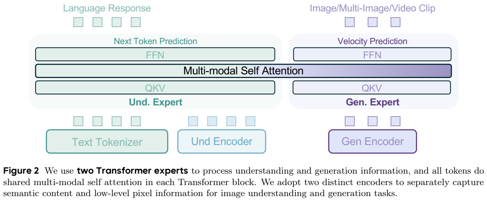
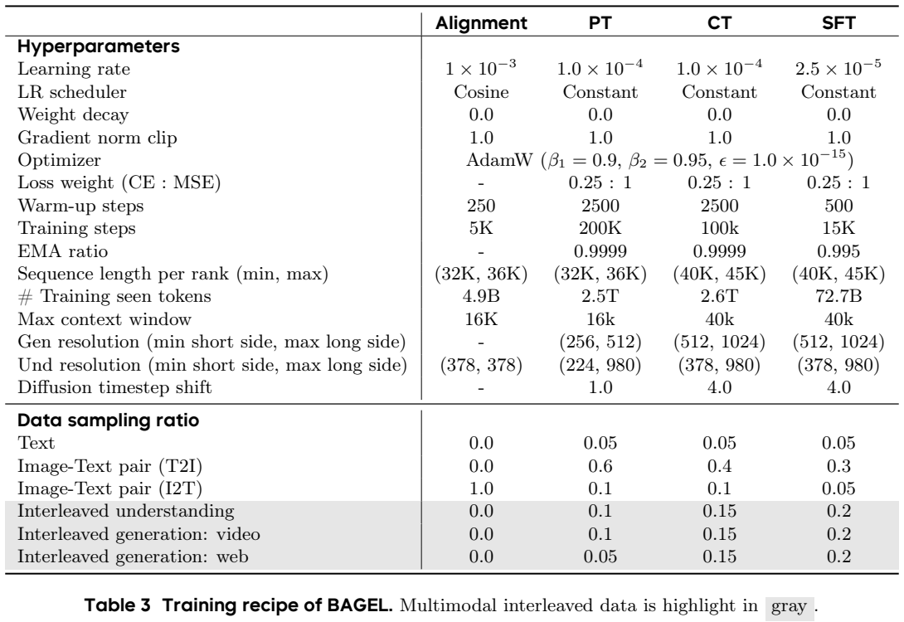
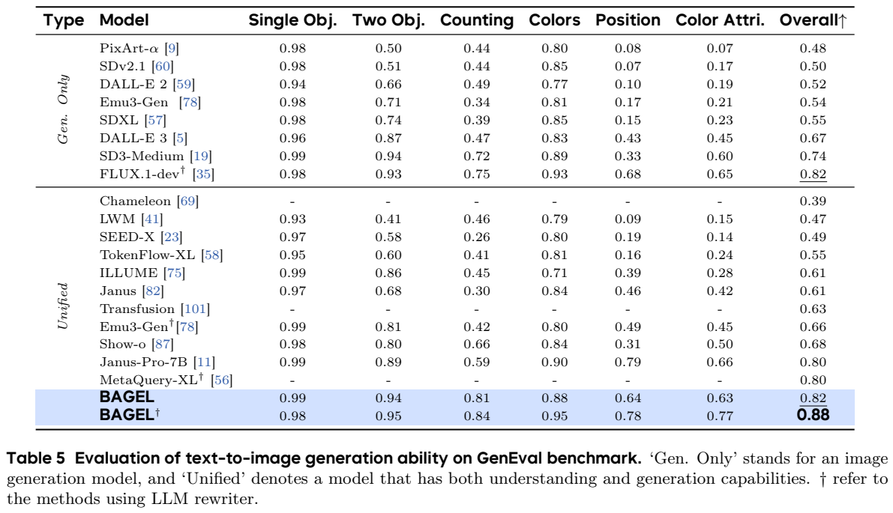
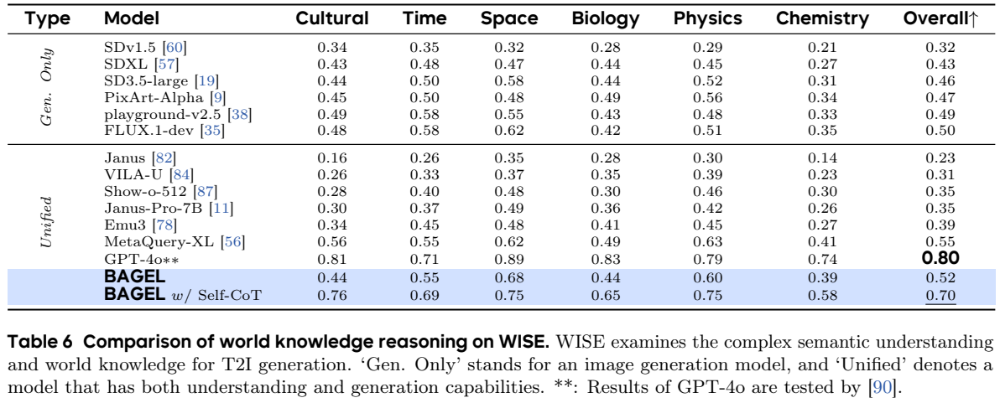
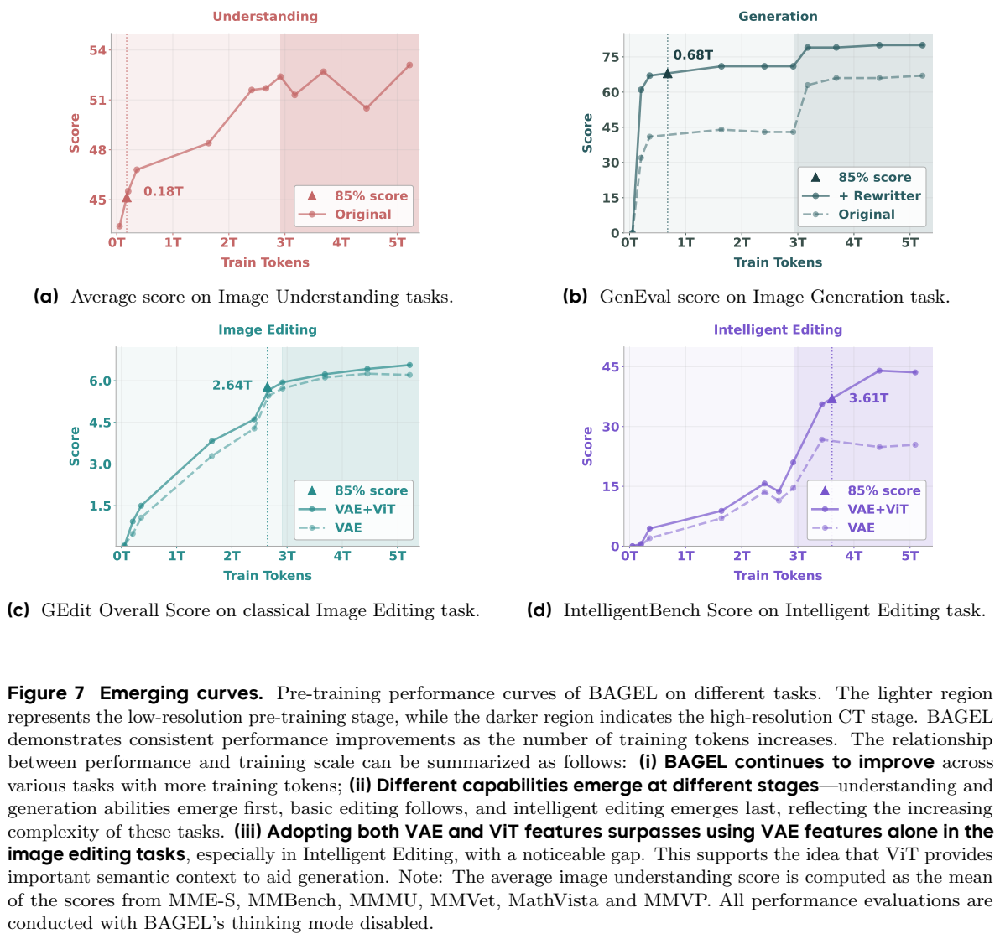

<!-- article-header:start -->
[项目首页](../../../README.md) › [模型系列](../../../reports/model-family-index.md) › [BAGEL](../README.md)
<!-- article-header:end -->

# BAGEL：以共享注意力连接多模态理解与连续视觉生成

> 本文依据 [Emerging Properties in Unified Multimodal Pretraining，arXiv:2505.14683v1](https://arxiv.org/pdf/2505.14683v1)。原图表采用局部裁切；公式为明确标注的解读表达；数值来自报告，未重新运行模型。

<!-- article-toc:start -->
<a id="article-toc"></a>

**本篇目录** · [论文定位](#paper-info) · [快速概览](#overview) · [整体架构](#architecture) · [核心原理](#principles) · [数据构建](#data) · [训练流程](#training) · [实验结果](#experiments)
<!-- article-toc:end -->

<a id="paper-info"></a>

## 1. 论文信息与模型定位

| 项目 | 内容 |
|---|---|
| 论文题名 | Emerging Properties in Unified Multimodal Pretraining |
| 作者与机构 | Chaorui Deng、Deyao Zhu、Kunchang Li 等；ByteDance Seed 及深圳先进技术研究院、Monash、HKUST、UC Santa Cruz 等合作作者 |
| 日期与版本 | arXiv 首次提交 2025-05-20，采用 v1；PDF 另列 Date: May 26, 2025 |
| 模型家族 | BAGEL，原生统一多模态理解与生成 |
| 主模型口径 | 7B 激活参数、14B 总参数；另有 1.5B 基础规模消融，不能与单个完整系统规模混用 |
| 输入输出 | 文字、图像、多图及视频上下文 → 文字、图像或连续多图；报告展示编辑、未来帧、视角变化与导航 |
| 官方资源 | [项目页](https://bagel-ai.org/)；报告说明公开代码与 checkpoint，技术解读固定在 v1 |

BAGEL 不是让语言模型只吐出一小组条件向量，再交给完全独立的图像生成器。它把文字预测与视觉潜在空间的速度预测放进一个集成 Transformer 框架，用专门参数处理不同 token，同时让它们在每层交换上下文。报告的“世界学习”主要指从视频与网页交错数据学到的视觉变化和组合任务能力；定性导航或三维操作图不能直接视为真实机器人闭环成功率。[§1–2](https://arxiv.org/pdf/2505.14683v1#page=3)

<a id="overview"></a>

## 2. 快速概览

统一理解和生成面临两个问题。首先，识别图像语义与重建像素需要不同表示、目标和优化设置，完全共享参数可能相互干扰。其次，若理解模块只通过少量潜在 token 与外部生成器交流，多图和长上下文中的细节可能被压缩掉。BAGEL 为理解和生成各保留一个 Transformer expert，用共享注意力让文字、语义视觉 token 和 VAE token 直接交换信息。

数据重点从单张图片描述扩展到图文交错：视频被转成连续帧及变化描述，网页保留图片之间的文字，并在图片前增加简短描述。训练同时包括文字下一 token 预测与连续视觉 Rectified Flow，逐步提高生成分辨率与交错数据比例。作者观察理解与基础生成较早收敛，编辑尤其是需要知识组合的编辑更晚出现较好表现。

这个观察需要按实验条件理解：后期同时改变了分辨率、采样配比及训练 token 数，作者定义的“涌现”也使用特定基准与检查点，不是严格因果证明某一规模必然产生能力。最终模型在 GenEval 无提示改写时为 0.82，使用 LLM rewriter 为 0.88；WISE 从无思考 0.52 到 Self-CoT 0.70，但仍低于表内 GPT-4o 的 0.80。理解、生成、提示改写和思考模式应分别报告。[§6–7](https://arxiv.org/pdf/2505.14683v1#page=17)

<a id="architecture"></a>

## 3. 整体架构



> Figure 2，v1 PDF 第 4 页；[原页](https://arxiv.org/pdf/2505.14683v1#page=4)。截图保留完整架构及图注。

图的底部有三种入口：文字 tokenizer、理解编码器和生成编码器。理解端以 SigLIP2-so400m/14 初始化，使用 NaViT 风格处理原长宽比，最大图像尺寸 980×980，再由两层 MLP 对齐语言维度。生成端使用 FLUX 的预训练 VAE，空间下采样 8 倍、latent channel 16，再对 latent 做 2×2 patch embedding。VAE 训练时冻结，它与负责高层语义的 ViT 各有用途。

语言骨干继承 Qwen2.5，包括 RMSNorm、SwiGLU、RoPE、GQA，并新增 QK-Norm 稳定训练。MoT 将 Qwen2.5 的可训练参数复制为生成专家：文字与 ViT token 用理解专家的投影和 FFN，VAE token 用生成专家；不同 token 的 Q/K/V 仍进入同一共享注意力操作。它不是仅复制 FFN 的普通 MoE，路由也不是每个 token 动态选择任意 top-k 专家，而是按模态硬路由。[§2.2、§2.4](https://arxiv.org/pdf/2505.14683v1#page=5)

标准交错场景把序列划分为同一模态的连续段：每段能看此前段，文字段内部因果，视觉段内部双向。先前图像的干净 VAE 与 ViT token 作为条件，不能把尚待去噪 token 当成完成图像的缓存。生成结束后，缓存以干净表示替换。多图联合训练还使用 diffusion forcing 的噪声条件与随机分组全注意力，这是额外训练策略，不能概括为所有图像始终同一噪声等级。[§2.3](https://arxiv.org/pdf/2505.14683v1#page=5)

| 模块 | 输入与输出 | 公开机制 |
|---|---|---|
| SigLIP2 / NaViT 理解端 | 原长宽比图像 → ViT token | 位置插值支持最高980×980输入，两层MLP映射到骨干维度 |
| FLUX VAE 及 patch embedding | 像素 ↔ 连续latent token | VAE下采样8倍、16通道；2×2 latent patch接入Transformer |
| 理解专家与生成专家 | 文字/ViT或VAE token → 模态对应隐藏状态 | 按token类型硬路由完整Transformer参数，注意力交互操作共享 |
| 广义因果注意力 | 交错模态段 → 有条件的跨段交互 | 可读此前段；文本段内因果，视觉段内双向；干净图像表示用于后续条件 |
| 文本头与流速度头 | 隐藏状态 → 文字概率或latent速度 | 文字采用下一token目标，带噪VAE位置采用Rectified Flow MSE |

[模块依据：§2.2–2.4，PDF 第4–6页](https://arxiv.org/pdf/2505.14683v1#page=5)。

<a id="principles"></a>

## 4. 核心创新与数学原理

### 4.1 MoT：分开参数，又保留跨模态注意力

每类token首先用自身专家产生Q/K/V，随后进入同一注意力计算，因此不同专家并不是互不相见的两条网络。该分工让生成端可以调整适合连续latent的投影与FFN，而文字及ViT端保留语言理解初始化；同时跨模态条件仍可在每一层交流。其代价是复制参数带来的总模型容量增加，不能用单一“共享骨干”概括存储成本。[§2.2、§2.4，PDF 第4–6页](https://arxiv.org/pdf/2505.14683v1#page=5)。

**按 token 分配完整 Transformer 专家。** 用解读式 `h'=T_u(h)` 表示文字/ViT 路径、`h'=T_g(h)` 表示 VAE 路径；二者在每层共同构造注意力关系。共享的是交互操作和上下文，不意味着全部参数共享。相较只分离 FFN，MoT 也分离 Q/K/V 等参数，让理解 CE 与生成 MSE 的优化不必争抢同一整套权重。论文在 1.5B Qwen2.5 的固定数据/超参消融中，MoT 的 CE 和尤其 MSE 损失优于 Dense 和 MoE；这不能直接证明所有更大规模架构必然同样排序。[Figure 3](https://arxiv.org/pdf/2505.14683v1#page=6)

### 4.2 连续图像生成：时间条件与干净缓存各司其职

扩散时间嵌入直接加入VAE token的初始隐藏状态，没有另用AdaLN改写每层归一化。生成过程中的带噪表示用于预测速度；一张图像完成后，后续上下文读取其干净VAE和ViT表示，而不是缓存某次中间噪声状态。这样既能复用KV缓存，又避免后续文本或图像把不完整的噪声结果当成已知事实。[§2.2–2.3，PDF 第5页](https://arxiv.org/pdf/2505.14683v1#page=5)。

**文字离散生成，图像连续流生成。** 文字仍使用标准条件负对数似然。为理解 Rectified Flow，可用一组自洽的标准解读定义：z0 为噪声、z1 为干净图像 latent，令

```math
z_t=(1-t)z_0+tz_1,\qquad
\mathcal L_{\rm flow}=\mathbb E\Vert v_\theta(z_t,t,c)-(z_1-z_0)\Vert ^2.
```

t∈[0,1]，c 是文字与既有图像条件，vθ 学习连续轨迹的速度。推理从噪声出发，数值积分 `dz/dt=vθ`，再由 VAE 解码成像素。以上是机制解读，不是报告的编号公式；实际 timestep 分布、shift、采样器会改变数值实现。本模型并非逐 token 自回归生成离散图像词码。

### 4.3 联合优化：损失权重与数据比例相互耦合

理解任务的离散词预测与图像速度回归使用不同的输出空间，直接比较两项损失的原始数值没有统一单位。给MSE更高权重，是控制联合训练方向的一项手段；图像样本占比、每张图的latent位置数量和学习率同样改变梯度贡献。原文把架构消融与训练超参分开报告，阅读时也应避免把某一损失下降直接等同于全部下游任务提高。[§4、§4.1–4.2](https://arxiv.org/pdf/2505.14683v1#page=8)。

报告 Table 3 的 CE:MSE 权重为 0.25:1，可解读为 `L=0.25 L_CE+L_MSE`。权重不同不表示两种梯度重要性精确相差四倍，因为损失归一化、数据采样及梯度尺度也影响实际更新。作者的学习率消融发现较大 LR 有利于 MSE、较小 LR 有利于 CE，因而需要联合调整权重和采样比例。

### 4.4 双视觉条件：语义与像素线索互补

同一先前图像同时提供ViT和干净VAE表示，解决的是两种条件信息的互补问题；它不要求二者token一一配对。多图训练进一步允许每张图使用独立噪声等级，并随机把连续图像组成同噪声、组内全注意力的集合。跨图一致性因此来自条件可见范围和联合训练，而不是简单把所有图像拼成一个固定分辨率大图。[§2.3，PDF 第5页](https://arxiv.org/pdf/2505.14683v1#page=5)。

**用两种图像表示辅助生成。** ViT 提供对象与语义，VAE 提供细节与像素潜在结构；二者作为先前图像上下文可减少把视觉需求压成少量中间条件的损失。按架构，H×W 图像的 VAE 下采样再 patch 化后，视觉生成位置约有 `(H/16)(W/16)` 个，此为在尺寸可整除条件下的配置推导。移除 ViT 对简单编辑影响较小，对 IntelligentBench 更明显，说明需要知识理解的编辑更依赖语义路径；原文没有由此证明所有输入上下文“完全无信息损失”。[§2、Figure 7](https://arxiv.org/pdf/2505.14683v1#page=13)

<a id="data"></a>

## 5. 数据构建与处理

| 数据来源（Table 1） | 条目规模 | 数据库 token 统计 |
|---|---:|---:|
| 纯文本 | 400M | 0.4T |
| 图文理解对 | 500M | 0.5T |
| 图文生成对 | 1600M | 2.6T |
| 交错理解 | 100M | 0.5T |
| 视频交错生成 | 45M | 0.7T |
| 网页交错生成 | 20M | 0.4T |

这些是数据池统计，训练随机采样，不能与实际 seen tokens 一一等同。图文理解使用 CLIP 相似度、分辨率、长宽比、文本长度、去重和概念重采样，并加入 OCR、图表、grounding；生成数据强调清晰度、结构与语义多样性，另有少量已有生成模型的合成图片。

视频来自公开网络视频、Koala36M 与 MVImgNet2.0。先分镜、合并相近片段，裁黑边/水印等覆盖，再按长度、分辨率、清晰度、运动稳定性过滤及 CLIP 去重。每段平均抽四帧；蒸馏的 Qwen2.5-VL-7B 为帧对描述变化，限制 30 token 减少冗长与幻觉，得到 45M 交错序列。帧间描述提供时间变化监督，不能把“平均四帧”写成所有视频都固定四帧。[§3.3](https://arxiv.org/pdf/2505.14683v1#page=8)

网页基于 OmniCorpus：先让 LLM 标小部分主题，再训练 fastText 做粗筛，之后用 Qwen2.5-14B 精筛。Table 2 要求图像宽高 150–20000、长宽比 1/2–2、保留 3–8 张图；去 UI、模糊、不相关图片，删除超过 100 OCR token 的文档式图片，并裁剪无关页眉页脚。这里过滤的是生成网页子集，不能误推整个训练都不含 OCR 文档。图像前插入 Qwen2.5-VL-7B caption，超过 300 token 的图间文字由 LLM 摘要，得到 20M 文档。

另建 500K reasoning-augmented 样本：T2I 使用 Qwen2.5-72B 扩展指令与详细提示、FLUX.1-dev 生成目标图；编辑使用源/目标图、用户查询及 R1 示范产生解释；概念编辑从网页中选择图对，再生成问题、评分过滤及解释。训练解释在已知目标图条件下构造，不应等同模型真实推理时能预先知道目标结果。[§3.3.4](https://arxiv.org/pdf/2505.14683v1#page=9)

<a id="training"></a>

## 6. 训练流程与目标



> Table 3，PDF 第 10 页；[原页](https://arxiv.org/pdf/2505.14683v1#page=10)。先读阶段列，再区分 seen tokens、per-rank packing 和单样本 context window。

| 阶段 | 实际训练量/步数 | 设置变化 |
|---|---|---|
| Alignment | 4.9B / 5K | 仅训练 MLP；ViT与语言主干冻结；378×378 caption 对齐 |
| PT | 2.5T / 200K | 除 VAE 外全部参数训练；理解原尺寸范围224–980，生成256–512 |
| CT | 2.6T / 100K | 提高生成范围到512–1024、理解短边378；提高交错数据比例 |
| SFT | 72.7B / 15K | 高质量生成/交错子集及 LLaVA-OV、Mammoth-VL 指令子集 |

Table 3 的 LR 分别为 10⁻³、10⁻⁴、10⁻⁴、2.5×10⁻⁵；仅对齐阶段余弦，其余恒定，warmup 为 250/2500/2500/500 步。AdamW β1=0.9、β2=0.95、ε=10⁻¹⁵，weight decay 0，gradient norm clip 1；PT/CT 的 EMA 0.9999，SFT 0.995。timestep shift 从 PT 的1到 CT/SFT 的4，不能说它等于去噪步数。

每 rank 打包长度32–36K或40–45K，是多个序列的负载平衡；单样本最大 context window 对齐/PT为16K、CT/SFT为40K。后期采样不只是增加图片：PT 的 T2I 比例0.6，到 SFT降至0.3；三类交错数据合计从0.25增至0.6。完整训练成本和所有硬件资源未在该表给出。图像编码器初始化名为384分辨率，而实际对齐为378，是正文不同阶段规格，应分别记录。[§4、Table 3](https://arxiv.org/pdf/2505.14683v1#page=10)

<a id="experiments"></a>

## 7. 实验设置与主要结果

理解使用 MME、MMBench、MMMU、MM-Vet、MathVista、MMVP；生成用 GenEval 与 WISE；编辑用 GPT-4.1 评估 GEdit-Bench。新 IntelligentBench 有350例，由 GPT-4o-2024-11-20 对输入图、问题、参考图与生成图评分0–2，再归一到100。模型裁判分数含其判断误差，不能写成真实人类任务成功率。

Table 4 的 BAGEL7B 在 MMBench/MMMU/MM-Vet/MathVista 为85.0/55.3/67.2/73.1；Qwen2.5-VL7B 为83.5/58.6/67.1/68.2。因此它在视觉数学上提升明显，MMMU却落后3.3点；报告支持多数指标竞争力，并非全部理解任务最高。





> Table 5、6，PDF 第 17 页；[原页](https://arxiv.org/pdf/2505.14683v1#page=17)。GenEval `†` 是 LLM rewriter；WISE Self-CoT 是模型先生成思考，两种条件不同。

| 实验条件 | BAGEL | 对照与含义 |
|---|---:|---|
| GenEval 无 rewriter | 0.82 | Janus-Pro7B为0.80 |
| GenEval 有 rewriter | 0.88 | FLUX.1-dev有rewriter为0.82 |
| WISE 无 Self-CoT | 0.52 | 低于 MetaQuery-XL0.55 |
| WISE 有 Self-CoT | 0.70 | 高于无思考，但低于GPT-4o0.80 |
| GEdit英文 Overall | 6.52 | 低于Step1X-Edit6.70及GPT-4o7.53 |
| GEdit中文 Overall | 6.50 | 低于Step1X-Edit6.86 |

GenEval中的位置条件无改写仅0.64，低于Janus-Pro0.79；总体分数不能替代每类能力。GEdit 的语义一致性、图像质量和总体评价也有不同排序，BAGEL的高语义分数并不保证最终Overall最高。[Table 5–7](https://arxiv.org/pdf/2505.14683v1#page=19)



> Figure 7，PDF 第13页；[原页](https://arxiv.org/pdf/2505.14683v1#page=13)。横轴seen tokens，浅/深背景区分低分辨率PT与高分辨率CT；全图关闭thinking模式。

以达到最终峰值85%为指标，理解/生成/编辑/智能编辑分别约需0.18T/0.68T/2.64T/3.61T token。图中理解分数并非每步单调，后期条件也同时变化；这些曲线描述本训练方案的能力出现次序，不能证明“多训练某个固定token数就必然出现世界模型”。VAE+ViT在智能编辑上高于只用VAE，支持语义上下文的作用。本文更可靠的经验是：统一目标可由专用参数与共享上下文协调，交错数据及后期训练对组合编辑尤其重要，但仍需按评测条件区分生成质量、知识正确性与真实环境能力。

<!-- article-footer:start -->
---

[← 上一篇：Claude 4](../../claude/document-28803263c0f6/README.md) · [按发表时间浏览](../../../reports/paper-reading-guide.md#year-2025) · [下一篇：OpenUni →](../../openuni/arxiv-2505.23661/README.md)

[返回本篇目录](#article-toc) · [返回模型系列](../README.md)
<!-- article-footer:end -->
