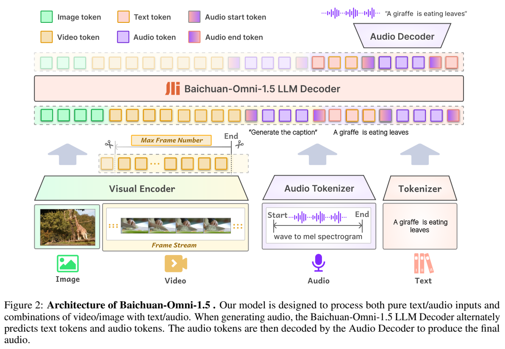
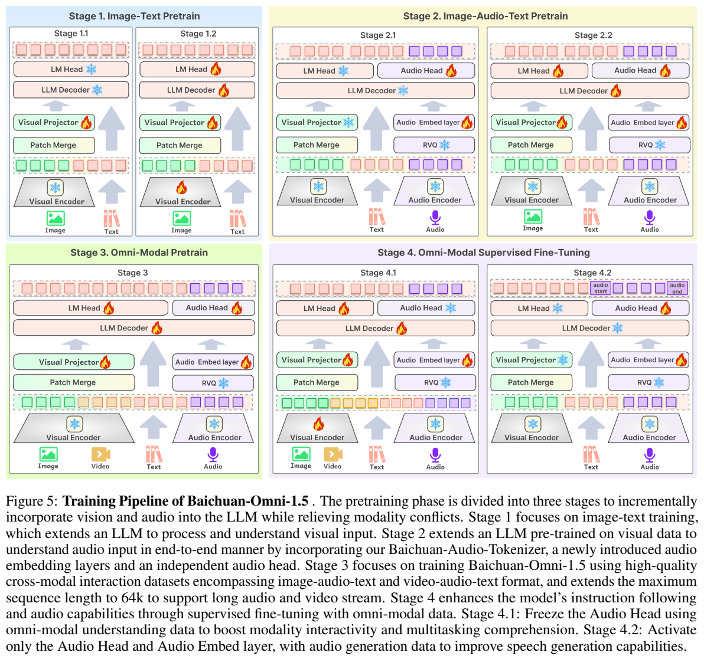
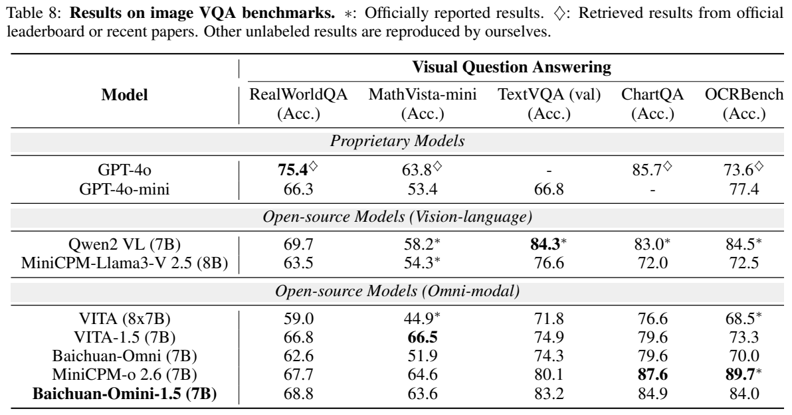
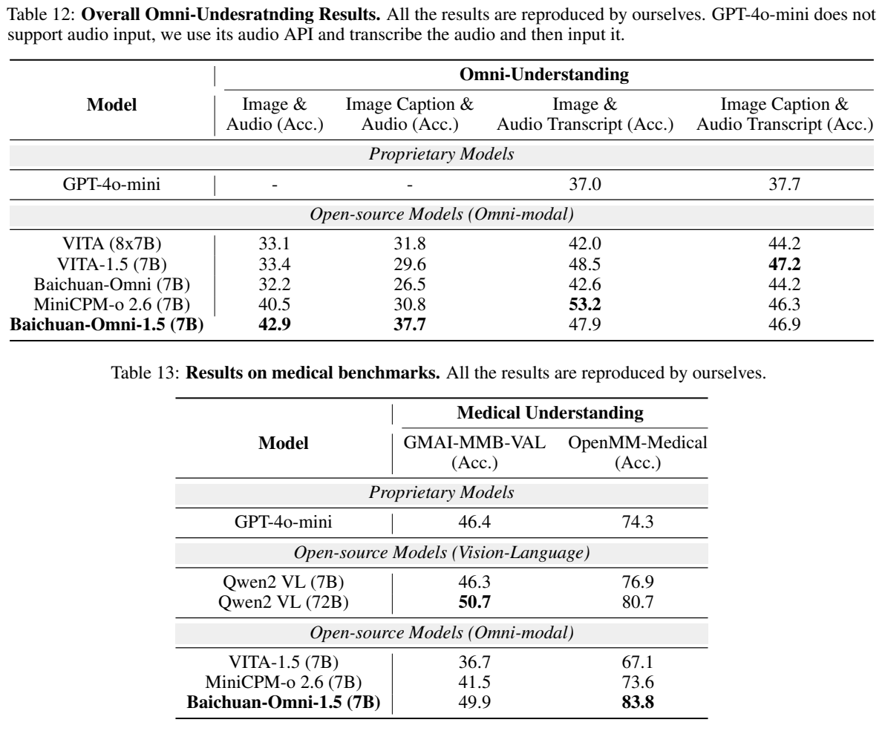

# Baichuan-Omni-1.5：以语义声学双目标连接看、听与说

## 1. 论文信息与模型定位

原文为百川智能的 **Baichuan-Omni-1.5 Technical Report**，本文使用 [官方仓库PDF](https://github.com/baichuan-inc/Baichuan-Omni-1.5/blob/main/baichuan_omni_1_5.pdf) 在2026年10月8日取得的27页快照。项目目录标注2025年1月26日；由于官方PDF链接可更新，来源哈希保存在配图manifest与evidence中。报告主体到第17页，其余主要是参考文献。

该模型以7B语言骨干支持文本、图像、视频和音频输入，输出文本及语音；7B是实验表指定的**LLM参数量**，不是所有视觉、语音模块相加的总量。相较纯视觉语言模型，它重点解决语音输入、语义理解和声音生成的联合建模，并通过跨模态数据减少加入音频后对视觉与纯文本能力的影响。报告还构建OpenAudioBench与OpenMM-Medical评测。它不提供图像/视频生成接口，也没有把自然环境声音的完善理解作为已经解决的能力。〔PDF第1–3、6、11、17页〕

## 2. 快速概览

方案围绕三个问题组织：用动态视觉编码处理不同图片形状；用12.5Hz、8层RVQ音频tokenizer同时保留文字语义和声学信息；先分别对齐视觉与音频，再训练跨模态交互及指令跟随。语音输出由LLM交替预测文本与音频码，经过flow-matching声学解码器与vocoder恢复波形。

结果并非所有模态全面领先。MMBench英文85.6、中文83.6，MMMU验证集53.9；ChartQA84.9和OCRBench84.0低于MiniCPM-o 2.6的87.6/89.7；无字幕Video-MME60.1低于GPT-4o-mini63.6及MiniCPM-o63.4。OmniBench原图加原音频42.9高于MiniCPM-o40.5，但原图加转录47.9低于其53.2。系统的优势在于较完整的输入输出闭环及某些任务，不能从“支持更多模态”直接推出每一模态质量更高。〔Table 7–9、12，PDF第12–16页〕

## 3. 整体架构

Figure 2从下向上显示四种输入：图片和视频帧进入视觉编码器，音频波形先转Mel谱再进入Audio Tokenizer，文本通过普通tokenizer。所有表示接入同一LLM Decoder，生成端用模态切换标记交错文本和音频码，Audio Decoder输出最终声音。图中音频起止token属于序列控制，不是传统“完整ASR转文字后再外接TTS”的串联路径。

视觉分支沿用Qwen2-VL的NaViT式动态分辨率编码，再通过两层MLP projector做2×2压缩；编码器的精确参数数目、patch配置不在本报告重新披露，本文不从其他版本填入。音频分支由Whisper Large Encoder抽取Mel特征，残差卷积降低帧率，8层RVQ产生离散码。输出Audio Head是3层depth Transformer加8个分类头，匹配一个音频帧的多层码，不宜把8层码误写成8倍LLM时间步。〔PDF第6–8页〕

tokenizer训练时同时把离散表示交给音频decoder重建Mel谱、交给冻结的预训练LLM预测转录。前者保留声学，后者约束语义。声学decoder与Whisper Encoder结构对称并用多尺度Mel损失。为提升听感，最终采用flow matching U-Net，包含一个下采样、一个上采样和12个中间块，在24kHz音频上训练Mel生成，随后用HiFi-GAN转波形。12.5Hz是tokenizer的时间帧率，24kHz是输出音频采样率，两者不能混为一谈。〔Figure 4，PDF第6–7页〕

## 4. 核心创新与数学原理

**残差量化兼顾语义与声学。** 一帧特征逐层量化其未被表示的残差，8层码合起来逼近原特征。以下为RVQ机制的**解释性表达**，报告未给出此公式或每层码本大小：

$$
r^{(0)}=h,\quad
c^{(\ell)}=\arg\min_{c\in\mathcal C_\ell}\|r^{(\ell-1)}-c\|_2^2,\quad
r^{(\ell)}=r^{(\ell-1)}-c^{(\ell)},\quad
\widehat h=\sum_{\ell=1}^{8}c^{(\ell)}.
$$

h为Whisper及下采样后的帧特征，码本向量修正前一级剩余误差。转录预测推动这些码携带词义，Mel重建推动它保留声音细节。原文没有公布这两类损失的权重、量化器更新方法或commitment loss配置，不能据标准RVQ实现补写超参。〔PDF第7页〕

**文字与声音交错，减少模态割裂。** 输入交错文本与音频，让模型在同一上下文中学习二者的语义对应；输出则交替生成对应文本段和音频码。训练时先仅学习音频embedding/head，再开放语言骨干，同时保留图像及纯文本数据。这是对模态冲突的训练设计，原文没有提供完整同预算实验来逐项证明交错比例、音频头和阶段顺序各贡献多少。

**flow matching恢复连续声音表征。** 该模块学习条件速度场，把噪声连续变换为目标Mel谱，再由vocoder生成波形。可用 `dx_t/dt = vθ(x_t,t,c)` 理解其连续生成过程，c为音频码等条件；这只是方法解释，不是作者披露的精确概率路径、噪声插值或求解器设置。报告未给出步数及端到端首音延迟，不能把“实时交互”的描述换成确定毫秒值。〔PDF第7页〕

Figure 1的雷达图还对指标做了 `x_norm=(x-x_min+10)/(x_max-x_min+10)` 归一化。它反映选定对手和指标范围，不是把不同任务统一成了一个客观能力单位；阅读结论应优先看原表的具体分数和评价协议。〔PDF第1页〕

## 5. 数据构建与处理

摘要称约500B规模的多模态数据，但正文混用样本、小时和token表述；第3.3.1节甚至写“300 billion image-text samples”。Table 1按M条统计、跨模态部分明确按token统计，缺乏统一单位对照。因此本文不将500B或300B解释为独立图像张数，也不据此计算总训练token的精确分配。

Table 1合计公开71.3M、内部238.2M条，**包括150.7M纯文本条目**。其图像部分分别为Caption33.2M+49.1M、Interleaved19.1M+28.7M、OCR12.4M+7.8M。公开资源经比例采样，内部书籍和论文解析为交错图文、OCR及图表，专门caption模型补充细致描述和文字提示，并大量合成中文内容。Table 2的视频数据约31M条，主要来自Koala的30M描述，另有视频QA及GPT-4o对YouTube内容的生成描述。多任务衍生数据不能简单当成同量独立视频。〔PDF第4–6页〕

Table 3音频共887K小时，按任务分为ASR185K、AQA21K、语音翻译15K、音文交错393K、TTS51K、交错TTS142K、纯音频80K小时；这些是任务数据统计，不保证互不重叠。跨模态合成将图文中的句子分段，随机四分之一用内部TTS替换为音频，使用44种声线，让模型结合视觉补全余下描述；视频则提取原有音轨。该交互数据明确为100B token，不能再未经说明与摘要总量相加。〔PDF第5–6页〕

SFT约17M对：文本400K、图像16M、视频100K、音频282K、图像音频60K。图像任务分配为GeneralQA32.26%、OCR26.51%、图表9.04%、数学10.31%、时空2.63%、描述8.23%、医学11.02%；低质量回答用GPT重写并人工检查。视频按任务、难度、正确性和画质平衡。音频SFT由文本指令筛选，使用10,000种音色合成问答，按自然停顿分段，并用ASR输出与原文比对；声音合成错误和ASR困难样本分别回收为TTS、ASR数据。预训练的44声线与SFT的10,000音色属于不同步骤。〔Table 4–5，PDF第9–10页〕

## 6. 训练流程与目标

Figure 5中的火焰表示更新、雪花表示冻结。阶段设计从图文对齐，过渡到音频，再扩展多模态交互，最后分别强化理解与声音生成。原文在Omni预训练的冻结范围存在图文不一致，下表保留这一边界。

|步骤|可确认的训练范围与目标|学习率/配比|
|---|---|---|
|图文Stage I|冻结LLM与ViT，仅训练视觉projector对齐|1e-3|
|图文Stage II|解冻LLM与ViT，加入OCR/图表及纯文本|LLM/projector1e-5，ViT1e-6；纯文本40%|
|音文Stage I|冻结LLM、视觉模块与tokenizer，仅更新音频embedding/head|1e-4；ASR/TTS/INTLV/ITTS|
|音文Stage II|除视觉encoder和音频tokenizer外更新其余参数|1e-5；音频/图像/纯文本0.2/0.4/0.4|
|Omni预训练|加入图像音频文本、视频音频文本交互，扩展64K|4e-6；视频1 FPS、最多32帧，单帧最高560×1120|
|SFT理解4.1|冻结Audio Head；图中ViT、LLM、projector与音频embedding更新|SFT学习率等未披露|
|SFT生成4.2|仅音频embedding与Audio Head更新|其他模块冻结|

第3.3.3节说Omni预训练训练“全部参数”，但Figure 5的Stage 3仍将视觉encoder、音频encoder和RVQ画为冻结。故不能把该阶段精确复现成“所有模块解冻”；报告版本本身的描述需要实现资料进一步确认。音频tokenizer的独立双目标预训练也不能等同于此处LLM音文预训练。〔PDF第7–9页〕

报告给出了模块更新范围和部分学习率，但没有完整公开optimizer、batch size、每段步数/epoch、损失加权及生成解码配置。SFT与自回归码预测是已说明的训练方向，未报告RLHF/RLVR阶段，也不能用其多任务对齐路线推断不存在的强化学习算法。

## 7. 实验设置与主要结果

纯语言与图像采用0-shot，图像统一使用VLMEvalKit；表中星号为官方值、菱形来自榜单或其他论文，无标记由作者复测。这种来源混合必须保留，不能称所有值来自同一次实验。本文仅整理报告，未运行模型。〔PDF第11–13页〕

|指标|Baichuan-Omni旧版|1.5|MiniCPM-o 2.6|Qwen2-VL-7B|
|---|---:|---:|---:|---:|
|MMBench-en/cn（Table 7）|76.2/74.9|85.6/83.6|83.6/81.8|81.7/81.9|
|MMMU val（Table 7）|47.3|53.9|51.1|52.7|
|MathVista-mini|51.9|63.6|64.6|58.2|
|TextVQA val|74.3|83.2|80.1|84.3|
|ChartQA|79.6|84.9|87.6|83.0|
|OCRBench（原表百分化分数）|70.0|84.0|89.7|84.5|

图像性能相对旧版有明显提升，MMBench较强，但数学、OCR、图表各有落后项目，HallusionBench49.7低于MiniCPM-o50.1和Qwen50.6。OCRBench这里写84.0，不能与别篇用840或1000分制的表未经换算直接比较；报告也没有DocVQA成绩。

视频Table 9明确**无字幕**，本模型1 FPS、最多32帧：MVBench63.7、EgoSchema62.4、Video-MME60.1、Perception-Test68.9。MiniCPM-o最多64帧，Qwen2-VL为2 FPS、最多768帧；其格中还区分官方和作者复测值，如Video-MME63.3/59.0。因此不能只挑对自己有利的数字称输入预算完全相同。开放视频QA由GPT4-0125-preview判正确率与0–5质量分；Table 10的ActivityNet-QA62.0/3.1低于MiniCPM-o63.0/3.1，且62.0未超过GPT-4o-mini62.1，尽管正文宣称超过。MSVD-QA74.2/3.6则较强，但质量分低于旧版4.0。〔PDF第13–15页〕

音频OpenAudioBench的Web Questions与TriviaQA各随机抽1000题，AlpacaEval去掉代码/数学后199题，输入由TTS合成、输出内容由GPT-4o判分。Table 11的speech→text/speech→speech分别是Reasoning QA50.0/40.9、Llama Questions78.5/75.3、Web Questions5.91/5.52、TriviaQA5.72/5.31、AlpacaEval7.79/6.94；两个配置的结果不可混列。**speech→speech仍以交错输出里的文字部分判内容**，这些数值不直接测声音自然度、音色相似度或延迟。Web/Trivia的分数尺度也不同于前两项百分准确率。报告未提供独立MOS、端到端首包延迟或大量声音生成客观对照。〔PDF第13–15页〕

OmniBench原图加音频42.9、caption加音频37.7、原图加转录47.9、caption加转录46.9。转录替代音频后更好，提示音频识别/理解仍是瓶颈；四种配置的视觉与音频证据不同，不是四个等价输入。GPT-4o-mini经音频API转录，原音频两列为空，也不能据此称它参与了同一端到端音频输入对比。

医学Table 13的OpenMM-Medical83.8高于Qwen2-VL-72B80.7，但GMAI-MMB-VAL49.9低于其50.7，原文“两项最好”的描述与表格不符。OpenMM-Medical来自42个公开医学数据集、88,996张图像，配成多选VQA；这类分数说明该测试集的图像问答能力，不能直接推出临床诊断有效性或实时咨询可靠性。〔PDF第16页〕

纯文本Table 6的MMLU72.2、CMMLU75.5、AGIEval54.4、C-Eval73.1较旧版65.3/72.2/47.7/68.9改善，支持多模态后仍保留语言能力，但未给同一骨干训练前后严格消融以分离数据配比贡献。可支持的结论是：多阶段对齐与离散语义声学表示构成了较完整的全模态模型，优势和剩余差距都应按任务、输入帧预算、输出模式和判分尺度解释。〔PDF第11、17页〕
