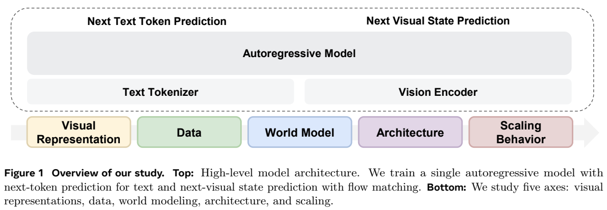
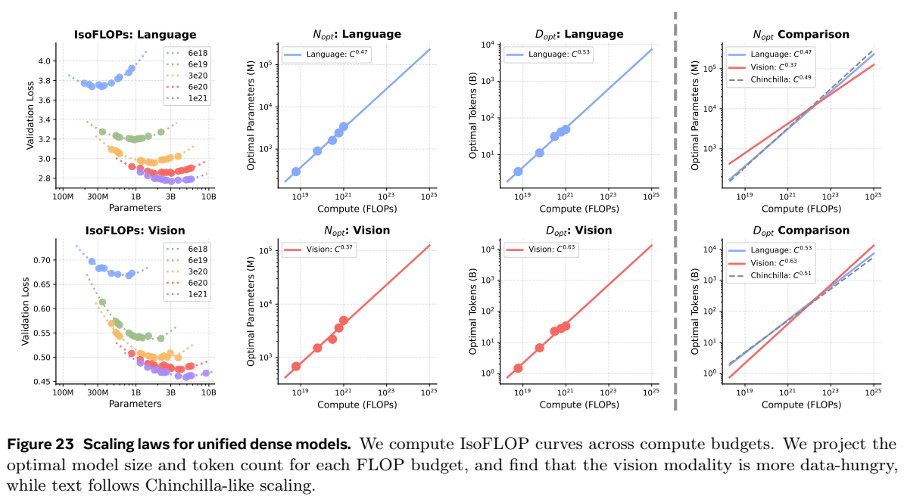
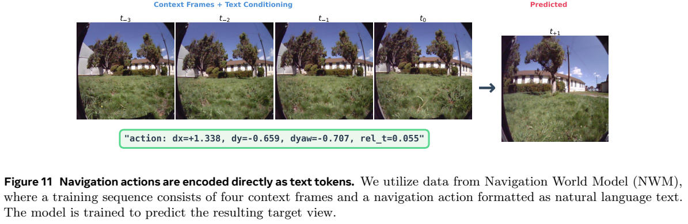
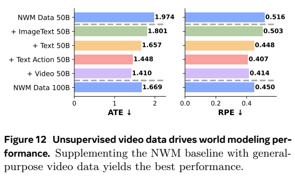
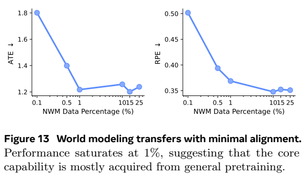
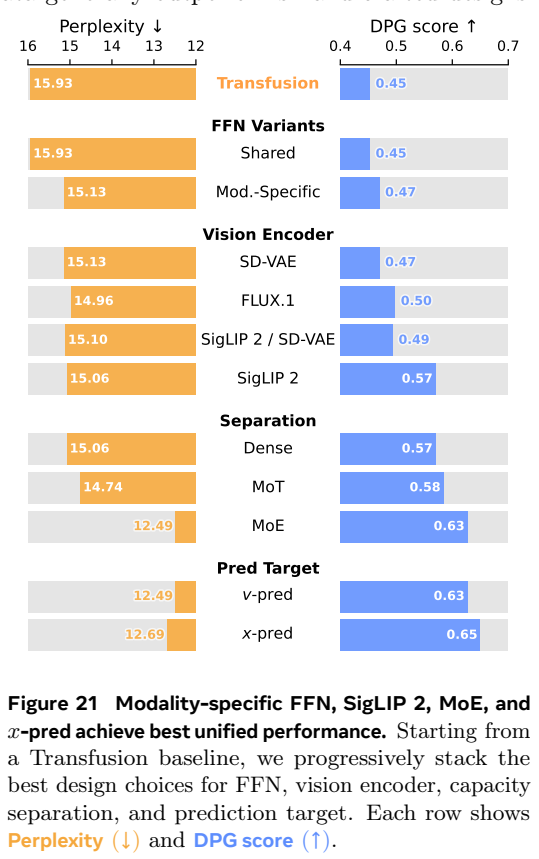

<!-- article-header:start -->
[项目首页](../../../README.md) › [模型系列](../../../reports/model-family-index.md) › [Beyond Language Modeling](../README.md)
<!-- article-header:end -->

# Beyond Language Modeling：从零统一预训练中的视觉表示、MoE与缩放不对称

> 对应 **Beyond Language Modeling: An Exploration of Multimodal Pretraining**，固定 [arXiv:2603.03276v1](https://arxiv.org/abs/2603.03276v1)。它是一组受控预训练研究，主要评估预训练后能力；VQA另有专门微调，不能把所有结果称为零样本。

<!-- article-toc:start -->
<a id="article-toc"></a>

**本篇目录** · [论文定位](#paper-info) · [快速概览](#overview) · [整体架构](#architecture) · [核心原理](#principles) · [数据构建](#data) · [训练流程](#training) · [实验结果](#experiments)
<!-- article-toc:end -->

<a id="paper-info"></a>

## 1. 论文信息与模型定位

| 项目 | 内容 |
|---|---|
| 机构 | FAIR、Meta与New York University |
| 作者 | Shengbang Tong、David Fan、John Nguyen等 |
| 日期 | 2026-03-03，v1 |
| 研究框架 | Transfusion式统一文字自回归与视觉flow matching |
| 默认骨干 | 从零训练decoder-only Transformer；2.3B总参数，1.5B/token激活 |
| 视觉表示 | 默认冻结SigLIP2 So400M＋已有RAE解码器 |
| 任务 | 文字建模、视觉理解、图像生成、未来视觉状态预测与导航规划 |
| 官方资源 | [PDF](https://arxiv.org/pdf/2603.03276v1) · [项目](https://beyond-llms.github.io/) |

与把已有LLM接上视觉投影的助手不同，本篇从随机初始化训练共享多模态Transformer，试图减少既有语言预训练对设计实验的干扰。“从零”指这个骨干，而视觉编码器、RAE/VAEs的解码器和BPE tokenizer仍来自已有资源；不能据此声称整个系统不使用任何预训练知识。它也不是以最终聊天排行榜竞争为主要目的，重点是控制计算、数据和结构后理解统一学习过程。[原文 §2.2](https://arxiv.org/pdf/2603.03276v1#page=5)

<a id="overview"></a>

## 2. 快速概览

四条结论组成研究主线。第一，具有语义的RAE表示能同时支持理解与生成，在本实验中优于低维VAE；因此不必先验设置理解用SigLIP、生成用VAE两条独立路径。第二，文字、原始视频和图文资料可以互补，视觉信息不必然明显破坏文字建模；但图像caption文字分布与普通文本不同，域外Notes困惑度仍可能变差。

第三，统一的下一视觉状态预测可承接世界模型任务：把动作写为普通文字数字，给定当前视觉历史预测下一帧，再用外部规划器搜索动作。一般视频预训练对导航实验帮助很大，只用少量导航领域数据即可接入动作语义，但这仍是已训练过相关数据的导航协议，并非无需动作对齐就能控制任意真实机器人。

第四，MoE能增加总容量而维持大致固定激活计算，路由自然出现文字、视觉和混合专家。等计算缩放实验显示稠密模型的视觉最优数据增长比文字更快，MoE将两种模态的指数差缩小。结果适用于原文预算、资料和表示，不能把拟合曲线当所有模型的通用硬件成本公式。[原文 §3–7](https://arxiv.org/pdf/2603.03276v1#page=17)

<a id="architecture"></a>

## 3. 整体架构



*来源：原文Figure 1，PDF第4页，[原页](https://arxiv.org/pdf/2603.03276v1#page=4)。同一骨干顶部同时预测离散文字和连续视觉状态；下方五轴是实验主题，不是五个独立模型模块。*

文字由LLaMA3 BPE编码，进入embedding；图像与视频逐帧经冻结视觉编码器变为连续latent，每帧以`<BOI>`/`<EOI>`包围。输入输出投影用简单线性层，避免加入U-Net额外结构。默认共享attention、按文字/视觉分别设置FFN，每个token只激活对应FFN：总参数2.3B，激活1.5B；后续MoE进一步让容量分配由学习路由决定。

混合attention保持跨帧与文字序列因果性，一张图或一帧内部的256个视觉token可双向attention。文字不能看未来，当前视觉帧可以读此前文字和帧。这样空间内部不是一个像素token接一个token生成，时间和模态序列则仍保持自回归。注意这是训练与推理mask设计，不能误写成整个序列双向。

推理时文字逐token解码；生成`<BOI>`后暂停文字，在上下文后加入纯噪声视觉latent，进行25步Euler去噪，再附`<EOI>`继续文字。RAE解码器将视觉latent恢复为像素。默认CFG=3.0，训练10%随机丢条件，没有为每项图像评测搜索最佳CFG。冻结语义编码器能保留已有理解特征，但视觉恢复质量仍依赖解码器与特征细节，论文附录发现深层语义提高时像素保真可能下降。[原文 §2.1、B、D.1](https://arxiv.org/pdf/2603.03276v1#page=31)

<a id="principles"></a>

## 4. 核心创新与数学原理

原文公式1是文字交叉熵：$`\mathcal L_{LM}=-\sum_i\log p_\theta(x_i\mid x_{\lt i})`$。公式2以干净latent $`z_0`$ 和标准高斯噪声 $`\epsilon`$ 构造

```math
z_t=(1-t)\epsilon+t z_0,\qquad t\sim U[0,1],
```
```math
\mathcal L_{flow}=\mathbb E\left[\Vert v_\theta(z_t,t,context)-(z_0-\epsilon)\Vert _2^2\right].
```

这里 $`t=0`$是噪声、$`t=1`$是干净latent，目标速度 $`z_0-\epsilon`$ 沿连接二者的路径。每张图/帧独立采样一个t，帧内所有token共享该t。训练调整高维表示的噪声调度，不能直接把它和离散图像token的下一词分类等同。公式3默认 $`\mathcal L=\mathcal L_{LM}+3\mathcal L_{flow}`$；x-pred对照直接预测干净状态，RAE与VAE的优劣并不相同。

RAE把已有语义encoder和像素decoder组成视觉表示系统。实验统一语言端看到的图像token为256：RAE/raw pixel的224输入使用14patch；附录Table4的VAE输入为256，原始32×32latent通过PixelUnshuffle(2)改成16×16、通道增四倍，输出再PixelShuffle。主文泛称所有帧224，附录给VAE256的更细配置，本文据具体表记录。这是空间重排，不能说压缩时丢弃四分之三latent数值。

MoE粒度原文公式4为 $`G=4d_{model}/d_{expert}`$。固定激活计算时增大G意味着使用更多小专家；G=1为16大专家、Top1，G=16为更细粒度，G=64理论1024专家、实现1008。粒度、总专家数和激活专家数是不同变量；稀疏扫描固定16激活、专家维512，总专家32→1008，总参数2.30B→51.46B，激活仅1.50B→1.53B。更大总参数仍增加储存、通信和路由压力，不能称真实训练完全无额外系统成本。

专家分析用归一化选择率 $`R_m^{(i)}=C_m^{(i)}/(N_m k)`$，再计算 $`S_i=(R_{text}^{(i)}-R_{image}^{(i)})/(R_{text}^{(i)}+R_{image}^{(i)})`$。$`S\gt 0.5`$表示文字选择率超过视觉三倍，$`S\lt -0.5`$相反；居中称混合专家。它是验证资料上的使用偏好，不是证明某专家专属储存某类知识。图像生成/理解路由相关 $`r\ge0.90`$支持共享视觉处理，不能据相关性证明每层计算完全相同。[原文 §6、E.8](https://arxiv.org/pdf/2603.03276v1#page=36)



*来源：原文Figure23/24，PDF第17页，[原页](https://arxiv.org/pdf/2603.03276v1#page=17)。左列U形曲线各颜色是同一计算预算，上行语言、下行视觉；右侧对数坐标直线含远超实测预算的外推。*

论文近似 $`C\approx6ND`$，MoE用激活N；固定C扫描模型N与训练tokenD，拟合对数参数空间的抛物线找 $`N_{opt}`$，再拟合 $`N_{opt}\propto C^a,D_{opt}\propto C^b,a+b=1`$。稠密语言a/b为0.47/0.53，视觉0.37/0.63；MoE为0.41/0.59与0.36/0.64。视觉偏向更快增长数据，MoE把数据指数差0.10降至0.05。百亿、万亿规模的数据需求倍率来自外推，不是实际训练了这些规模。辅助loss centering是附录单独对照，会改善DPG但略损PPL，不应说默认所有实验都用了它。

<a id="data"></a>

## 5. 数据构建与处理

资料四类：DCLM网页文字；YouTube-Temporal1B、SomethingSomethingV2、Kinetics等原始视频；MetaCLIP和内部Shutterstock图文；NWM与文本动作标注视频。视频默认1fps。动作写为如dx/dy/dyaw/rel_t的普通数字字符串，将视觉状态＋文字动作→未来视觉状态统一到同一序列，没有独立连续动作adapter。

MetaCLIP重描述使用Qwen2.5-VL-32B-Instruct，vLLM每节点8路tensor parallel，temperature0.6、top-p0.95、最多128token。caption强调具体主体、属性、动作与场景。约12M视频文字动作由模型描述相邻视频chunk之间的物理动作，再自反检查“是否动作”和“是否符合视频”。每段1–4上下文帧、1–4结果帧，减少只记固定帧数的捷径；自动验证仍不是逐条人工事实保证。

caption分布差异通过各100K样本、截断2000字符、Qwen3-Embedding-8B求文本embedding中心，再算中心cosine distance。MetaCLIP/重描述/SSTK到DCLM距离0.196/0.286/0.215。这是总体语义分布代理指标，不能解释为错误率；重描述有益VQA但不一定最保留文字困惑度，SSTK更利生成，所以进一步分配MetaCLIP用于I2T、SSTK用于T2I。[原文 §4.2、G](https://arxiv.org/pdf/2603.03276v1#page=39)

主要表示/数据研究约520B文字＋520B多模态token，与520B纯文字对照；它控制文字预算，却增加总训练token，不能一概说这些数据实验全部等总算力。固定总预算的设计叠加和IsoFLOP实验另有协议。专家分析1T混合为50%文字、25%视频、22.5%图文、2.5%动作。不同实验token数、混合和硬件不同，应逐实验读，不能合成一个万能最终训练配方。

<a id="training"></a>

## 6. 训练流程与目标

默认序列4096、128GPU、每卡batch4，约2M token/step；AdamW峰值 $`3\times10^{-4}`$、warmup1000step、cosine降至峰值5%。总step按对应token预算确定。基础Transformer从零训练，视觉encoder冻结，目标为文字CE与视觉flow；没有默认聊天SFT或RL阶段。报告未统一给所有实验GPU型号、总墙钟、weight decay和完整数值精度，不补造。

MoE稀疏扫描约57Btoken、27,248step，64张H200，16层、d_model2048、GQA32 query heads/8KV heads、全局512序列。总专家扫描固定Top16、专家维512。专家分析的1T模型与此短预算扫描要分开；每模态共享专家策略是一个对应模态始终激活专家加15路由专家，不是文字/视觉两共享专家对每个token同时激活。

VQA结果另在Cambrian-7M训练一轮，视觉冻结，64GPU、约1M token全局batch、峰值 $`10^{-5}`$；纯文字基线先只训练视觉adapter、峰值 $`2\times10^{-3}`$，再相同微调。因此平均VQA反映预训练初始化对相同后续任务的帮助，不是裸预训练模型直接测出来的零样本分数。

导航比例研究用200Btoken、128H100，基础25%文字、25%视频，其余50%图文/动作资料，扫描0.1%至25%导航资料。评测规划器CEM采样120个动作序列、8步/2秒视野，用预测终帧与目标的LPIPS挑前5条并平均动作，每例重复3次。规划器的搜索不属于训练RL，最终指标ATE/RPE越低越好。[原文 E、F](https://arxiv.org/pdf/2603.03276v1#page=37)

<a id="experiments"></a>

## 7. 实验设置与主要结果







*来源：原文Figure11–13，PDF第10页，[原页](https://arxiv.org/pdf/2603.03276v1#page=10)。上方四帧与动作条件预测右侧目标；下方ATE/RPE向左越好，右侧横轴领域数据比例不等距。*

导航50B领域数据ATE/RPE为1.974/0.516；直接扩大到100B为1.669/0.450。50B领域加50B原始视频达到1.410/0.414；加文字动作为1.448/0.407，故“原始视频两项都最好”不严谨：ATE最好是视频，RPE略优为文字动作。领域比例约1%后曲线饱和支持一般预训练可迁移，但自然语言指令rollout只是定性样例，未证明真实闭环导航可靠性。

表示对照中SigLIP2多模态预训练＋VQA微调平均40.3，纯文字初始化＋同类后续微调27.8；VAE、其它语义表示和raw pixel提升幅度不同。固定20B VQA加80B文字得37.9，加图文36.9，加视频36.1，均超过100B只VQA的35.7。这支持多样资料的价值，不能当所有领域资料扩展无效的普遍规则。



*来源：原文Figure21/22，PDF第16页，[原页](https://arxiv.org/pdf/2603.03276v1#page=16)。橙色PPL越低越好、蓝色DPG越高越好；图中数字已按原像素核验，不能从文本提取位置误配数值。*

设计叠加由共享FFN的PPL15.93/DPG0.45，经模态FFN15.13/0.47、SigLIP2为15.06/0.57，再MoE12.49/0.63；x-pred到12.69/0.65，生成提升同时PPL略变差。因此不能声称最后一步同时改善所有指标。WISE知识生成图显示语义表示与MoE较强，但仍是既定prompt/评分器下的成绩，不能证明完全真实的物理因果理解。

在 $`10^{21}`$FLOPs稠密等计算实验，统一模型DCLM PPL13.3对纯文字13.6，DPG0.622对T2I0.598，FID39.3对41.5；MoE统一PPL12.3对纯文字12.0，FID39.2对T2I39.8。MoE也有微小语言权衡，不是严格无损统一。不同latent视觉loss尺度不一致，跨encoder直接比diffusion loss绝对值无效。

范围限制包括未使用交错图文数据、没系统研究后训练RL、专家负载不均的硬件瓶颈、有限模型和计算预算。论文主要给机制与设计证据，不能把外推、单帧生成或自动动作caption当成已完成通用世界模型部署。本文未运行任何模型，所有数据和图像来自固定v1。

<!-- article-footer:start -->
---

[← 上一篇：Gemini 3.1 Pro](../../gemini/document-7cca3ca5d4d3/README.md) · [按发表时间浏览](../../../reports/paper-reading-guide.md#year-2026) · [下一篇：Omni-Diffusion →](../../omni-diffusion/arxiv-2603.06577/README.md)

[返回本篇目录](#article-toc) · [返回模型系列](../README.md)
<!-- article-footer:end -->
