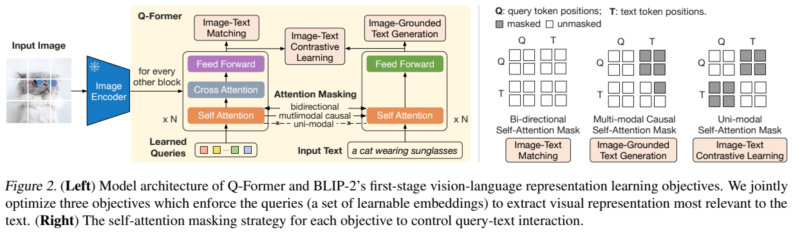
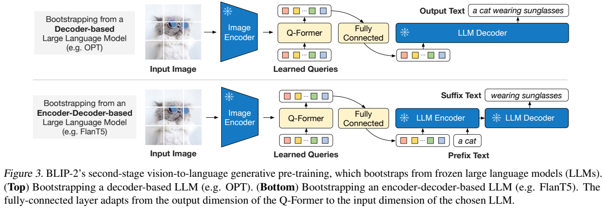
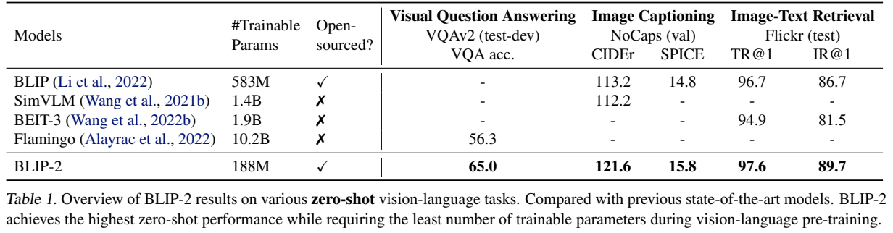
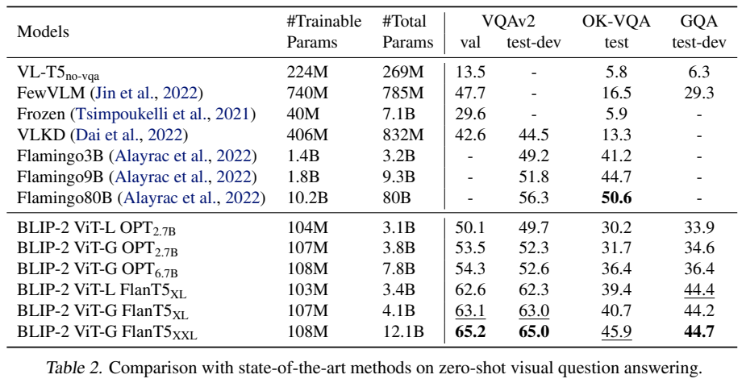
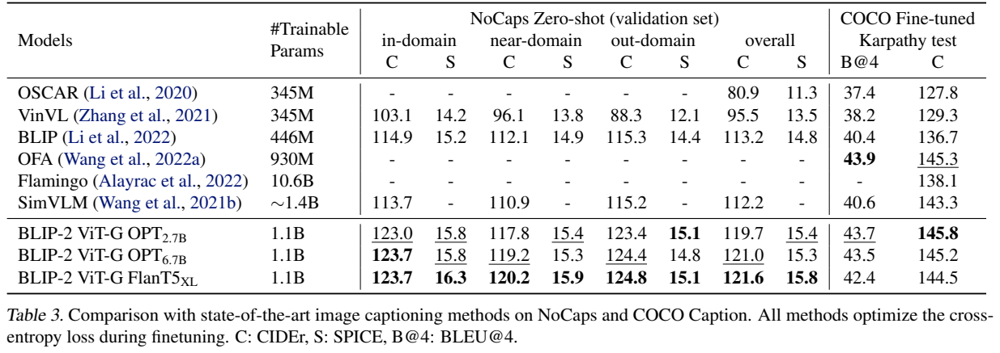
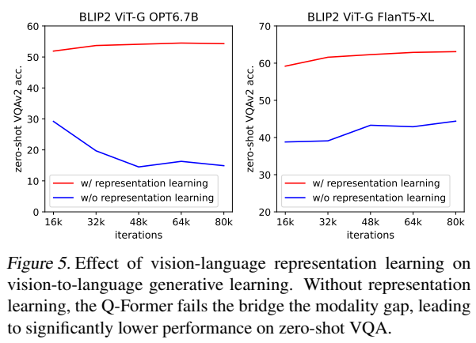
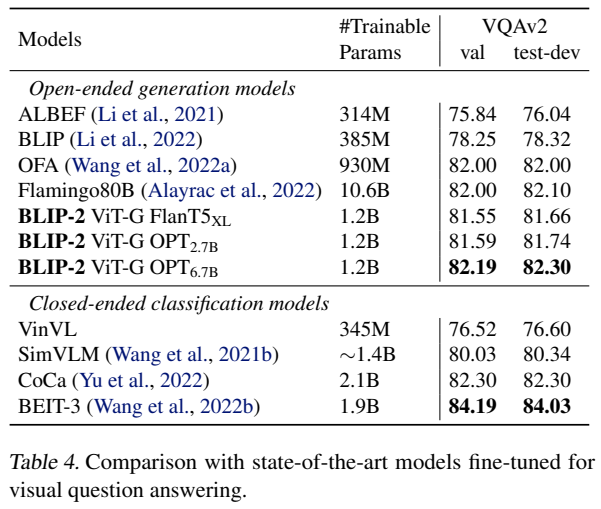

<!-- article-header:start -->
[项目首页](../../../README.md) › [模型系列](../../../reports/model-family-index.md) › [BLIP / xGen-MM](../README.md)
<!-- article-header:end -->

# BLIP-2：以 Q-Former 连接冻结视觉编码器和语言模型

> 采用 [arXiv:2301.12597v1](https://arxiv.org/pdf/2301.12597v1)。本文区分预训练与下游微调的冻结设置，配图为原文图表区域裁切。

<!-- article-toc:start -->

**本篇目录** · [论文定位](#paper-info) · [快速概览](#overview) · [整体架构](#architecture) · [核心原理](#principles) · [数据构建](#data) · [训练流程](#training) · [实验结果](#experiments)
<!-- article-toc:end -->

## 1. 论文信息与模型定位

| 项目 | 内容 |
|---|---|
| 论文题名 | BLIP-2: Bootstrapping Language-Image Pre-training with Frozen Image Encoders and Large Language Models |
| 作者与机构 | Junnan Li、Dongxu Li、Silvio Savarese、Steven Hoi；Salesforce Research |
| 发表与版本 | 2023-01-30；采用 arXiv v1，13 页 |
| 模型家族 | BLIP；本文关注 BLIP-2 的模块化图文预训练方法 |
| 视觉端 | CLIP ViT-L/14 或 EVA-CLIP ViT-G/14 |
| 语言端 | OPT 2.7B/6.7B，或 FlanT5 XL/XXL；对应完整系统规模见结果表，不能只按 LLM 档位计总量 |
| 新训练模块 | Q-Former，模型介绍给出 188M 参数；第二阶段还有映射到 LLM 嵌入维度的 FC 层 |
| 输入与输出 | 输入图片和文字提示，输出文字；检索使用第一阶段表示而不接 LLM |
| 官方资源 | [论文](https://arxiv.org/pdf/2301.12597v1) · [LAVIS 项目](https://github.com/salesforce/LAVIS/tree/main/projects/blip2) |

BLIP-2 的核心不是重新训练视觉和语言基础模型，而是学会让现成的两个模型协同。预训练时保持视觉编码器和 LLM 冻结，训练较小桥接模块来降低需更新的参数量；下游视觉问答、描述与检索微调则会更新视觉编码器，因此“冻结全部大模型”只适用于相应阶段。[原文 §§3–4](https://arxiv.org/pdf/2301.12597v1#page=3)

## 2. 快速概览

冻结 LLM 时，视觉表示不能仅因维度对齐就被理解。BLIP-2 让 Q-Former 先从图像中提取与文字相关的信息，再将这些信息转换为 LLM 的软视觉提示。它分两步解决问题：第一阶段学习“图像里哪些内容与描述有关”，第二阶段学习“如何把这些内容交给固定语言模型生成文字”。

第一阶段联合图文对比、图文匹配和图像条件文字生成，用同一模型但不同注意力掩码控制查询与文字交互；第二阶段接上 OPT 或 FlanT5，采用相应语言建模目标。32 个可学习查询把可变规模视觉特征压缩成固定输出，减少语言端需要接收的视觉序列。

报告展示零样本 VQA、图像描述、图文检索及指令生成案例。ViT-G＋FlanT5-XXL 在 VQAv2 test-dev 为 65.0，Flamingo80B 为 56.3，差为 8.7 个百分点。优势主要体现为预训练可更新参数较少与有效图文桥接；这不代表推理无需加载较大的冻结模型，也不代表开放知识任务和所有微调指标都领先。[原文 Tables 1–2](https://arxiv.org/pdf/2301.12597v1#page=6)

## 3. 整体架构

> 来源：Figure 2，v1 PDF 第 3 页，图表区域裁切。[来源](https://arxiv.org/pdf/2301.12597v1#page=3)。左图读视觉特征、查询、文本之间的连接；右图读各目标允许哪些位置互相注意。

Q-Former 包含共享自注意力层的两条使用路径：图像侧查询通过交叉注意力读取冻结视觉特征，文字侧既能编码文字也能生成文字。查询彼此用自注意力交换信息，交叉注意力每隔一个 Transformer block 插入一次。主体用 BERT-base 初始化，新增交叉注意力随机初始化；查询本身也属于训练参数。

| 组件 | 原文配置 | 作用 |
|---|---|---|
| 冻结 ViT | ViT-L/14 或 ViT-G/14；去掉末层，使用倒数第二层输出 | 提供图像 Patch 特征，不在预训练中更新 |
| 可学习查询 | 32 个，每个 768 维 | 从视觉表示中汇集与文字任务相关信息 |
| Q-Former | 188M；图文两条路径共享自注意力 | 将视觉信息压缩成 Z，输出尺寸 32×768 |
| FC 映射 | 从 768 维映射到所选 LLM 输入维度 | 让 Z 成为 LLM 可接收的软提示 |
| 冻结 LLM | decoder-only OPT 或 encoder-decoder FlanT5 | 利用视觉提示生成目标文字 |

原文举例 ViT-L 特征为 257×1024，而查询输出为 32×768。固定查询数意味着语言端前缀长度不随视觉 Patch 数直接增长；但信息瓶颈也可能漏掉细节，不能把压缩视为绝对无损。Q-Former 不是把图片离散成词表代码，而是输出连续向量，这与离散视觉 Token 自回归生成方法应区分。

> 来源：Figure 3，v1 PDF 第 4 页，图表区域裁切。[来源](https://arxiv.org/pdf/2301.12597v1#page=4)。顶部为视觉前缀＋decoder-only LLM；底部把视觉前缀与文字前缀送入 encoder，再由 decoder 生成后缀。

OPT 路径把 FC 后的查询特征拼到文字嵌入前，由 decoder 在其条件下生成整段文字；FlanT5 路径将训练文字分前缀和后缀，视觉特征与前缀交给 encoder，后缀作为 decoder 目标。因此二者并非只替换模型名称，训练输入和目标组织不同。[原文 §3.3](https://arxiv.org/pdf/2301.12597v1#page=4)

## 4. 核心创新与数学原理

**同一桥接模型中的三种信息约束。** ITC 图文对比要求图像和文字表示相互接近，同时与 batch 内负样本区分。对图像查询输出 Z 与文字 [CLS] 表示 t，作者先计算每个查询与 t 的相似度，再取最大值作为该图文对的相似度。可用解释性表达 $`s(I,T)=\max_j\mathrm{sim}(z_j,t)`$ 概括；此式是对正文操作的整理，不是报告编号公式。

ITC 的单模态掩码使查询和文字不能互看，避免在算相似度时提前泄漏配对信息。ITM 图文匹配则允许查询与文字双向交互，把各查询输出送入二分类器，再平均 logits 判断匹配与否，并挖掘较难负样本。它检查更细粒度的配对一致性，而不只是独立嵌入空间距离。

ITG 图像条件文字生成采用多模态因果掩码：查询能互看却不能读取目标文字；每个文字 Token 能读取全部查询与此前文字。由于文字不能直接跨注意力访问 ViT，生成所需信息必须先经过查询，再通过共享自注意力传到文字。这会迫使查询保存可用于语言生成的图像内容。文字首位改为 [DEC]，用来标示解码任务。[原文 §3.2、Figure 2](https://arxiv.org/pdf/2301.12597v1#page=3)

| 目标 | 查询能否看文字 | 文字能看到的内容 | 要解决的问题 |
|---|---|---|---|
| ITC | 不能 | 独立文字编码 | 配对表示对齐，防止互相泄漏 |
| ITG | 不能 | 查询＋此前文字 | 查询必须提供能生成描述的信息 |
| ITM | 能 | 双向图文交互 | 判断细粒度图文是否匹配 |

**以视觉软提示引导冻结 LLM。** 第二阶段可解释为 $`U=ZW+b`$，再把 U 接入语言端；这里 W、b 是 FC 参数，U 是语言模型嵌入维度的视觉前缀。优化通过冻结 LLM 的计算图传回桥接模块，冻结权重不等于阻断全部梯度传播。LLM 参数保持不动，桥接参数仍可学习让固定网络对图像条件做出合适响应。

生成目标可用标准阅读辅助 $`-\sum_t\log p(y_t\mid U,y_{\lt t})`$ 表示，FlanT5 则另以文字前缀作为 encoder 条件。报告没有给出这些表达的编号公式，本文也不补造三个目标的精确权重。关键在于先进行表示学习再接固定 LLM，而不是只靠最后一个生成损失一次跨过两种空间。

**把通用接口与下游任务适配分开。** VQA 微调时，问题还进入 Q-Former 的文字路径，查询通过自注意力获取问题条件，使交叉注意力能关注更相关区域；这不应被当作零样本预训练时每次都必然采用的设置。检索则直接使用第一阶段 Q-Former，无需生成型 LLM，从而利用同一表示学习框架的不同任务接口。[原文 §§4.3–4.4，第 7–8 页](https://arxiv.org/pdf/2301.12597v1#page=7)

## 5. 数据构建与处理

预训练沿用 BLIP 的 129M 图像集合，包含 COCO、Visual Genome、CC3M、CC12M、SBU 与 LAION400M 中的 115M 图像。129M 是图像规模，不是每阶段互不重复的新数据。网络描述质量参差不齐，作者采用 CapFilt 补充与筛选字幕：BLIP-large 为每张网络图像生成 10 条描述，把这些描述和原始网页文字一起用 CLIP ViT-L/14 相似度排序，保留前两条，每步随机抽其中一条。[原文 §3.4](https://arxiv.org/pdf/2301.12597v1#page=4)

| 用途 | 数据 | 处理与监督 |
|---|---|---|
| 两阶段预训练 | 129M 图像集合，含 115M LAION 子集 | 合成描述＋CLIP 排序；每图保留两条候选 |
| 描述微调 | COCO caption | 生成参考描述；再零样本迁移到 NoCaps |
| VQA 微调 | VQAv2 train＋val，以及 Visual Genome 训练问答 | 问题同时条件化 Q-Former 与 LLM |
| 图文检索微调 | COCO 图文 | 继续 ITC、ITM、ITG；迁移 Flickr30K |

预训练图片 224×224，使用随机尺寸裁剪和水平翻转。下游描述与检索分辨率为 364，VQA 为 490，分辨率随任务变化；不能用 224×224 泛指全部结果。字幕合成和排序提高可用监督密度，但 CLIP 相似分高不等于每个细节正确；论文没有给出完整人工核查误标率，本文不额外推断质量保证。

原文强调预训练样本每次只有单个图文对。这与后面缺乏多图上下文学习有关：模型未在这种数据中学习一段序列内多个图文示例的对应关系。因此，有效单图零样本迁移并不自动意味着具备图文 few-shot 学习。[原文 §5](https://arxiv.org/pdf/2301.12597v1#page=8)

## 6. 训练流程与目标

| 阶段 | 目的与目标 | 更新与冻结 | 原文规模设置 |
|---|---|---|---|
| 第一阶段 | ITC＋ITM＋ITG，学文字相关视觉表示 | 冻结 ViT；训练 Q-Former | 250K 步；ViT-L batch 2320、ViT-G batch 1680 |
| 第二阶段 | OPT 语言建模或 FlanT5 前缀语言建模 | 冻结 ViT 和 LLM；训练桥接部分 | 80K 步；OPT batch 1920、FlanT5 batch 1520 |
| 描述/VQA 微调 | 参考文字或答案生成 | 更新 Q-Former 和视觉编码器；LLM 冻结 | 各 5 epochs、学习率 1e-5，batch 分别 256/128 |
| 检索微调 | ITC＋ITM＋ITG | 无 LLM；更新 Q-Former 与视觉编码器 | 5 epochs、batch 224；ViT-L 学习率 5e-6、ViT-G 1e-5 |

预训练使用 AdamW，权重衰减 0.05，峰值学习率 1e-4，2000 步线性 warmup，随后余弦衰减，第二阶段最低学习率 5e-5。v1 正文把两个 AdamW 系数都排成 β1，数值是 0.9 与 0.98；本文记录排版问题，不将它当成两个不同 β1 的有效配置。下游表格分别明确了 β 参数，例如描述和 VQA 为 (0.9,0.999)。[原文 §3.4、Appendix Tables 7–9](https://arxiv.org/pdf/2301.12597v1#page=12)

冻结 ViT 与 OPT 使用 FP16，FlanT5 使用 BF16；作者报告与 FP32 相比未观察到性能退化。最大 ViT-G＋FlanT5-XXL 在一台 16×A100 40GB 机器上，第一阶段少于 6 天，第二阶段少于 3 天。这是指定配置的训练测量，不能直接换算成“所有 BLIP-2 都只需九天”，也不代表冻结模型不占显存。

训练参数统计需谨慎：完整 Q-Former 介绍和 Table 1 为 188M，Table 2 第二阶段不同模型写 103M–108M；下游表由于解冻视觉端可达到 1.1B–1.2B。原文未在上述结果表统一解释各口径的部件差异，本文保留各表数值与阶段身份。54 倍比较使用 10.2B 与 188M 的预训练概览口径，不能同时改成 108M 后继续称 54 倍。

## 7. 实验设置与主要结果

零样本 VQA 不使用目标任务标注微调，OPT 的提示为 Question/Answer，FlanT5 为 Question/Short answer；beam size=5、length penalty=-1，以较短答案匹配标注。下游微调后的 VQA 和描述是另一个实验设置，不应混到同一零样本排名。

> 来源：Tables 1、2，v1 PDF 第 6 页，图表区域裁切。[来源](https://arxiv.org/pdf/2301.12597v1#page=6)。Table 2 同时列可训练和总参数，VQAv2 val/test-dev 两列不同。

| 配置 | VQAv2 test-dev | OK-VQA test | GQA test-dev |
|---|---:|---:|---:|
| Flamingo80B | 56.3 | 50.6 | — |
| BLIP-2 ViT-G＋OPT2.7B | 52.3 | 31.7 | 34.6 |
| BLIP-2 ViT-G＋FlanT5 XL | 63.0 | 40.7 | 44.2 |
| BLIP-2 ViT-G＋FlanT5 XXL | 65.0 | 45.9 | 44.7 |

XXL 的 VQAv2 比 Flamingo80B 高 8.7 个百分点，OK-VQA 却低 4.7 个百分点。论文把后一差距解释为知识密集问题更依赖语言端知识，这是作者假设，不能只凭该表证明唯一因果。ViT-L 到 ViT-G、同语言家族扩规模通常改善结果，但 GQA 某些配置差异并不严格单调，应逐项读取。

> 来源：Figure 5、Tables 3、4，v1 PDF 第 7 页，图表区域裁切。[来源](https://arxiv.org/pdf/2301.12597v1#page=7)。红线先做表示学习，蓝线省去该阶段；表中的 NoCaps 是 COCO 微调后的零样本迁移。

Figure 5 是核心阶段消融：省略第一阶段会使两类 LLM 的零样本 VQA 明显下降，OPT 随训练还继续退化。由于 LLM 权重冻结，这不能被解释为 LLM 权重被更新后遗忘；观察针对的是整套系统在桥接训练中的任务能力。结果支持表示学习先行有助于固定 LLM 读懂视觉前缀。

描述微调后，ViT-G＋FlanT5 XL 在 NoCaps overall CIDEr 为 121.6、SPICE 为 15.8，COCO CIDEr 为 144.5；OPT2.7B 的 COCO 为 145.8，说明任务最佳组件选择并不完全一样。微调 VQA 的 OPT6.7B test-dev 为 82.30，开放生成类中超过 Flamingo80B 的 82.10，却低于闭集 BEIT-3 的 84.03，且任务形式不同。[原文 Tables 3–4](https://arxiv.org/pdf/2301.12597v1#page=7)

检索采用第一阶段模型在 COCO 微调，先以特征相似度选 128 个候选，再用 ITM 重排。ViT-G 在 Flickr30K 1K test 的图到文 R@1 为 97.6、文到图 89.7；COCO 5K test 则为 85.4、68.3。Table 6 中加入 ITG 将 COCO 两方向 R@1 从 84.5/67.2 提到 85.4/68.3，提供生成监督改善检索表示的证据。[原文 Tables 5–6](https://arxiv.org/pdf/2301.12597v1#page=8)

这些结果支持冻结基础模型加可训练桥接的有效性，但指令案例不是完整可靠性评测。原文也报告多图示例未改善 VQA、视觉知识和推理可能错误，未来训练数据与骨干变化都可能影响结果；本文依据 v1 解释方法，不将当年的分数当作当前排名。

<!-- article-footer:start -->
---

[← 上一篇：MultiInstruct](../../multiinstruct/arxiv-2212.10773/README.md) · [按发表时间浏览](../../../reports/paper-reading-guide.md#year-2023) · [下一篇：Kosmos-1 →](../../kosmos/arxiv-2302.14045/README.md)

[返回本篇目录](#article-toc) · [返回模型系列](../README.md)
<!-- article-footer:end -->
