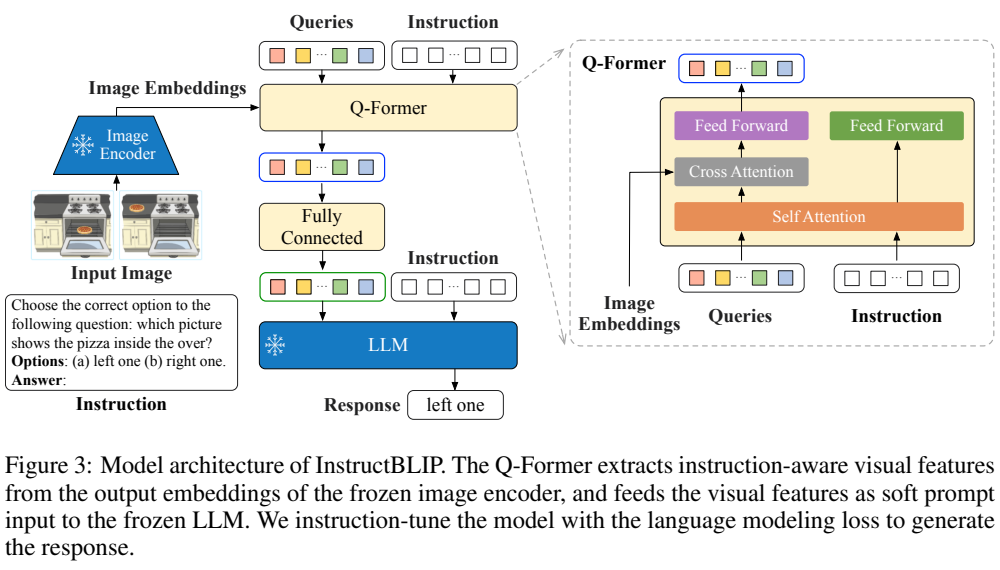
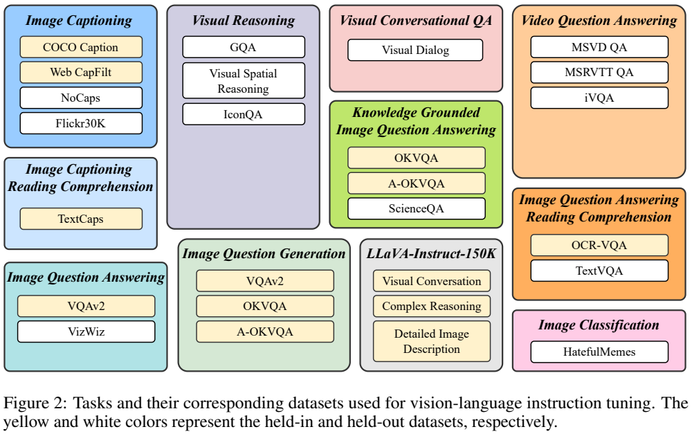
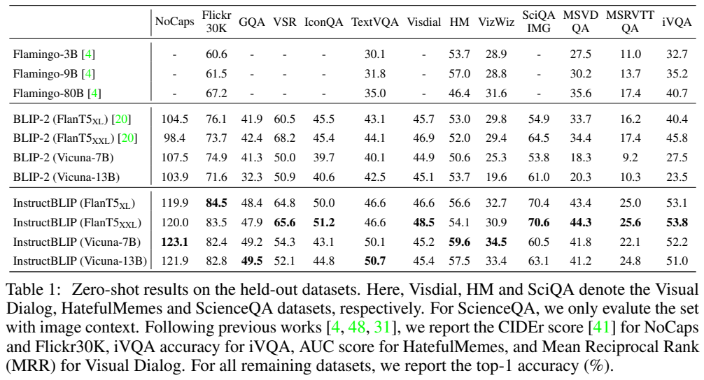
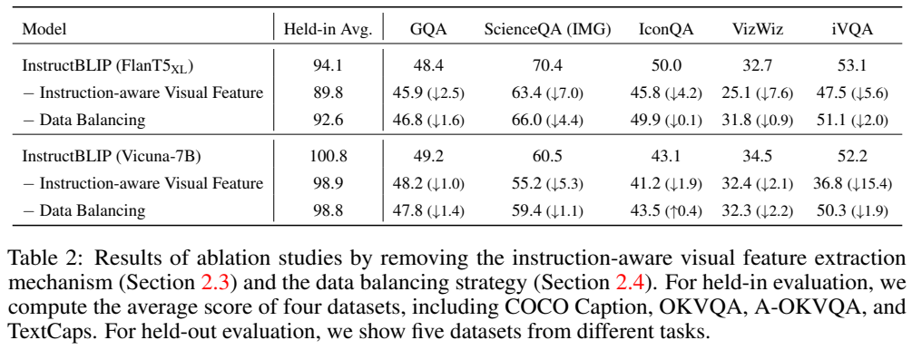

<!-- article-header:start -->
[项目首页](../../../README.md) › [模型系列](../../../reports/model-family-index.md) › [BLIP / xGen-MM](../README.md)
<!-- article-header:end -->

# InstructBLIP：让视觉查询先理解指令，再读取图像

> 基于 [arXiv:2305.06500v1](https://arxiv.org/pdf/2305.06500v1)。图片是固定版本原文图表裁图；原文采样公式忠实保留，其他公式为机制解读。未运行模型。

<!-- article-toc:start -->

**本篇目录** · [论文定位](#paper-info) · [快速概览](#overview) · [整体架构](#architecture) · [核心原理](#principles) · [数据构建](#data) · [训练流程](#training) · [实验结果](#experiments)
<!-- article-toc:end -->

## 1. 论文信息与模型定位

| 项目 | 内容 |
|---|---|
| 论文题名 | InstructBLIP: Towards General-purpose Vision-Language Models with Instruction Tuning |
| 作者与机构 | Wenliang Dai、Junnan Li、Dongxu Li 等；Salesforce Research、HKUST、南洋理工大学 |
| 日期与采用版本 | 2023-05-11，arXiv v1 |
| 所属家族 | BLIP；由预训练 BLIP-2 扩展视觉指令能力 |
| 模型分支 | ViT-g/14 + FlanT5-XL(语言3B)、FlanT5-XXL(语言11B)、Vicuna-7B/13B；完整模型规模与语言骨干口径不同 |
| 输入输出 | 图片、文字指令，评测时也可输入视频抽样帧 → 文本或候选答案排序 |
| 官方资源 | [LAVIS InstructBLIP](https://github.com/salesforce/LAVIS/tree/main/projects/instructblip)；论文说明全部模型开放 |

InstructBLIP 主要研究参数受限的视觉指令学习及未见任务泛化，不从零预训练新视觉或语言骨干。其语言端既有 encoder-decoder 的 FlanT5，也有 decoder-only 的 Vicuna，不能把全部模型统称为同一解码结构。论文中“FlanT5-XL 3B”是语言部分，正文比较时称包含视觉组件的最小模型约4B，两个数值不冲突。[§2.6、§3.1](https://arxiv.org/pdf/2305.06500v1#page=6)

## 2. 快速概览

同一张图可能要求识字、描述、空间判断或回答常识问题，固定视觉摘要未必保留当前任务最需要的信息。BLIP-2 的 Q-Former 先读取图像，再将结果交给语言模型；若问题只在后面的语言模型出现，前面压缩视觉信息时无法知道需要关注哪一细节。InstructBLIP 将指令同时输入 Q-Former 与语言模型，使视觉查询在提取特征前就能与任务文字交互。

数据侧把多个公开视觉语言任务转成自然语言指令，训练时学习任务描述与响应形式，而不仅是数据集名称。采用13个held-in数据集训练、13个held-out数据集评估，另外完整留出视觉推理、视频问答、视觉对话和图像分类四类任务。训练只更新 Q-Former，冻结图像编码器与语言模型，以较少可训练参数利用现成主干。

实验显示这类指令学习的收益主要体现在未见任务上：FlanT5-XL 在 ScienceQA 图像子集的零样本准确率从54.9到70.4，在MSRVTT-QA从16.2到25.0。不过不是每个骨干每个指标都提高，例如 FlanT5-XXL 的 VSR 从68.2到65.6，Vicuna-13B 的 Visual Dialog MRR 从45.1到45.4，仅小幅变化。更准确的结论是整组模型在该表多个任务上提高了可达到的最佳成绩，而非所有版本全指标一致提升。[Table 1](https://arxiv.org/pdf/2305.06500v1#page=6)

## 3. 整体架构

> Figure 3，v1 PDF第4页；[原页](https://arxiv.org/pdf/2305.06500v1#page=4)。上方完整架构展示冻结模块、查询和指令路径。

左侧图像编码器输出图像embedding。可学习queries与指令token共同进入Q-Former，通过self-attention交换信息；queries再经cross-attention读取视觉特征。查询输出经过Fully Connected映射为语言模型的soft prompt，和原始指令一起输入冻结LLM，输出回答。图右侧放大结构显示，图像cross-attention属于query路径，不能描述为指令token本身全部直接对图像做相同cross-attention。

| 模块 | 输入输出 | 本篇训练作用 |
|---|---|---|
| ViT-g/14 | 图像 → 密集图像embedding | 冻结，为不同指令提供相同底层视觉特征 |
| Q-Former | queries、指令、图像embedding → 指令相关查询特征 | 主要可训练模块，负责选择和压缩视觉信息 |
| 维度映射 | 查询特征 → LLM可读soft prompt | 接续BLIP-2接口；图中标Fully Connected |
| FlanT5 / Vicuna | soft prompt与指令 → 回答 | 指令训练时冻结，读取已有语言知识与响应能力 |

“指令感知”发生在Q-Former，而不是让冻结ViT按每个问题重做一次权重更新。图像编码结果可以相同，问题改变后query如何汇聚这些结果会变化。soft prompt是连续特征，不是先把图片强制译成一段描述再输入语言模型。报告没有在本篇逐层重新列出所有BLIP-2查询尺寸，不能凭其他版本源码补出未核验数字。[§2.3](https://arxiv.org/pdf/2305.06500v1#page=5)

视频评测均匀抽四帧，每帧独立经图像编码器与Q-Former，再拼接查询输出交给LLM。这是用图像接口迁移到视频任务；论文没有新增专门视频编码器或声称掌握连续所有帧。多帧信息包含事件线索，但四帧抽样仍可能遗漏短时动作。[§2.5](https://arxiv.org/pdf/2305.06500v1#page=6)

## 4. 核心创新与数学原理

**问题先进入视觉读取过程。** 用解读表达把两步区分：

$$
Q_s=\mathrm{SelfAttn}(Q,S),\qquad
Z_s=\mathrm{CrossAttn}(Q_s,F_I).
$$

Q是学习查询，S是指令token，FI是冻结视觉特征，Zs是适配指令的视觉提示。这只是图3机制的简化示意，不是论文编号公式，也省略了多层交互、残差和FFN。关键在于Z会随指令变化，而非所有问题共享同一个最终视觉压缩。标准cross-attention对视觉值按相似性加权，因此指令能通过改变query表示，改变所保留的视觉信息。

**数据平衡使用平方根平滑。** 原文§2.4给出的采样概率是：

$$
p_d=\frac{\sqrt{S_d}}{\sum_{i=1}^{D}\sqrt{S_i}}.
$$

Sd为第d数据集训练样本量，D为数据集数。这是先选数据集的概率，不是每一条样本都以同一个pd独立出现。相比按样本量正比选集，它减少大数据集主导；相比各数据集均匀，它仍给予大数据集更多更新。比如两集规模比100:1，平滑后的选集比为10:1；该例是对公式的解读，非论文实验数字。原文还手工降低A-OKVQA多选权重、提高OKVQA权重，最终配比不完全由这一公式唯一决定。

**候选答案按语言概率排序。** 对分类和多选，采用候选词表约束与候选log-likelihood比较，可简化写为：

$$
\hat a=\arg\max_{a\in\mathcal A}\log p_\theta(a\mid I,s).
$$

A是候选集合。这是§2.5的解读式，不能自行补出长度归一化等报告未披露策略。自由生成与候选排序是不同推理协议；二元分类还扩展正负词语集合，例如yes/true与no/false，以更充分聚合相关语言概率。较好的选择题成绩不一定等于开放问题能同样精确作答。[§2.4–2.5](https://arxiv.org/pdf/2305.06500v1#page=5)

## 5. 数据构建与处理

> Figure 2，PDF第3页；[原页](https://arxiv.org/pdf/2305.06500v1#page=3)。黄色是参与指令训练，白色是held-out；彩色外框仅表示任务类别。

图中有问答、反向问题生成、描述、文字阅读、知识问答等11类任务。复用数据集做另一任务意味着“数据集/任务组合”和“唯一数据源”不同；原文摘要、贡献、§2.2均写26个、13+13划分，而§2.1一处写28个，本文保留这一版本的不一致，以训练评测协议的13+13为主，不自行构造一个不存在的统一精确计数。

| 训练来源示例 | 原文规模与单位 | 指令化方式 |
|---|---|---|
| COCO Caption | Karpathy split：82K/5K/5K图像 | 给定图片生成描述 |
| Web CapFilt | 14M图文对 | 网络图文及BLIP合成描述 |
| TextCaps | 21K/3K/3K图像 | 阅读图片文字再描述 |
| OCR-VQA | 800K/100K/100K样本 | 阅读图内文字回答问题 |
| OKVQA、A-OKVQA | 前者9K/5K；后者17K/1K/6K问题 | 知识问答、多选、反向提问等 |
| LLaVA-Instruct-150K | 表中分项23K描述、77K推理、58K对话 | 原本已是指令格式，不再添加模板 |

以上按附录C口径记录，不把图像数和QA数相加为“总样本”；LLaVA名称150K与表中分项合计也属于源数据命名及取整口径，不能据此声称严格150000条。每个任务设计10–15种自然语言模板，训练均匀抽模板；对偏短答案任务，部分模板明确要求short/briefly，让短回答成为指令条件，而不是所有场景默认短输出。包含场景文字的任务还在指令中补充OCR tokens，相关阅读结果不应误标为纯端到端OCR-free。[§2.1、附录C–D](https://arxiv.org/pdf/2305.06500v1#page=16)

held-out既包括同类任务但新数据集，也包括整个任务类别未参加指令训练。作者说明避免跨数据集评测条目落入held-in训练集；这个检查范围不能扩大成从未出现在图像编码器、语言模型或BLIP-2全部预训练中的严格保证。原报告没有公开所有基础预训练数据逐项匹配的审计结果。

## 6. 训练流程与目标

初始化来自BLIP-2检查点；Vicuna因原BLIP-2未包含此语言骨干，先按BLIP-2方式进行相应预训练。随后混合held-in任务做指令学习，只更新Q-Former，冻结ViT与LLM。监督目标为输出参考回答的语言建模损失，可用标准解读式：

$$
\mathcal L=-\sum_t\log p_\theta(y_t\mid Z_s,s,y_{<t}).
$$

θ主要对应可训练Q-Former参数；冻结LLM仍向soft prompt传递梯度。FlanT5具有encoder-decoder结构，这个条件概率式概括输出生成目标，不把它改成Vicuna的内部decoder-only实现。论文没有为这一步新增RL奖励或DPO目标。[§2.6](https://arxiv.org/pdf/2305.06500v1#page=6)

| 设置 | 原文数值 |
|---|---|
| 最大训练步数 / 验证间隔 | 60K / 每3K步；各版本选单个最佳checkpoint用于全部评测 |
| Batch | 语言3B为192；7B为128；11B/13B为64 |
| 优化器 | AdamW，β1=0.9、β2=0.999，weight decay0.05 |
| 学习率 | 初始1K步由10⁻⁸升到10⁻⁵，此后余弦降到0 |
| 图像与硬件 | 224×224；16张NVIDIA A100 40GB；报告称两天内完成 |
| 下游微调 | 继续冻结图像编码器，可训练参数约188M；该处与原先更新视觉端的1.2B口径比较 |

“两天内”是作者该配置下的训练时间，不包含全部BLIP-2或语言骨干从零预训练，也不是本次仓库实测。下游任务微调与通用指令模型零样本评测是不同阶段，应分别记录，尤其ScienceQA的90.7%不能与零样本70.6%混用。

## 7. 实验设置与主要结果

> Table 1，PDF第6页；[原页](https://arxiv.org/pdf/2305.06500v1#page=6)。NoCaps/Flickr30K为CIDEr，Visual Dialog为MRR，HatefulMemes为AUC，其余多为准确率，不能全部称百分比。

| held-out指标 | BLIP-2 FlanT5-XL | InstructBLIP FlanT5-XL | 变化 |
|---|---:|---:|---|
| NoCaps CIDEr | 104.5 | 119.9 | +15.4分数点 |
| GQA Accuracy | 41.9 | 48.4 | +6.5个百分点 |
| ScienceQA IMG Accuracy | 54.9 | 70.4 | +15.5个百分点 |
| MSRVTT-QA Accuracy | 16.2 | 25.0 | +8.8个百分点 |
| iVQA Accuracy | 40.4 | 53.1 | +12.7个百分点 |

视频任务未出现在指令训练中，四帧拼接仍取得较好表现，支持视觉指令能力迁移；不能由此断言无需时间建模就能解决所有视频推理。不同语言骨干也有明显差异：FlanT5-XXL的ScienceQA70.6高于Vicuna13B63.1，Vicuna13B的TextVQA50.7高于FlanT5-XXL46.6。语言骨干的原始指令任务分布影响后续结果，规模并非唯一原因。

> Table 2，PDF第7页；[原页](https://arxiv.org/pdf/2305.06500v1#page=7)。每个移除项均与对应完整模型比较。

FlanT5-XL移除指令感知后ScienceQA从70.4降到63.4、VizWiz从32.7降到25.1；Vicuna7B的iVQA从52.2降到36.8。它直接支持让视觉读取受问题影响的机制。移除数据平衡也多处下降，但Vicuna7B的IconQA从43.1升到43.5，因此“平衡改善所有任务”过强。held-in平均分混合不同指标，且与Figure4的平均任务集合不同，不能作为统一准确率。

下游微调Table3中FlanT5-XXL的ScienceQA IMG为90.7、OCR-VQA73.3，均高于对应BLIP-2的89.5/72.7；OKVQA55.5仍低于PaLM-E562B的66.1。Figure4控制训练设置，指令学习的held-out平均52.9高于多任务方案约45.5–46.8，而held-in接近，说明自然语言任务条件主要改善迁移。论文的贡献是把指令作用提前到视觉信息选择，并提供训练/未见任务分开的证据；冻结主干、固定图像分辨率和稀疏视频帧仍限制细粒度阅读与连续动作理解。[§3.4–3.5、Table3](https://arxiv.org/pdf/2305.06500v1#page=9)

<!-- article-footer:start -->
---

[← 上一篇：VideoChat](../../videochat/arxiv-2305.06355/README.md) · [按发表时间浏览](../../../reports/paper-reading-guide.md#year-2023) · [下一篇：VisualGLM-6B →](../../glm/document-4d81507404ce/README.md)

[返回本篇目录](#article-toc) · [返回模型系列](../README.md)
<!-- article-footer:end -->
