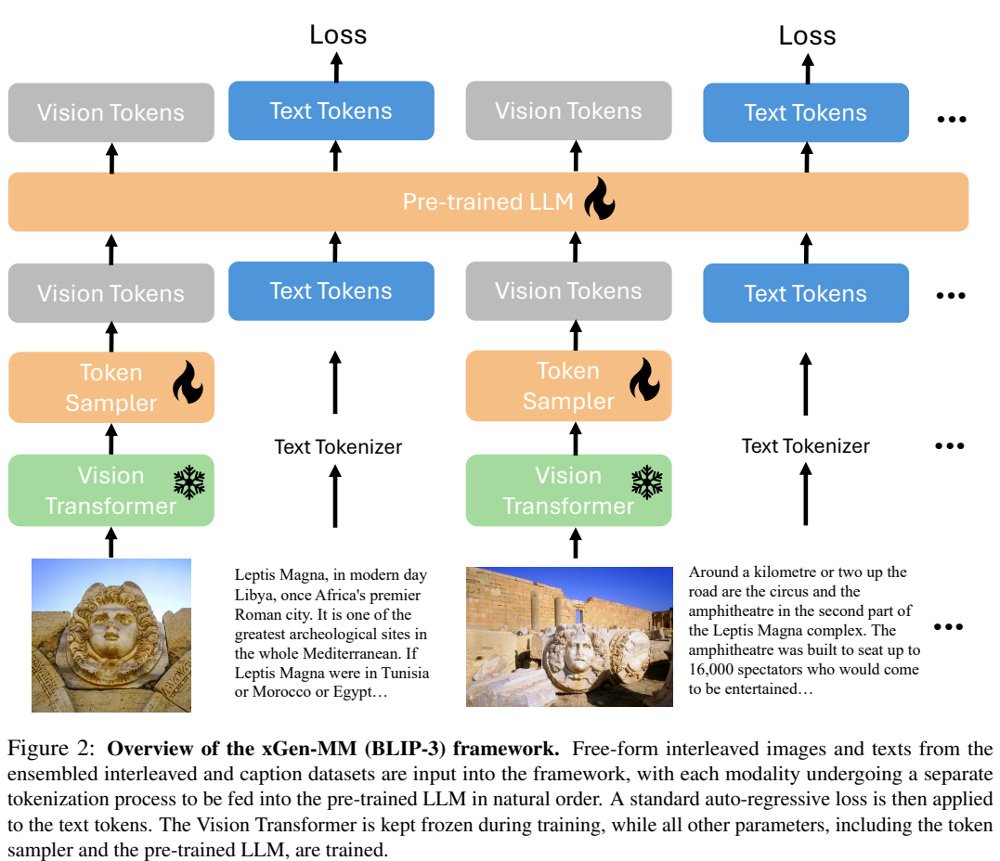
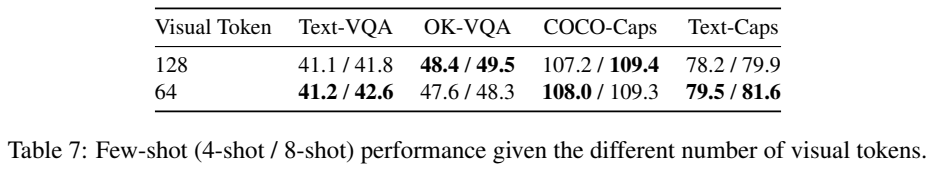
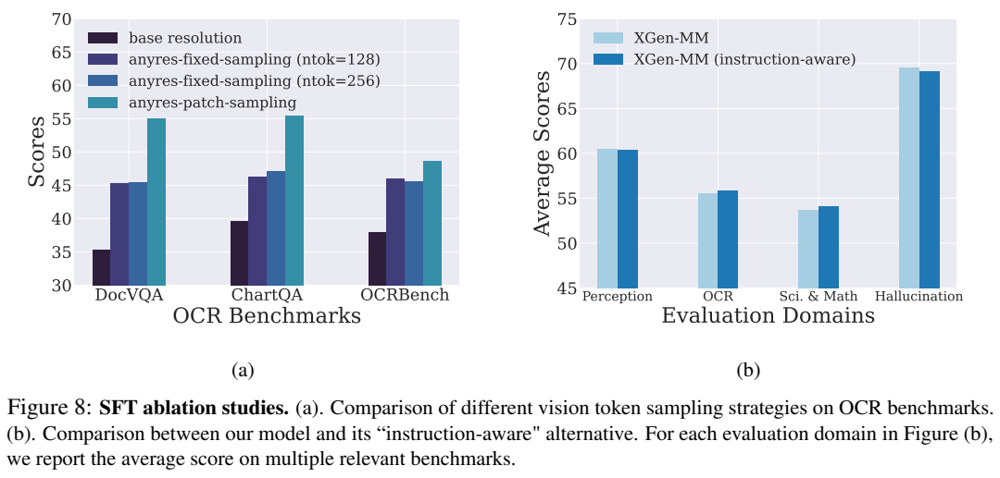
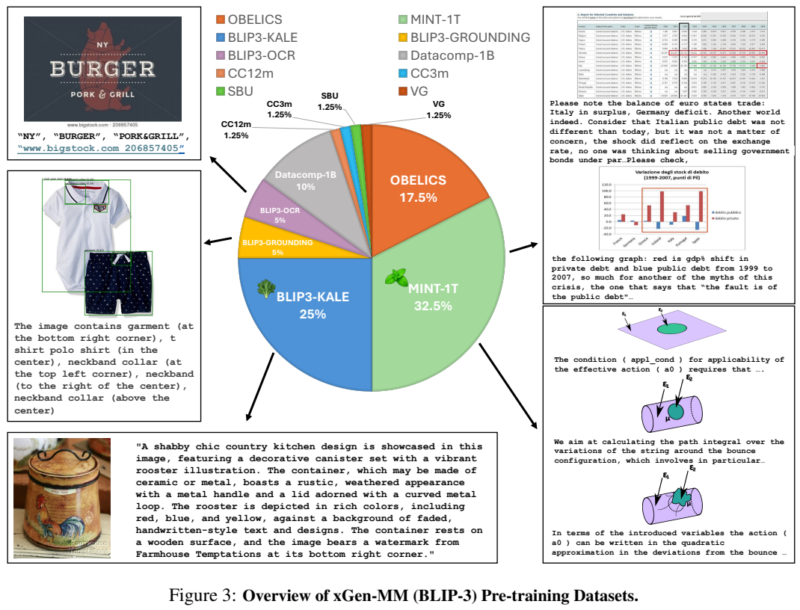
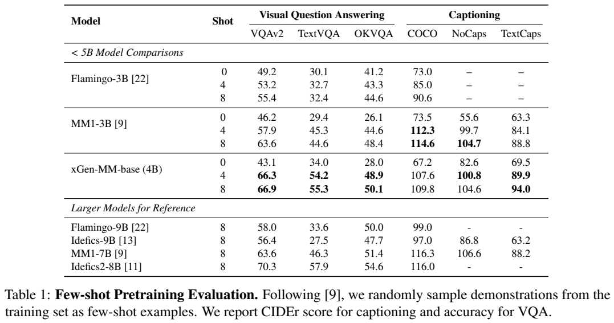
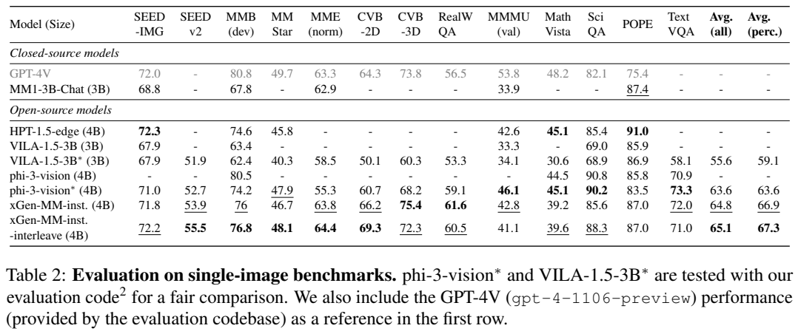

<!-- article-header:start -->
[项目首页](../../../README.md) › [模型系列](../../../reports/model-family-index.md) › [BLIP / xGen-MM](../README.md)
<!-- article-header:end -->

# xGen-MM（BLIP-3）：交错图文预训练与逐块视觉采样

> 解读版本固定为 [arXiv:2408.08872v1](https://arxiv.org/abs/2408.08872v1)。原图以完整 PDF 页面呈现；本文公式用于解释已披露机制，不冒充原文编号公式。

<!-- article-toc:start -->
<a id="article-toc"></a>

**本篇目录** · [论文定位](#paper-info) · [快速概览](#overview) · [整体架构](#architecture) · [核心原理](#principles) · [数据构建](#data) · [训练流程](#training) · [实验结果](#experiments)
<!-- article-toc:end -->

<a id="paper-info"></a>

## 1. 论文信息与模型定位

| 项目 | 内容 |
|---|---|
| 原题 | xGen-MM (BLIP-3): A Family of Open Large Multimodal Models |
| 机构 | Salesforce AI Research、University of Washington |
| 首次提交 | 2024-08-16，本文使用 v1 |
| 语言骨干 | Phi3-mini；主结果以约 4B 模型展示 |
| 视觉路径 | SigLIP 视觉 Transformer 加 Perceiver Resampler |
| 输入输出 | 单图、多图、自由交错图文；输出文字回答和描述 |
| 模型系列 | base、单图 instruct、多图 instruct-interleave、含 DPO 和安全微调的模型 |
| 资源 | [固定版本 PDF](https://arxiv.org/pdf/2408.08872v1) · [官方代码分支](https://github.com/salesforce/LAVIS/tree/xgen-mm) |

这是 BLIP 技术线的视觉语言理解模型与训练框架，重点是把可扩展数据、视觉压缩和对话训练组合起来。它没有提出图像生成解码器，也不应与名称接近的 BLIP3-o 混为同一篇。作者将视觉骨干与语言模型连接，以文本输出解决问答、描述、OCR 和多图理解；公开资源包括模型、数据建设成果及微调代码，但 v1 仍未披露每个训练阶段的全部优化器与算力配置。[原文摘要、§3–5](https://arxiv.org/pdf/2408.08872v1#page=3)

<a id="overview"></a>

## 2. 快速概览

BLIP-2 通过 Q-Former 建立图像与语言连接，并使用图文对比、匹配和生成等多个目标。xGen-MM 的策略是简化连接与预训练目标：用 Perceiver Resampler 把视觉特征采样为较短序列，把图像 token 和文字 token 按网页或文档原顺序交错，再只在文字位置进行自回归预测。这样可以直接利用复杂多图文档，而不把所有材料都改写成一张图对应一句话。

架构简化的收益与数据扩展相结合。模型实际预训练约 100B 多模态 token，数据既有 HTML/PDF/arXiv 交错文档，也有详细描述、OCR 与定位标注。之后引入高分辨率分块，使小字和图表细节进入视觉编码器；每个块单独采样，避免将全部块压成同样少量 token。再用单图 SFT、多图 SFT 和偏好/安全训练逐步调整使用行为。

论文最有信息量的结果不是一个综合平均分，而是三个对照：base 在四/八样例提示下明显改善；单图微调后的模型需要多图 SFT 才恢复更强的多图能力；逐块采样在 OCR 消融中优于把全图块合并后统一压缩。它们共同说明，结构上“能够接收多张图”并不自动保证最终模型能可靠比较多张图，输入表示与训练分布必须同时覆盖任务。[原文 §6–7](https://arxiv.org/pdf/2408.08872v1#page=9)

<a id="architecture"></a>

## 3. 整体架构



*来源：原文 Figure 2，PDF 第 3 页；[原页](https://arxiv.org/pdf/2408.08872v1#page=3)。雪花代表冻结，火焰代表更新。*

从下向上读 Figure 2，每张图先通过绿色 Vision Transformer 得到视觉特征，橙色 Token Sampler 将其压缩。文字走单独的 tokenizer。两种 token 依照原始图文顺序进入同一个预训练语言模型，而不是将所有图像统一摆在文字前面；损失箭头只画在蓝色文字位置，视觉 token 是上下文条件。

主架构由 ViT、Perceiver Resampler、Phi3-mini 构成。Figure 2 明确标示 ViT 冻结、sampler 和语言模型训练；这是主预训练框架的参数更新说明。后面的 DPO 和安全微调采取 LoRA 更新部分语言权重，不能照搬这张图解释所有后训练阶段都全量更新。

高分辨率处理用于 SFT 与后训练。图像切为多个局部块，各块独立编码，同时保留一张缩小后的完整图像，提供全局场景。之后每个局部块和整图都单独经过 resampler，将输出串联为语言端视觉输入。该方式让输入预算随块数增加，保留细节；“any-resolution”并不表示视觉 token 数永远固定，也不表示不做缩放和分块。

原文称 sampler 可将视觉 token 缩短五倍或更多，取决于查询数量。这里应区分视觉骨干的 patch、送给 sampler 的高维 embedding 与最终送进 LLM 的 token。128/64 采样 token 是论文的压缩消融设置，不是 ViT 的原始 patch 数；在分块高分辨率输入下，单块采样数量与整张图片总数量也不能混用。[原文 §3、第 3–4 页](https://arxiv.org/pdf/2408.08872v1#page=4)

| 模块 | 输入与输出 | 公开机制 |
|---|---|---|
| 视觉编码器 | 图像块 → patch 特征 | 使用预训练 SigLIP；预训练输入为384×384，视觉骨干冻结。 |
| 高分辨率组织 | 原图 → 局部块与缩小整图 | any-resolution 在SFT和后训练使用；全局视图补充局部块之间的关系。 |
| Perceiver sampler | 每组 patch → 固定数量视觉 token | 可学习查询交叉注意力压缩；各组独立采样后拼接，避免所有块争用同一输出预算。 |
| 语言主干 | 视觉 token 与文本交错序列 → 文字 | Phi-3 mini 自回归预测文字；视觉输入作为上下文，不承担视觉码预测。 |
| 多图与后训练接口 | 多幅图及指令 → 跨图回答 | 多图微调在单图SFT后进行；DPO与安全微调属于后续独立阶段。 |

[模块依据：v1 §2、§3，PDF 第3–4页；§7.2，第12页](https://arxiv.org/pdf/2408.08872v1)。

<a id="principles"></a>

## 4. 核心创新与数学原理

### 4.1 采样连接器如何建立文字生成接口

将一块图像的视觉特征写作 $`X\in\mathbb R^{n\times d}`$，用 $`m`$ 个可学习查询 $`Q`$ 通过交叉注意力获取摘要。以下是标准机制的解读式，省略残差、归一化及多层结构：

```math
Z\approx\mathrm{softmax}\!\left(\frac{(QW_Q)(XW_K)^\top}{\sqrt{d_k}}\right)XW_V,
\qquad m\ll n.
```

查询与输入特征形成 $`m\times n`$ 的交互，输出 $`m`$ 个表示，再映射到语言模型。这是学习型压缩，压缩率过大可能丢失小字或局部实体；因此论文同时研究查询数和如何组织高分辨率块。报告没有将上述简化写法列作新的编号公式，也没有在正文给出所有 sampler 层数及维度。

Perceiver 的职责是把视觉编码器输出转换成语言主干能够消费的有限序列；压缩发生在视觉进入 LLM 之前。预训练时冻结视觉编码器，而 sampler 和语言模型参与适配，因此训练既调整“保留哪些视觉信息”，也调整“怎样根据这些信息续写”。这与仅训练一个投影、始终冻结语言模型的设置不同，不能把两者的可训练参数范围混为一谈。 [§2–3，PDF第3–4页](https://arxiv.org/pdf/2408.08872v1)

### 4.2 逐块预算与全局视图的互补

若局部块加缩小整图一共有 $`K`$ 组特征，每组采样为 $`m`$ 个 token，则逐块方案的语言侧预算可概括为 $`Km`$；全图固定方案先拼接各组特征，最终只取 $`m`$ 或固定指定数量。前者为每个块留出表示容量，后者在图片包含更多块时逐渐加大压缩比。这个容量差异解释了为什么“已经高分辨率编码”不保证 OCR 提升：细节可能在后续固定长度压缩中又丢掉。





*来源：原文 Figure 8、Table 7，PDF 第 12 页；[原页](https://arxiv.org/pdf/2408.08872v1#page=12)。Figure 8(a) 横轴是 DocVQA、ChartQA、OCRBench，青绿色柱为逐块采样，其他柱为固定分辨率或统一采样。*

图 8(a) 的逐块方案在三项文字密集基准均高于固定方案。但该 SFT 消融使用简化数据混合，不应与主结果表直接比较绝对分数，亦不能从柱高推算精确官方分数。图 8(b) 显示让 sampler 额外接收指令后，各类平均成绩变化不明显，作者最终采用不含该修改的简单版本。这并不否认所有“指令感知”连接器，而是说明本次 Perceiver 修改未取得明显收益。

逐块处理还带来两个不同尺度的输入：局部块提供小字与细部，缩小整图提供布局上下文。独立采样并不自动知道块间关系，后续语言主干需要结合这些视觉组进行整合。另一项容易混淆的扩展是多图微调：它让模型处理来自不同图像的交错上下文，解决跨图指令遵循；切分同一张高分辨率图并不能替代这种训练。 [§3，第4页；§7.2，第12页](https://arxiv.org/pdf/2408.08872v1)

### 4.3 统一文字目标的范围与后训练边界

将交错序列记为 $`s`$，文字位置集合为 $`\mathcal T`$，标准条件生成损失的辅助写法为：

```math
\mathcal L_{\mathrm{text}}=-\sum_{t\in\mathcal T}\log p_\theta(s_t\mid s_{\lt t}).
```

视觉表示参与前缀上下文，但不要求模型预测下一个视觉码。因此这是视觉理解预训练，不能从“单一自回归损失”推导出模型已经具备图像生成。训练对 OCR 描述删除“the text”等填充语，减少容易预测的模板 token；作者认为这可能避免稀释有效文字识别监督，但明确是解释性假设，不是被单独证明的损失分解定理。

这里“统一目标”主要是简化预训练与 SFT 的文字生成路径。后训练明确采用 DPO 偏好目标和安全微调，不能据此声称全项目从始至终只用同一个交叉熵目标。[原文 §2、§4、§5.1、§7.2](https://arxiv.org/pdf/2408.08872v1#page=6)

作者将数据组织和监督密度视为与架构同等重要的选择：自然图文交错语料保留上下文结构，单图与多图指令数据再规定回答任务。所谓目标简化意味着这些阶段可以共享文字自回归接口，并不意味着每种训练数据提供相同信号；图中文字转录、自然描述和跨图推理分别约束不同的条件生成行为。 [§3–4，PDF第4页](https://arxiv.org/pdf/2408.08872v1)

<a id="data"></a>

## 5. 数据构建与处理



*来源：原文 Figure 3，PDF 第 5 页；[原页](https://arxiv.org/pdf/2408.08872v1#page=5)。饼图是训练采样比例，外围是不同来源的示例，不能把它当各数据集原始库存占比。*

| 数据来源 | 采样比例 | 主要信息 |
|---|---:|---|
| MINT-1T | 32.5% | HTML、PDF、arXiv 交错图文，内部按 7:5:1 混合 |
| OBELICS | 17.5% | HTML 交错图文 |
| BLIP3-KALE | 25% | 知识增强详细描述，细节由另篇论文介绍 |
| BLIP3-GROUNDING | 5% | 图中对象及位置 |
| BLIP3-OCR | 5% | 图像文字内容 |
| Datacomp-1B | 10% | 未经本项目专项标注的公开图文 |
| CC12M、CC3M、SBU、VG | 各 1.25% | 其他公开描述资料 |

MINT-1T 的名字和规模代表数据资源，不等于当前模型训练了 1T token；论文模型实际预训练约 100B。图中两类交错资料合计 50%，将文档多图关系作为预训练常态，另半部分专门补充描述、OCR 和实体定位。

BLIP3-OCR-200M 从 Datacomp-1B 选取 2 亿高分辨率图像，用 PaddleOCR 抽出文字。数据可带精确框、粗位置描述等多粒度标注，但本篇模型实际仅使用不带框的 OCR 文本；Figure 4 展示多种颗粒度并不意味着它们都被用于训练。作者还删除冗余填充短语，强调实际文字内容。

BLIP3-GROUNDING-50M 则选取 5,000 万张图像，以开源图像标签和检测模型定位对象，并把位置信息嵌入描述。格式包括精确坐标框、自然语言起止坐标和“左上角”等粗空间位置。这类数据让语言监督提及对象的相对或绝对空间属性，但数据建设使用检测器不等于最终模型直接输出分割掩码；论文主模型仍生成文字。[原文 §5.1，第 5–6 页](https://arxiv.org/pdf/2408.08872v1#page=5)

单图 SFT 汇集 100 万条公开指令数据，覆盖对话、描述、VQA、图表文档、科学数学，混入纯文本指令。多图 SFT 另混合公开多图、交错样本，并复用部分单图数据，减少单图能力退化。纯文字数学和代码样本也影响多模态数学成绩：Table 8 中 MMMU 从 39.1 到 40.9、MathVista 从 37.1 到 38.9，但 ScienceQA 从 84.8 到 81.4，说明增加文字领域覆盖并不会统一改善所有任务。[原文 §5.2、Table 8](https://arxiv.org/pdf/2408.08872v1#page=13)

偏好资料 VLFeedback 有 80k 条指令，多模型生成回答，由 GPT-4V 按有用性、视觉忠实度、伦理评分。作者取平均最高和最低回答构成偏好对，并过滤首选回答分数过低的样本，最终 62.6k 对。这里是模型评审生成的偏好监督，并非全部逐条由真人投票。安全微调采用 VLGuard 的 2k 训练例，另随机混入 5k SFT 例防止过度拒答。[原文 §5.3，第 6–7 页](https://arxiv.org/pdf/2408.08872v1#page=6)

<a id="training"></a>

## 6. 训练流程与目标

| 阶段 | 原文设置与目标 |
|---|---|
| 多模态预训练 | 约 100B 多模态 token；384×384 分辨率与 SigLIP 对齐；预测下一文字 token |
| 单图指令微调 | 100 万公开样本，1 epoch；加入高分辨率逐块采样，学习响应用户任务 |
| 多图指令微调 | 单图 SFT 模型继续训练；混入多图和部分单图样本，强化交错图文与跨图问答 |
| DPO | 62.6k 偏好例，1 epoch；LoRA 更新约 2.5% 语言骨干权重 |
| 安全微调 | VLGuard 2k 加 SFT 5k 例，3 epochs；同样通过 LoRA 更新部分语言权重 |

预训练图明示冻结 ViT、更新 sampler 和语言模型；DPO/安全步骤改为部分语言权重更新。v1 未完整列出主预训练和各 SFT 的 GPU 数量、总训练成本、学习率、batch、上下文与每个模块的后训练状态，本文仅保留明确披露项。

DPO 通过比较同一输入下较好与较差回答改变生成倾向，通常需要当前模型与参考模型的条件概率比；论文没有给出完整数学式或偏好温度超参，本文不额外指定。作者还针对“内生幻觉”对加噪图像生成回答，在每次迭代增加一次 DPO 更新，把该回答作为额外不偏好的输出。这种构造尝试让模型减少对不可靠视觉条件下回答的偏好，但不能保证任意领域都没有幻觉。[原文 §4、§5.3](https://arxiv.org/pdf/2408.08872v1#page=6)

多图 SFT 之所以单独设置，是因为 base 的交错输入能力可能被大量单图问答格式覆盖。模型结构可接收多个图像，而训练后的注意模式和任务格式仍需专门训练来维持；论文 Table 3 为这条训练顺序提供了实际结果支撑。

<a id="experiments"></a>

## 7. 实验设置与主要结果





*来源：原文 Table 1、2，PDF 第 9 页；[原页](https://arxiv.org/pdf/2408.08872v1#page=9)。上表 VQA 是准确率，描述是 CIDEr；下表带星模型使用作者评测代码重新测得。*

base 的少样例结果如下，提示示例从训练集随机抽取：

| 样例数 | VQAv2 | TextVQA | OKVQA | COCO CIDEr | NoCaps CIDEr | TextCaps CIDEr |
|---:|---:|---:|---:|---:|---:|---:|
| 0 | 43.1 | 34.0 | 28.0 | 67.2 | 82.6 | 69.5 |
| 4 | 66.3 | 54.2 | 48.9 | 107.6 | 100.8 | 89.9 |
| 8 | 66.9 | 55.3 | 50.1 | 109.8 | 104.6 | 94.0 |

四样例带来较大改善，八样例继续小幅提高，证明该 base 能利用图文上下文适配任务。但作者提醒零样例数字对提示敏感，更反映预训练分布与任务格式是否接近，不能将其低分直接解释为模型缺乏全部相应视觉知识。与 MM1-3B 八样例相比，TextVQA 55.3 高于 44.6，COCO CIDEr 109.8 低于 114.6；优势随任务变化，不能把 OCR 优势扩展成全部描述最优。

Table 2 中单图 instruct 的 MMB-dev 为 76.0、MMMU-val 为 42.8、MathVista 为 39.2、TextVQA 为 72.0；多图版本分别为 76.8、41.1、39.6、71.0。后者全项平均 65.1 略高于 64.8，但 MMMU 和 TextVQA 下降，因此原文“保持单图能力”应理解为总体表现接近，而非每一项都提高。GPT-4V 对照是 gpt-4-1106-preview，不是当前版本。

多图 Table 3 更清楚：BLINK 从 46.6 到 49.7、QBench-2 从 52.4 到 75.1、Mantis-eval 从 42.4 到 56.7。多图版本 QBench-2 超过表中 GPT-4V 的 73.4，但 BLINK 和 Mantis-eval 低于 51.1/62.7。故结论是多图指令训练对这类能力有效，不能宣称整个模型全面超过闭源对照。[原文 Table 3，第 10 页](https://arxiv.org/pdf/2408.08872v1#page=10)

后训练 Table 4 中，DPO 将 HallusionBench 从 56.3 到 57.1，但 POPE 保持 87.0，VLGuard 攻击成功率从 56.6 到 54.9；再做安全微调后攻击成功率降到 5.2。该率越低越好，其它多数理解指标越高越好。安全阶段 HallusionBench 为 56.6、POPE 为 86.8，显示安全改进不等于所有幻觉指标同时大幅改进。作者保留若干理解基准作为控制，但这些表不能证明安全行为覆盖所有场景。[原文 §6.3、Table 4](https://arxiv.org/pdf/2408.08872v1#page=10)

最后，预训练扩展从数十亿到 60B token 明显改善多项少样例指标，100B 继续增益趋缓；降低采样 token 从 128 到 64 在选定消融中总体接近，但 OKVQA 八样例从 49.5 到 48.3。压缩、数据规模、任务类型之间存在具体取舍，本篇最可借鉴的是用可核查消融指导简化，而不是默认越长视觉序列或越复杂连接器必然越好。本文只核对原报告，不声称运行模型或复现实验。[原文 §7、第 11–13 页](https://arxiv.org/pdf/2408.08872v1#page=11)

<!-- article-footer:start -->
---

[← 上一篇：VITA](../../vita/arxiv-2408.05211/README.md) · [按发表时间浏览](../../../reports/paper-reading-guide.md#year-2024) · [下一篇：EAGLE →](../../eagle/arxiv-2408.15998/README.md)

[返回本篇目录](#article-toc) · [返回模型系列](../README.md)
<!-- article-footer:end -->
