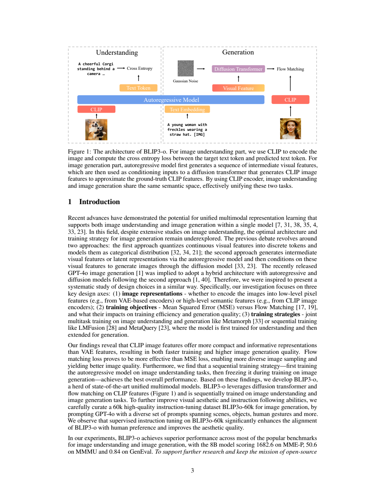
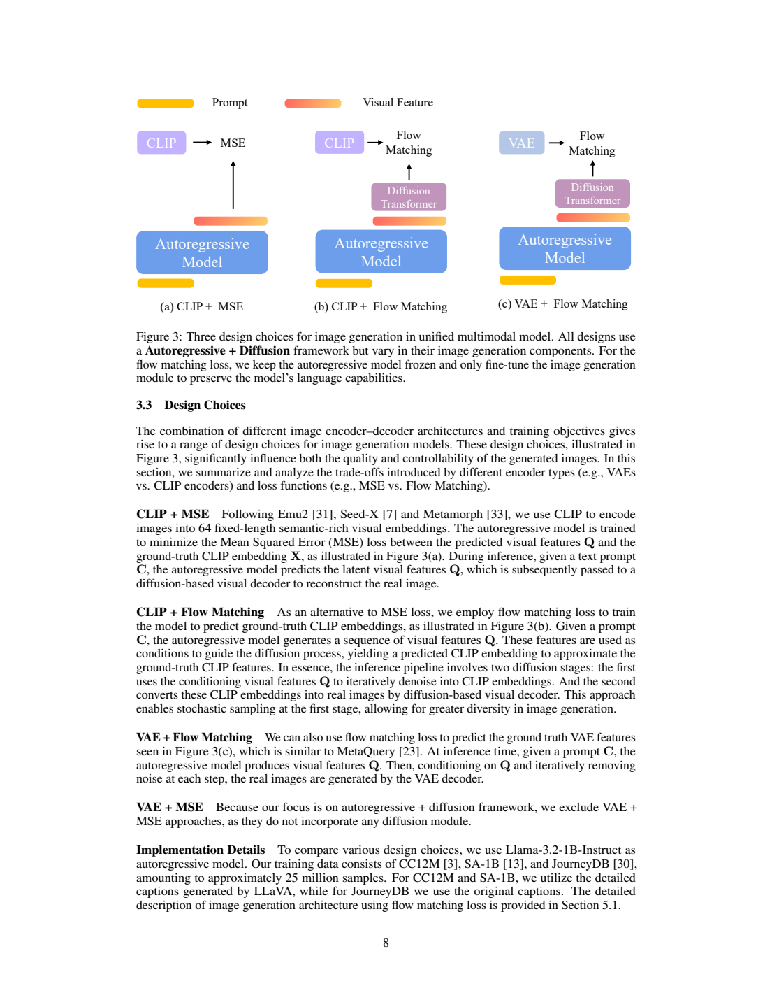
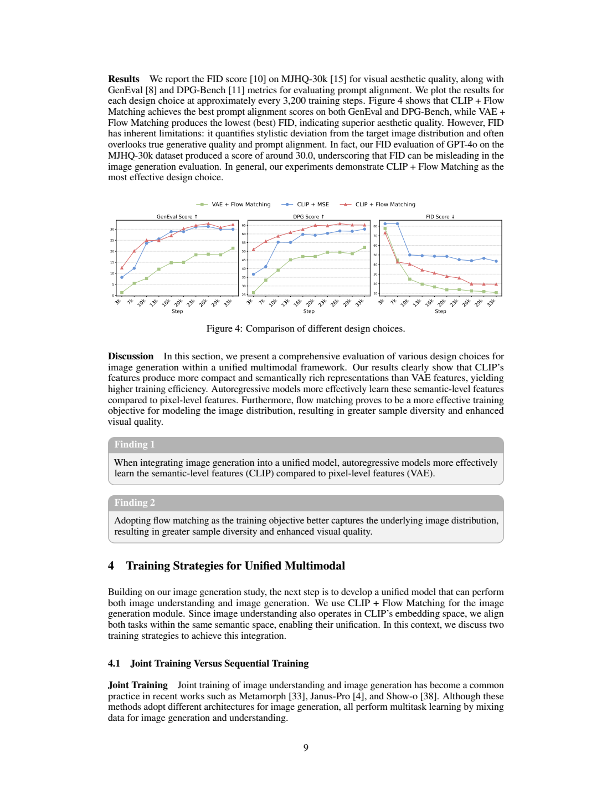
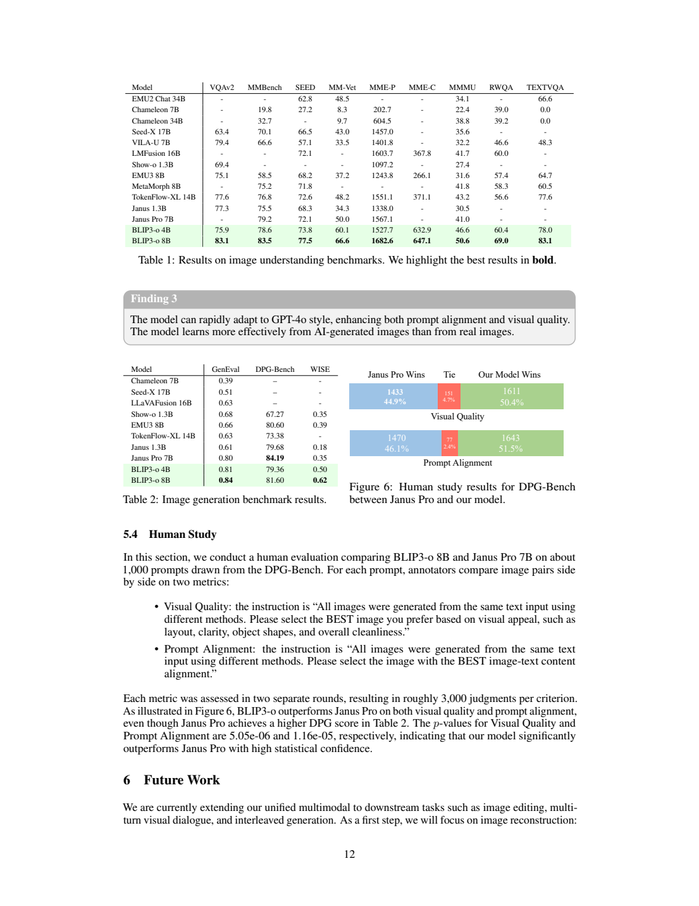

# BLIP3-o：以连续 CLIP 特征与 Flow Matching 统一图像理解和生成

## 1. 论文信息与模型定位

| 项目 | 内容 |
| --- | --- |
| 论文 | *BLIP3-o: A Family of Fully Open Unified Multimodal Models—Architecture, Training and Dataset* |
| 作者与机构 | Jiuhai Chen、Zhiyang Xu、Xichen Pan、Yushi Hu 等；Salesforce Research 及马里兰大学、弗吉尼亚理工、纽约大学等合作机构 |
| 本文依据 | [arXiv:2505.09568v1](https://arxiv.org/abs/2505.09568v1)，2025 年 5 月的首次公开版本，17 页 |
| 模型家族 | BLIP3-o-4B、BLIP3-o-8B；理解骨干分别采用 Qwen2.5-VL-3B-Instruct 和 7B-Instruct |
| 研究问题 | 怎样在保留现有视觉语言模型理解能力的同时，让同一系统生成图像，并兼顾语义对齐和生成多样性 |
| 阅读边界 | 本文是 v1 论文介绍，不把后续代码更新、其他版本成绩或作者对闭源模型结构的推测当成已核验事实 |

BLIP3-o 不是把一切模态都改造成离散词表的方案。它保留自回归视觉语言模型，在生成图像时，让语言模型先产生连续视觉条件，再让扩散 Transformer 建模图像特征的分布。图像理解与图像生成共享语义空间，但生成端增加独立的扩散模块。报告强调开放模型、训练代码和数据；需要同时保留一个关键限定：**4B 模型只使用公开来源的数据，8B 模型训练还使用了 30M 专有图像**。标题中的“Fully Open”不能被直接解释为两个规格使用的全部原始训练图像都可公开下载。

它也不是 BLIP-2 的直接结构替换：BLIP-2 重点用查询模块连接冻结视觉编码器与语言模型，BLIP3-o 则研究统一理解和生成的表示、生成目标及训练顺序。两者在本仓库按论文自身设计解释，避免仅凭名称推断技术继承。

## 2. 快速概览

| 关键选择 | 本文方案 | 为什么这样做 |
| --- | --- | --- |
| 图像生成表示 | 连续 CLIP 语义特征 | 让图像理解和生成在相近语义空间工作，减少自回归模块需要处理的视觉序列 |
| 从文字到视觉条件 | 提示词嵌入后追加可学习查询，经自回归 Transformer 得到视觉特征 | 用已有语言模型组织提示中的对象、属性和关系 |
| 生成学习目标 | 对 CLIP 特征使用条件 Flow Matching | 建模同一提示可能对应的多个图像特征，避免纯回归倾向于单一平均解 |
| 训练组织 | 先利用已有理解模型，再冻结其参数训练生成模块 | 控制训练成本，并减少生成训练对理解骨干的影响 |
| 数据增益 | 大规模详细描述，加上 60K 高质量图文指令对 | 前者提供广泛视觉覆盖，后者集中改善动作、组合关系和文字等生成要求 |

最有帮助的阅读线索是把系统分成两个生成问题：首先根据文字生成**图像的 CLIP 特征**，其次根据该特征生成**图像像素**。Flow Matching 对应前一个问题，后面仍需要图像扩散解码器。因此，“自回归加扩散”在这里不是把两个名字并排堆起来，而是明确划分语言条件组织、语义特征采样和像素生成三个职责。

最终 8B 的 GenEval 为 0.84，高于表中 Janus-Pro-7B 的 0.80；但 DPG-Bench 为 81.60，低于后者的 84.19。这个差异很有启发性：物体和属性组合、较复杂的提示依从、知识性生成并非同一个指标，一个模型在某种生成能力领先，并不代表所有任务都领先。

## 3. 整体架构

**读图：**Figure 1 左侧展示理解路径，右侧展示生成路径。理解时，图像被编码为视觉特征并送入视觉语言模型，与文本共同产生回答。生成时，文字经过自回归模型形成连续条件，噪声与条件一起进入 Diffusion Transformer，得到 CLIP 图像表示，再由图像解码器输出像素。图中的两个扩散环节分别服务于特征生成与图像解码，不能合并成一次语言模型输出图像。

生成路径的输入首先是文字嵌入序列 $C$。模型在其后追加可学习查询 $Q$，将 $[C;Q]$ 输入自回归 Transformer；查询经注意力读取提示的语义，形成中间视觉表示。随后，DiT 以该表示为条件，从高斯噪声逐步生成目标 CLIP 特征。这里自回归模型提供的是生成条件，DiT 才负责表示分布的随机采样。

论文采用连续 CLIP 表示的一个理由是，它把语义压缩到固定的 64 个向量，不随最终输出分辨率直接增长。相对而言，VAE 的空间特征更接近局部像素，分辨率提升通常带来更长序列。但“语义更短”不等于“不需要空间细节”：实际成图仍依赖后续扩散解码器恢复纹理、边缘和空间布局，语言条件对对象位置与属性的控制也要通过生成训练习得。

DiT 采用 Lumina-Next/NextDiT 的设计，包括三维旋转位置编码、sandwich RMSNorm 和分组查询注意力。最终 8B 配置使用冻结的 Qwen2.5-VL-7B-Instruct，并训练具有约 1.4B 可训练参数的 DiT；4B 使用 Qwen2.5-VL-3B-Instruct 和相同生成架构。报告没有充分列出最终各层深度、头数及全部模块参数清单，不据名称把“8B”拆成精确的总参数求和。

Figure 1 用 CLIP 表达统一语义空间的概念，而最终理解骨干是已有的 Qwen2.5-VL。原文没有据此证明两条路径中所有物理视觉编码器共享同一份权重，本文也不做这样的结构推断。

## 4. 核心创新与数学原理

**读图：**Figure 3 将生成策略分成 CLIP 特征加 MSE、CLIP 特征加 Flow Matching、VAE 特征加 Flow Matching。作者没有把 VAE 加 MSE 作为完整测试配置。图片显示的是机制差异，不能将图中不同路径直接当成最终 4B/8B 模型的同规模比较。

首先看简单回归。自回归模型产生视觉条件 $Q$，线性投影 $W$ 对齐其维度与真实图像特征 $X$，目标为

$$
\mathcal L_{\mathrm{MSE}}=\|X-WQ\|_2^2.
$$

这个损失要求一个提示对应一个确定的特征预测。在同一提示存在多个合理目标图像时，平方损失容易把预测拉向条件均值；模型能对齐语义，但重复运行缺少从特征分布采样的机制。后续像素解码器即使有随机性，也未必能充分恢复目标图像集合的语义差异。这是作者改用 Flow Matching 的主要动机。

Flow Matching 让模型学习从噪声分布流向真实图像特征分布的速度场。以 $X_0$ 表示高斯噪声、$X_1$ 表示真实图像的 CLIP 特征、$t\sim U(0,1)$ 表示时间。**v1 PDF 第 7 页的线性插值式把右侧目标写成了自引用的 $X_t$，随后速度式也使用 $X_t-X_0$，与上下文的 $X_1$ 终点不一致。以下按其明确说明的线性插值给出勘误解释，不冒充原式逐字转写：**

$$
X_t=(1-t)X_0+tX_1,\qquad
\frac{dX_t}{dt}=X_1-X_0,
$$

$$
\mathcal L_{\mathrm{Flow}}(\theta)
=\mathbb E\left[
\|V_\theta(X_t,Q,t)-(X_1-X_0)\|_2^2
\right].
$$

训练时 DiT 在随机时间和随机噪声下预测条件速度；推理时从新噪声出发，按照速度场更新特征，因此同一文字条件可以产生不同的特征样本。它改变的不是把“均方误差”完全废除，而是**把回归对象从单一图像特征换成多个噪声状态下的速度**，借助随机初始状态形成分布采样。最终解码得到像素的过程仍是另一个生成模块。

**读图：**Figure 4 的横轴是训练步数，比较三种方案的 GenEval、DPG-Bench、FID。前两个越高越好，FID 越低越好。CLIP 加 Flow Matching 在语义对齐指标上表现更好，但 VAE 加 Flow Matching 的 FID 更优。因此，这组证据支持“CLIP 语义表示更适合对齐提示”的选择，而不支持“CLIP 在所有生成指标都最优”。

这组设计实验使用 Llama-3.2-1B-Instruct 和 25M 图文数据，最终发布模型换成 Qwen2.5-VL 骨干并有自己的数据配置。不能把图上的趋势当成最终 8B 模型的直接消融，也不能从图中估读的百分数替换正式表格成绩。顺序训练的讨论同样主要是动机和设计说明；本文没有报告在所有条件一致时，联合训练与顺序训练的完整定量对照。

## 5. 数据构建与处理

最终生成预训练数据分为公开来源和专有来源。公开部分包括 CC12M、SA-1B、JourneyDB 等。4B 使用约 25M 公开图像的详细描述，以及约 3M 简短描述；作者发布的描述数据对应 25M 详细文本和 3M 简短文本。8B 在 25M 公开图像之外，还使用约 30M 专有图像，总体加入约 6M CC12M 风格的简短描述。详细描述平均约 120 个 token，简短描述平均约 20 个 token，后者约占 8B 数据中的一成。

详细描述由 Qwen2.5-VL-7B-Instruct 为图像生成。相比简短网页标题，丰富描述能把主体、动作、背景、关系及外观写清楚，为文本条件学习提供更密集的监督。简短描述仍被保留，以免模型只能适应长而完整的提示。在第 3 节设计实验中，CC12M 与 SA-1B 的详细描述采用 LLaVA 生成；这与最终模型的数据再描述配置不同，必须分开阅读。

高质量指令数据称为 BLIP3-o-60k。作者利用 GPT-4o 生成提示与对应图像，覆盖人体姿态、常见水果蔬菜、地标、简单文字等生成要求，并加入 JourneyDB、DALL·E 3 等来源的提示。其目标不是再增加一个规模更大的网页图文集合，而是集中补充生成难点：例如对象的属性组合、动作姿态和文字呈现。论文称每个类别大约构建 10K 对，合计 60K；由于这里列举的类别不是一份精确穷尽的计数表，不按列举名称机械相加推断每类实际数量。

这套数据策略让读者看到两个不同增益来源：大规模描述帮助覆盖视觉概念，高质量指令对帮助模型学习用户要求。但报告没有给出足够完整的去重阈值、过滤分数、全部类别分布及不同来源配额，不能补写成可逐项复现的清洗流水线。作者认为某些人工智能生成的高质量图文对有助于训练，这是本文的经验观察；缺少充分控制来源、描述长度和图像质量的对照时，不宜推广为“合成图像普遍优于真实图像”。

## 6. 训练流程与目标

训练思路是先得到可靠的理解模型，再让它作为生成条件骨干，学习视觉特征生成。对于最终发布配置，作者直接采用 Qwen2.5-VL-Instruct，因此并没有从头重复训练视觉理解阶段。在后续生成学习中冻结理解骨干，训练 DiT。这样能把理解能力的维持与生成分布的学习在参数更新上分开，也节约从头训练统一模型的成本。

生成预训练主要学习大规模图文映射：文字经骨干形成条件，目标图像经 CLIP 编码得到真实特征；随机时间、噪声及真实特征组成 Flow Matching 的训练样本。随后，模型使用 BLIP3-o-60k 的高质量图文指令进行微调，改善提示依从和较难的生成内容。报告称这一阶段训练有助于提升生成质量，但未公开列出全部学习率、批大小、优化器配置、训练步数、设备数量和训练时长。本文只说明其已披露流程，不用其他 BLIP、Qwen 或 Lumina 论文的超参数填补空白。

顺序训练的好处在于，它能让已具备理解能力的骨干固定下来，生成模块围绕其条件表示学习；代价是理解与生成的特征接口仍受原骨干约束。作者把更充分的联合训练视为后续研究方向。这里的“冻结”确实由最终配置说明支持，而不是根据常见多模态方案推断。

推理时，理解任务沿已有视觉语言模型路径生成文字；文生图任务先计算提示条件，再从噪声得到 CLIP 特征，最后调用图像解码器。展示样例中有 1024×1024 输出，但本文没有完整推理预算、采样步数或吞吐测试，不能由展示分辨率推断同等硬件速度。报告在未来工作中讨论图像编辑、多轮视觉对话、交错生成，不把这些讨论直接列成已完成且统一测评的能力。

## 7. 实验设置与主要结果

**读图：**Table 1 从 VQAv2 到 TextVQA 比较理解任务，MME 分为感知与认知两个不同分数；Table 2 比较 GenEval、DPG-Bench 与 WISE；Figure 6 展示 BLIP3-o-8B 与 Janus-Pro-7B 的人工二选一偏好。读者应先看任务和计分尺度，再看模型列，不能混合求一个“全能总分”。

| 模型 | VQAv2 | MMBench | MMVet | MME 感知 / 认知 | MMMU | TextVQA |
| --- | ---: | ---: | ---: | ---: | ---: | ---: |
| BLIP3-o-4B | 75.9 | 78.6 | 60.1 | 1527.7 / 632.9 | 46.6 | 78.0 |
| BLIP3-o-8B | 83.1 | 83.5 | 66.6 | 1682.6 / 647.1 | 50.6 | 83.1 |
| Janus-Pro-7B | — | 79.2 | 50.0 | 1567.1 / — | 41.0 | — |

Table 1 还报告 4B/8B 的 SEED-Bench 为 73.8/77.5，RealWorldQA 为 60.4/69.0。8B 在这些表格中总体高于 4B，但两者同时改变了骨干规格和数据来源，不能据此证明提升只来自参数规模。理解骨干继承自 Qwen2.5-VL，报告也没有给出完整“添加生成能力前后”的同模型对照；理解成绩因此说明发布系统有较强能力，不等于生成训练已被严格证明提升了理解。

| 模型 | GenEval ↑ | DPG-Bench ↑ | WISE ↑ |
| --- | ---: | ---: | ---: |
| BLIP3-o-4B | 0.81 | 79.36 | 0.50 |
| BLIP3-o-8B | 0.84 | 81.60 | 0.62 |
| Janus-Pro-7B | 0.80 | 84.19 | 0.35 |
| Emu3 | 0.66 | 80.60 | 0.39 |
| Show-o | 0.68 | 67.27 | 0.35 |

生成结果的主要意义是：BLIP3-o 在 GenEval 的组合生成和 WISE 的知识性生成上表现突出，而 Janus-Pro-7B 在 DPG-Bench 更高。4B 虽使用公开数据，GenEval 也达到 0.81；但其 DPG-Bench 79.36 略低于表中 Emu3 的 80.60，不能写成“小模型全面超过此前模型”。表格中的横向比较还包含不同训练数据、骨干和生成策略，不能当成只有一个变量的严格实验。

人工比较采用约 1,000 个提示，每个评价维度约 3,000 次判断。视觉质量上，BLIP3-o-8B 获胜 1,611 次，Janus-Pro-7B 获胜 1,433 次，平局 151 次，即 50.4%、44.9%、4.7%；提示对齐上分别为 1,643、1,470、77 次，即 51.5%、46.1%、2.4%。论文给出相应显著性检验，但这些是二者相对偏好，并非所有生成结果达到完美质量的概率。人工提示偏好与 DPG-Bench 的排序不同，也提醒我们评测内容与评价规则会影响结论。

最可靠的结论是：把语义 CLIP 特征与条件 Flow Matching 结合，可以形成有竞争力的统一理解与生成系统；固定理解骨干使生成训练路径更清晰。其限制同样具体：最终数据和规格不是完全对齐的控制实验，全部训练超参数不充分，8B 使用专有数据，部分未来能力尚未完整展示。复现或选型时，应分别审视语义对齐、图像质量、知识性生成和数据开放程度，而不是只看一个领先指标。
