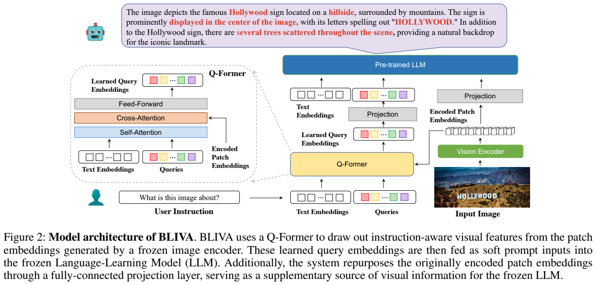
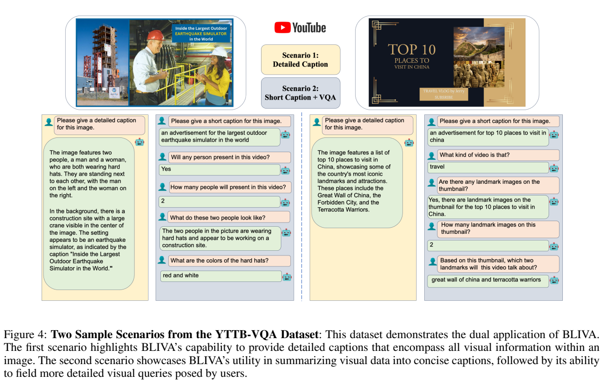
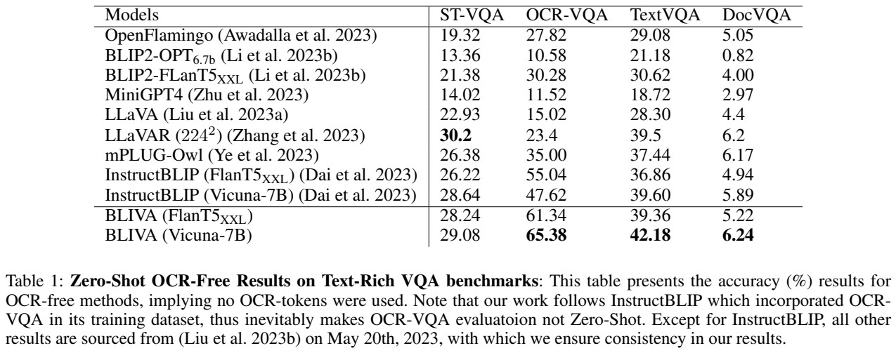
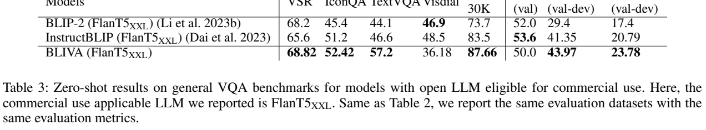
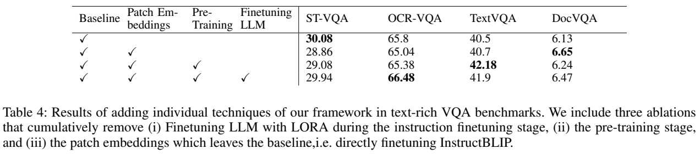
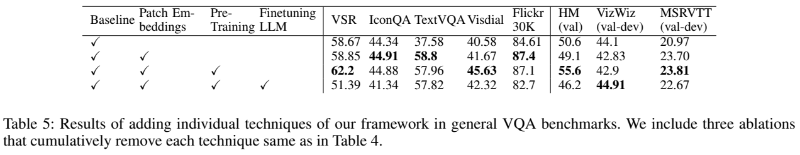
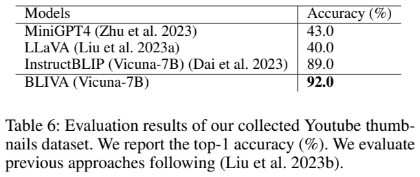

<!-- article-header:start -->
[项目首页](../../../README.md) › [模型系列](../../../reports/model-family-index.md) › [BLIVA](../README.md)
<!-- article-header:end -->

# BLIVA：用查询特征与完整 patch 特征共同回答含文字图像的问题

[返回 BLIVA 系列](../README.md) · [返回仓库](../../../README.md)

<!-- article-toc:start -->

**本篇目录** · [论文定位](#paper-info) · [快速概览](#overview) · [整体架构](#architecture) · [核心原理](#principles) · [数据构建](#data) · [训练流程](#training) · [实验结果](#experiments)
<!-- article-toc:end -->

## 1. 论文信息与模型定位

| 项目 | 内容 |
|---|---|
| 原文 | *BLIVA: A Simple Multimodal LLM for Better Handling of Text-Rich Visual Questions* |
| 作者与机构 | Wenbo Hu、Yifan Xu、Yi Li、Weiyue Li、Zeyuan Chen、Zhuowen Tu；UC San Diego、Coinbase Global |
| 本文依据版本 | arXiv:2308.09936v1，2023 年 8 月 19 日；11 页 PDF |
| 模型组成 | 冻结 EVA-CLIP ViT-G/14，InstructBLIP 初始化的 Q-Former，新增 patch 投影层，冻结 Vicuna-7B；另有 FlanT5-XXL 版本 |
| 输入与输出 | 图像与文字问题输入，文字答案或描述输出；视频问答属于沿用既有评测接口，并非本文提出视频专用编码器 |
| 定位 | 对 InstructBLIP 的视觉信息入口进行增补，重点解决场景文字、包装、海报、网页等文本密集图像的理解 |
| 资源 | [论文固定版本](https://arxiv.org/pdf/2308.09936v1) · [官方代码](https://github.com/mlpc-ucsd/BLIVA) · [YTTB-VQA 数据集](https://huggingface.co/datasets/mlpc-lab/YTTB-VQA) |

BLIVA 的问题意识很具体：一个语言模型可能知道路牌、广告或电影海报的语义，却没有收到足够清晰的视觉细节。InstructBLIP 用一小组可学习查询将视觉 patch 压缩为提示向量，这有利于选取与问题相关的信息，但小字可能在压缩过程里被忽略。BLIVA 保留这一分支，再把原始编码 patch 通过另一条投影路径送给语言模型，让“经过指令筛选的摘要”和“较完整的视觉特征”同时存在。它不调用外部 OCR 系统来解决这个瓶颈，也没有重新预训练一个语言基础模型。[来源：原文 Introduction、Method，PDF 第 1–4 页。](https://arxiv.org/pdf/2308.09936v1)

## 2. 快速概览

| 需要把握的问题 | BLIVA 的回答 |
|---|---|
| 改动位于哪里？ | 在 Q-Former 通路旁增加 encoded patch embeddings → 全连接投影 → LLM 的通路，并拼接两类视觉提示 |
| 两路信息是否替代关系？ | 不是；Q-Former 提供与指令相关的压缩特征，patch 路径保留额外细节，最终联合输入 |
| 大模型是否都参与更新？ | 主配置冻结视觉编码器与 LLM，只训练新增投影层及后续指令阶段的 Q-Former；LoRA 更新 LLM 只作消融 |
| 新增预训练规模？ | 附录给出 558K 图文对、3 个 epoch；正文将其概括为约 0.5M |
| 最醒目的结果？ | OCR-free OCR-VQA：原始 InstructBLIP Vicuna-7B 为 47.62，BLIVA 为 65.38，增加 17.76 **个百分点** |
| 最重要的结果边界？ | OCR-VQA 本身进入训练，不能称为未见数据集零样本；DocVQA 仍只有 6.24，224 分辨率没有解决细小文档文字问题 |

这篇论文适合用于理解“视觉压缩与细节保真”的取舍。其创新不依赖复杂的新损失，而是调整 LLM 能看到的视觉信息。这里也要区分两种 TextVQA 协议：Table 1 不提供 OCR 文本，BLIVA 得分 42.18；Table 2 为对齐 InstructBLIP 的一般任务协议提供 OCR tokens，得分 57.96。两个数不能直接混为一次实验，更不能把后者称为纯图像 OCR-free 能力。[来源：原文 Table 1–2，PDF 第 5–6 页。](https://arxiv.org/pdf/2308.09936v1)

## 3. 整体架构

*原文 Figure 2，PDF 第 3 页，图表区域裁切。右边的视觉编码器输出一份 patch 特征：一份直接上行到 Projection，另一份送入 Q-Former；左边放大图表示指令与 queries 先在自注意力中交互，再由 queries 通过交叉注意力读取视觉特征。两条上行路径最后进入同一个 LLM。*

图像首先交给 EVA-CLIP 的 ViT-G/14。作者不使用最后一层视觉输出，而选择倒数第二层特征，理由是实验中略好；视觉编码器从预训练权重初始化并全程冻结。第一条分支沿用 InstructBLIP：用户问题作为 Q-Former 的文本输入，与可学习 queries 交互；queries 再读取 patch 序列，输出与指令相关的视觉表示，经投影匹配语言模型维度。问“路牌写了什么”与问“附近有什么建筑”，应引导同一幅图像产生不同关注点。

第二条分支称为 visual assistant。它将视觉编码器已经产生的 patch embeddings 直接通过全连接层映射至 LLM 嵌入空间，不先将其压缩到固定的小查询集合。最后，原文说明先拼接两类视觉 embeddings，再将组合结果置于问题文字 embeddings 之后，作为 LLM 的输入。Figure 2 的示意色块并不是离散 OCR 字符，而是连续向量。LLM 仍按自己的词表生成答案；视觉接口训练负责让这些连续提示能被已有语言网络利用。

Vicuna-7B 是主要实验配置，FlanT5-XXL 是另一个语言骨干配置。原文将后者称为可用于商业使用的 LLM 版本；本文只记录论文当时的实验定位，实际资源使用仍应查看各组件对应的许可。两种骨干的内部生成结构不同，不能仅凭连接图认为所有参数及训练成本完全一致。BLIVA 的核心共同点是双分支视觉入口和主配置冻结 LLM。[来源：原文 Architecture Overview、Implementation Details，PDF 第 3–4 页。](https://arxiv.org/pdf/2308.09936v1)

## 4. 核心创新与数学原理

原文没有提出带编号的新数学公式。下面使用明确的符号重写其结构与目标，属于机制解释，不是声称复现原文某个 Eq.。设图像编码结果为 $V=E(I)\in\mathbb R^{N\times d_v}$，问题为 $s$，查询集合为 $Q_0$。两条路径可表达为

$$
Z_q=P_q\bigl(F_{\mathrm{QFormer}}(Q_0,s,V)\bigr),\qquad
Z_p=VP_p+b_p,
$$

$$
X_{\mathrm{LLM}}=[\operatorname{Embed}(s);Z_q;Z_p].
$$

其中 $P_q$ 是查询输出到语言空间的映射，$P_p$ 是新增 patch 投影；两路输出的最后一维必须与 LLM 的嵌入维度一致，才能在序列轴拼接。这里的拼接不是对两路向量逐元素平均。论文没有在正文明确列出全部实际 token 数，因而本文不把某个常见 Q-Former 配置的查询数当作本文逐项披露的超参数。

查询分支的关键是条件化：$Z_q$ 依赖问题 $s$，并非先计算一个永远不变的图像摘要后只把问题交给 LLM。patch 分支的关键是降低额外压缩：$Z_p$ 直接来源于更密集的视觉序列。它能补充小字、局部纹理、空间关系，但并不保证恢复已经被图像缩放或视觉编码器丢掉的像素。因此，双路输入可以缓解查询瓶颈，却不能从 224×224 图像里凭空还原不可见的细小字符。

这种设计也有计算代价。若问题含 $L$ 个 token、查询输出含 $M$ 个 token、patch 输出含 $N$ 个 token，进入解码器的提示长度由约 $L+M$ 增至约 $L+M+N$。标准密集自注意力的注意力矩阵规模相应随序列长度平方变化。这是通常 Transformer 的复杂度解释，而非论文报告的实测延迟；冻结 LLM 参数只减少优化所需的状态，并不会取消对这些视觉提示的前向计算和梯度传播。

生成训练使用语言建模损失，可解释为

$$
\mathcal L_{\mathrm{LM}}
=-\sum_{t=1}^{T}\log p_\theta(y_t\mid y_{<t},s,Z_q,Z_p).
$$

$y_t$ 是目标描述或答案 token。主配置中的 $\theta$ 仅包含允许更新的接口模块，但损失仍经过冻结的 LLM 反向传播到视觉提示。对于分类和多选任务，作者采用候选答案的 log-likelihood ranking，可概括为 $\hat a=\arg\max_{a\in\mathcal A}\log p(a\mid I,s)$；开放生成采用 beam search。原文没有在此给出统一候选长度归一化细节或 beam 数，不能自行添加。

论文将效果归因于互补表示，这一解释有直观依据，但必须结合消融的实际结果判断：Table 4 中直接微调的本地 InstructBLIP baseline 在 OCR-VQA 已达到 65.8，略高于完整 BLIVA 的 65.38；因此“17.76 点提升”是相对 Table 1 的原始 InstructBLIP 47.62，不能声称对所有公平重训 baseline 都提高同样幅度。架构改动有效与某个提升数完全由架构造成，是不同强度的结论。[来源：原文 Method、Table 1、Table 4，PDF 第 3–7 页。](https://arxiv.org/pdf/2308.09936v1)

## 5. 数据构建与处理

新增 patch 分支先使用 LLaVA 筛选的 558K 图文对，来自 LAION、CC-3M、SBU，并由 BLIP 生成描述。这里的 558K 是 BLIVA 新增预训练阶段的规模；其 Q-Former 来自已经训练过的 InstructBLIP，视觉编码器与语言模型也继承既有权重，因而不能把 558K 当作整套模型历史上接触过的全部数据。

指令训练尽量沿用 InstructBLIP 的数据及提示，包含 MSCOCO、TextCaps、VQAv2、OKVQA、A-OKVQA、OCR-VQA 和 LLaVA-Instruct-150K。作者明确说明，受机构网络条件与数据内容限制，没有获取 InstructBLIP 使用的 LAION-115M 部分；其他训练数据尽可能保持一致。这意味着本文的本地重训 baseline 与公开原始 InstructBLIP 不完全是同一次数据配置，也解释了为何结果表同时给出原始模型行和 baseline 行。

附录展示了真实图像处理代码。训练时 RandomResizedCrop 输出 224×224，裁剪比例为 0.5–1.0，使用 bicubic 插值并随机水平翻转，然后转张量和归一化；评测时直接 bicubic resize 至 224×224。归一化均值为 (0.48145466, 0.4578275, 0.40821073)，标准差为 (0.26862954, 0.26130258, 0.27577711)。这不是任意高分辨率 OCR 系统，文本过小、裁剪遗漏或变形都可能限制可读性，作者也以缩小后的字符难以辨认解释 DocVQA 的弱结果。[来源：原文 Datasets、Appendix Data Pre-processing，PDF 第 4、10 页。](https://arxiv.org/pdf/2308.09936v1)

*原文 Figure 4 与 Table 1，PDF 第 5 页。Figure 4 展示 YTTB-VQA 缩略图的长描述、短描述和问答示例；Table 1 比较不用 OCR tokens 的四个文本图像基准。示例中的正确回答不能替代定量实验。*

YTTB-VQA 是另行构建的**评测集**：100 组 YouTube 缩略图问答，覆盖 13 类视频。作者随机选择带有丰富文字的缩略图，通过视频 ID 获取高分辨率 thumbnail，再由人工记录问题、答案、视频类别与视频链接。类别包含科技、购物、体育、娱乐、企业、交通、食物、电影、天文、历史、音乐、地理和学术分享。论文没有将这 100 组描述为大规模训练语料。它体现工业场景的可用性，但样本数有限，3 个百分点的差距仅对应约 3 题，不能据此证明覆盖广泛真实场景的稳定优势。

## 6. 训练流程与目标

| 阶段 | 数据与目标 | 参数更新 | 原文披露的设置 |
|---|---|---|---|
| 新增接口预训练 | 558K 图像描述对；让 patch 提示在固定语言模型中可用 | 新增 patch 投影层；其他预训练模块保留 | 3 epoch，batch 64，约 6 小时 |
| 视觉指令微调 | 混合 caption/VQA/指令数据；生成目标答案 | Q-Former 与投影层共同更新；视觉编码器和 LLM 冻结 | batch 24，最多 200K step，原文称约两遍训练数据；不足两天 |
| LLM 更新消融 | 与第二阶段配合的 LoRA | 额外更新 LLM 的低秩适配参数 | 本文不补写原文未披露的 LoRA rank 或 alpha |

两阶段均采用 AdamW，$\beta_1=0.9$、$\beta_2=0.999$，weight decay 0.05。前 1K step 线性 warmup，将学习率从 $10^{-8}$ 提升到 $10^{-5}$，之后 cosine decay 到 0。附录报告使用 8 张 48GB NVIDIA A6000 Ada GPU；这里按原文的命名记录，不据此推算未披露的总 FLOPs。训练时间也仅覆盖 BLIVA 的新增阶段，不包括 EVA-CLIP、InstructBLIP 或 Vicuna 的历史训练。[来源：Appendix Implementation Details，PDF 第 10 页。](https://arxiv.org/pdf/2308.09936v1)

冻结骨干的逻辑是保持已有表示和语言能力，同时让接口适应它们。论文指出解冻视觉编码器可能造成灾难性遗忘，但没有给出与主结果同等充分的视觉解冻数值表。LLM LoRA 则确实列在 Table 4–5：有些 OCR 分数略升，多个一般任务下降，因此作者选择冻结 LLM 的版本作为主配置。应将这种取舍理解为当前数据、模型、超参数下的结果，而不是“多模态模型永远不该微调 LLM”的一般规律。

## 7. 实验设置与主要结果

原文报告四个 OCR 相关基准和八个一般视觉语言基准，但不同列的指标不同：Flickr30K 用 CIDEr，Visual Dialog 用 MRR，Hateful Memes 用 AUC，其余列主要为 top-1 accuracy。缺少测试答案时使用替代划分：VizWiz 用 validation；Hateful Memes 从训练集取同样数量样本作评测。GQA、iVQA、MSVDQA 因获取问题未评，ScienceQA 与 NoCaps 因无法复现也不报告。这些选择使本文的“八基准”与 InstructBLIP 原始完整套件不同。

| OCR-free，Table 1 | 原始 InstructBLIP Vicuna-7B | BLIVA Vicuna-7B | 差值（百分点） |
|---|---:|---:|---:|
| ST-VQA | 28.64 | 29.08 | +0.44 |
| OCR-VQA，已进入训练 | 47.62 | 65.38 | +17.76 |
| TextVQA | 39.60 | 42.18 | +2.58 |
| DocVQA | 5.89 | 6.24 | +0.35 |

主要收益集中在 OCR-VQA，而不是所有文本图像任务都有类似幅度。ST-VQA 的 LLaVAR 为 30.2，仍高于 BLIVA 29.08；DocVQA 的绝对分数很低。对于一般任务，Table 2 的本地 baseline 与 BLIVA 比较为：VSR 58.67→62.2，IconQA 44.34→44.88，含 OCR tokens 的 TextVQA 37.58→57.96，Visual Dialog MRR 40.58→45.63，Flickr30K CIDEr 84.61→87.1，Hateful Memes AUC 50.6→55.6，MSRVTT 20.97→23.81；VizWiz 则 44.10→42.9，下降。FlanT5-XXL 的结果也有明显反例：Visual Dialog 48.5→36.18、Hateful Memes 53.6→50.0，因此不能将 Vicuna 的整体趋势直接推广到另一个骨干。

*PDF 第 7 页原文图表裁图，包含 Table 3–6。Table 4–5 的勾选是逐步增加 patch 分支、预训练和 LLM LoRA；每一行的参照应是同一表中的相邻配置，而不是直接套用 Table 1 的公开模型分数。*

消融显示预训练和双路信息的作用依赖任务。Table 5 中只增加 patch 分支，TextVQA 从 37.58 到 58.8，Flickr30K 从 84.61 到 87.4；加入预训练后 VSR 从 58.85 到 62.2、Visual Dialog 从 41.67 到 45.63，但 TextVQA 从 58.8 降至 57.96。再加入 LLM LoRA，VSR 从 62.2 降至 51.39，Flickr30K 从 87.1 降至 82.7，同时 VizWiz 从 42.9 升至 44.91。Table 4 中 LoRA 的 OCR-VQA 66.48 略好于冻结版本 65.38。证据支持作者选择一个较均衡的冻结配置，而不支持“每个组件在每个指标上必然增加分数”。

YTTB-VQA 的 Table 6 给出 BLIVA 92%、InstructBLIP 89%、MiniGPT-4 43%、LLaVA 40%。结合 Figure 4，它说明两路视觉提示在这组缩略图问题中有帮助；结合只有 100 题的规模，则应保留对方差与外推的谨慎。原文还承认数值符号识别有困难。BLIVA 最值得记住的技术结论，是在冻结骨干的框架内增加一条密集视觉路径可能提升局部细节利用，同时增加 token 成本，而且无法绕过图像分辨率与训练数据的限制。[来源：原文 Table 1–6、Conclusion，PDF 第 5–7 页。](https://arxiv.org/pdf/2308.09936v1)

<!-- article-footer:start -->
---

[← 上一篇：Cheetah](../../cheetah/arxiv-2308.04152/README.md) · [按发表时间浏览](../../../reports/paper-reading-guide.md#year-2023) · [下一篇：VisCPM →](../../viscpm/arxiv-2308.12038/README.md)

[返回本篇目录](#article-toc) · [返回模型系列](../README.md)
<!-- article-footer:end -->
