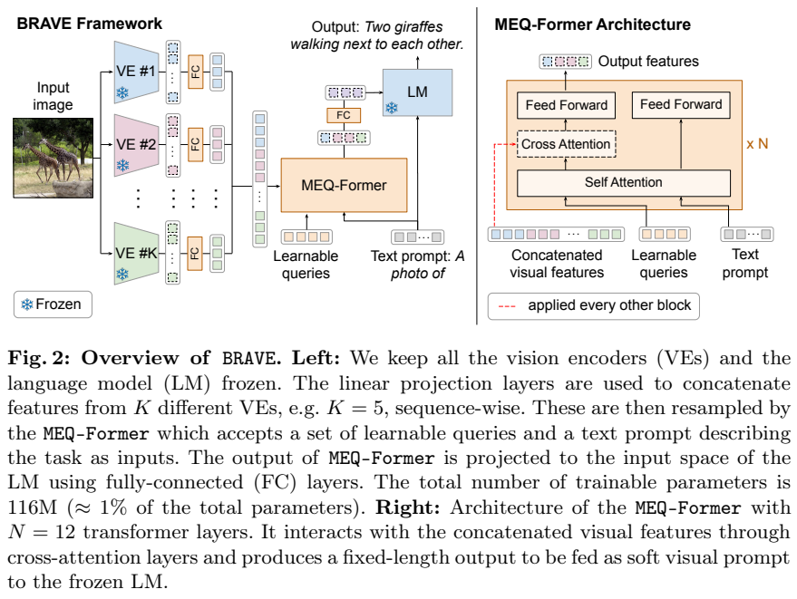
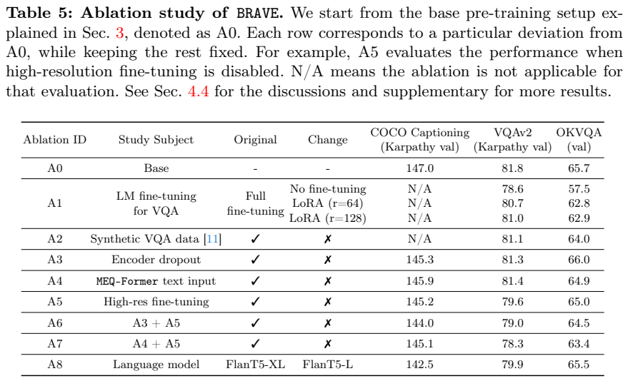
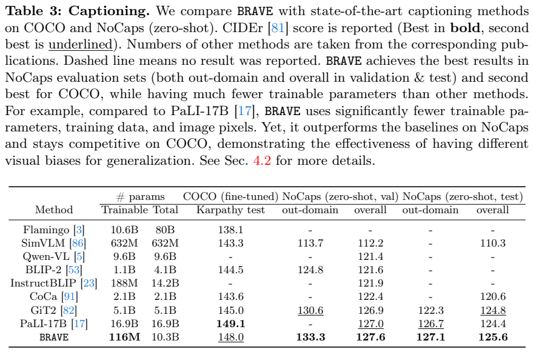
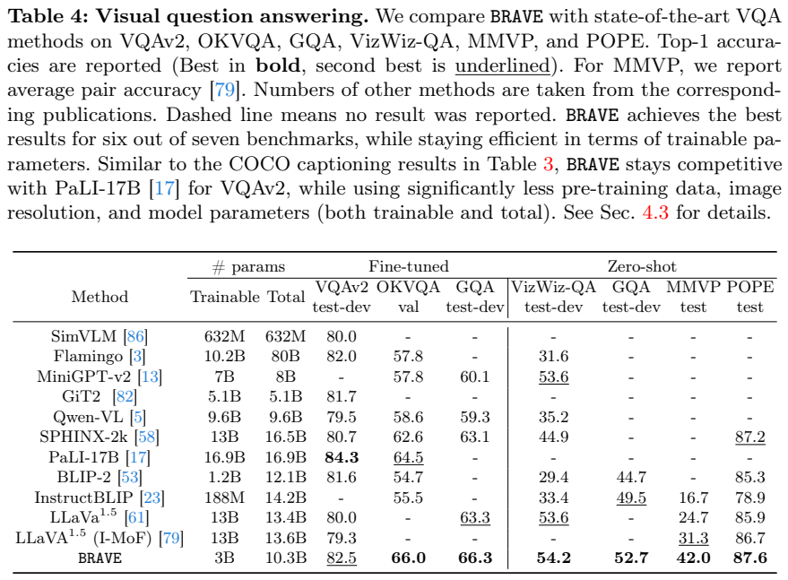

<!-- article-header:start -->
[项目首页](../../../README.md) › [模型系列](../../../reports/model-family-index.md) › [BRAVE](../README.md)
<!-- article-header:end -->

# BRAVE：以多编码器查询Transformer拓宽视觉表示

> 对应 **BRAVE: Broadening the visual encoding of vision-language models**，固定 [arXiv:2404.07204v1](https://arxiv.org/abs/2404.07204v1)。重点是多种视觉归纳偏置的整合，不是训练一个新的视觉骨干。

<!-- article-toc:start -->

**本篇目录** · [论文定位](#paper-info) · [快速概览](#overview) · [整体架构](#architecture) · [核心原理](#principles) · [数据构建](#data) · [训练流程](#training) · [实验结果](#experiments)
<!-- article-toc:end -->

## 1. 论文信息与模型定位

| 项目 | 内容 |
|---|---|
| 作者/机构 | Oğuzhan Fatih Kar等，Google与EPFL |
| 日期 | 2024-04-10，v1 |
| 语言端 | FlanT5-XL |
| 视觉端 | EVA-CLIP-g、CLIP-L/14、SILC-G/16、ViT-e、DINOv2-L/14 |
| 连接器 | MEQ-Former，12层、160查询、hidden768 |
| 参数 | 总10.3B，预训练可训练116M；VQA微调可训练约3B |
| 官方来源 | [PDF](https://arxiv.org/pdf/2404.07204v1) · [项目](https://brave-vlms.epfl.ch) |

模型接收单图和文字，输出描述或答案。先比较八种视觉encoder，再选择覆盖不同数据和目标的五种组成BRAVE。它强调扩大视觉信息来源：对比学习、分类和自监督可能关注不同线索，单一encoder不存在跨所有任务的稳定最优。本篇图像与文字之外的模态、视频扩展是未来方向，不能写成已验证能力。[原文 §2、§6](https://arxiv.org/pdf/2404.07204v1#page=16)

## 2. 快速概览

单视觉encoder会把没有保留的细节变成语言端不可恢复的信息缺口。论文不让五个完整VLM分别回答后投票，而让一个MEQ-Former读取五种视觉特征，生成固定长度soft prompt给同一个语言模型。它同时看到任务文字，可根据描述或问答所需信息调整查询。

预训练冻结所有视觉与语言组件，只更新小连接器，使用100M WebLI图文；描述任务继续冻结语言端，VQA任务则更新语言模型。因此摘要中的“冻结LM、只116M可训练”属于预训练与captioning，不能覆盖最终VQA的训练成本。多encoder减少语言端输入长度，但每张图仍需经过五个视觉前向，推理成本未被完全消除。

MMVP以一对图的两问都答对计分，BRAVE42.0，对最佳单encoder27.3有明显提升；NoCaps泛化也较强。COCO和VQAv2仍低于原表PaLI17B，不能概括所有项目第一。结果体现互补信息与任务适配的价值，并非证明任意多加encoder总会提高。[原文 Table2–4](https://arxiv.org/pdf/2404.07204v1#page=11)

## 3. 整体架构

*来源：原文Figure2，PDF第7页，[原页](https://arxiv.org/pdf/2404.07204v1#page=7)。各encoder输出先过FC，再沿序列轴合并；右侧查询通过cross-attention读视觉key/value。雪花表示图示的预训练冻结配置。*

每种encoder可输出不同长度、通道的patch特征。各自线性映射到1408通道，再沿token序列拼接，不要求像素位置一一对齐，也不是通道拼接。五encoder在预训练设置下得到1223×1408特征；MEQ-Former将它变为160×768，最后FC投影到FlanT5嵌入空间，作为文字提示之前的视觉soft prompt。

MEQ-Former包含12层，cross-attention隔一层出现；输入为可学习查询与任务文字。主模型32×5=160查询，与encoder数量成比例设置。所谓固定长度指这一配置对图像输出固定160，不能理解为增加任意数量encoder也自动不改查询容量。原文约14倍压缩说的是特征总元素量：只比token数1223/160约7.6倍，两个口径不同。

没有encoder身份embedding，注意力不通过额外标签指定来源。预训练随机以20%概率mask每种encoder的特征，降低只依赖一路的倾向；这和随机删除图像patch、实际永久移除encoder不是同一操作。任务文字会影响压缩表示，因此不同问题可能要重新计算查询，不能把问答引导压缩等同问题无关的一次性视觉摘要。[原文 §3](https://arxiv.org/pdf/2404.07204v1#page=8)

## 4. 核心创新与数学原理

论文没有新损失公式，关键在跨encoder统一查询。机制解读为 $X=\operatorname{Concat}_{seq}(E_1(I)W_1,\ldots,E_K(I)W_K)$，再用

$$Q'=\operatorname{softmax}\left(\frac{Q(XW_{key})^\top}{\sqrt d}\right)XW_{value}.$$

这里Q含可学习查询，实际模型还包含文字交互、自注意力与FFN；表达式仅解释一个cross-attention，不是原文完整网络公式。查询长度M远小于视觉总长度N时，cross-attention读视觉的主要矩阵为M×N，较在所有视觉token上做N×N attention轻。视觉encoder各自内部计算仍存在，不能声称整个系统完全线性或推理免费。

以描述/答案监督可解释为条件序列交叉熵 $-\sum_t\log p(y_t\mid Q',q,y_{<t})$。FlanT5是encoder-decoder文字模型，不能套写成Vicuna式decoder-only骨干；条件生成表达不意味着网络架构相同。原文绕过BLIP2单encoder两阶段预训练，直接用caption目标训练桥接，没有另加本篇的新图文对比、匹配或图像生成损失。

“互补”需看实验。Table2中EVA-CLIP在GQA50.1/MMVP27.3较强，SILC在COCO141.1/OKVQA63.4较强；不同目标encoder可在常规问答相近，但MMVP更易暴露视觉差异。联合连接器对照独立Q-Former ensemble，116M对605M可训练，224分辨率下COCO145.2对140.9、VQAv2 79.6对78.5、OKVQA65.0对64.3。它支持当前联合桥更有效，不是普遍否定ensemble。[原文 Table2、Table6](https://arxiv.org/pdf/2404.07204v1#page=14)

## 5. 数据构建与处理

预训练资料为过滤、去重、英文WebLI100M图文，224×224输入，以网页alt-text作为目标描述。五种encoder和FlanT5本身已分别预训练，因此100M是新增桥接资料，不是整个10.3B系统只见过100M样本。不同encoder已有OpenAI WIT、LAION、WebLI、JFT、LVD等来源，数据范围并不完全相同。

VQA混合包括VQAv2、OKVQA训练集与VQ2A合成问题，总17M训练例。合成资料提高覆盖，主文没有逐条列生成模板、清洗阈值和详细比例，不补写为GPT4V生成或任何未经披露的大规模数据引擎。高分辨率阶段只用VQAv2/OKVQA；GQA有独立额外微调用于对比已在该任务训练的模型。[原文 §2、§4.3](https://arxiv.org/pdf/2404.07204v1#page=10)

COCO描述用Karpathy训练划分，然后在NoCaps评估新类别。NoCaps“zero-shot”指没有在NoCaps任务再微调，不是零图文预训练。VizWiz、MMVP、POPE等也属于经过VQA训练后对相应测试任务的转移，不能把它们称从未见过任何视觉问答。原文强调未额外采用OCR或scene text理解预训练资料，不能据此推断网页图像中没有文字。

## 6. 训练流程与目标

| 阶段/任务 | 资料与分辨率 | 更新模块 |
|---|---|---|
| 桥接预训练 | WebLI100M，224 | MEQ-Former及投影；视觉/LM冻结 |
| COCO caption微调 | Karpathy，336 | 连接器；视觉/LM冻结 |
| VQA混合微调 | 17M问答，224 | MEQ-Former与LM；视觉冻结 |
| VQA高分辨率微调 | VQAv2＋OKVQA，336 | 语言/连接器适配，视觉冻结 |
| GQA额外对照 | GQA训练集 | 从混合微调模型再训练 |

实现用FLAX/Scenic，预训练batch1024、64张TPUv5 chips。固定v1的23页包含主文与参考文献，多次指向supplementary，但当前PDF没有对应完整超参附录；学习率、optimizer、step、epoch、上下文长度和墙钟并未在这些页面完整披露，本文不从其它版本补齐或假装原文已有。

*来源：原文Table5，PDF第13页，[原页](https://arxiv.org/pdf/2404.07204v1#page=13)。每行是一项相对A0改动，N/A不是零；此处COCO/VQAv2为validation，与主test结果口径不同。*

冻结LM时VQAv2/OKVQA78.6/57.5，全量训练81.8/65.7；LoRA rank128为81.0/62.9，以324M可训练近似弥补约70%的差距。不能把这项LoRA对照误写成最终主结果采用LoRA。移除encoder dropout使COCO147.0→145.3、VQAv2 81.8→81.3，但OKVQA65.7→66.0，因此正则化不是每项都提高。取消高分辨率则COCO145.2/VQAv2 79.6，说明细节输入也是收益来源。

## 7. 实验设置与主要结果

*来源：原文Table3，PDF第10页，[原页](https://arxiv.org/pdf/2404.07204v1#page=10)。统一为CIDEr，参数表分别列可训练/总量；比较训练效率不能只看116M而忽略10.3B总组件。*

BRAVE COCO Karpathy test148.0，低于PaLI17B149.1；NoCaps validation域外/总体133.3/127.6，test127.1/125.6，在该表对照中较强。NoCaps新类别转移说明广泛视觉偏置有益，但不能当无限开放世界类别识别保证。CIDEr和VQA准确率不是同一尺度。

*来源：原文Table4，PDF第11页，[原页](https://arxiv.org/pdf/2404.07204v1#page=11)。GQA分别有微调与zero-shot两列；MMVP为pair accuracy，不是单题accuracy。*

| 指标 | BRAVE | 解释 |
|---|---:|---|
| VQAv2 test-dev | 82.5 | 原表PaLI17B84.3更高 |
| OKVQA val | 66.0 | 训练含OKVQA |
| GQA额外微调/转移 | 66.3/52.7 | 两种训练条件不可互换 |
| VizWiz-QA test-dev | 54.2 | 无该任务额外训练的转移 |
| MMVP pair accuracy | 42.0 | 一对两问均正确才计对，随机约25% |
| POPE | 87.6 | 原表Top1 accuracy，不能混用常见F1数字 |

MMVP各图独立输入，没有把另一张作上下文；42.0对最佳单encoder27.3支持辨别视觉差异，却仍有大量失败。POPE评估特定对象存在性幻觉，不代表所有错误与事实幻觉都已解决。移除一两种encoder性能相对缓降，继续移除更差，表明兼有冗余和独特信息；平均attention大并不等价对应encoder的因果贡献大。

本文尚需所有encoder前向，100M桥接资料亦有成本，未覆盖3D或分割等全部归纳偏置。图像理解成功不能外推音频/视频已具备。介绍未执行模型，数值来自固定v1，保留任务微调、图像尺寸、指标及划分条件。

<!-- article-footer:start -->
---

[← 上一篇：InternLM-XComposer2-4KHD](../../internlm-xcomposer/arxiv-2404.06512/README.md) · [按发表时间浏览](../../../reports/paper-reading-guide.md#year-2024) · [下一篇：Graphist →](../../graphist/arxiv-2404.14368/README.md)

[返回本篇目录](#article-toc) · [返回模型系列](../README.md)
<!-- article-footer:end -->
