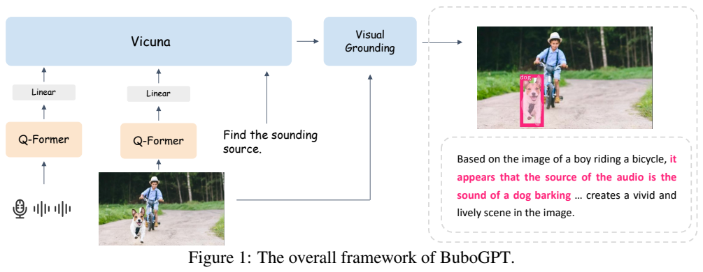
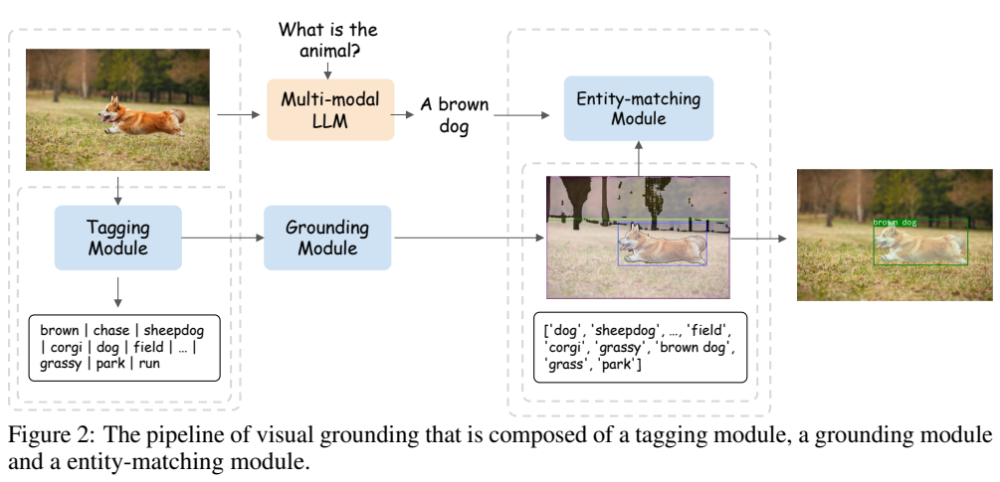
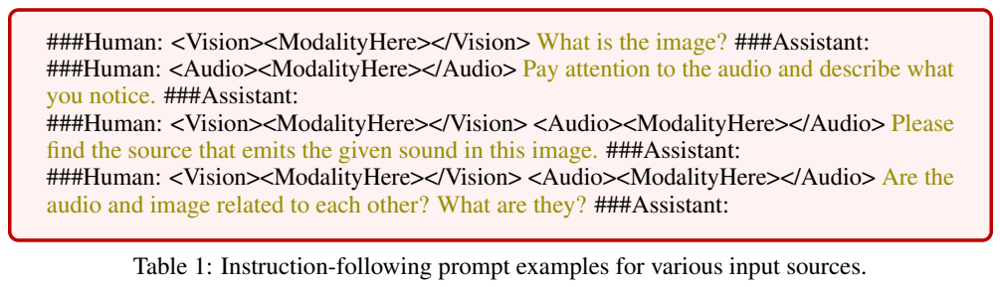
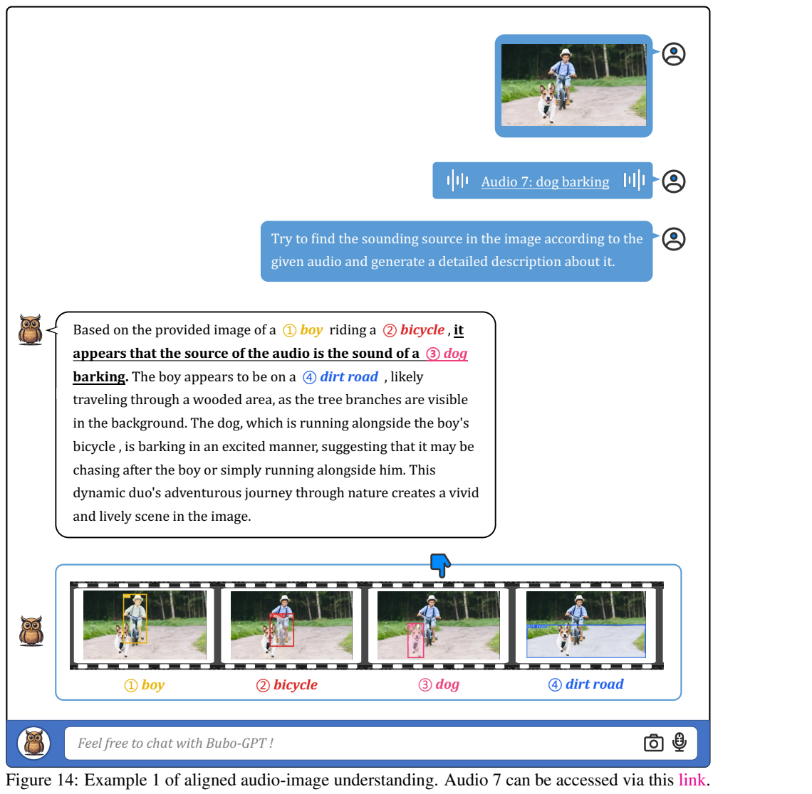
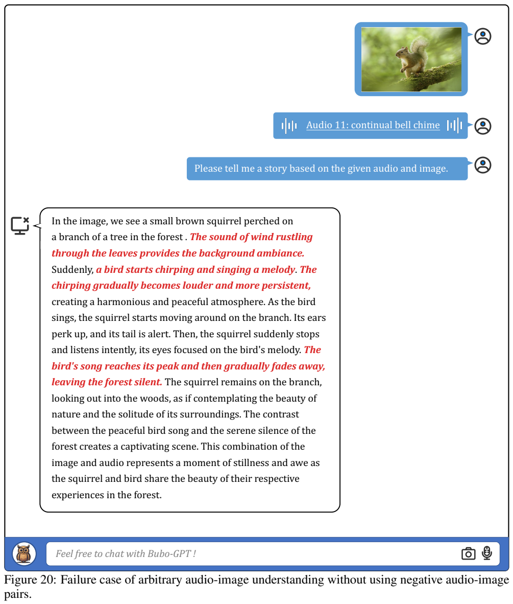

<!-- article-header:start -->
[项目首页](../../../README.md) › [模型系列](../../../reports/model-family-index.md) › [BuboGPT](../README.md)
<!-- article-header:end -->

# BuboGPT：以语言为桥梁，将图像、声音与视觉区域联系起来

<!-- article-toc:start -->
<a id="article-toc"></a>

**本篇目录** · [论文定位](#paper-info) · [快速概览](#overview) · [整体架构](#architecture) · [核心原理](#principles) · [数据构建](#data) · [训练流程](#training) · [实验结果](#experiments)
<!-- article-toc:end -->

<a id="paper-info"></a>

## 1. 论文信息与模型定位

| 项目 | 内容 |
| --- | --- |
| 论文 | *BuboGPT: Enabling Visual Grounding in Multi-Modal LLMs* |
| 作者与机构 | Yang Zhao、Zhijie Lin、Daquan Zhou、Zilong Huang、Jiashi Feng、Bingyi Kang；ByteDance |
| 原文版本 | [arXiv:2307.08581v1](https://arxiv.org/abs/2307.08581v1)，2023 年 7 月 17 日，24 页；技术正文主要为前 6 页 |
| 输入 / 输出 | 图像、音频、文字的不同组合；文字回答及与文字实体关联的图像框或掩码 |
| 核心组件 | BLIP-2 视觉编码器与 Q-Former、ImageBind 音频编码器、Vicuna，以及 RAM、Grounding DINO、SAM、GPT-4 组成的定位流水线 |
| 论文性质 | 早期多模态指令模型与模块组合报告；结果以可视化案例为主 |

BuboGPT 关心的不是只让模型说出“图片里有什么”，而是让回答中的对象能够对应到图像的具体区域，并在同时有声音输入时说明哪个对象可能发声。例如，图像中有男孩、自行车和狗，声音是狗叫，系统应把回答中的“狗”关联到狗的图像区域。

它采用两条相互连接的路径：可训练的多模态语言模型负责理解和回答，现成视觉定位工具负责产生空间区域，GPT-4 根据文本把两者匹配起来。因此，展示界面中出现掩码，并不意味着 Vicuna 自己学习了逐像素分割。本文按首次公开版本介绍，不从后续项目实现推断原文未给出的参数规模或训练超参数。

<a id="overview"></a>

## 2. 快速概览

| 研究困难 | 解决方法 | 需要保留的边界 |
| --- | --- | --- |
| 图像或声音编码无法直接成为语言输入 | 每种模态用 Q-Former 和线性投影对齐 Vicuna 的词嵌入空间 | 图像编码器、音频编码器和 Vicuna 在训练中固定 |
| 文字回答缺少区域对应 | 先用 RAM 标注候选实体，再检测、分割，最后匹配回答中的实体 | 定位质量依赖外部工具，不是单一模型端到端输出 |
| 总是假设图像与声音相关 | 指令数据同时包含正配对和随机负配对 | 作者以案例展示改善，未报告统一错误率 |
| 音频短描述不适合对话 | 用 GPT-4 将 Clotho 的多条短描述组织为详细说明 | 扩写可能引入合理但不一定有声学证据的场景推测 |

最有价值的思想是：**跨模态对齐不仅包括“学习哪些输入有关”，还包括学习承认“这些输入可能无关”**。如果指令阶段所有图像与声音总是来自同一场景，模型就容易依靠图片编造与之匹配的声音。负配对让它有机会学习独立描述不同输入，而非强行归因。

另一条重要线索是“文本桥梁”。系统把图像候选对象和多模态回答都转为可读实体，再由语言模型推断匹配关系。这种设计易于利用成熟检测、分割工具，但也把推理错误、候选漏检和实体歧义串联到最终展示中。

<a id="architecture"></a>

## 3. 整体架构



**读图：** 图像与音频分别经过 Q-Former 和线性映射进入 Vicuna；文字指令同时输入。回答文本随后进入 Visual Grounding 模块，图像也直接提供给定位模块，输出带区域标注的对象。箭头显示这是“生成回答，再关联区域”的组合系统，定位框并不是语言模型直接回归的坐标。

视觉分支沿用 BLIP-2 的视觉编码器和已预训练 Q-Former；音频分支使用 ImageBind 音频编码器和独立 Q-Former。两种模态各有线性投影，将查询特征变为 Vicuna 可以接收的嵌入序列。Q-Former 的作用是从高维模态特征中提取少量与语言有用的信息；本文没有充分披露各分支查询数量、特征维度和最大输入长度，不直接套用其他论文配置。

外部定位管线先调用 Recognize Anything Model（RAM），产生候选标签；再把标签串接成文本提示，送给 Grounding DINO，得到开放词汇对象框；SAM 以这些框为提示，得到细粒度掩码。最后，GPT-4 读取候选实体列表和 BuboGPT 的回答，识别回答中的实体对应哪个已检测对象。这个最后环节使“狗的叫声”可以通过语言联系到图像中的狗。

这里应区分 ImageBind 的音频特征对齐、Vicuna 的跨模态推理、Grounding DINO 的文本引导检测及 SAM 的分割。报告中使用了这些能力，不代表 BuboGPT 重新训练了所有底层模型。也不能把文本上的“这是发声对象”解释为从音频空间信号直接估计声源坐标。

| 模块 | 输入与输出 | 公开机制 |
|---|---|---|
| 视觉与音频编码 | 图像/声音 → 各自特征 | 视觉采用BLIP-2编码器，音频采用ImageBind编码器；训练中均冻结。 |
| 模态连接器 | 特征 → Vicuna词嵌入空间 | 每种模态有Q-Former和线性映射；视觉预训练只调投影，音频同时调Q-Former与投影。 |
| Vicuna | 模态表示及指令 → 回答文本 | 冻结语言主干联合解释输入；其文字回答成为后续实体匹配的桥梁。 |
| 候选定位链 | 图像 → 标签、框、掩码 | RAM生成标签，逗号拼接后输入Grounding DINO得到框，SAM据框生成掩码。 |
| 实体匹配 | 候选实体列表和回答 → 对应关系 | GPT-4按提示匹配文本所指对象；不把语言模型注意力直接解释为定位结果。 |

[模块依据：v1 §3.1–3.2，第3页；§4.2.3、§5、§7，第5–6页](https://arxiv.org/pdf/2307.08581v1)。

<a id="principles"></a>

## 4. 核心创新与数学原理

### 4.1 文字桥接的实体定位链





**读图：** Figure 2 中一条路径识别并定位候选对象，另一条路径由多模态模型回答问题，Entity-matching 将回答与候选关联起来。Table 1 下方的提示分别对应图像、音频、联合声源定位、联合关系判断，表格是输入格式示例，不是实验成绩表。

原文将标签写成 $`\{t_1,\ldots,t_{n_t}\}`$，检测与分割后得到实体及定位信息 $`\{(e_1,g_1),\ldots,(e_{n_e},g_{n_e})\}`$。其中 $`g_i`$ 是框或掩码。多模态模型产生文本 $`t_o`$，匹配模块接收实体列表和回答文本，通过 GPT-4 推断匹配对。这一过程强调的是**语义实体匹配**，而不是对所有图像像素执行语言注意力可视化；原文没有定义实体匹配损失，也没有训练 GPT-4 来优化定位。

这条链按先候选、后关联的顺序工作：RAM 决定可供检索的概念，Grounding DINO 与 SAM 提供空间位置，多模态回答决定当前问题涉及哪个实体。因而定位质量同时受候选覆盖和回答正确性限制；这是对该串联流程的直接分析，而非论文新增的误差定理。原文局限也明确指出，借文字连接而没有额外定位训练，会限制针对特定对象的问答能力。 [§3.1，第3页；§7，第6页](https://arxiv.org/pdf/2307.08581v1)

### 4.2 独立模态接口与联合语言推理

为了更清楚地表达模态接口，可将视觉与音频特征映射写为下面的解释性记号，原文未给出这一组公式：

```math
Z_v=W_v Q_v(E_v(I)),\qquad
Z_a=W_a Q_a(E_a(A)).
```

$`I,A`$ 分别是图像和音频，$`E`$ 是冻结编码器，$`Q`$ 是相应 Q-Former，$`W`$ 是线性映射，$`Z`$ 是输入语言模型的模态嵌入。回答可以表示为 $`p(y\mid Z_v,Z_a,u)`$，其中 $`u`$ 是指令；只有一种模态时移除缺失输入。这个记号用于说明信息流，不意味着论文新增了跨模态对比损失或采用某个未报告的联合优化公式。

两种 Q-Former 在训练起点上并不对称：视觉侧已经借用 BLIP-2 的预训练连接器，第一阶段只需适配线性投影；音频侧需要同时训练查询模块和投影。它们最终进入同一 Vicuna 词嵌入空间，但这不等于共享同一组压缩参数。空间框和掩码在另一条外部链路产生，不是上述两个模态向量公式的额外输出。 [§3.2，第3页](https://arxiv.org/pdf/2307.08581v1)

### 4.3 用独立描述抑制强制声画关联

负配对提供的学习信号也应准确理解。作者随机组合图像与音频，答案分别说明“The image …”和“The audio …”。它并没有报告显式二分类关系头或特定二元交叉熵；不一致关系由文字监督表达。模型因此可能学习减少强制关联，但“随机”不能保证两种输入语义必然无关：抽到狗图像和狗叫声就可能出现偶然相关。原文未给出排除这种情况的筛选规则。

正样本来自 VGGSS 的声源对应，固定模板把类别改写成关系描述；负样本则把分别采样的图像说明和音频说明连接起来。两者让训练答案呈现“联合关系”与“分别描述”两种不同生成模式。第5节提供加入负样本前后的定性例子，支持其减少错误关联的动机，但没有给出可据此计算关系识别准确率的完整二分类测试集。 [§4.2.3–5，第5–6页](https://arxiv.org/pdf/2307.08581v1)

<a id="data"></a>

## 5. 数据构建与处理

视觉预训练使用 CC3M、CC12M、SBU、LAION 的组合，论文报告约 130M 图文对。这里是其说明的数据规模，报告未提供完整训练步数，不能把 130M 直接当作全部实际训练曝光次数。音频预训练主要使用 WaveCaps，报告为 403,050 个音频片段，平均时长 67.59 秒、平均描述长 7.8 个词。该数据整合多个声音库，并用 ChatGPT 将原始弱描述转成字幕；报告没有详细说明所有音频裁剪、采样率和长片段处理方法。

| 指令数据类型 | 来源与规模 | 监督目的 |
| --- | --- | --- |
| 图文 | MiniGPT-4 的 3,439 对，LLaVA 的约 158K 样本 | 图像描述、对话与推理 |
| 音文 | Clotho-Detail 的 3,938 条，平均 52.70 个词 | 更详细的声音说明和对话响应 |
| 图音文正配对 | VGGSS 转换的 5,158 对 | 声音与图中对象的对应关系 |
| 图音文负配对 | 从音文与 MiniGPT-4 图文数据随机抽取组合，数量未明确披露 | 分开说明不相关输入，抑制无依据关联 |

Clotho 原本每个音频有五条不同标注者的短描述。作者用 GPT-4 与少样本提示，将这些描述合并为长段落。例如，多人分别把纸张翻动理解成翻书、看地图、包礼物，扩写应保留“纸张翻动”这个共有声学事实，并将具体活动作为可能解释，而非随意选定一个活动当成真值。这种数据加工同时提供描述丰富度和不确定性表达，但自动扩写没有消除标注歧义。

VGGSS 正配对的声音与画面局部对象相关，作者把类别标签用固定模板包装成自然语言。负配对则把两种独立描述拼接。数据设计的核心并非增加新模态，而是给模型看不同输入组合和不同关系类型。报告没有提供负配对规模、全部混合权重和去重统计，因此本文不计算一个看似精确的最终指令数据总数。

<a id="training"></a>

## 6. 训练流程与目标

第一阶段分别进行单模态描述预训练，使投影层输出对齐语言模型的词嵌入空间。视觉侧继承 BLIP-2 的 Q-Former并固定，只训练视觉投影层；音频侧同时训练音频 Q-Former 和投影层。该阶段输入对应图像或声音并预测描述，没有加入额外任务指令。视觉与音频的预训练不是让语言模型从头学习两种感知编码，而是调整它们进入冻结 Vicuna 的接口。

第二阶段使用图文、音文和图音文指令数据，教模型根据用户问题组织回答。图像通过 `<Vision>…</Vision>` 标识，音频通过 `<Audio>…</Audio>` 标识，内部占位符会替换为相应嵌入序列；缺少某种输入时采用对应单模态提示。指令可以要求详细描述、寻找发声对象或判断图音关系。本文仅说明原文支持的模块更新：编码器和 Vicuna 全程固定，第一阶段两分支的更新差异明确；原文没有逐模块完整列出第二阶段所有 Q-Former 参数的冻结表，不能补写一个未经披露的精确配置。

报告未给出正式损失函数、学习率、批大小、优化器、训练轮次、设备和时间。根据描述预测及指令回答可以解释其条件文本学习意图，但不能把行业常见默认配置当成作者实验设置。定位管线调用预训练工具和 GPT-4，没有报告联合反向传播到 RAM、Grounding DINO、SAM 的训练方案。

两阶段方式把“接口能够传递信息”和“模型能够遵从问题”分开学习。正负关系数据则改变指令阶段所见的关系分布。即便如此，冻结语言模型依然可能凭语言先验生成不真实细节，模态接口也不能保证所有声音或图像对象都被准确识别。

<a id="experiments"></a>

## 7. 实验设置与主要结果



**读图：** 图像包含男孩、自行车、狗和道路，音频标注为狗叫。回答把狗关联为声源，并在下方给出对象区域。这个例子展示“声音类别—文字实体—图像位置”链条，但它不是一项有置信区间的声源定位准确率测试。

报告分四类展示能力。Figures 3–7 展示单图描述、问答和实体区域；Figures 8–13 展示音频描述与追问；Figures 14–17 展示匹配图音的声源关联；Figures 18–19 展示任意图音组合的叙述。作者用同一图像搭配不同声音的例子，说明系统可以改变其发声对象判断，但没有报告完整数据集上的切换成功率或控制实验统计。



**读图：** 输入是松鼠图像与持续钟声，没有负配对训练的版本却生成风声、鸟鸣等与森林场景符合但与音频不符的叙述。红色文字标出这类错误。它直观说明图像先验可能覆盖声音证据，支持加入负配对的动机；不过单个失败例不等于量化证明某个模块在总体上减少多少幻觉。

| 待评估能力 | 原文证据 | 尚未提供的量化信息 |
| --- | --- | --- |
| 回答与区域关联 | 实体框、掩码与文字对照案例 | 标准指代表达定位指标、掩码 IoU 和实体匹配准确率 |
| 音频理解 | 多种环境声音描述及追问 | 统一音频问答、字幕分数或完整人工评分 |
| 图音匹配 | 正配对声源示例、任意组合及负配对失败例 | 关系判断准确率、负配对规模与标准化消融表 |
| 成本与效率 | 模块组成和冻结策略 | 参数总量、训练算力、外部 GPT-4 调用量与端到端时延 |

本文的结果部分没有主流多模态基准成绩表，也没有大规模人类评价。因此不能声称“超过某模型多少”或按示例数量推算成功率。案例回答中的故事性细节也要与声学事实区分：例如狗是否追逐男孩是情境推断，不是静态画面和狗叫声必然确定的事实。

作者明确承认两点限制：Vicuna 继承语言幻觉问题；由于定位结果通过文本关联，缺少额外精细定位训练，针对具体对象的 Grounding QA 能力有限。最准确的阅读结论是，BuboGPT 展示了一条可组合的图音理解与区域展示路径，突出不相关输入监督的价值；它尚未通过本文的定量实验确立全面定位性能或可靠性排名。

<!-- article-footer:start -->
---

[← 上一篇：Emu](../../emu/arxiv-2307.05222/README.md) · [按发表时间浏览](../../../reports/paper-reading-guide.md#year-2023) · [下一篇：ChatSpot →](../../chatspot/arxiv-2307.09474/README.md)

[返回本篇目录](#article-toc) · [返回模型系列](../README.md)
<!-- article-footer:end -->
