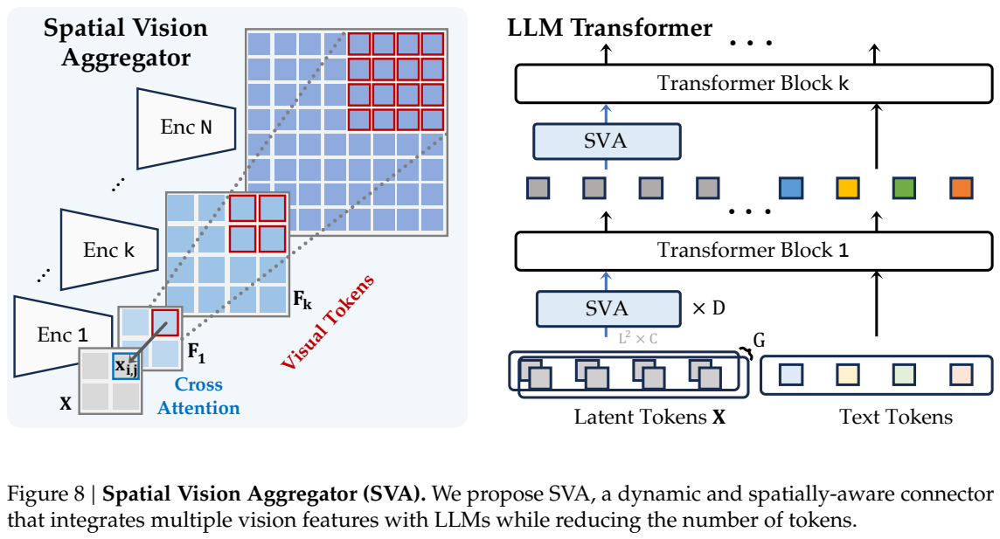
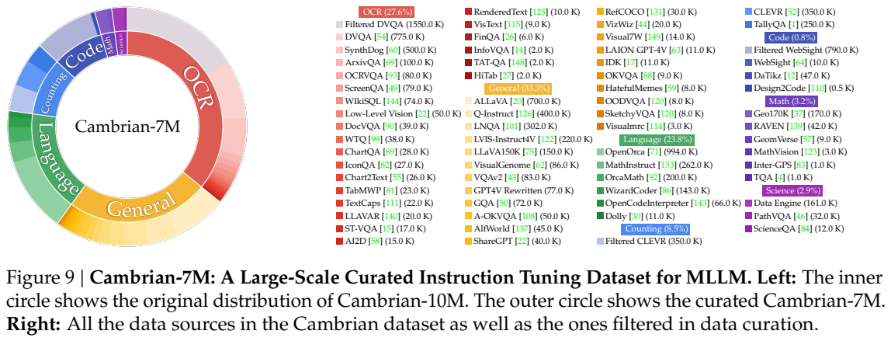
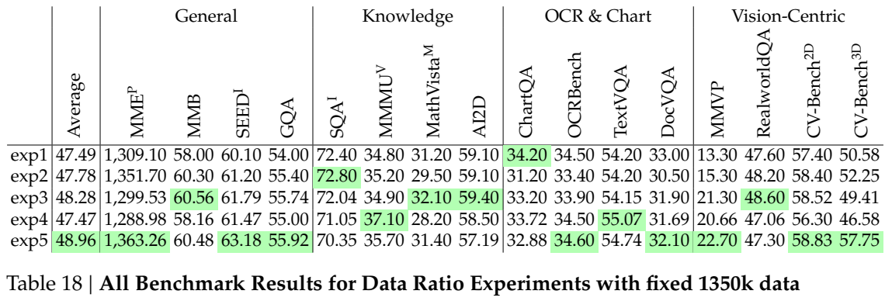
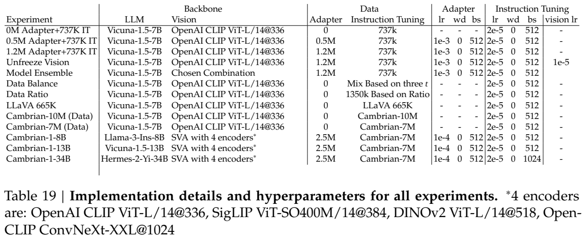
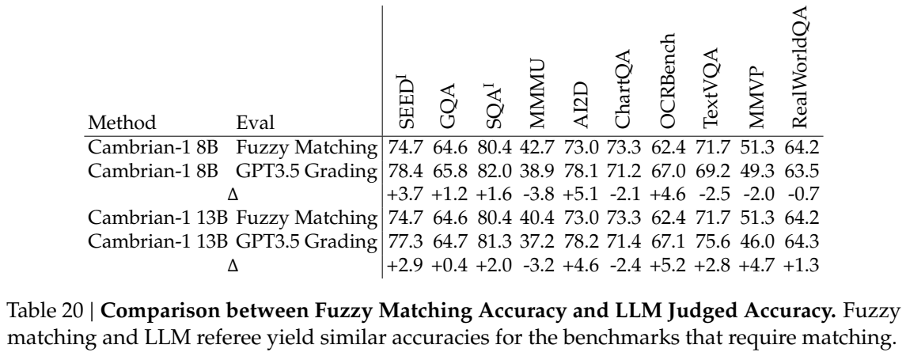
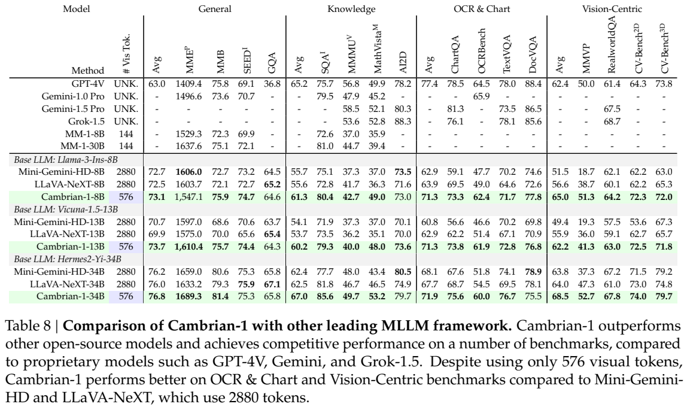
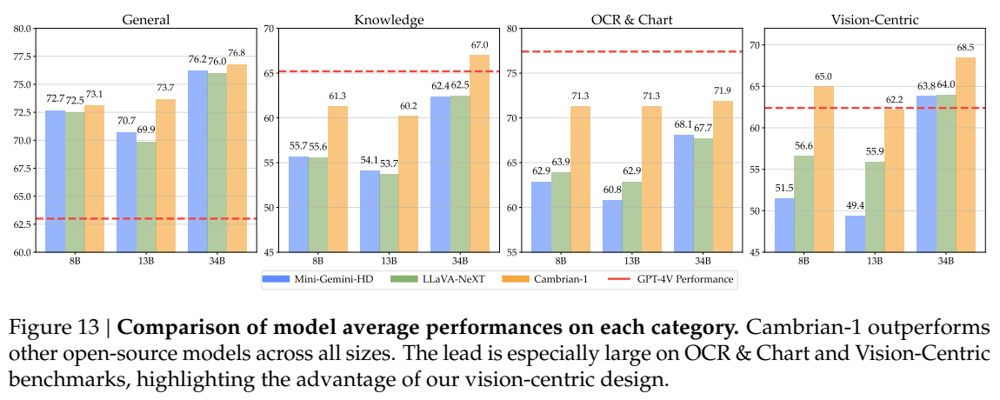

<!-- article-header:start -->
[项目首页](../../../README.md) › [模型系列](../../../reports/model-family-index.md) › [Cambrian-1](../README.md)
<!-- article-header:end -->

# Cambrian-1：用空间视觉聚合器连接多种视觉表征与语言模型

[返回 Cambrian-1 系列](../README.md) · [返回仓库](../../../README.md)

<!-- article-toc:start -->

**本篇目录** · [论文定位](#paper-info) · [快速概览](#overview) · [整体架构](#architecture) · [核心原理](#principles) · [数据构建](#data) · [训练流程](#training) · [实验结果](#experiments)
<!-- article-toc:end -->

## 1. 论文信息与模型定位

| 项目 | 内容 |
|---|---|
| 原文 | *Cambrian-1: A Fully Open, Vision-Centric Exploration of Multimodal LLMs* |
| 主要作者与机构 | Shengbang Tong、Ellis Brown、Penghao Wu 等；纽约大学，通讯作者 Saining Xie |
| 本文依据版本 | arXiv:2406.16860v1，2024 年 6 月 24 日；44 页 PDF |
| 模型档位 | Cambrian-1-8B、13B、34B，对应 Llama-3-Instruct-8B、Vicuna-1.5-13B、Hermes-2-Yi-34B 语言骨干 |
| 视觉端 | OpenAI CLIP、SigLIP、DINOv2、OpenCLIP ConvNeXt 四编码器组合；SVA 融合为 576 个视觉 token |
| 模态与输出 | 图像和文字输入，文字输出；本文重点是视觉理解和问答，而非图像生成 |
| 资源 | [固定版本论文](https://arxiv.org/pdf/2406.16860v1) · [项目主页](https://cambrian-mllm.github.io/) · [官方仓库](https://github.com/cambrian-mllm/cambrian) · [Cambrian-10M](https://huggingface.co/datasets/nyu-visionx/Cambrian-10M) · [CV-Bench](https://huggingface.co/datasets/nyu-visionx/CV-Bench) |

这不是只发布一个新模型的报告。作者把多模态 LLM 拆成视觉表征、连接器、指令数据、训练配方、评测五个问题，研究“视觉端到底贡献了什么”。他们用统一语言模型与训练接口比较 23 种视觉骨干配置，分析现有基准中语言先验的影响，再将研究结论组合成 Cambrian-1。8B/13B/34B 是语言骨干的档位名称，不代表包含四个视觉模型和连接器后的精确总参数量。[来源：原文第 1–3、6 节。](https://arxiv.org/pdf/2406.16860v1)

## 2. 快速概览

| 核心问题 | 本文做法与结论 |
|---|---|
| 怎样评价视觉编码器？ | 固定 Vicuna-1.5-7B 与数据配方，接入不同视觉表征；同时比较有图、无图和随机猜测 |
| 哪些表征互补？ | 语言监督模型擅长 OCR 等任务，DINOv2 在空间感知任务有竞争力；高分辨率 ConvNeXt 带来细节能力 |
| 如何减少视觉 token？ | SVA 给二维 latent 网格分配局部对应区域，在区域内跨编码器聚合，并在 LLM 内多次读取视觉特征 |
| 数据是否只越多越好？ | Cambrian-10M 约 9784K 条；平衡来源与任务比例得到较小的 Cambrian-7M，平均结果反而更好 |
| 新评测测什么？ | CV-Bench 2638 题，覆盖二维空间关系与计数、三维深度次序与相对距离 |
| 代表结果 | 8B 的四类平均为 73.1/61.3/71.3/65.0；视觉 token 576，表中 LLaVA-NeXT-8B 为 2880 |

模型在多项结果上取得较好成绩，但报告更有价值的地方是控制实验。比如，它没有只比较更大的语言模型，还指出部分知识基准在这个实验池中关闭图像后分数变化很小。因此，一项多模态成绩提升不一定主要来自更好的感知。这个发现针对本文训练设置和样本池，不能推成“MMMU 所有题目都不需要图像”。[来源：第 3.1 节、Figure 3、Table 8。](https://arxiv.org/pdf/2406.16860v1)

## 3. 整体架构

*原文 Figure 8，PDF 第 13 页。左图中同一个 query 只对应各视觉特征图的同一空间区域，红框的 patch 数随编码器分辨率变化；右图中 SVA 不只出现在 LLM 前，也在部分 Transformer 层之间再次读取视觉特征。相应公式的解释见下文核心创新与数学原理。*

最终视觉组合包括 CLIP ViT-L/14@336、SigLIP ViT-SO400M/14@384、DINOv2 ViT-L/14@518 和 OpenCLIP ConvNeXt-XXL@1024。它们的预训练方式、架构和输入尺度不同，输出不是天然对齐的一组 token。简单基线将各编码器特征插值到统一 token 数后按通道拼接，再用投影连接 LLM；这个做法容易丢失高分辨率特征，也不能灵活调整各来源贡献。

SVA 使用一个 24×24 的二维 latent 网格，共 576 个视觉位置。每个位置只聚合各编码器中对应的子区域。ConvNeXt 的四个阶段特征先统一到 96×96，再按通道拼接，因此一个 latent 位置可读取其对应的 4×4 局部 patch。其他编码器在该配置下对应每个位置一个特征；实现还为局部 patch 加可学习位置编码，并把视觉全局池化特征补入 query，兼顾局部结构与整体上下文。

需要留意附录 F 的笔误：它把其他编码器特征写作“576×576”，但同一句给出 $L=24,m_k=1$，且正文明确最终 576 个 token；按空间定义应为 24×24 网格、576 个位置，而不是 331,776 个位置。本文按与架构、模型 token 数和公式一致的解释整理，不把这一文字错误当作实际空间大小。

在 LLM 之前，SVA 聚合得到视觉 token 与文本 token 一起输入。进入语言模型后，部分层之间插入新的 SVA，让已经更新的视觉 token 再访问未压缩的视觉上下文。最终配置初始连接器采用 $D=3,G=1$；内部 SVA 的 $D,G$ 均为 1。8B、13B、34B 的内部插入间隔分别为 3、4、9 层，这是容量与计算之间的取舍，不能写成三个档位都每三层插一次。[来源：第 4 节、Appendix F，PDF 第 12–14、39 页。](https://arxiv.org/pdf/2406.16860v1)

## 4. 核心创新与数学原理

原文 Eq. (1) 是 SVA 的局部交叉注意力。设 latent 网格边长为 $L$，通道维度为 $C$，第 $k$ 个编码器特征图为 $F_k\in\mathbb R^{m_kL\times m_kL\times C}$。位置 $(i,j)$ 对应的区域为

$$
R_{i,j,k}=F_k[m_ki:m_k(i+1),\ m_kj:m_k(j+1)]
\in\mathbb R^{m_k^2\times C}.
$$

将这个区域展开后分别投影成 $K_{i,j,k},V_{i,j,k}$，query 投影为 $q_{i,j}$。按 token 轴拼接各编码器的局部键和值，原文公式可等价写成

$$
q^*_{i,j}=\operatorname{softmax}
\left(\frac{q_{i,j}[K_{i,j,1};\ldots;K_{i,j,N}]^\top}{\sqrt C}\right)
[V_{i,j,1};\ldots;V_{i,j,N}].
$$

这里注意力 softmax 的候选数量是 $\sum_km_k^2$，并非整张图的全部 patch。一个区域先通过不同预训练模型得到多种观察，再由 query 选择局部信息。空间归纳偏置将“同一 latent 位置代表同一区域”写进连接方式，避免全局 resampler 把任意位置一起竞争压缩，尤其有助于保留小字、图表线条和局部空间关系。

从 Eq. (1) 可解释局部聚合的计算优势：忽略通道投影、头数、组数等因素，一次聚合的注意力配对数量约为 $L^2\sum_km_k^2$，全局 query 对所有视觉特征做注意力则约为 $L^4\sum_km_k^2$。这是对连接器注意力规模的推导，不是端到端 FLOPs 测量；四个视觉编码器本身仍需计算，LLM 内多次聚合也增加成本。因此“只用 576 视觉 token”不能直接推成总延迟恰好是 2880-token 模型的五分之一。

$D$ 控制聚合的深度，$G$ 控制独立 query 组的数量；多组并行聚合后拼接。LLM 中间层继续读取原始视觉特征，可以将一次固定压缩变成多次有上下文的读取。当语言推理进入新的阶段，需要不同视觉细节时，这条路径仍能提供信息。它也仍是有损接口：每个局部区域最终压成少数向量，不等价于保留每个像素。

另一个数学设计来自评测。CV-Bench 的二维准确率先平均 COCO 与 ADE20K 的准确率，最终再将二维、三维准确率等权平均，即

$$
A_{2D}=\frac{A_{\mathrm{COCO}}+A_{\mathrm{ADE20K}}}{2},\qquad
A_{\mathrm{CV}}=\frac{A_{2D}+A_{3D}}2.
$$

这是附录 C.3 的原始无编号定义，目的在于避免不同来源题数不相等时大的子集支配结果。它与直接将 2638 题合并算微平均不是同一种统计。深度与相对距离题还使用三维框顶点的最远/最近距离加间隔筛选，避免两个物体的距离范围重叠时仍强行判定。这里“3D”指从二维图像回答依托三维标注生成的问题，不是模型输入点云。[来源：原文第 3.2、4 节与 Appendix C.3。](https://arxiv.org/pdf/2406.16860v1)

## 5. 数据构建与处理

*原文 Figure 9，PDF 第 15 页。左侧内外环比较 Cambrian-10M 与整理后的 Cambrian-7M，右侧列出数据源和被削减的来源。它展示的核心是平衡各类数据，而不是所有来源保持原始数量后直接拼接。*

Cambrian-10M 是约 9784K 条指令数据的大池，覆盖一般视觉对话、OCR、计数、代码、数学、科学及纯语言。已有来源包括 ALLaVA、Q-Instruct、LVIS-Instruct4V、LLaVA150K、VQAv2、GQA、OCRVQA、DocVQA、ChartQA、DVQA、CLEVR、TallyQA、WebSight 及语言指令集等。纯语言部分用于维持语言模型的对话与指令能力；代码包含视觉网页等任务，不能全部理解为纯文本编程数据。

科学资料相对稀缺，原有 PathVQA 32K 与 ScienceQA 12K 不够覆盖多种知识。数据引擎先指定学科与子领域，借助 GPT-4 枚举主题，再检索 Wikipedia 等来源；解析器提取图像及其 caption，由 GPT-3.5 等模型基于 caption 编写图像问答，得到 161K 科学相关条目。这里问答生成依据是网页图像描述，不应误写成所有图都经过 GPT-4V 直接视觉标注。来源可靠也不等于合成问答绝无错误，图像与描述对应质量仍影响训练监督。

整理包含两个层面。第一层为单一来源设样本上限 $t$，抑制 DVQA、CLEVR 等大来源支配数据池。作者比较 150K、250K、350K、450K；Table 6 中 250K 与 350K 的总平均均约 54.3，250K 的未四舍五入值在附录更高。这是当前池与任务组合下的“肘部”，不是通用最优阈值。第二层固定 1.35M 总规模调节任务比例，发现 OCR 占比过高会牺牲一般问答和视觉感知，科学数据过少也影响知识任务。最终整理为 Cambrian-7M。

作者还为短答案任务添加相应系统提示，例如说明只输出单词、数字或选项字母，将“输出格式”显式条件化；需要推理的任务使用先展示推理再给答案的提示。动机是防止模型把所有开放对话都学成一个词的“答题机器”。Figure 12 给出定性变化，但没有用独立的大规模对话偏好评测量化这一收益，不应自行添加某个聊天分数。

CV-Bench 是单独的评测集。二维题来自 ADE20K 与 COCO：650 个空间关系问题、788 个计数问题；三维题来自 Omni3D：深度次序与相对距离各 600 个，共 2638 个经过人工检查的问题。自动从标注生成后，人工接受、修改或拒绝有错误、实例歧义、过小目标等样本，彩色框用于消除指代歧义。它补充传统问答的感知维度，并非新的训练语料规模。[来源：第 3.2、5 节、Appendix C、E。](https://arxiv.org/pdf/2406.16860v1)

## 6. 训练流程与目标

应区分视觉表征研究与最终模型。多数第 3 节控制实验使用 Vicuna-1.5-7B，先用 1.2M ShareGPT4V adapter 数据训练连接器，再用标为 737K 的混合指令数据训练连接器与 LLM，冻结视觉编码器。作者另做解冻视觉端与扩展至 5M 指令数据的实验，观察 DINOv2 与语言监督模型的差距是否缩小。解冻实验有明确的视觉学习率；不能把它们自动套到所有最终 Cambrian-1 配置上。

*原文 Tables 18–20，PDF 第 42 页，各表单独展示。Table 19 是最终模型与各研究配置的超参数来源，特别注意 adapter 与 instruction tuning 两栏的学习率、batch 不同；Table 20 表明更换答案判定方式也会改变成绩。*

| 配置 | adapter 阶段 | 指令阶段 |
|---|---|---|
| 第 3 节典型研究配置 | 1.2M，LR $10^{-3}$，batch 512，weight decay 0 | 737K，LR $2\times10^{-5}$，batch 512，weight decay 0 |
| 显式视觉解冻对照 | 先训练连接器 | 视觉 LR $10^{-5}$，其余按研究配方 |
| 最终 Cambrian-1-8B/13B | 2.5M，LR $10^{-4}$，batch 512，weight decay 0 | Cambrian-7M，LR $2\times10^{-5}$，batch 512，weight decay 0 |
| 最终 Cambrian-1-34B | 同上，batch 512 | 同上，batch 1024 |

最终模型用 2.5M adapter 数据及 Cambrian-7M 指令数据。附录把 adapter 来源概括为 ShareGPT4V 的约 1.2M 和 MiniGemini 使用的约 1.2M caption 数据，两数是粗略表述；本文保留报告的 2.5M 配置，不把来源近似数当作精确可相加的清单。Table 19 最终模型行未列视觉学习率，按标准两阶段配置保留视觉骨干；本文没有将“解冻通常有帮助”的研究发现改写为最终四编码器全部端到端更新。

训练本质上仍是根据图像与指令生成目标答案，标准解释可写为 $\mathcal L=-\sum_t\log p_\theta(y_t\mid y_{<t},I,s)$。这是语言建模目标的通常表达，报告没有提出独立的视觉对比损失作为 SVA 的核心目标。所有模型在 TPU-v4 pods 上训练，使用 TorchXLA 与 FSDP；视觉研究配置在 TPU-v4-128 上不足 24 小时，最终模型在 TPU-v4-512 上不足 4 天。论文强调静态图、分片、断点恢复与大模型加载的实现工作。它没有在这份固定版本的主训练表完整列出所有优化器 beta、epoch、调度细节，本文不补写默认值。[来源：第 3.3、6 节、Appendix A、F、Table 19。](https://arxiv.org/pdf/2406.16860v1)

## 7. 实验设置与主要结果

*原文 Table 8 与 Figure 13，PDF 第 19 页。模型按相同语言骨干分组，视觉 token 数单独列出；下方柱图是四类平均而不是单个基准准确率。红色 GPT-4V 参照线也不代表全部指标被 Cambrian 超过。*

| 相同 Llama-3-8B 骨干，Table 8 | 一般平均 | 知识平均 | OCR/图表平均 | 视觉感知平均 | 视觉 token |
|---|---:|---:|---:|---:|---:|
| Mini-Gemini-HD-8B | 72.7 | 55.7 | 62.9 | 51.5 | 2880 |
| LLaVA-NeXT-8B | 72.5 | 55.6 | 63.9 | 56.6 | 2880 |
| Cambrian-1-8B | 73.1 | 61.3 | 71.3 | 65.0 | 576 |

8B 的细项为 MathVista 49.0、ChartQA 73.3、OCRBench 62.4、TextVQA 71.7、DocVQA 77.8、MMVP 51.3、RealWorldQA 64.2、CV-Bench 2D 72.3、3D 72.0。相较 LLaVA-NeXT-8B，MathVista 36.3→49.0，MMVP 38.7→51.3；但 GQA 65.2→64.6，MME Perception 1603.7→1547.1，并不是所有细项提升。Cambrian-1-34B 的知识平均 67.0、视觉感知平均 68.5；其 MMMU 49.7 仍低于表中 GPT-4V 56.8，OCR/图表平均 71.9 也低于 GPT-4V 77.4。不同档位同时换了语言骨干，不能把 8B→34B 的差距视为只增加参数的严格缩放实验。

连接器对照更直接。Table 4 的四类平均，通道拼接为 67.2/48.9/50.1/52.6，无空间约束的 resampler 为 63.1/46.5/27.1/42.6，SVA 为 68.5/49.7/55.5/53.2。关闭 LLM 内多次聚合的 SVA 仍有 68.0/49.5/55.2/52.6，说明在这组设置中大部分 OCR 收益来自空间聚合，多次访问进一步小幅提升。Table 5 在另一组两编码器设置中，多层聚合使 OCR/Chart 52.4→53.3；不能将这两张表的差值混合成同一次实验。

数据对照使用较小研究模型：Table 7 的 Cambrian-10M 总平均 54.8、Cambrian-7M 55.9，视觉感知 51.4→54.1，OCR/图表两者均 47.3。这支持整理数据可在减少条目时改善总体结果，而非每个类别都增长。评测还将 MME Perception 除以 20 统一量纲后再做分类平均；类别平均的含义与单一基准分数不同。

答案后处理是额外的可复现因素。Table 20 中 8B 改用 GPT-3.5 grading 后，AI2D 73.0→78.1、MMMU 42.7→38.9，方向不一致；报告提供 fuzzy matching 与 LLM 判定对照，但不能称它们数值完全相同。附录 13B 行与主 Table 8 有一些不一致，本文以 Table 8 作为最终主结果来源。Cambrian-1 的证据说明多视觉表征、空间连接器与数据整理能共同改善感知，但总结果同时包含多项变化，SVA 单独贡献应以相应控制实验判断。[来源：Table 4–8、19–20，PDF 第 14、16–19、42 页。](https://arxiv.org/pdf/2406.16860v1)

<!-- article-footer:start -->
---

[← 上一篇：video-SALMONN](../../salmonn/arxiv-2406.15704/README.md) · [按发表时间浏览](../../../reports/paper-reading-guide.md#year-2024) · [下一篇：LongVA →](../../longva/arxiv-2406.16852/README.md)

[返回本篇目录](#article-toc) · [返回模型系列](../README.md)
<!-- article-footer:end -->
