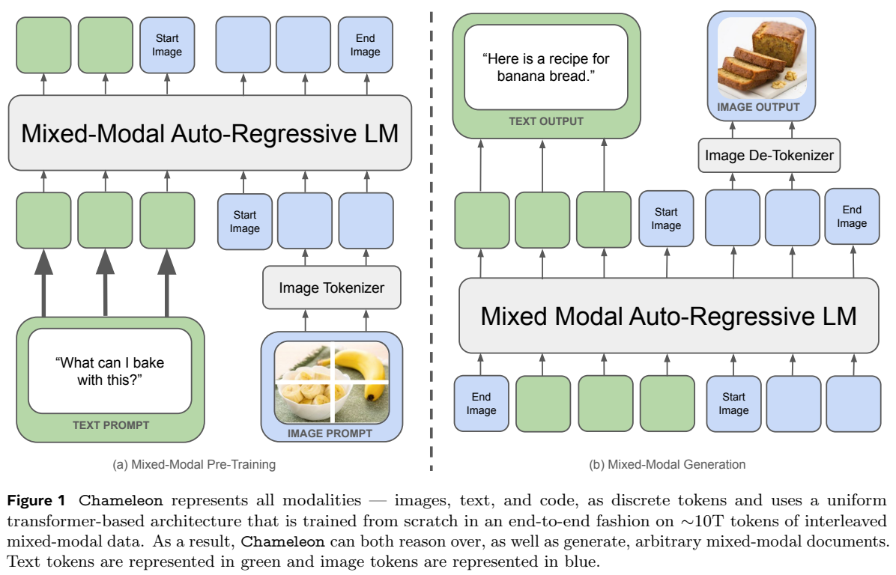
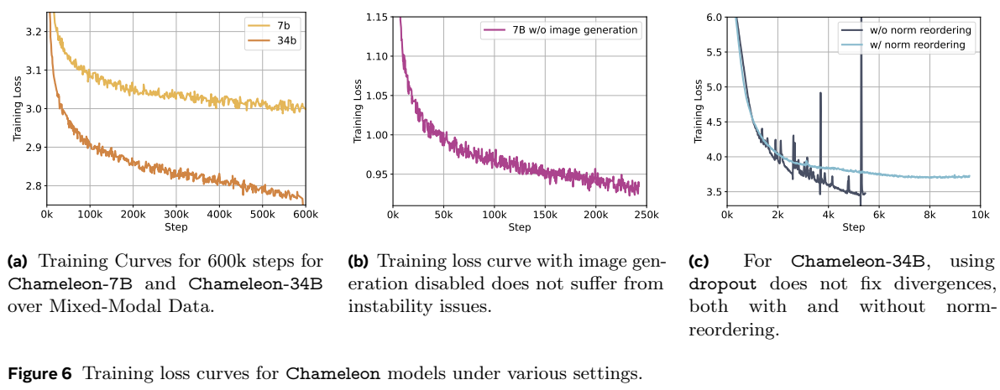
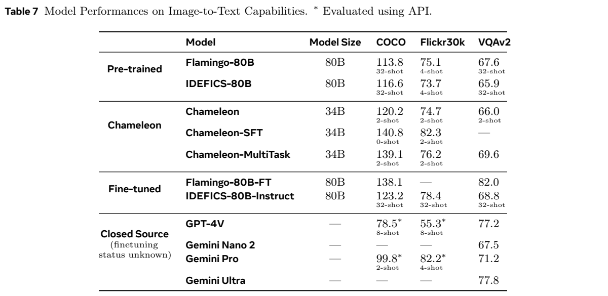
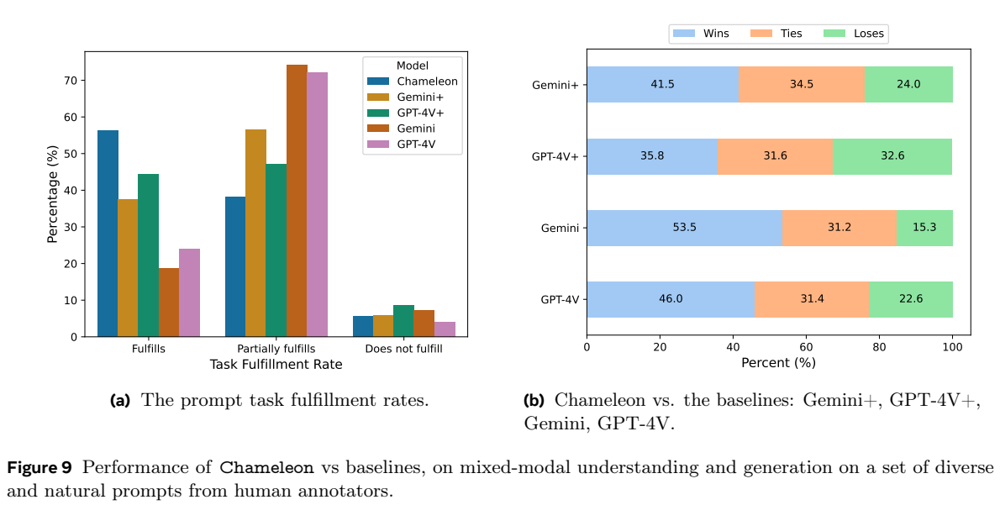

[返回 Chameleon 家族](../README.md) · [返回项目](../../../README.md)

# Chameleon：将图像和文字统一为离散token的早期融合模型

> 对应 **Chameleon: Mixed-Modal Early-Fusion Foundation Models**，固定 [arXiv:2405.09818v1](https://arxiv.org/abs/2405.09818v1)。本文介绍报告中的完整理解与生成系统，不据此推断后续某个公开checkpoint的实际开放功能。

## 1. 论文信息与模型定位

| 项目 | 内容 |
|---|---|
| 作者/机构 | Chameleon Team，FAIR at Meta |
| 日期 | arXiv首次提交2024-05-16，首页日期May17 |
| 规模 | 7B、34B稠密Transformer |
| 上下文 | 4096 token |
| 图像编码 | 512×512图像→1024离散token，8192大小codebook |
| 总词表 | 65,536，包含8192图像token |
| 输入输出 | 文字、图片与其交错文档，生成文字及图片 |
| 固定来源 | [PDF](https://arxiv.org/pdf/2405.09818v1) |

核心定位是完整多模态文档建模。模型可读图讲解，再生成配图并接着写文字；图像生成和文字生成共同依赖同一因果Transformer，而不由外接文生图模型处理每个图片请求。图像tokenizer/de-tokenizer仍是专门组件，所以“统一模型”不能被解释为直接把原始像素当字词，或不需要图像解码器。[原文 §1–2.1](https://arxiv.org/pdf/2405.09818v1#page=4)

## 2. 快速概览

早期融合将两类token从骨干起点放入同一表示和注意力结构，从零训练共享模型。相比只把连续视觉特征作为文字回答的条件，它还学习预测后续图像code，可以自然延续图文交错序列。代价是每张图需1024自回归步骤，且离散图像压缩的重建上限会影响理解；报告特别指出密集文字图片难以重建，OCR能力受限。

关键工程贡献是训练稳定性。图像和文字分布熵不同，共享权重训练时发现表示norm缓慢上升，可能晚期才出现发散。作者组合QK-Norm、输出z-loss、7B的dropout与34B的norm重排，完成9.2T累计训练token。不能把所有规模统一写成“dropout解决发散”：34B预训练反而不用dropout。

模型在文字与图像描述任务上有较强成绩，也可做图文生成，但VQAv2仍落后于部分后融合助手。人工评测针对必须带图片的长回答，对照含GPT4V/Gemini＋DALL-E3组合；结论是这一任务的偏好，不能变成总体理解或OCR超越GPT4V。报告中有偏好率统计不一致，本文按原始计数解释。[原文 §2.3、§4–5](https://arxiv.org/pdf/2405.09818v1#page=13)

## 3. 整体架构

*来源：原文Figure1，PDF第2页，[原页](https://arxiv.org/pdf/2405.09818v1#page=2)。绿色为文字、蓝色为图像code，图像起止标记控制序列结构；右侧不是把图像URL插入文字，而是生成后再解码视觉token。*

图片先经新训练的量化tokenizer成为1024个code，再由统一词表embedding进入Transformer。文字和代码均用新BPE，图像起止标记界定块；训练资料可以纯文字、图文对或多个图像与文字交错。Transformer沿用LLaMA2的RMSNorm、SwiGLU和RoPE，34B使用GQA，7B不用GQA；骨干不是以LLaMA2权重初始化后只训练适配器。

生成可自由在模态间切换，模态受限任务则对词表进行mask，如生成图片期间屏蔽不属图像code的候选。图像是固定1024code块，文字是变长，因此推理需要检测图像开始标记、管理块并调用de-tokenizer。报告基于PyTorch/xformers实现流式文字/图片，非流式图片块可融合控制减少逐步CPU检查，实际仍是自回归token生成，不是扩散去噪。

4096上下文意味着单图1024code已占约四分之一窗口，额外标记与文字进一步占空间。系统支持交错顺序，不等于能把任意长度文档无损塞进窗口。固定图像分辨率与code容量也限制小文字、复杂细节和长图形信息。[原文 §2.1、§2.4](https://arxiv.org/pdf/2405.09818v1#page=8)

## 4. 核心创新与数学原理

统一离散序列 $s_1,\ldots,s_T$ 的生成可用机制说明式 $\mathcal L_{AR}=-\sum_t\log p_\theta(s_t\mid s_{<t})$ 表达：文字和视觉code都在同一词表预测，区别于文字CE＋视觉连续回归两目标。原文未给完整预训练loss编号式，本文用它解释token建模，不额外宣称新的视觉对比或像素重构目标。图像tokenizer的训练是单独环节，其压缩错误无法通过语言预测完全恢复。

attention logits通常含 $QK^\top/\sqrt d$。QK-Norm在query与key上用layer norm，直接约束进入attention softmax的表示尺度，减轻norm不受控增长；它与最后词表softmax的logit漂移不同，不能只做QK-Norm就认为全部问题解决。

词表softmax具有平移不变性：$\operatorname{softmax}(z+c)=\operatorname{softmax}(z)$。概率可保持近似不变而logits共同漂移，数值范围仍可能出问题。原文进一步正则化分区函数 $Z=\sum_i e^{z_i}$，增加

$$\mathcal L_z=10^{-5}(\log Z)^2.$$

这不是对每个类别logit平方直接惩罚，也不是强制文字/图像概率相等。报告将不同模态共同训练的norm竞争作为问题解释，以训练曲线与去掉图片生成对照佐证；不能由此推出所有多模态系统必定存在相同发散机制。

*来源：原文Figure6与§2.3，PDF第7页，[原页](https://arxiv.org/pdf/2405.09818v1#page=7)。曲线横轴步数、纵轴训练loss；左图只显示前600K步，不是全部训练。右图同时说明dropout与norm重排的组合并不自动稳定。*

34B的残差更新改为 $h=x+\operatorname{Norm}_{att}(\operatorname{Att}(x))$，$o=h+\operatorname{Norm}_{ffn}(\operatorname{FFN}(h))$；LLaMA2对照则在Att/FFN之前归一化。区别是残差分支输出的尺度受约束，不是删掉残差连接。SwiGLU乘性结构可能进一步放大norm，使这项配置在大模型有用。作者随后发现7B也可用重排无dropout稳定，但主训练表7B仍为0.1，不能用事后发现替代实际训练配置。[原文 §2.3](https://arxiv.org/pdf/2405.09818v1#page=7)

## 5. 数据构建与处理

图像tokenizer仅用许可图像训练，含人脸图像比例加倍，以改善人像生成。骨干图文预训练另含公开和许可图文，图像resize/center crop至512。二者资料范围不能混同为全部预训练图像均属于同一许可集。

前80%训练使用大规模无监督混合：文字/代码继承LLaMA2与CodeLLaMA资料，正文报2.9T文字token；1.4B图文对、约1.5T图文token；网页交错资料约400Btoken，不含Meta产品/服务数据。图文对50%图片在前、50%文字在前，以覆盖描述与生成方向。最后20%降低前期资料权重50%、加入较高质量和过滤指令训练集，并保持近似图像/文字比例。

Table1基础资料为4.4T，正文各类近似值算术相加约4.8T，没有给出完全统一的去重或口径解释；累计训练正文9.2T、2.1epochs。Figure1的“约10T”是近似累计量，不能把4.4T和9.2T当两个独立训练阶段，也不能把未说明的差额自行解释成额外隐藏语料。[原文 §2.2、Table1](https://arxiv.org/pdf/2405.09818v1#page=8)

SFT按六类组织：文字1.6M、代码14.1K、视觉聊天15.6K、图像生成64.3K、交错生成16.9K、安全95.3K。图片生成从许可集筛审美评分至少6，并选接近512方图的高分样本；视觉聊天与交错资料由第三方高质量采集，不含Meta用户资料。安全资料来自既有文字/代码、安全合成、人工图像prompt和混合prompt扩展。不同模态配对必须平衡，否则模型会学到无条件多出图或不出图的先验；报告未列完整采样比例。

SFT输入图片用border padding保留信息，答案图片center crop重视觉质量，两者处理目的不同。不能把所有图片都说成center crop。数据样本数、图片数、token数原表各自有统计，不按一条对话一张图假设。[原文 §3、Table3](https://arxiv.org/pdf/2405.09818v1#page=9)

## 6. 训练流程与目标

| 配置 | 7B | 34B |
|---|---:|---:|
| 上下文 | 4096 | 4096 |
| 主学习率 | $10^{-4}$ | $10^{-4}$ |
| global token batch | $2^{23}$，约8M | $3\times2^{22}$，约12M |
| 预训练dropout | 0.1 | 0 |
| QK-Norm/z-loss | 有/$10^{-5}$ | 有/$10^{-5}$ |
| A100-80GB并发卡数 | 1024 | 3072 |
| 总GPU hours | 856,481 | 4,282,407 |

AdamW β1/β2=0.9/0.95、epsilon=$10^{-5}$，weight decay0.1、global clipping1；warmup4000step，之后指数学习率衰减至0。不得将此预训练schedule写成cosine。RSC使用InfiniBand，报告GPU hours包含实际训练资源统计，不能将GPU hours除成几个小时墙钟而不考虑并发变化。

SFT使用cosine、初始 $10^{-5}$、weight decay0.1、batch128、序列4096，pack多个prompt/answer并以标记分隔，只对答案token计loss；dropout0.05，保留z-loss。文章没有说全程冻结34B或仅训练LoRA，也没有提供SFT总step/epoch和完整模块冻结表，不补造配置。预训练与SFT的dropout和schedule需分别陈述。

这套报告对齐主要是监督微调，安全拒答也来自SFT；RLHF/RLAIF作为可能进一步提高的工作提及，不能写为已经执行的最后训练阶段。单任务SFT、multitask任务微调和一般Chameleon-SFT并非同一评测设置。[原文 §3.2、§5.2](https://arxiv.org/pdf/2405.09818v1#page=16)

## 7. 实验设置与主要结果

*来源：原文Table7，PDF第17页，[原页](https://arxiv.org/pdf/2405.09818v1#page=17)。每格shot不同，COCO/Flickr为CIDEr、VQAv2为准确率；“—”是未报告，不是模型无法完成。*

| 34B设置 | COCO | Flickr30k | VQAv2 |
|---|---:|---:|---:|
| 预训练模型 | 120.2（2shot） | 74.7（2shot） | 66.0（2shot） |
| 单任务SFT | 140.8（0shot） | 82.3（2shot） | 未报告 |
| Multitask | 139.1（2shot） | 76.2（2shot） | 69.6 |

预训练34B用更少shot可接近较大Flamingo/IDEFICS；描述微调较好，但VQAv2 69.6低于GPT4V77.2、FlamingoFT82.0等。caption限制30token、不同模型prompt/生成长度可能不同，不能把描述任务总分当完整多模态排名。文字评测用未SFT模型：34B MMLU65.8、GSM8K maj1 61.4/maj32 77.0、MATH maj1 22.5/maj4 24.7，比较必须统一多数投票次数。更大量文字、代码和高质量后期训练均可能贡献，不证明视觉单独提高文字能力。

*来源：原文Figure9，PDF第12页，[原页](https://arxiv.org/pdf/2405.09818v1#page=12)。蓝色wins、橙色ties、绿色loses；“+”表示文本模型输出caption再由DALL-E3配图，并非原API原生混合生成。*

人工集1048prompt，其中441含图像、607纯文字，但全部期望图文输出；三位标注者评判并取多数。Chameleon完整完成率正文55.2%，Gemini+/GPT4V+为37.6/44.7。因为任务要求图片，对照纯文字API先天缺输出模态；组合系统更适合检验，仍不等同相同结构/生成成本对照。

偏好分定义wins＋0.5ties。对Gemini+总体原始41.5%/34.5%/24.0%，计算约58.8%，附录Table11总体也58.8%；主文却称60.4%，该值实际对应441个混合输入子集。本文保留并说明这个冲突，不能将60.4%说成无条件总体胜率。对GPT4V+总体35.8/31.6/32.6，折算51.6%；其中直接胜出只是35.8%。Tie计半分不是统计显著性检验。

该人工集基本不覆盖OCR、图表，亦非真实在线日志；多人完全一致只有约28–35%，部分问题可靠性有限。安全Table5的34B众包20K unsafe约0.1%，内部445轮red team为1.6%，不能转化为所有请求安全保证；正文误写30B，按表34B保留。论文没有在该v1给统一标准文生图FID/GenEval成绩，不补造图像生成排行榜。本文未运行模型，所有图表与数字来自固定原文。
