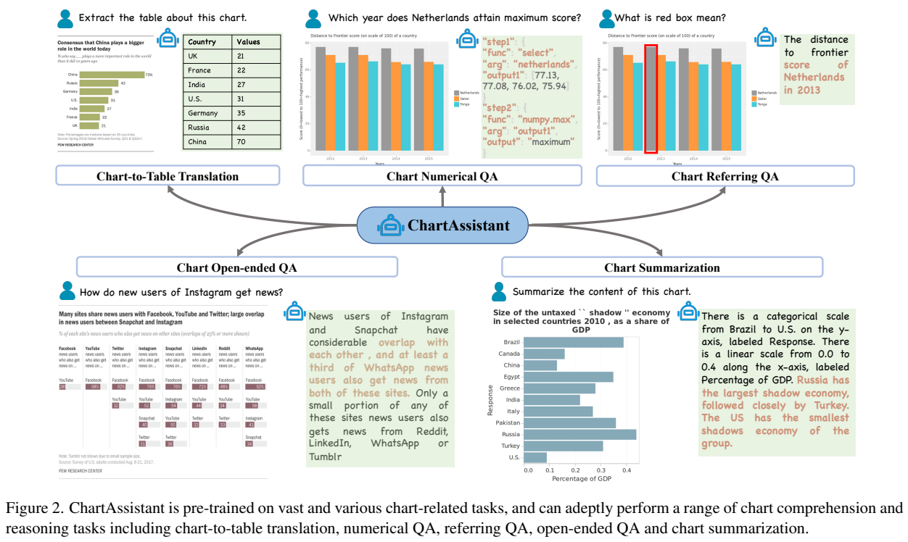
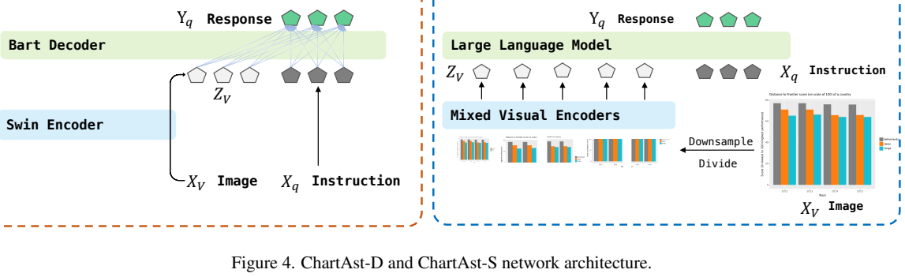
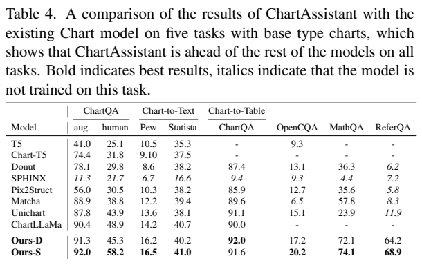
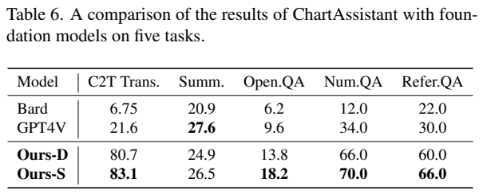
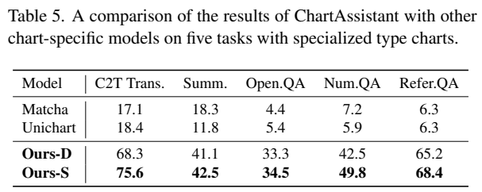
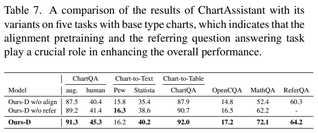
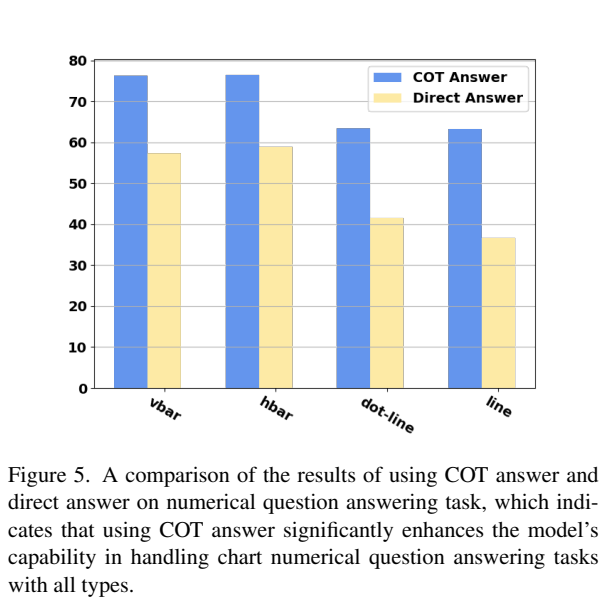
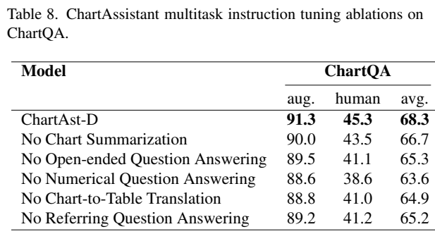

<!-- article-header:start -->
[项目首页](../../../README.md) › [模型系列](../../../reports/model-family-index.md) › [ChartAssistant](../README.md)
<!-- article-header:end -->

# ChartAssistant：先学图表到表格，再统一图表问答与推理

<!-- article-toc:start -->

**本篇目录** · [论文定位](#paper-info) · [快速概览](#overview) · [整体架构](#architecture) · [核心原理](#principles) · [数据构建](#data) · [训练流程](#training) · [实验结果](#experiments)
<!-- article-toc:end -->

## 1. 论文信息与模型定位

| 项目 | 内容 |
| --- | --- |
| 论文 | *ChartAssisstant: A Universal Chart Multimodal Language Model via Chart-to-Table Pre-training and Multitask Instruction Tuning* |
| 作者 | Fanqing Meng、Wenqi Shao、Quanfeng Lu、Peng Gao、Kaipeng Zhang、Yu Qiao、Ping Luo |
| 机构 | 上海人工智能实验室 OpenGVLab、上海交通大学、香港大学、南京大学 |
| 原文 | [arXiv:2401.02384v1](https://arxiv.org/abs/2401.02384v1)，2024 年 1 月 4 日，26 页含补充材料 |
| 模型 | ChartAst-D：基于 Donut，约 260M 参数；ChartAst-S：基于 SPHINX，约 13B 参数 |
| 数据与定位 | ChartSFT，多种图表类型与五类任务的指令数据；面向图表理解，不是通用照片生成模型 |

原文标题将 Assistant 拼为“Assisstant”，正文和项目通常采用 ChartAssistant；这里保留 PDF 标题以确认论文身份。报告提出的核心问题是：图表包含坐标轴、图例、文字、视觉标记与数值关系，通用自然图像理解不足以支持可靠的图表计算；只对某一任务微调的专用模型又难以迁移到其他任务。

作者采用两个现有视觉语言骨干，重点贡献是 ChartSFT 与训练组织：先把图表转换为 Markdown 表格，让模型学习图形与结构数据的关系；再联合训练数值问答、指代问答、开放问答、摘要和图表转表格。它希望一个检查点解决这些任务，减少逐个下游任务再次微调的需求。本文以固定 v1 为准，不把后续模型更新混入结果。

## 2. 快速概览

**读图：** 图中从同一模型伸出五条任务路径。左上是恢复数据表，右上是对红框所指元素的问答，中上是数值问题和 JSON 函数步骤，下方是开放问答及摘要。数值问答示例有选择数据与调用最大值函数的步骤，提示该能力涉及后端计算。

| 选择 | 具体内容 | 带来的作用 |
| --- | --- | --- |
| 专门对齐阶段 | 图表到 Markdown 表格 | 对齐曲线、柱形、图例、坐标与结构化数值 |
| 结构化推理监督 | 数值问答输出 JSON 形式的函数及参数 | 将读取、选择数据与计算步骤分开，并交给后端执行 |
| 图中指代训练 | 箭头、框及多种颜色标记的问答 | 训练识别用户指向的元素及元素关系 |
| 图表样式与类型扩展 | 多绘图库、多样式；加入雷达、面积、直方、气泡、箱线图 | 减少对少数固定渲染模板的依赖 |
| 双规格 | 260M 的 Donut 路径与 13B 的 SPHINX 路径 | 展示数据和流程可用于不同参数规模与视觉语言架构 |

这篇论文的重点应按“数据结构—训练顺序—多任务评测”阅读。图表转表格让模型先学习底层数据关系，指令混合决定它如何利用这些关系回答问题。不同图表类型的合成数据补充覆盖，但公开基准和作者自建测试并不是同一种泛化证据。特别是较复杂图型获得训练数据后成绩提升，不能直接等同于完全未见图型的零样本泛化。

## 3. 整体架构

**读图：** ChartAst-D 左侧通过 Swin 编码图像，BART 解码器使用视觉特征和问题；ChartAst-S 右侧先对图像下采样及切分，以混合视觉编码器提取特征，再将视觉与文字 token 一起送入大语言模型。两者接受相同任务组织，连接方式却不同。

ChartAst-D 使用 Swin-Base 视觉编码器与 BART 文本解码器。Swin 用非重叠窗口和层级注意力处理图表，将图像 $`X_V`$ 变为视觉序列 $`Z_V=\{z_i\}_{i=1}^{n}`$。BART 解码器通过交叉注意力访问视觉特征，根据文字指令生成回答。这里视觉特征充当交叉注意力的键和值，而不是简单转成文字 OCR 结果后再回答；模型沿用 Donut 的端到端文档理解路线。

ChartAst-S 沿用 SPHINX 的多视觉编码器与语言模型设计，组合 DINOv2、CLIP、ConvNeXt 等视觉信息，并对高分辨率图像采用全局下采样和局部切分。视觉 token 与指令 token 拼接，送入语言模型自回归生成回答。全局视图有助于掌握图例、坐标系和整体趋势，局部视图有助于保留密集标签和细小标记；这些是机制解释，不意味着每幅图都已测得完全无损的局部读取。

模型本体负责文字、表格或函数步骤的生成；数值 QA 的最终计算由后端按照函数步骤执行。因此，其整体求解能力由视觉读取、函数选择、参数生成和计算执行共同组成，错误可能来自任何一环。报告没有提出新的学习式计算器，也没有证明 BART 或 SPHINX 在不使用后端时达到同样数值准确率。

论文披露的是约 260M 与 13B 的模型规格，比较基础模型时正文又称“小型 200M 模型”。本文采用架构节的 260M，不把这种约称差异解释成另一个独立模型。原文没有给出所有连接器维度和分层冻结明细，不补写未经披露的配置。

## 4. 核心创新与数学原理

论文的正式目标是回答序列的下一 token 交叉熵。第一阶段只使用图表到表格任务，令 $`X_V^{c2t}`$ 为图像、$`X_q^{c2t}`$ 为指令、$`Y_q^{c2t}`$ 为目标表格序列，原文 Eq. (1) 为

$$
\mathcal L_{\mathrm{Stage1}}
=-\sum_{i=1}^{m}\log P_\theta\bigl(Y_{q,i}^{c2t}\mid
X_V^{c2t},X_q^{c2t},Y_{q,<i}^{c2t}\bigr).
$$

监督目标是表格文本，但学习对象包括关系：某条曲线属于哪个图例、哪个柱形对应哪个类目、读取哪个刻度后能恢复数值。因而这个任务并非只学表格排版，而是把图表视觉表达约束到一种结构化语义输出。不过交叉熵直接比较 token，不保证不同但语义等价的表格写法获得同样损失；评测时才使用对表格置换更稳健的指标。

第二阶段混合五类任务。原文 Eq. (2) 将任务或样本索引写为 $`k\in\Omega`$：

$$
\mathcal L_{\mathrm{Stage2}}
=-\sum_{k\in\Omega}\sum_{i=1}^{m}
\log P_\theta\bigl(Y_{q,i}^{k}\mid
X_V^{k},X_q^{k},Y_{q,<i}^{k}\bigr).
$$

两阶段改变的是训练数据与初始化检查点，而不是改成五个独立输出头。统一的序列生成接口让表格、回答、JSON 步骤和摘要共用模型，但实际混合比例决定各任务的曝光量。正文提到按一定比例采样，所读补充设置没有完整列出可复现的比例表，本文不把样本数量比例假定为实际采样权重。

数值 QA 的 Chain-of-Thought 是可执行函数步骤。例如先依据图例检索 Netherlands 的数值，再执行最大值函数；复杂问题可以包含均值、差值、比率或相关性判断。这样把“根据图形确定正确数据”交给模型，把精确数值运算交给后端。其创新不应被压缩成“加一句逐步思考”：输出结构、可调用函数以及执行顺序都属于监督内容。

指代 QA 则通过在图中加入框、箭头和颜色，将“这个元素”转为显式视觉指向。有多个标记时，模型还需要比较它们的关系。该任务可以增强其他任务，但原文没有证明所有视觉关系都得到同等改善；消融提供的是特定评测上的经验贡献。

## 5. 数据构建与处理

ChartSFT 的 Table 1 合计为 **39,388,322 条图表—文字标注**，这是多任务样本数，不是 39M 张互不重复的图表。大部分图表类型包括柱、线、点线、饼；扩展类型包括面积、直方、雷达、气泡、箱线，共九类。

| 任务 | Table 1 样本数 | 主要构建方式 |
| --- | ---: | --- |
| 图表到表格 | 911,958 | 公开图表表格对、样式重绘、arXiv 表格转图表、特殊图型合成 |
| 数值 QA | 24,494,581 | 扩展模板、结构化函数推理步骤与答案 |
| 指代 QA | 5,899,842 | 对元素添加箭头或框，生成读取与计算问题 |
| 开放 QA | 7,075,203 | 公开问答、科学图表及根据表格上下文生成问答 |
| 摘要 | 1,006,738 | 公开摘要数据及 UniChart 的知识蒸馏 |

图表到表格数据首先取自 ChartQA 和 PlotQA。作者用 ggplot、plotly、matplotlib、seaborn、pyecharts 等库重绘，并改变颜色、尺寸、字体、背景等二十多种参数，得到额外样式。再从约 1.3M 篇 arXiv 论文的 LaTeX 源码中定位表格，用 ChatGPT 转为 Markdown，并建议适当的图型，得到 132,719 对。这里使用的是论文里的表格再渲染，不代表所有生成图都保留原论文中的图表视觉布局。

数值 QA 将 PlotQA 的 40 种模板扩展为 101 种通用模板，新增 61 种；ChartSFT 的新增模板平均推理步骤 5.02，PlotQA 为 3.48，反映更复杂的求解组织。指代 QA 另有 114 种模板，并随机化标记的颜色、大小和宽度。后端按照 JSON 中的有序函数计算答案，避免让文本生成本身承担全部浮点运算。

特殊图型数据来自二十多种预设概率分布或随机数。直方图和箱线图先生成原始数组，再计算频率、须线等统计量；雷达、气泡和面积图按数值数据渲染。ChatGPT 提供标题、图例、标签及开放问答等语义内容。合成覆盖有助于扩大图型范围，但真实图表里的不规则布局、低质量截图和标注噪声仍可能不同于合成分布。

原文开放 QA 正文计数与 Table 1 有 40 条差异；本文保留 Table 1 的可核对口径。比起机械复述“比某数据大几倍”，更重要的是理解多任务复用同一底层数据，以及自动合成、模型生成标注和蒸馏都可能带来误差。报告未完整披露跨来源去重规则和全部测试集规模，不补写这些缺失统计。

## 6. 训练流程与目标

预训练阶段专做图表到 Markdown 表格的对齐，补充 B.1 报告 65K 步。随后进入五任务联合指令训练，继续使用交叉熵目标和第一阶段检查点。目标是一个模型能接收不同指令，完成各种图表任务，主表评测不为每个下游任务再单独微调。特殊图型也经过相应训练，因此不能将其结果表述为完全未经图型数据训练。

补充材料给出 Adam 优化器、调度学习率，ChartAst-D 初始学习率 $`5\times10^{-5}`$，ChartAst-S 为 $`2\times10^{-6}`$；图像输入分辨率写为 448×448，最大解码长度分别为 1,536 和 2,048。训练设备为 8 张 A100 80GB。作者称训练 330K 步后测试，但没有明确逐段训练步数的总计关系，也未完整列出批大小、混合权重、梯度累计和模块冻结表，因此本文不自行拼出一个完全复现的配置。

图表问答时输入图像和文字指令，模型输出回答或计算步骤。若任务输出函数计划，系统按计划执行计算并返回结果；图表转表格则输出文本表格，摘要输出自然语言。接口虽统一，评测规则必须随任务变化，不能拿较高的 BLEU 当作数值一定正确。

两个规格都应用这一数据与训练思想，性能差异同时受模型容量、视觉编码方式及语言先验影响。对比 ChartAst-D 与 ChartAst-S 并不是一个只改变参数数量的干净缩放实验；它也改变了交叉注意力与拼接式视觉输入等设计。

## 7. 实验设置与主要结果

**读图：** Table 4 有八个不同指标列，ChartQA 拆 augmented/human，摘要拆 Pew/Statista；Table 5 是特殊图型的五类任务；Table 6 是另一个每任务 50 样本的小规模集合。它们不是同一测试集，不能跨表横向比较数值。原图完整保留表头，以避免把摘要 BLEU 读成问答准确率。

ChartQA、MathQA、ReferQA 使用允许约 5% 数值误差的 relaxed correctness；OpenCQA 与 Chart-to-Text 使用 BLEU；图表转表格使用 DePlot 的 RMSF1，对表格顺序或转置更稳健。作者自建 MathQA、ReferQA 与公开基准并列评测，但不因此成为所有图表应用的统一标准。

| 模型 | ChartQA aug. / human | 表格恢复：ChartQA | OpenCQA BLEU | MathQA | ReferQA |
| --- | ---: | ---: | ---: | ---: | ---: |
| UniChart | 87.8 / 43.9 | 91.1 | 15.1 | 23.9 | 11.9 |
| MatCha | 88.9 / 38.8 | 89.6 | 6.5 | 57.8 | 8.3 |
| ChartAst-D | 91.3 / 45.3 | 92.0 | 17.2 | 72.1 | 64.2 |
| ChartAst-S | 92.0 / 58.2 | 91.6 | 20.2 | 74.1 | 68.9 |

ChartAst-S 的 human 问答明显强于 D，但表格恢复略低于 D，说明更大语言模型不自动使每个指标最好。Table 4 的 Statista 摘要中 D 为 40.2，也低于 ChartLLaMA 的 40.7；报告整体任务表现较强，不应改写为每个规格在每列都全面第一。特殊图型中 S 的表格、摘要、开放 QA、数值 QA、指代 QA 分别为 75.6、42.5、34.5、49.8、68.4，均高于表中 MatCha、UniChart，但训练覆盖不同是解释优势的重要因素。

小规模通用模型对比每任务仅 50 个样本，既含真实图表表格对，也含表格经 API 渲染的图。S 的表格恢复 83.1、数值 QA 70.0、指代 QA 66.0，GPT-4V 分别为 21.6、34.0、30.0；然而摘要 BLEU 上 GPT-4V 的 27.6 高于 S 的 26.5 和 D 的 24.9。原文猜测摘要指标偏向流畅性，但未提供充分事实核验来证明较高摘要分一定掩盖更多事实错误。这里能够确认的是该小集合的指标差异，而不是现实世界所有图表上的全面超越。

**读图：** Table 7 删除对齐阶段或指代任务，Figure 5 比较可执行 CoT 与直接答案，Table 8 分别去掉任务。原文此处有引用 Table 10 的笔误，实际对应 Table 7；本文按图片编号解释。

删除对齐预训练后，D 的 MathQA 从 72.1 降至 52.4，human ChartQA 从 45.3 降至 40.4；删除指代任务后 MathQA 为 62.2。直接答案改为 CoT 后，数值 QA 从 51.9 升至 72.1，增益包含可执行后端计算，不是纯语言计算提升。Table 8 去掉数值任务后 ChartQA 平均从 68.3 降至 63.6，是表中较大降幅；而去掉摘要降至 66.7。补充材料加入等价问题表述后，相关测试准确率从 71.8 到 76.2，表明对模板改写进行训练有助于该设置下的鲁棒性。

总体证据支持先学图表与表格的结构关系，再联合图表任务的训练方式，也支持把计算步骤交给后端。其实际边界是合成与自动标注数据依赖、自建测试的覆盖范围、基础模型对比样本较少以及缺失部分复现设置；这些决定结果应如何解释和迁移到新的真实图表。

<!-- article-footer:start -->
---

[← 上一篇：MobileVLM](../../mobilevlm/arxiv-2312.16886/README.md) · [按发表时间浏览](../../../reports/paper-reading-guide.md#year-2024) · [下一篇：SpatialVLM →](../../spatialvlm/arxiv-2401.12168/README.md)

[返回本篇目录](#article-toc) · [返回模型系列](../README.md)
<!-- article-footer:end -->
