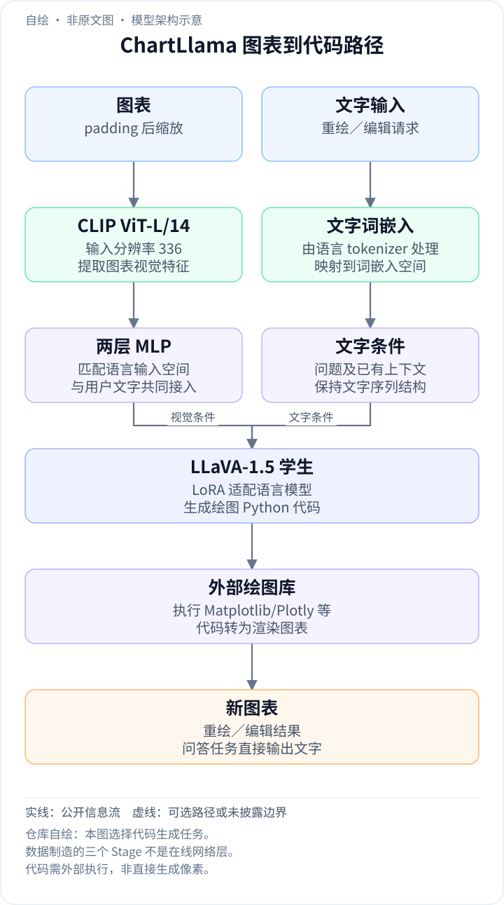
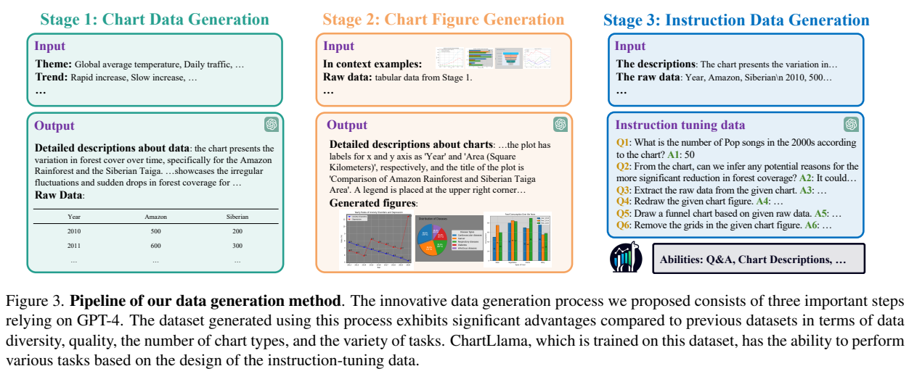
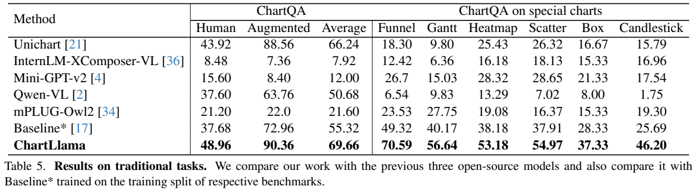
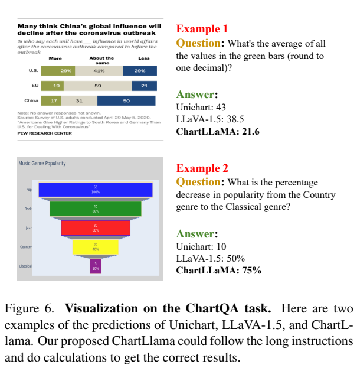
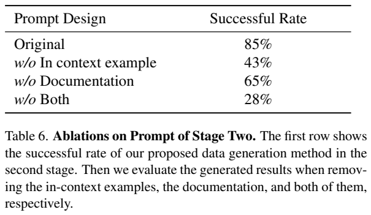
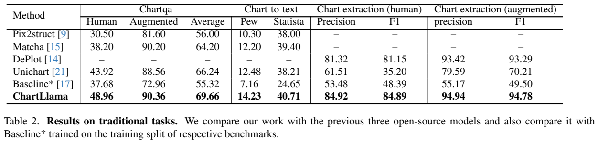
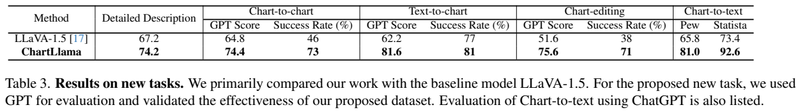
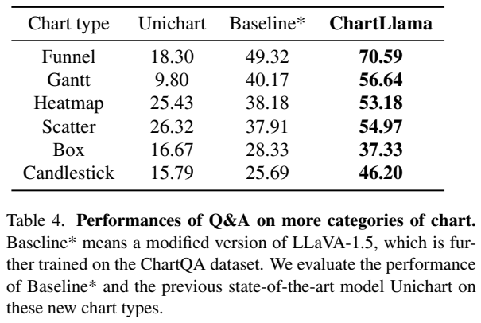
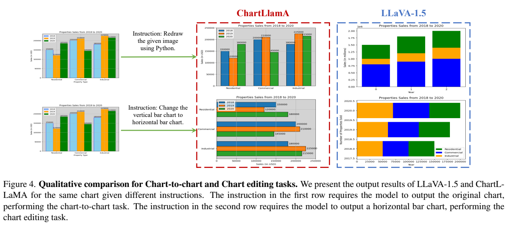
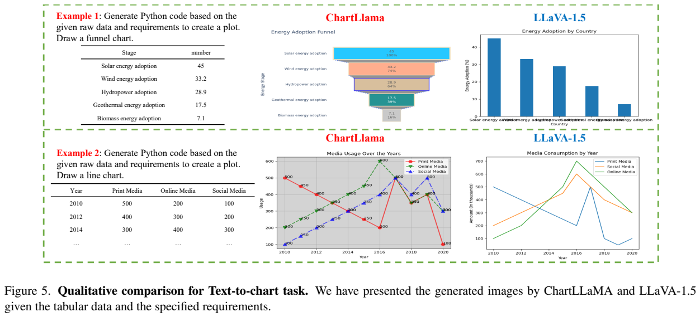

<!-- article-header:start -->
[项目首页](../../../README.md) › [模型系列](../../../reports/model-family-index.md) › [ChartLlama](../README.md)
<!-- article-header:end -->

# ChartLlama：从表格与绘图代码合成监督，学习图表理解和编辑

[返回 ChartLlama 系列](../README.md) · [返回仓库](../../../README.md)

<!-- article-toc:start -->

**本篇目录** · [论文定位](#paper-info) · [快速概览](#overview) · [整体架构](#architecture) · [核心原理](#principles) · [数据构建](#data) · [训练流程](#training) · [实验结果](#experiments)
<!-- article-toc:end -->

## 1. 论文信息与模型定位

| 项目 | 内容 |
|---|---|
| 原文 | *ChartLlama: A Multimodal LLM for Chart Understanding and Generation* |
| 作者与机构 | Yucheng Han、Chi Zhang、Xin Chen、Xu Yang 等；南洋理工大学、腾讯、东南大学 |
| 本文依据版本 | arXiv:2311.16483v1，2023 年 11 月 27 日；19 页 PDF，含 9 页附录 |
| 模型基础 | LLaVA-1.5：CLIP ViT-L/14@336 视觉编码器、两层 MLP 投影、带 LoRA 的语言模型 |
| 输入输出 | 图表图片或文字指令/表格输入，答案、描述、结构化表格或 Python 绘图代码输出 |
| 研究重点 | 用可控的合成表格、可执行绘图代码和多任务指令，弥补通用多模态模型的图表领域数据不足 |
| 资源 | [固定版本论文](https://arxiv.org/pdf/2311.16483v1) · [官方主页](https://tingxueronghua.github.io/ChartLlama/) · [官方仓库](https://github.com/tingxueronghua/ChartLlama) |

ChartLlama 的“生成图表”主要是**生成绘图程序后执行绘制**，不是在视觉扩散模型里直接预测图像像素。输入已有图表时，它可以反推数据及绘图代码，再按指令改变方向、配色或图表类型；输入表格和文字时，则生成对应代码。论文的主要新贡献在数据构建和任务设计，模型接口沿用 LLaVA-1.5。固定版本没有清楚列出一张完整的最终模型参数表，本文不凭名称补写精确总参数量。[来源：原文第 3–4 节、Appendix A。](https://arxiv.org/pdf/2311.16483v1)

## 2. 快速概览

| 关键点 | 内容 |
|---|---|
| 三步数据流程 | 先生成表格数据及趋势描述，再生成绘图代码和图表，最后基于已知数据、描述与代码设计任务 |
| 数据规模 | 约 11K 图表、160K 指令，10 种图表类型、7 类任务；多问答可共享同一图表 |
| 任务范围 | 问答、摘要、数据提取、详细描述、图表重绘、文字到图表、图表编辑 |
| 代表结果 | ChartQA 人工题 48.96、增强题 90.36，平均 69.66；Unichart 平均 66.24 |
| 代码能力 | Chart-to-chart 可执行成功率 46%→73%，chart-editing 38%→71%，与原始 LLaVA-1.5 比较 |
| 主要边界 | 合成过滤主要检查格式和代码执行，并不自动证明数据和图像语义完全一致；多语言 OCR 是明确限制 |

本文把“理解”与“生成”放到同一个文本输出空间：答案、CSV 风格数据和 Python 程序都能用下一 token 预测学习。数据的价值也在于同一图表同时有底层表格与绘图源码，便于构造精确数值、视觉样式和编辑目标的监督。这里的 160K 是指令数，11K 是图表数，两者不能相加成独立图片数量。[来源：Table 1、第 3 节。](https://arxiv.org/pdf/2311.16483v1)

## 3. 整体架构

<!-- derived-architecture:start -->

*自绘模型架构示意（非原文图）。依据下述公开资料归纳；方框表示功能组件，不代表逐层实现。*

依据：[§4.1–4.2、附录 A，PDF pp.6、11](https://arxiv.org/pdf/2311.16483v1)。
<!-- derived-architecture:end -->

*原文 Figure 3，PDF 第 4 页。绿色框产生表格与数据描述，橙色框产生图表和视觉描述，蓝色框生成问答、抽取、重绘与编辑指令。这是数据流水线，不能把三个 Stage 当作三个模型网络层或三次学生模型训练。*

图表图像通过 CLIP ViT-L/14@336 编码，再经两层 MLP 映射到语言模型空间。附录强调图像预处理采用 padding，避免常规中心裁剪直接丢掉坐标轴、图例和标题。这对图表尤为重要：裁掉一个纵轴单位就可能使数值问答失去条件。但 padding 后仍缩放到固定分辨率，小字符、密集图例和长表头仍可能难以识别。

语言模型结合视觉提示与用户文字，自回归输出不同目标。问答生成短文字，图表摘要生成较长描述，数据提取生成表格字符串，重绘和编辑生成 Python 代码。代码通过 Matplotlib、Plotly 等工具渲染成图像，因此模型输出的准确性同时涉及数值、程序语法、绘图库使用和指令遵循。

作者对语言模型采用 LoRA，以较少更新参数保持已有通用能力。附录 A 讨论 LLaVA-1.5 需要较高的 LoRA rank，并写作超过 128，但没有给出一套明确对应最终 ChartLlama 训练的 rank、alpha、target modules 清单。不能因此将某个常见配置如 rank=128、alpha=256 直接补进本文。报告也没有提出 Q-Former、多视觉编码器或新的专用 OCR 网络。[来源：Implementation details、Appendix A，PDF 第 6、11 页。](https://arxiv.org/pdf/2311.16483v1)

可将一次图表重绘分为模型内理解与模型外执行：输入图表先 padding，再经 336 分辨率 CLIP 和 MLP 进入语言模型；用户的重绘要求指定输出 Python 程序；生成的程序交给绘图库执行，得到新图。问答或表格抽取则在文字／表格字符串处结束，不必运行绘图工具。原文的数据流水线负责制造这些任务的监督，在线推理并不会先重跑那三个数据生成 Stage。这里沿用 LLaVA-1.5 的学生结构，只展开报告明确的接口，未披露的最终 LoRA 超参数仍保留未知。[原文 §4.1–4.2、附录 A，PDF 第 6、11 页](https://arxiv.org/pdf/2311.16483v1#page=11)

## 4. 核心创新与数学原理

原文主要是工程与数据方法，没有新的编号数学公式。其机制可以用一个可逆任务关系解释：设表格为 $`D`$、视觉样式为 $`a`$、绘图代码为 $`c`$，绘图库生成图像 $`I=\mathrm{Render}(c,D,a)`$。合成阶段已知 $`D,c,a`$，学生模型训练时则要根据 $`I`$ 与指令预测文字答案、$`D`$ 或 $`c`$。这里的等式是本文整理的解释，不是原文 Eq.。

这个关系并不保证反问题唯一：同一图像可能由不同 Python 程序画出，一些数据的小差别也可能在像素上不可分辨。因此 chart-to-chart 的合理目标是重现数据、类型、轴、配色与标题，而不是程序逐字符完全相同。把源码作为监督，比仅有图表截图更容易构造可执行输出和针对性编辑。

对所有文本目标，标准监督目标可表示为

$$
\mathcal L_{\mathrm{SFT}}
=-\sum_t\log p_\theta(y_t\mid y_{<t},I,s),
$$

其中 $`s`$ 是用户任务，$`y`$ 可以是答案、描述、表格文本或程序。模型没有在同一次输入里必然先输出表格再让外部 LLM 推理；论文主要研究单个多模态模型直接完成任务。不同任务的输出格式被指令区分，数值计算能力则通过合成问答与已有语言模型能力共同学习，原文没有额外的可微计算器损失。

LoRA 的通常定义为 $`W'=W+(\alpha/r)BA`$，其中 $`A\in\mathbb R^{r\times d_{in}}`$、$`B\in\mathbb R^{d_{out}\times r}`$，训练低秩增量代替更新整个 $`W`$。这是标准机制解释，不能将此式中的 $`r,\alpha`$ 认为已经由论文逐项披露。原有视觉表征与语言能力负责通用入口，新增领域数据负责把它们引导至图表任务。

数值推理示例展示了数据监督的意义。原文 Figure 6 中绿色条的数值为 29、19、17，平均为 $`(29+19+17)/3=21.666\ldots`$，模型回答 21.6；按通常四舍五入到一位小数应为 **21.7**，所以这个定性示例不能直接作为精确舍入无误的证据。同图的 Country 20 到 Classical 5 的下降比例为 $`(20-5)/20=75\%`$，与回答一致。本文保留这个小误差，以区分“读到大致正确数值”与“严格满足数学指令”。[来源：原文 Figure 6、Appendix A，PDF 第 11 页。](https://arxiv.org/pdf/2311.16483v1)

## 5. 数据构建与处理

第一步生成表格。作者先准备数百个主题短语，随机选择主题、趋势、行列长度及图表类型，再让 GPT-4 生成 CSV 数据和详细描述；也可以参照已有图表数据集进行合成。约束趋势是为了避免没有结构的随机数，限制行列数是为了防止过长重复表格，指定图表类型则保证适用性，例如饼图比例应满足相应总和要求。合成数值是训练材料，不能当作真实统计事实。

第二步生成图像。提示包含原始表格、相关函数文档、成功绘图代码示例及样式要求。GPT-4 编写自包含 Python：数据放入代码、不依赖外部文件，并设置标题、坐标轴标签、图例、可选数据标注；成功代码可回收为之后的 in-context example。作者认为这种方法比固定绘图模板更灵活，能够扩展漏斗、甘特、热图、散点、箱线、蜡烛等类型。

第三步生成指令。已知原始数据、数据趋势描述、图表描述与源码，GPT-4 可以设计问答、短摘要、详细描述、表格抽取、绘图程序与修改指令。Q&A 数量较多，因为一张图可以问多个数值、比较和趋势问题。教师主要读取这些文字和代码，不是让 GPT-4V 在每次生成时直接看图；附录 E 明确指出当时使用的 GPT-4 不能处理图像，使全面纠错困难。

实际过滤检查输出标记和数据格式是否符合要求，并执行绘图脚本，无法运行的图对应样本被移除。可执行性是必要条件，但一个可执行程序仍可能画错序列、单位或颜色，文字描述也可能与像素不一致。报告没有给出全面人工语义核验比例或自动验证覆盖率。因此“已知底层数据”提高了可控性，但不能等同于训练监督的数值正确率 100%。

*PDF 第 11 页，附录印刷页码为 1。Figure 6 的绿色条数值和模型回答可直接核对；右侧 Table 6 是教师绘图数据生成成功率，85% 并不是学生模型在图表问答中的准确率。*

Table 6 对第二步提示做消融：完整提示成功率 85%，删 in-context example 后 43%，删文档后 65%，同时删两者为 28%。这支持示例与函数文档帮助生成可用绘图程序，但没有直接证明每份合成问答都正确。固定版本也没有清楚披露 11K 图表对应的完整去重策略及各新任务测试集的精确样本量，本文不添加这些细节。[来源：第 3 节、Appendix C–E，PDF 第 4–5、11–14 页。](https://arxiv.org/pdf/2311.16483v1)

## 6. 训练流程与目标

本文从已有 LLaVA-1.5 的通用视觉语言能力出发，用合成领域数据训练视觉投影层和语言模型适配参数。附录 B 介绍基础模型的历史：约 558K LAION-CC-SBU 图像描述对训练投影，随后约 665K 指令数据获得通用视觉问答、OCR、区域理解能力。那是 LLaVA-1.5 的基础训练说明，不能写成 ChartLlama 在新领域阶段重新执行了同样两步并重复使用所有这些条目。

| 环节 | 目标与可核对信息 |
|---|---|
| 基础模型初始化 | 继承 LLaVA-1.5 的图像理解、OCR、文字与程序生成能力 |
| 图表领域微调 | 使用约 160K 合成指令；训练投影层与语言模型的 LoRA 接口；视觉编码器不在正文列出的更新模块中 |
| ChartQA 测试 | 作者称在自己合成数据训练后进行零样本评测，未针对 ChartQA 训练集进一步微调 |
| Chart-to-text BLEU-4 测试 | 原文明确为贴近参考写作风格，额外在该任务 train split 训练；与上述零样本协议不同 |

监督以各任务的目标文字/代码为答案。原文并没有 RLHF、DPO 或图像扩散训练阶段。正文说训练超参数见附录，但这份 v1 附录没有完整给出学习率、batch、epoch、GPU、优化器和耗时表；本文仅整理已披露内容。语言模型采取 LoRA 的动机是减少过度适配和能力遗忘，报告没有提供同样数据下全量微调与 LoRA 的严格对照数值，不能把该动机当作已证实的普遍定律。[来源：第 4.1–4.2 节、Appendix A–B、G。](https://arxiv.org/pdf/2311.16483v1)

## 7. 实验设置与主要结果

*PDF 第 7 页原文图表裁图，Table 2 是传统任务，Table 3 是新任务及 GPT 评分，Table 4 是特殊类型图表问答。BLEU-4、GPT Score、可执行成功率、抽取 F1 的含义不同，不能直接排成同一准确率排行榜。*

| Table 2 指标 | Unichart | Baseline* | ChartLlama |
|---|---:|---:|---:|
| ChartQA human relaxed accuracy | 43.92 | 37.68 | 48.96 |
| ChartQA augmented | 88.56 | 72.96 | 90.36 |
| ChartQA 平均 | 66.24 | 55.32 | 69.66 |
| Pew 描述 BLEU-4 | 12.48 | 7.16 | 14.23 |
| Statista 描述 BLEU-4 | 38.21 | 24.65 | 40.71 |
| Human 图表抽取 F1 | 35.20 | 48.39 | 84.89 |
| Augmented 图表抽取 F1 | 70.21 | 49.50 | 94.78 |

Baseline* 使用相同 LLaVA-1.5 架构、在相应传统任务训练集分别训练，不是原始零样本模型。抽取的另一个强基线 DePlot 在 human/augmented F1 为 81.15/93.29，ChartLlama 分别为 84.89/94.78，差距比与 Unichart 比较时小得多。ChartQA human 更需要数学推理，48.96 也表明模型仍有大量错误，不能因平均 69.66 就宣称复杂图表已被解决。

新任务 Table 3 与原始 LLaVA-1.5 比较：详细描述 GPT Score 67.2→74.2；chart-to-chart GPT Score 64.8→74.4、成功率 46%→73%；text-to-chart 62.2→81.6、成功率 77%→81%；chart-editing 51.6→75.6、成功率 38%→71%。Chart-to-text 的 GPT Score 在 Pew/Statista 上为 81.0/92.6，不能与 Table 2 的 BLEU-4 14.23/40.71 当作同一度量。

GPT 评测根据参考描述、原始数据、参考代码和预测代码给分，主要判断语义与代码质量，并不等于一个完全基于渲染图像像素的相似度评测。原文正文与附录某些评分维度/区间描述略有差异，例如 text-to-chart 正文列四方面而 Figure 14 列三个维度，所以复现需以公开提示和实现为准，不能自行补一套统一公式。可执行成功率也只表示运行可用，不能保证数值和样式正确。

Table 4 的六种特殊图表中，ChartLlama 的漏斗 70.59、甘特 56.64、热图 53.18、散点 54.97、箱线 37.33、蜡烛 46.20，高于表中 Baseline* 与 Unichart。这里“新图表类型”是相对既有基准覆盖范围，合成训练本身覆盖这些类型，不能叫它们学生模型从未见过的类型。

*原文 Figure 4–5，PDF 第 8 页。上方既比较重绘，也比较竖柱图改横柱图；下方比较表格到漏斗图和折线图。看图时应核对类别、数值、坐标轴与指令，而不只比较是否画得漂亮。*

作者还承认，多模态模型因输出格式不合现有指标而得分偏低；因此附录里一些模型的低分不能简单等同于没有感知能力。明确限制是当前视觉编码器缺乏多语言 OCR，非英语图表的实用性受限。本文证明了一条可用的领域数据路线：从表格和程序开始合成监督，扩展任务种类，在同一多模态接口中联合理解与程序生成；其结论应保持在论文实际的指标、语言、图表分布和评测条件内。[来源：第 4 节、Limitations、Appendix F–H。](https://arxiv.org/pdf/2311.16483v1)

<!-- article-footer:start -->
---

[← 上一篇：ShareGPT4V](../../sharegpt4v/arxiv-2311.12793/README.md) · [按发表时间浏览](../../../reports/paper-reading-guide.md#year-2023) · [下一篇：LLMGA →](../../llmga/arxiv-2311.16500/README.md)

[返回本篇目录](#article-toc) · [返回模型系列](../README.md)
<!-- article-footer:end -->
