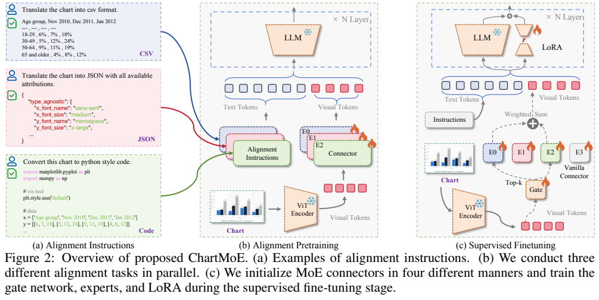
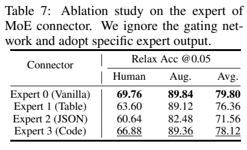
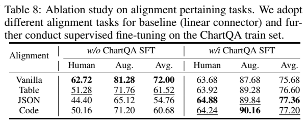
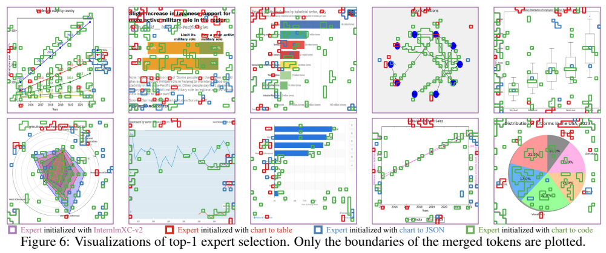
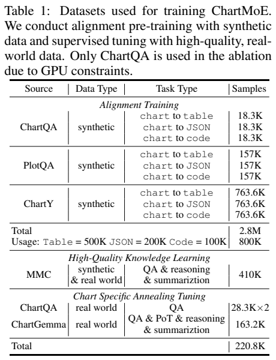
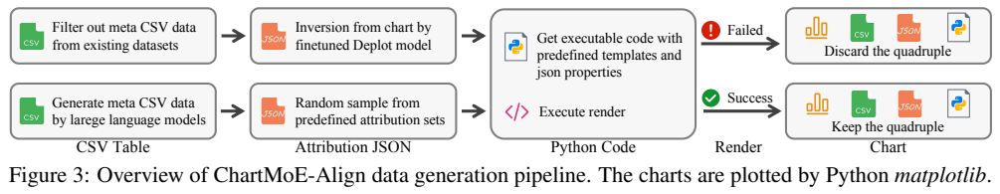
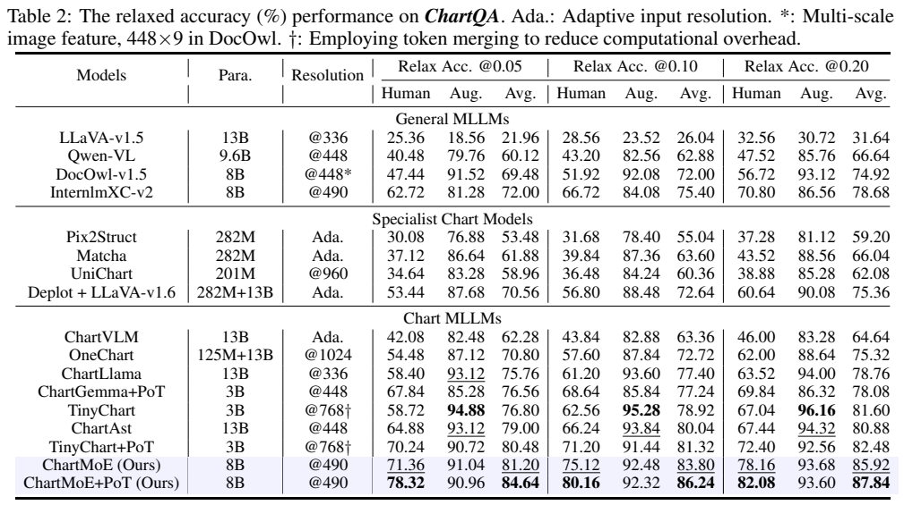

<!-- article-header:start -->
[项目首页](../../../README.md) › [模型系列](../../../reports/model-family-index.md) › [ChartMoE](../README.md)
<!-- article-header:end -->

# ChartMoE：用表格、JSON 与代码对齐初始化图表专家连接器

<!-- article-toc:start -->

**本篇目录** · [论文定位](#paper-info) · [快速概览](#overview) · [整体架构](#architecture) · [核心原理](#principles) · [数据构建](#data) · [训练流程](#training) · [实验结果](#experiments)
<!-- article-toc:end -->

## 1. 论文信息与模型定位

**论文**：*ChartMoE: Mixture of Expert Connector for Advanced Chart Understanding*。作者包括 Zhengzhuo Xu、Bowen Qu、Yiyan Qi、Sinan Du、Chengjin Xu、Chun Yuan 和 Jian Guo，来自 IDEA、清华大学、北京大学等机构。本文依据 [arXiv:2409.03277v1](https://arxiv.org/abs/2409.03277v1)；[项目页面](https://chartmoe.github.io/)提供相关资源。

ChartMoE 是基于 InternLM-XComposer2 的图表理解模型。它保留视觉编码器和语言模型，把连接两者的普通投影器换成由不同结构化任务初始化的专家连接器。模型处理图表问答、数据提取、事实核验，以及根据指令生成可执行绘图代码；代码由外部绘图库渲染，并非模型直接生成图像像素。

它针对的困难是：图表中的数字、图例、颜色、线条和空间布局彼此关联，仅把图像描述成自然语言容易丢失这些约束。论文希望让表格、JSON 和代码这三种表示成为视觉特征进入语言模型时的不同解释路径。（PDF 第 1–4 页）

## 2. 快速概览

| 项目 | 本文方案 |
|---|---|
| 基座 | CLIP ViT-Large 与 InternLM2-7B-Chat，沿用 InternLM-XComposer2 系统 |
| 图像输入 | 490 × 490；每张图像产生 1,225 个视觉 token |
| 主要改动 | 四个两层 MLP 专家组成视觉连接器；每个 token 选择 Top-2 专家 |
| 专家来源 | 原始连接器、表格对齐连接器、JSON 对齐连接器、代码对齐连接器 |
| 数据 | 约 938.9K 图表结构化四元组，可展开为约 2.8M 对齐样本；实际阶段使用量另列 |
| 训练 | 单任务连接器对齐 → 高质量知识学习 → 图表专用退火微调 |
| 核心结果 | ChartQA 修改后的 5% 容差指标为 81.20；接入程序计算为 84.64 |

数值问答的最高分包含 Program-of-Thoughts（PoT）：模型生成 Python 程序，再由执行器计算答案。它反映模型与工具组成的系统能力。另一个阅读要点是，论文修改了 ChartQA 的答案处理和容差评测，不能脱离这一口径直接比较外部排行榜。（PDF 第 5–7 页）

## 3. 整体架构

*原文图表区域裁切。Figure 2 左侧展示三种独立对齐任务，右侧把这些连接器装配为 MoE；雪花与火焰区分冻结和更新的模块。图中的专家位于视觉编码器与 LLM 之间，不是替换 LLM 内部的全部前馈层。*

视觉编码器先输出网格特征。普通模型对每个视觉 token 使用同一个 MLP；ChartMoE 对同一 token 计算路由分数，选择两个专家，再把输出加权相加。得到的视觉序列与文本指令拼接，交给语言模型生成回复。整个过程保留 1,225 个视觉位置，没有通过 MoE 把序列长度压缩为更少 token。

三个新专家分别训练图表到 CSV 表格、图表到 JSON 属性、图表到 Matplotlib 代码的转换。表格侧重数值，JSON 还包含颜色、字体、线型等属性，代码同时要求表达数据和绘图操作。第四个专家保留基座连接器，为原有视觉语言能力提供入口。各专家的结构相同，但参数通过不同目标形成差异；路由器随后学习如何组合它们。（PDF 第 3–4 页）

## 4. 核心创新与数学原理

原文用下式描述连接器。设图像特征为 $V=\{v_i\}=M^V(I)$，第 $j$ 个专家为 $M^E_j$，路由器为 $M^G$：

$$
\hat v_i=\sum_j g_j(v_i)M^E_j(v_i),\qquad
g(v_i)=\operatorname{Top}(\operatorname{softmax}(M^G(v_i));K).
$$

本文采用四个专家、$K=2$。Top 操作把非入选专家权重置零；原文没有在这个公式中说明截断后重新归一化，也没有披露额外的负载均衡损失，因此不能补写这些常见 MoE 实现为本文事实。路由器的输入是视觉 token；公式没有把用户问题直接作为路由条件。（PDF 第 4 页）

关键创新是**在装配 MoE 前建立不同的结构化先验**。随机初始化四个专家，可能让它们重复学习类似映射；从同一连接器复制参数的 Co-Upcycle 也可能缺少差异。独立的表格、JSON 和代码对齐先把映射任务分开，再在后续问答训练中学习协作。Table 5 的同条件实验中，四专家 Top-2 的随机初始化、Co-Upcycle 和本文初始化分别得到 73.20、77.48 和 78.76。增加到八专家未进一步提高最佳分数，说明专家数量不能替代有效初始化。（PDF 第 8 页）

*Figure 6 用颜色标出主要专家选择：紫色对应原始专家，红色对应表格，蓝色对应 JSON，绿色对应代码。观察背景、文字和数据边缘的颜色分布，可以理解不同初始化形成的偏好；这类可视化是局部案例，不是“某专家永久只负责一种元素”的证明。*

专家并非可以直接当成独立最优问答模型。Table 8 中，仅完成结构化对齐的单连接器，直接 ChartQA 分数低于原始连接器；再经问答微调后才提升。Table 7 强制只使用某一专家也会损失完整协作效果。结构化任务提供的是适合后续学习的表示，而不是立即替代问答训练。（PDF 第 9 页）

## 5. 数据构建与处理

*Figure 3 从数据表、图表属性到代码模板，再到编译渲染，展示四元组的构造。Table 1 应分开读取“候选四元组规模”与“各训练阶段使用量”：同一四元组可以衍生三个目标格式，不能把任务样本数当成独立图像数。*

四元组包含图表图像、CSV 数据、JSON 属性和绘图代码。数据表来自 ChartQA、PlotQA 的元数据，以及利用语言模型生成的 ChartY。作者使用经微调的 DePlot 推断图表属性，并结合 ChartReformer 模板；缺失属性可从预定义集合中采样。随后把数据与属性填入对应图表类型的 Matplotlib 模板，执行代码并渲染图像，保留可成功编译的样本。

这一路线的价值在于：生成图、表、属性和代码拥有可追踪的关联。它并不等于对所有原始图表做像素级逆向恢复；采样属性会改变风格，代码可运行也不保证所有语义标签完全正确。论文的数据生成流程应按这些实际保证来理解。（PDF 第 4–5 页）

Table 1 分列 ChartQA 18.3K、PlotQA 157K 和 ChartY 763.6K，合计约 938.9K 四元组；三类对齐任务展开为约 2.8M 样本。实际连接器对齐使用表格 500K、JSON 200K、代码 100K。第二阶段使用 MMC-Instruction 中人工核验的 410K 高质量样本，覆盖问答、推理、摘要、转换和提取。第三阶段使用 ChartQA 与 ChartGemma；表中列 ChartQA 28.3K、重复两次，ChartGemma 163.2K，并记总量 220.8K。该总量与按表中四舍五入分项计算的 219.8K 不完全相符，本文保留原表口径，不人为修正成精确样本数。

## 6. 训练流程与目标

三阶段都围绕条件文本生成学习。为便于理解，可把目标概括为给定图像与指令后，最大化目标表格、JSON、代码或回答的逐 token 概率。这是自回归监督的解释写法，并非原文提出的新损失公式。

| 配置 | 对齐预训练 | 高质量知识学习 | 图表退火微调 |
|---|---:|---:|---:|
| LLM | 冻结 | LoRA | LoRA |
| 连接器 | 分别训练任务连接器 | 训练 MoE 专家与路由 | 继续训练 MoE |
| 峰值学习率 | 5e-5 | 1e-5 | 5e-5 |
| 全局批量 | 64 | 32 | 32 |
| A100-40G GPU 小时 | 240 | 138 | 76 |

视觉编码器保持冻结；后两阶段 LLM 的 LoRA rank 为 64。对齐阶段训练一轮。附录 Table 9 明确采用 AdamW，$\beta_1=0.9$、$\beta_2=0.95$、$\epsilon=10^{-8}$，权重衰减 0.1、梯度裁剪 1.0、1% warmup、余弦衰减、梯度累积 8、bfloat16；三个阶段均采用优化器和梯度分片及激活检查点。正文把 batch size 简写为 64，附录则区分 64/32/32，本文采用附录的分阶段配置。（PDF 第 5、13 页）

上述 GPU 小时是设备时间累计，不能推成单卡墙钟耗时。原文说模型推理可以放在一张 A100-40G 上，但没有据此披露训练卡数；后两阶段的精确训练轮数、总步数和上下文长度也不应凭基座习惯补全。PoT 推理时，模型生成提取数字、运算和返回结果的程序，由 Python 执行器完成计算。（PDF 第 5–6 页）

## 7. 实验设置与主要结果

*Table 2 同时列出人工问题、增强问题，以及 5%、10%、20% 三档数值容差。先看同一容差下的三列，再比较是否接入 PoT。放宽容差本身会提高分数，不能把它解释成训练后的能力提升。*

ChartQA 测试包括 1,250 个 Human 与 1,250 个 Augmented 问题。作者修改 Relaxed Accuracy 的数字提取与短字符串处理，并在统一的新实现下比较模型。5% 容差时，基座为 62.72/81.28/72.00（Human/Augmented/平均），ChartMoE 为 71.36/91.04/81.20，接入 PoT 后为 78.32/90.96/84.64。程序计算明显帮助人工复杂问题，但增强问题略降，不能写成所有子集均获益。10% 和 20% 容差下，PoT 平均分分别为 86.24 和 87.84。（PDF 第 6–7 页）

在 ChartBench 上，作者不使用其数据训练，也不接入 PoT，因为许多问题需要提取图中未显式标出的数值。基座总分 48.41，ChartMoE 为 51.67；饼图与箱线图等个别类别仍下降。ChartFC、ChartCheck T1/T2 的事实核验分数分别为 74.73、78.87、79.20，基座对应 65.93、72.04、70.44。这些结果支持图表理解与核验能力的改善，不能推广成对所有领域幻觉的保证。（PDF 第 7–8 页）

训练消融也应按阶段理解：Table 6 从基座加 ChartQA 的 75.68，依次加入对齐、MoE、高质量知识数据和 ChartGemma，得到 77.20、78.76、79.04、81.20。它说明表示初始化、专家组合与数据都贡献增益；与 Table 2 的原始基座 72.00 不属于同一训练条件。本文依照论文核验结果，未下载权重运行模型，也未重新执行评测。

<!-- article-footer:start -->
---

[← 上一篇：LongLLaVA](../../longllava/arxiv-2409.02889/README.md) · [按发表时间浏览](../../../reports/paper-reading-guide.md#year-2024) · [下一篇：Pixtral 12B →](../../mistral-pixtral/document-3ebe839c6607/README.md)

[返回本篇目录](#article-toc) · [返回模型系列](../README.md)
<!-- article-footer:end -->
