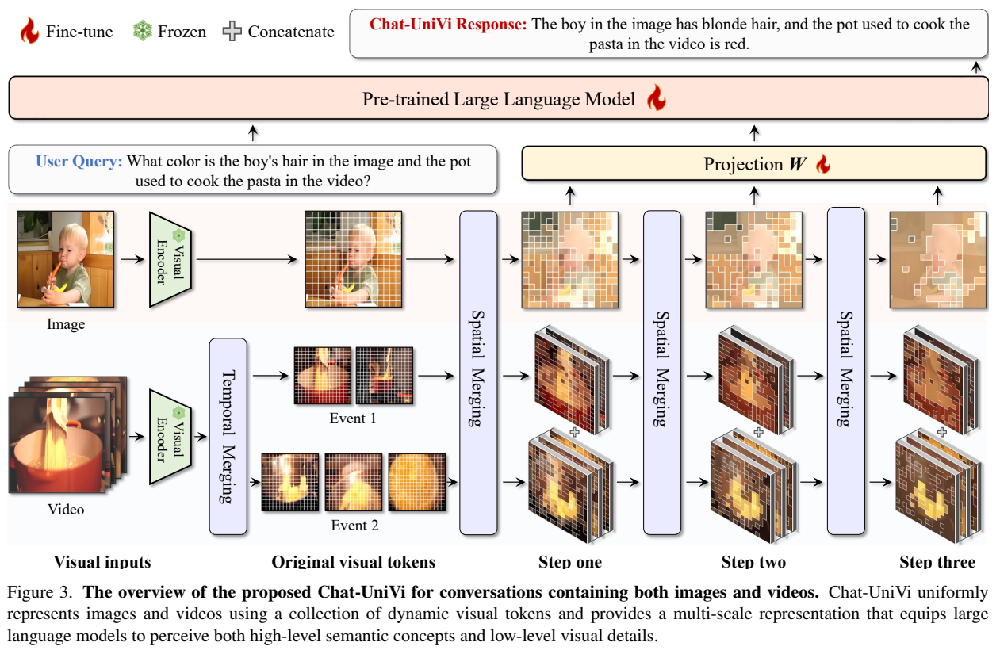
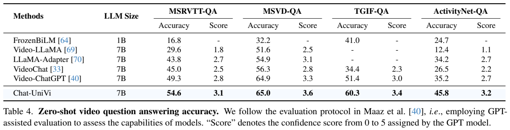
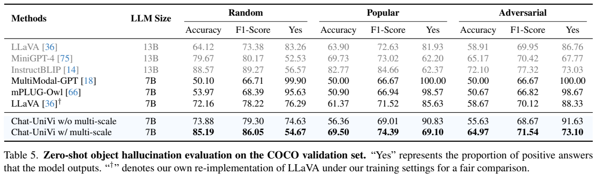
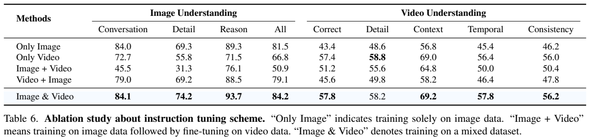
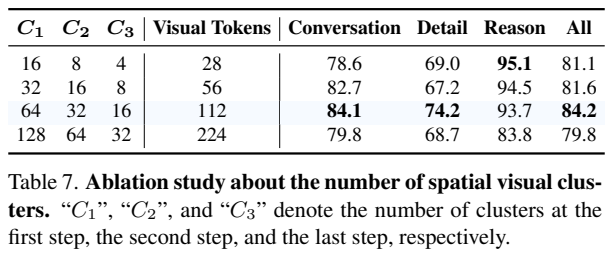
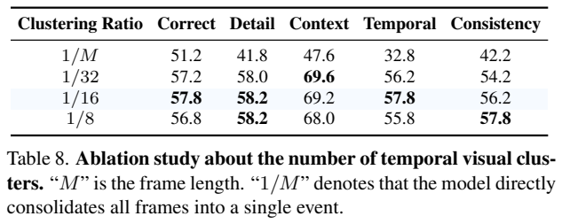
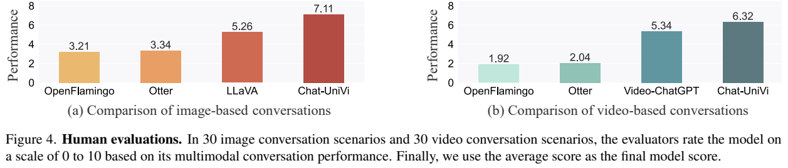

<!-- article-header:start -->
[项目首页](../../../README.md) › [模型系列](../../../reports/model-family-index.md) › [Chat-UniVi](../README.md)
<!-- article-header:end -->

# Chat-UniVi：用多尺度动态视觉 Token 统一图像与视频理解

<!-- article-toc:start -->
<a id="article-toc"></a>

**本篇目录** · [论文定位](#paper-info) · [快速概览](#overview) · [整体架构](#architecture) · [核心原理](#principles) · [数据构建](#data) · [训练流程](#training) · [实验结果](#experiments)
<!-- article-toc:end -->

<a id="paper-info"></a>

## 1. 论文信息与模型定位

| 项目 | 内容 |
| --- | --- |
| 论文 | *Chat-UniVi: Unified Visual Representation Empowers Large Language Models with Image and Video Understanding* |
| 作者 | Peng Jin、Ryuichi Takanobu、Caiwan Zhang、Xiaochun Cao、Li Yuan |
| 机构 | 北京大学深圳研究生院、鹏城实验室、中山大学等 |
| 固定版本 | [arXiv:2311.08046v1](https://arxiv.org/abs/2311.08046v1)，2023 年 11 月 14 日，26 页含补充材料 |
| 骨干 | CLIP ViT-L/14 视觉编码器、Vicuna-v1.5-7B 语言模型、可训练线性投影 |
| 核心贡献 | 无参数聚类合并、多尺度视觉序列、图像与视频混合指令训练 |
| 任务范围 | 图像、视频及其组合的文字理解与对话；本文不研究图像生成或音频理解 |

Chat-UniVi 处理的是视觉上下文预算问题。图像问答需要保留对象、属性和细节；视频理解还需要覆盖多帧和事件顺序。如果把每帧完整 patch 序列全部送给语言模型，输入会很长；如果把整个视频压成几个固定查询，又容易抹掉重要动态。作者提出在语义特征空间聚类，合并冗余区域，并把不同粒度的结果一起输入语言模型。

它的统一体现在图像和视频采用同一个视觉编码器与视觉 token 合并接口，训练时混合两种数据，推理时无需换成另一套视频模型。这里的“动态”指 token 所代表的区域及跨帧集合由输入内容决定，并非每张图像都完全没有预设数量约束；默认图像仍采用固定的三级聚类数量。

<a id="overview"></a>

## 2. 快速概览

| 组成 | 具体做法 | 目的 |
| --- | --- | --- |
| 空间压缩 | DPC-KNN 对 CLIP patch 特征聚类，同簇取平均 | 将相似背景或区域合并，减少视觉序列长度 |
| 时间组织 | 对帧平均特征聚类为“事件”，再在同事件内跨帧合并 | 避免直接把全部帧混成一个集合 |
| 多尺度 | 三级输出均送给语言模型，默认 64、32、16 个簇 | 同时保留较细视觉信息与更粗语义概念 |
| 视觉接口 | 线性投影对齐语言嵌入 | 复用冻结视觉骨干与预训练语言模型 |
| 指令训练 | 图像与视频数据混合，全量微调语言模型和投影 | 同时维持两种输入的回答能力 |

默认图像视觉序列为 $`64+32+16=112`$ 个 token，相比表中 LLaVA 的 256 个更短。视频则先形成多个事件，每个事件再应用多尺度表示；事件数随输入帧数增加，默认时间聚类比例为 1/16。因此这里并不是“所有视频都只有 112 个 token”，更不是无限时长视频的恒定成本处理。

需要特别注意评测口径。部分图像结果是 GPT-4 对 90 个问题的评分，视频问答使用 GPT 辅助评价，ScienceQA 另有零样本和专门微调两个配置。理解这些区别，才能判断压缩是否在特定设置下有效，而不是把所有成绩当成同一种标准准确率。

<a id="architecture"></a>

## 3. 整体架构



**读图：** 上方是单图，下方是视频。视频多一步 Temporal Merging，将帧组织为事件；随后两种输入都经过三次 Spatial Merging。每一级结果均经 Projection W 送入语言模型，而非只保留最后最粗一级。图中的冻结标记对应视觉编码器，微调标记对应指令阶段的语言模型和投影。

CLIP 首先输出规则网格的 patch 特征。空间聚类根据语义距离选择中心，将其他 token 分配给最近中心，再取簇内平均，形成新的视觉 token。新 token 的视觉区域是成员区域的并集，它可以跨越不连续空间位置；论文的示意图不能解释成每个簇必然是一个完整对象，也不是利用实例分割真值监督得到的对象掩码。

对视频，模型先将每帧的全部 token 均值池化成帧级特征，聚类这些帧特征。作者把簇称为“关键事件”，然后只在同事件的视觉 token 集合内做跨帧空间合并，最后按事件顺序拼接。这个设计避免所有帧同时压缩，但基于特征相似的分组不等于已经具备人工标注的事件边界；正文也没有明确保证每个簇中的帧时间连续。事件名称是该方法的建模约定，应与真实动作分段能力区分。

多尺度表示由逐次合并形成：细一级通常包含更多局部信息，粗一级覆盖更抽象的语义。每级结果都保留，投影矩阵 $`W`$ 将其映射到语言嵌入维度，与指令一起输入 Vicuna。无参数聚类意味着聚类过程没有需要学习的额外参数，并不意味着整个系统无可训练参数；投影和语言模型仍需要训练。

实际输入图像和视频帧均缩放至 224×224。该分辨率和压缩共同控制序列成本，但也可能损失小字、细微属性等信息。本文不把“语义聚类”解释成任何细节都能无损保留，也不从 token 数量直接推断墙钟加速比例；聚类本身仍有邻居距离计算开销。

<a id="principles"></a>

## 4. 核心创新与数学原理


**原文公式说明：**[Eq. (1)–(4)，PDF 第 4 页](https://arxiv.org/pdf/2311.08046v1#page=4) 先定义 token 密度与到更高密度 token 的距离，再把同样算法应用到事件内的跨帧 token。密度高且远离其他高密度点的 token 被选为中心。这里距离写成平方欧氏范数，不能把 OCR 文本中的上标误认成普通下标。

令原始视觉 token 为 $`Z=\{z_i\}_{i=1}^{L}`$，原文局部密度定义为

```math
\rho_i=\exp\left(-\frac1K
\sum_{z_k\in\mathrm{KNN}(z_i,Z)}\Vert z_k-z_i\Vert ^2\right).
```

相邻特征越相似，平均距离越小，密度越高。随后定义

```math
\delta_i=\begin{cases}
\min_{j:\rho_j\gt \rho_i}\Vert z_j-z_i\Vert ^2,&\exists j:\rho_j\gt \rho_i,\\ \max_j\Vert z_j-z_i\Vert ^2,&\text{否则}.
\end{cases}
```

选择较大 $`\rho_i\delta_i`$ 的点作为中心，一方面要求局部具有代表性，另一方面要求与其他高密度点有分离度。其他 token 按最近中心归属，簇内平均形成合并表示。高密度背景可能被压成少数簇；对象内部有不同特征时可能获得多个簇。但这不是显式按问句挑选相关对象，聚类发生在视觉特征上，原文没有提出指令条件化的 token 选择器。

时间聚类对帧级特征使用相同原则。若第 $`n`$ 个事件包含帧索引集合 $`F_n`$，原文 Eq. (3) 将其 token 集合写为

```math
\widetilde Z_n=\{z_i^m\mid m\in F_n,\ i\in\{1,\ldots,L\}\}.
```

再把空间公式中的候选集改成 $`\widetilde Z_n`$。因此合并可以发生于不同帧的相似视觉特征，而非仅分别压缩每帧再简单平均。保留多个事件能减轻全视频平均造成的先后关系丢失，但时间细节仍受采样帧、事件划分和语言模型长度限制。

三级结果拼接形成多尺度输入。以默认 64 帧和 1/16 比例为直观例子，若形成 4 个事件，三级特征共约 $`4\times112=448`$ 个 token；这个数是按照默认规则的解释性计算，不是论文测得的所有视频固定预算，也未包含文字和额外标识。原始 64 帧各 256 个 patch 会长得多，但两者还需考虑信息损失与合并开销。

正文没有另外提出聚类监督损失或显式时间对比损失，训练围绕视觉条件下的描述与回答进行。不能因为方法用到特征距离，就为它编写一个“对比学习目标”。

<a id="data"></a>

## 5. 数据构建与处理

预训练使用 COCO 图文对和 LLaVA 筛选的 CC3M-595K。补充 Table C 分别列出约 956K 与 595K 条描述数据。它们是训练样本数，并非两者拥有同样数量的唯一图像。预训练主要让视觉投影接口学会把特征传给语言模型。

| 指令来源 | 补充 Table C 规模 | 内容 |
| --- | ---: | --- |
| LLaVA-instruct-150K | 150K | 图像、多轮对话等视觉指令 |
| 过滤后的 MIMIC-IT | 399K | 图像输入的上下文指令数据 |
| Video-ChatGPT-instruct | 100K | 视频及相应文字指令 |

作者去掉 MIMIC-IT 中的视频数据，并删除 LLaVA 与 MIMIC-IT 的重复数据，以便视频数据主要来自 Video-ChatGPT。混合数据包含单轮、多轮、单图、多图和视频。此处“删除重复”是原文披露的处理，不代表论文给出了跨所有来源的精确近重复阈值；报告也未列出每种组合的最终采样权重。

每个训练视频选择 64 帧，全部图像或帧缩放至 224×224。报告未充分披露所有数据的帧间隔、视频时长分布和训练硬件总量。输入帧数与原视频时长是两个不同量：较长视频若仍只取 64 帧，可能看不到短暂事件；“动态 token 支持变长特征”不能自动消除采样遗漏。

聚类无需对象轮廓标签，因此图像描述与视频指令就能驱动后续训练。它降低了精细区域标注需求，但也意味着簇与语义对象的对应主要来自预训练视觉特征和下游学习。论文的可视化支持部分输入中能形成有意义区域，未提供全量对象分割评测。

<a id="training"></a>

## 6. 训练流程与目标

第一阶段冻结 CLIP 与 Vicuna，仅训练投影矩阵 $`W`$。使用图像描述数据，1 epoch，batch 128，AdamW、余弦学习率调度，学习率 $`2\times10^{-3}`$，warmup 比例 0.03。其目标是建立视觉嵌入与语言输入空间的接口，不是让全部模型从头学习视觉概念。

第二阶段在混合指令数据上全量微调语言模型和投影，视觉编码器维持冻结；2 epochs，batch 128，学习率 $`2\times10^{-5}`$，AdamW、余弦调度，warmup 0.03。统一接口使图像与视频不必分别训练两个语言解码器。正文对阶段划分清楚，但没有单独打印完整 token 级损失公式；本文不把常用交叉熵配置及掩码细节当成逐项已披露。

ScienceQA 专门微调是另一配置：9 epochs、batch 32、学习率 $`2\times10^{-5}`$，AdamW、余弦调度、warmup 0.03。其成绩必须与零样本 ScienceQA 分开，不能将 88.78 写成零样本结果。本文所谓图像、视频任务无需再对齐或专门微调，也不意味着论文所有结果都来自同一未经下游训练的检查点。

空间聚类默认三级数量 64、32、16，时间聚类比例 1/16。更高数量并非一定更好，作者根据消融选择折中。补充材料比较 LoRA 与全量微调，LoRA 图像总分 75.8，完整微调 84.2，视频时序分 51.6 对 57.8；论文称 LoRA 可节约超过一半训练显存，但没有在本文给出所有设备条件下的统一绝对资源表，不能推算任意配置的成本。

<a id="experiments"></a>

## 7. 实验设置与主要结果





**读图：** Table 4 每个数据集都有 Accuracy 与 0–5 的 GPT Score，两者不是同一量。Table 5 的 Random、Popular、Adversarial 是 POPE 的负对象采样方式，“Yes”是回答肯定的比例，不是准确率。完整表头能避免把这些数值混合。

| 视频问答 | Chat-UniVi Accuracy / Score | Video-ChatGPT Accuracy / Score |
| --- | ---: | ---: |
| MSRVTT-QA | 54.6 / 3.1 | 49.3 / 2.8 |
| MSVD-QA | 65.0 / 3.6 | 64.9 / 3.3 |
| TGIF-QA FrameQA | 60.3 / 3.4 | 51.4 / 3.0 |
| ActivityNet-QA | 45.8 / 3.2 | 35.2 / 2.7 |

这些是沿用 Video-ChatGPT 协议的 GPT 辅助评价。MSVD 的 Accuracy 只提高 0.1 个百分点，不能把四个任务都形容为巨大准确率跃升。另一个视频五维评分表将 0–5 线性换算到 0–100，Chat-UniVi Correct/Temporal 为 57.8/57.8，Video-ChatGPT 为 48.0/39.6；该换算并未把主观评分变成标准选择题正确率。

图像 GPT-4 评价基于 30 张 COCO 图像、90 个问题。Chat-UniVi 总分 84.2，高于同设置重实现的 LLaVA-7B 80.4，但略低于表中原 LLaVA-13B 的 85.1；它的112视觉 token 较少，表明此设置下压缩与表现取得较好折中，不能说全面超过 13B。ScienceQA 零样本平均 59.96，高于重实现 LLaVA-7B 的 48.08，但低于表中 GPT-4 的 82.69；专门微调后 88.78，仍低于 LLaVA-13B 的 90.92。

POPE 多尺度版本的 Random/Popular/Adversarial Accuracy 为 85.19/69.50/64.97；单尺度为 73.88/56.36/55.63，说明该配置下多尺度改善对象存在判断。不过 InstructBLIP-13B 三种准确率均更高，MiniGPT-4 的 adversarial 65.17 也略高。因此原文总体宣传不能改写成“解决幻觉”或“全部幻觉指标领先”。









**读图：** Table 6 的“Image + Video”指先图像后视频，“Image & Video”指混合；Table 7 改三级空间簇数；Table 8 改时间聚类比例。下方 Figure 4 是各 30 个图像/视频对话场景的 0–10 人工评分，不能与上方 GPT 百分制直接比较。

混合训练的图像总分 84.2，而只图像训练为 81.5，先图像再视频为 50.9；混合训练视频 Correct 57.8，只图像为 43.4。这支持同时学习两种输入的价值。但只视频版本的 Detail 58.8 高于混合的 58.2，故不是每个分项都混合最佳。空间112token总分84.2优于28token81.1与224token79.8；28token的Reason95.1却高于112token93.7，再次说明最佳数量取决于指标。时间比例1/16在总体折中上较好，1/32的Context及1/8的Consistency仍有更高分项。

人工图像评分 Chat-UniVi 7.11、LLaVA 5.26；视频6.32、Video-ChatGPT5.34。样本较少且为主观评价，不能据此推断所有场景优势。补充限制说明仍有幻觉、提示敏感、多视频或长序列性能下降，音频列为未来方向。最稳妥的结论是，多尺度语义聚类和混合训练能在本文预算与数据下改善统一图像视频理解；它没有证明压缩无损、无限长视频处理或全面领先。

<!-- article-footer:start -->
---

[← 上一篇：SPHINX](../../sphinx/arxiv-2311.07575/README.md) · [按发表时间浏览](../../../reports/paper-reading-guide.md#year-2023) · [下一篇：Video-LLaVA →](../../video-llava/arxiv-2311.10122/README.md)

[返回本篇目录](#article-toc) · [返回模型系列](../README.md)
<!-- article-footer:end -->
