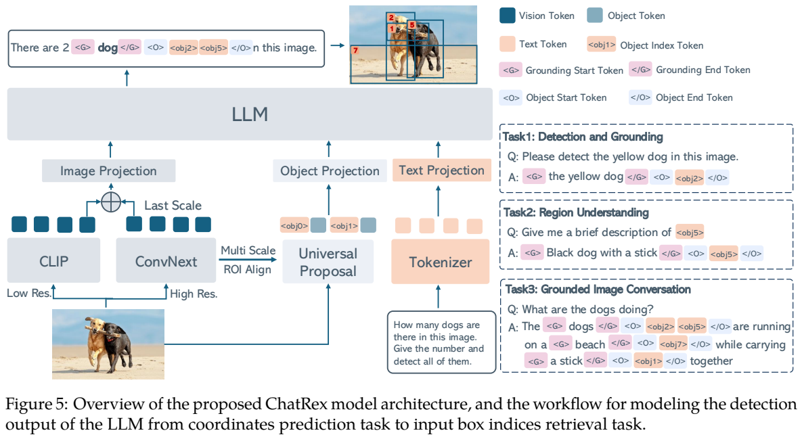
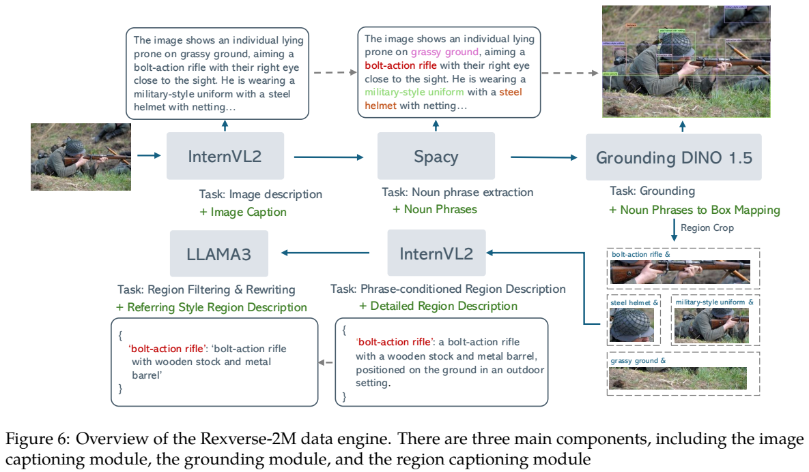
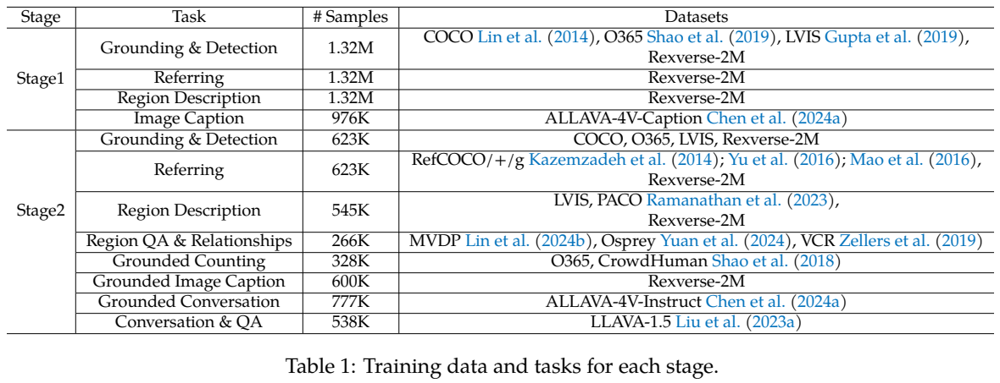
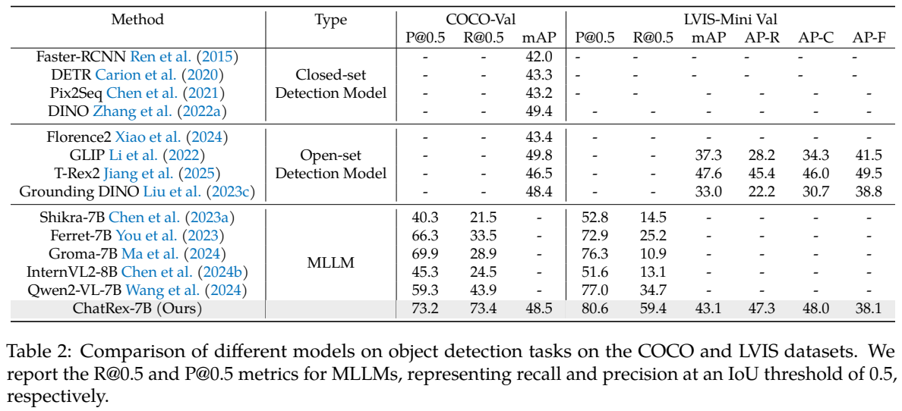
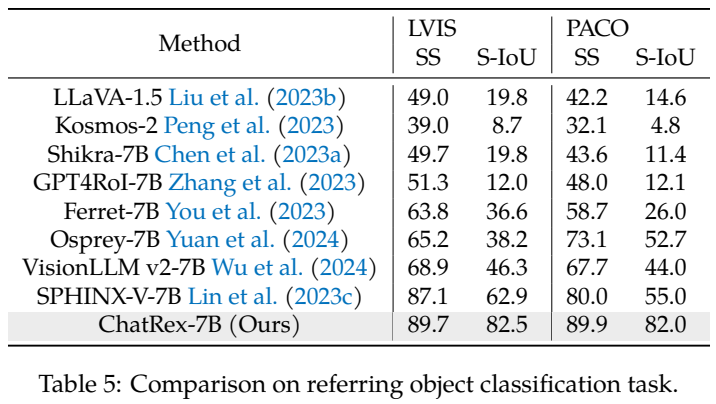
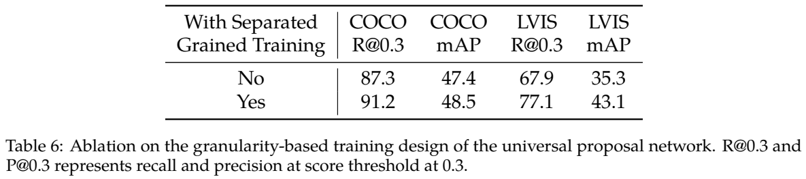

<!-- article-header:start -->
[项目首页](../../../README.md) › [模型系列](../../../reports/model-family-index.md) › [ChatRex](../README.md)
<!-- article-header:end -->

# ChatRex：先产生候选框，再让语言模型选择对象并解释场景

[返回 ChatRex 系列](../README.md) · [返回仓库](../../../README.md)

<!-- article-toc:start -->
<a id="article-toc"></a>

**本篇目录** · [论文定位](#paper-info) · [快速概览](#overview) · [整体架构](#architecture) · [核心原理](#principles) · [数据构建](#data) · [训练流程](#training) · [实验结果](#experiments)
<!-- article-toc:end -->

<a id="paper-info"></a>

## 1. 论文信息与模型定位

| 项目 | 内容 |
|---|---|
| 原文 | *ChatRex: Taming Multimodal LLM for Joint Perception and Understanding* |
| 作者与机构 | Qing Jiang、Gen Luo、Yuqin Yang、Yuda Xiong 等；IDEA，通讯作者 Lei Zhang |
| 本文依据版本 | arXiv:2411.18363v1，2024 年 11 月 27 日；35 页 PDF |
| 主配置 | Vicuna-7B，低分辨率 CLIP ViT-L/14 与高分辨率 ConvNeXt，两个投影接口及对象索引 token |
| 感知组件 | 基于 T-Rex2-L 的 Universal Proposal Network，简称 UPN；提供粗粒度、细粒度候选框 |
| 数据 | Rexverse-2M 自动生成多粒度图像—区域—文字标注，混合公开感知与通用问答数据训练 |
| 输入输出 | 图像与问题或对象引用输入；文字答案与对应框的索引输出，支持检测、指代、区域问答及带定位对话 |
| 资源 | [固定版本论文](https://arxiv.org/pdf/2411.18363v1) · [官方仓库](https://github.com/IDEA-Research/ChatRex) |

ChatRex 关注的是“会解释场景，却找不全对象”的问题。作者在 COCO 多物体图像上提示若干多模态模型检测给定类别，发现坐标自回归输出常漏掉实例、重复框或格式错误。ChatRex 把精确框回归交给检测器，把语义匹配交给 LLM：先提供候选区域，再让 LLM 输出对应索引。7B 表示语言骨干规模，整套系统还包含两个视觉编码器和独立 proposal 模型。[来源：原文 Introduction、第 3 节。](https://arxiv.org/pdf/2411.18363v1)

<a id="overview"></a>

## 2. 快速概览

| 关键问题 | 技术回答 |
|---|---|
| 怎样表示一个目标？ | 输入对象的 RoI 特征、位置编码与索引 token；输出一个 `<obj…>` 指向已有框 |
| 谁预测连续坐标？ | UPN；LLM 主要选择、分类和描述候选框，避免逐数字生成框坐标 |
| 如何兼顾实例与部件？ | UPN 用独立 coarse/fine prompts 区分不同标注粒度，避免把物体与部件的前景定义混在一起 |
| 为什么用双视觉端？ | 336×336 CLIP 提供全图理解，768×768 ConvNeXt 提供更细的多尺度区域特征 |
| 检测代表结果 | COCO precision/recall@IoU0.5 为 73.2/73.4，mAP 48.5；LVIS-Mini mAP 43.1 |
| 基本限制 | LLM 无法通过索引补出候选集里完全缺失的目标，感知上限依赖 UPN 的覆盖与框质量 |

对象索引让语言描述和检测结果共享一个接口。例如，“两只狗在跑”可以在“狗”这个短语后附上两个索引，再映射回图像框。它增加交互性，但不是语言模型自行重新计算所有坐标，也没有证明这种设计消除了所有生成顺序问题：多个索引仍要按自回归序列输出。[来源：第 3.2–3.3 节、Figure 5。](https://arxiv.org/pdf/2411.18363v1)

<a id="architecture"></a>

## 3. 整体架构



*原文 Figure 5，PDF 第 7 页。左侧 CLIP 与 ConvNeXt 产生全图视觉 token，UPN 框在高分辨率特征上经 RoI Align 形成对象 token；对象 token 之前有对应索引，LLM 答案中的索引指回候选框。右侧展示检测、区域理解和带定位对话共用同一接口。*

UPN 是独立的 DETR 类网络，基于 T-Rex2-L 初始化，使用 Swin-L 视觉骨干。它并不尝试给出自然语言答案，而是产生不同粒度的通用对象候选。训练中 COCO、Objects365 等实例标注归入 coarse，SA-1B 的区域/部件标注归入 fine。独立 prompt 区分两套目标定义，推理可以获取相应粒度的框。

ChatRex 的图像编码路径使用 CLIP ViT-Large-14-336 和 LAION 预训练 ConvNeXt-Large-320；后者名称中的 320 是预训练配置标识，本文实际输入为 768×768。CLIP 实际输入 336×336。两者最后尺度的空间位置数通过输入尺度调整一致，再以门控卷积融合高分辨率信息到低分辨率 token，减少直接拼接带来的序列增长。

对象编码路径从 ConvNeXt 的多尺度特征上，对每个 UPN 框做 RoI Align，取得区域内容特征，再加框坐标的 sin-cos 位置编码。内容告诉模型“是什么”，位置帮助回答“左边那个”“靠近某物的部件”等指代。全图视觉 token 与对象 token 分别经 MLP 投影到语言空间；对象特征前放置对应索引，用户文字随后进入 Vicuna-7B。

词表新增对象索引和 `<g>…</g>`、`<o>…</o>` 边界符。`<g>` 包围被定位的自然语言短语，`<o>` 包围对应的对象索引。模型最多输入 100 个框，检测输出列表可指向多个对象；这里“单 token 表示一个框”说的是输出索引，不意味着输入一个对象只消耗一个位置，输入还需要索引与 RoI 特征。论文在索引范围的示意中使用从 0 到 N 的写法，本文只保留明确的最大框数设定，不自行推算一个未经实现核验的精确新增词表大小。[来源：第 3 节、Appendix B。](https://arxiv.org/pdf/2411.18363v1)

<a id="principles"></a>

## 4. 核心创新与数学原理

UPN 原有的类别分数由 prompt embeddings 与检测 queries 点积得到，原文 Eq. (1) 为 $`S_{cls}=EQ_{dec}^{\top}`$。新增两个可学习粒度 prompt 后，Eq. (2) 变为


```math
S_{cls}=P_{concat}Q_{dec}^{\top},\qquad
P_{concat}\in\mathbb R^{2\times D},\quad
Q_{dec}\in\mathbb R^{N\times D},\quad
S_{cls}\in\mathbb R^{2\times N}.
```


这里 2 表示 coarse 与 fine，而不是所有视觉对象只剩两种语义类别。UPN 先判断某 query 对应哪种粒度的前景候选；真正的“狗、椅子、手套”等语义识别在后面的 LLM 接口中完成。将粒度拆开避免了同一图像部件在不同数据集里一会儿被标成前景、一会儿无标注造成的监督冲突。

第 3.2 节的门控融合为原文无编号公式：


```math
F_v=f_L+\sigma\bigl(W_G[W_1f_L;W_2f_H]\bigr)\odot W_2f_H.
```


$`W_1,W_2`$ 为 1×1 卷积映射，门控网络产生逐元素权重，决定高分辨率特征以多大强度补入低分辨率残差。各项相加必须有匹配的空间与通道维度。它与增加一倍视觉序列长度的直接拼接不同，融合发生在特征维度；但高分辨率编码器的计算仍存在，不应据此宣称系统没有额外开销。

对象表示对应原文 Eq. (3)–(4)：


```math
C_i=\mathrm{RoIAlign}(F_H,B_i),\qquad
V_i=C_i+\mathrm{PE}(B_i).
```


$`B_i`$ 是候选框，$`C_i`$ 是区域内容，$`PE(B_i)`$ 是坐标位置表示。RoI Align 通过连续采样减少粗糙量化对区域读取的影响；位置向量补足单独区域内容不携带全图坐标的问题。输入已有框后，检测任务从“生成四个坐标”变成“选择哪个索引”，短语与索引的对应关系也可沿用到描述和对话中。

这个改变有一个可推导的上限。假设评测 IoU 阈值固定，LLM 只从候选集选择框而不修正坐标，则最终检测召回率不能超过候选集在同一匹配定义下的召回率。本文可以概括为 $`R_{final}\le R_{proposal}`$，这是机制推论，不是原文新增 Eq.。提高 LLM 语义判断能减少误选与漏选，但候选缺失、错位或 100 框截断仍会限制结果。

此外，自回归索引选择仍有生成长度、重复与顺序因素；它缓解数字坐标的多 token 错误传播，却没有将模型变成严格无序集合预测网络。论文把检测器和理解网络的分工调整清楚，比“LLM 本身学会高精度连续回归”更准确。[来源：原文 Eq. (1)–(4)、第 3.3 节。](https://arxiv.org/pdf/2411.18363v1)

<a id="data"></a>

## 5. 数据构建与处理



*原文 Figure 6，PDF 第 9 页。InternVL2 先描述全图，SpaCy 抽取名词短语，Grounding DINO 1.5 将短语定位到框；再针对区域、结合短语生成描述，由 Llama3 检查并压缩为指代表达。图中箭头体现的是自动标注模块，不能当作 ChatRex 推理时必须全部运行的模块。*

图像从 COYO700M 筛选，去除小分辨率、NSFW 标签及内容贫乏的白背景网页图像，后者还使用专门训练的分类器。正文前面概括两百万图，详细统计为 2.1M 图像 caption，故“Rexverse-2M”是近似规模名称。

InternVL2-8B 生成图像描述后，SpaCy 提取类别名称或较长的名词短语，并去除 image、background 等不适合作对象的抽象引用。Grounding DINO 1.5 为过滤后的短语产生框，形成类别或短语监督。接着裁剪区域，用原短语条件化 InternVL2-8B，让它围绕该对象补充细节，减轻区域过小或含干扰对象时跑偏的情况。

Llama3-8B-Instruct 根据原类别和生成描述检查一致性，并改写为短的 referring expression。附录提示要求超过 5 个词、少于 10 个词且不含逗号。这里 Llama3 读取文字一致性，不是直接检查图像真值，因此自动过滤可能保留教师共同产生的错误；论文没有给出全面人工标注准确率。

数据统计为：2.1M 图像 caption，10.2M 带类别区域，2.5M 短语区域，2.5M 详细描述区域，2.4M 指代表达区域。这些不同标注可能覆盖同一对象，不能相加后声称均为独立图像或完全不同对象。作者还对 ALLaVA-4V-Instruct 的约 776K 对话进行 grounding，训练表中对应为 777K，属于近似统计差异。

训练时混合当前图像的真值框与 UPN proposals，最多保留 100 个输入框。这既保证监督目标有相应区域，也让模型接触不完美候选；推理仅靠 UPN 的提议，因此不能把训练时存在真值框写成测试条件。来自 COCO、LVIS、RefCOCO 等监督也进入训练，结果不应称为这些数据集上的严格未见任务零样本检测。[来源：第 4 节、Table 1、Appendix C。](https://arxiv.org/pdf/2411.18363v1)

<a id="training"></a>

## 6. 训练流程与目标

UPN 先进行自己的检测训练：粗粒度来源含 O365、OpenImages、Bamboo、COCO、LVIS、HierText、CrowdHuman、SROIE、EgoObjects，细粒度来源为 SA-1B。使用 Hungarian matching、分类 sigmoid focal loss、框 L1 与 GIoU，T-Rex2-L 初始化后全参数优化，并使用 DINO 风格的 contrastive denoising training。

附录 B.1 区分**匹配代价**与**优化损失**的权重：Hungarian matching 中分类/L1/GIoU 为 2/5/2，最终 loss 中为 1/5/2。可写为 $`\mathcal L_{UPN}=\mathcal L_{focal}+5\mathcal L_{L1}+2\mathcal L_{GIoU}`$，这是按原文权重整理，不要误把匹配的分类系数 2 套入训练损失。GIoU 是检测框几何目标，与后面的区域分类 S-IoU 指标不是同一东西。





*PDF 第 11 页。Table 1 按任务列出两阶段样本数，Table 2 的检测结果同时包含 P/R 与 mAP；不同模型未报告的 AP 是缺失值，不能写为零。*

| ChatRex 阶段 | 更新模块 | 数据与配置 |
|---|---|---|
| Alignment | image/object MLP，新增词表对应的 LLM 输入与输出 embeddings；其余骨干保持 | grounding 1.32M、referring 1.32M、region description 1.32M、image caption 976K；总 batch 256（每设备 32），LR $`10^{-3}`$ |
| Visual instruction tuning | 原文称更新 ChatRex 全部模型参数，联合感知与理解；UPN 的独立训练已在前述环节说明 | detection 623K、referring 623K、region description 545K、region QA/relations 266K、counting 328K、grounded caption 600K、grounded conversation 777K、通用 conversation/QA 538K；总 batch 128（每设备 16），LR $`2\times10^{-5}`$ |

新增索引词表需要更新 embeddings，这是与“仅训练投影就能对齐”的简单接口不同之处。后续阶段同时包含索引选择、区域描述、带框描述及普通问答，采用下一 token 预测来保持统一输出。标准解释为 $`\mathcal L=-\sum_t\log p(y_t\mid y_{\lt t},I,\{B_i,V_i\},s)`$，该式是目标机制的整理，并非原文另一个编号公式。固定版本没有完整披露 epoch、优化器 beta、warmup、训练 GPU 与总耗时，本文不从基础模型默认设置推填。[来源：第 4.2 节、Table 1、Appendix B，PDF 第 10–11、33 页。](https://arxiv.org/pdf/2411.18363v1)

<a id="experiments"></a>

## 7. 实验设置与主要结果

检测比较在 COCO-Val 和 LVIS-Mini Val 上进行。作者给每张图的真实类别列表，提示模型检测这些类别的所有实例，所以这里不是不提供任何类别的任意开放场景自主发现协议。P@0.5/R@0.5 的 0.5 指 IoU 阈值；许多坐标生成模型没有框置信度，无法方便地画 PR 曲线，因而只报告 P/R。ChatRex 使用 UPN 的框与置信度，可以计算 AP。这一差异使其 mAP 不应与其他模型的 recall 数直接比较。

| Table 2 | COCO P@0.5 | COCO R@0.5 | COCO mAP | LVIS-Mini R@0.5 | LVIS-Mini mAP |
|---|---:|---:|---:|---:|---:|
| Qwen2-VL-7B | 59.3 | 43.9 | — | 34.7 | — |
| Groma-7B | 69.9 | 28.9 | — | 10.9 | — |
| ChatRex-7B | 73.2 | 73.4 | 48.5 | 59.4 | 43.1 |

召回提升是明显结果，但专业检测器仍有强项：COCO DINO mAP 49.4，高于 ChatRex 48.5；LVIS-Mini T-Rex2 mAP 47.6，高于 ChatRex 43.1。RefCOCO 单物体指代表现也不是全表最好：ChatRex val/testA/testB 为 90.1/93.0/85.2，Ferret-v2 为 92.8/94.7/88.7。本文更突出的优势在多物体检索与区域解释共同存在，而不是所有定位任务都超过专门系统。

通用理解 Table 4 中 ChatRex 的 MMB 65.8、MM-Vet 36.4、SEED-I 69.6、LLaVA-W 65.9、MMMU 38.0、POPE 87.3、Hallusion 45.8，相对 LLaVA-1.5-7B 的 64.3/30.5/66.1/63.4/35.7/85.9/27.6 有改善；但 Ferret-v2 的 POPE 87.8 仍更高。它说明感知接口没有明显破坏这套理解指标，不能只凭不同模型横向表就把所有增益归因于一个组件。





*PDF 第 13 页。Table 5 的 SS/S-IoU 是区域类别语义指标，并非框坐标 IoU；Table 6 的 R@0.3 中，0.3 在原文明确是 proposal 置信度阈值，与 Table 2 的 IoU0.5 意义不同。*

区域分类 Table 5 的 ChatRex 在 LVIS 得 SS 89.7、S-IoU 82.5，在 PACO 得 89.9/82.0；SPHINX-V 对应 87.1/62.9、80.0/55.0。任务是给定区域索引后输出类别，而不是重新预测框。对 UPN 的粒度消融，固定 score threshold 0.3 后，分 coarse/fine 的 COCO proposal recall 87.3→91.2，LVIS 67.9→77.1；最终 mAP 分别 47.4→48.5、35.3→43.1，直接支持粒度分离提高候选覆盖。

论文还展示对象计数、区域关系和带定位规划对话，但并未给出机器人实际执行成功率。应将其理解为图像上的语言建议与对象指向。ChatRex 的关键结论是：在多物体场景中，把框几何与语言语义分工处理，并为区域与全图共同提供训练数据，能让 LLM 更稳定地使用对象；候选质量、自动标签误差与评测协议仍决定实际能力边界。[来源：第 5–6 节、Table 2–6。](https://arxiv.org/pdf/2411.18363v1)

<!-- article-footer:start -->
---

[← 上一篇：LongVU](../../longvu/arxiv-2410.17434/README.md) · [按发表时间浏览](../../../reports/paper-reading-guide.md#year-2024) · [下一篇：TimeMarker →](../../timemarker/arxiv-2411.18211/README.md)

[返回本篇目录](#article-toc) · [返回模型系列](../README.md)
<!-- article-footer:end -->
