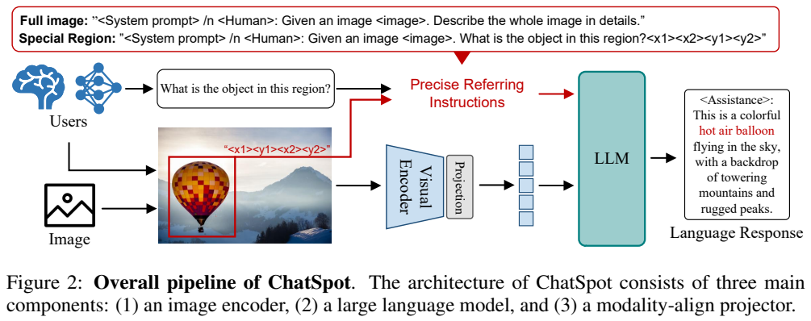
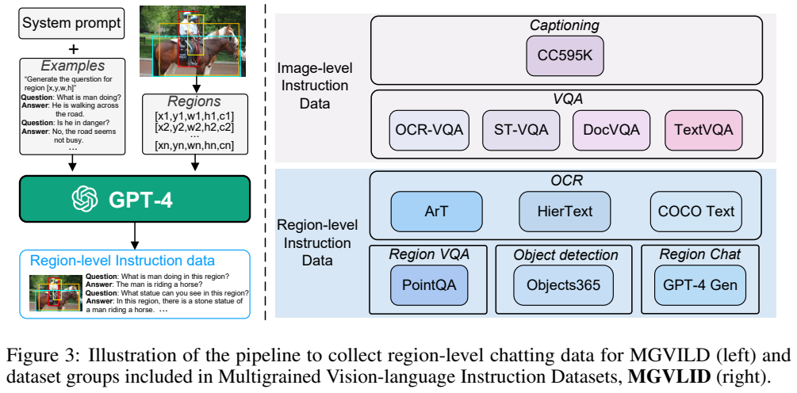
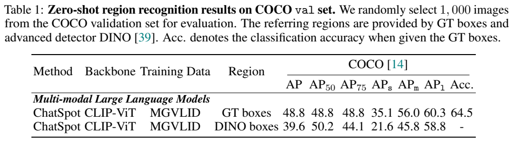
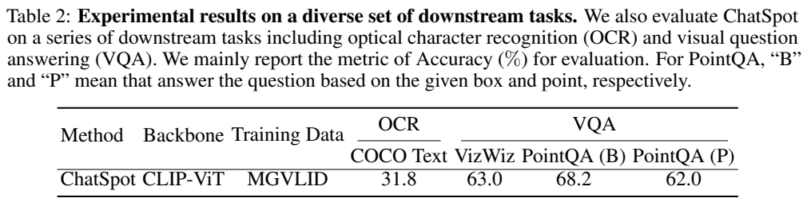
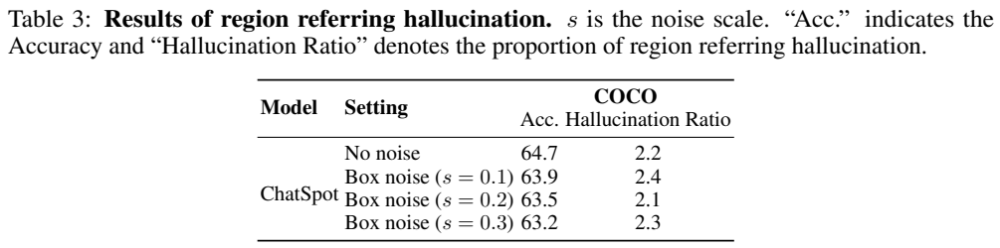

<!-- article-header:start -->
[项目首页](../../../README.md) › [模型系列](../../../reports/model-family-index.md) › [ChatSpot](../README.md)
<!-- article-header:end -->

# ChatSpot：把点击和框选转换成精确区域指令

> 采用 [arXiv:2307.09474v1](https://arxiv.org/abs/2307.09474v1)。图表来自该版本完整 PDF 页面；本文区分原文公式、机制解读和作者尚未实现的交互设想。

<!-- article-toc:start -->

**本篇目录** · [论文定位](#paper-info) · [快速概览](#overview) · [整体架构](#architecture) · [核心原理](#principles) · [数据构建](#data) · [训练流程](#training) · [实验结果](#experiments)
<!-- article-toc:end -->

## 1. 论文信息与模型定位

| 项目 | 内容 |
|---|---|
| 题名 | ChatSpot: Bootstrapping Multimodal LLMs via Precise Referring Instruction Tuning |
| 作者机构 | 旷视、华中科技大学、清华大学、西安交通大学 |
| 首次提交 | 2023-07-18，v1 技术报告 |
| 基础模型 | CLIP ViT-L/14 视觉编码器、Vicuna-7B 语言解码器 |
| 连接模块 | 实验实现使用一个线性投影层 |
| 实际输入形式 | 图像、自然语言、归一化的点或框坐标 |
| 输出 | 所选区域的文字识别、描述与问答；v1 不支持输出指代框 |
| 资源 | [固定 PDF](https://arxiv.org/pdf/2307.09474v1) · [论文所列演示入口](https://chatspot.streamlit.app)；原清单未提供代码仓库 |

本篇解决的是区域指代理解：用户指明位置，模型解释“这里是什么、在做什么”。它把选择对象所需的冗长语言替换为鼠标点击或框选，并让同一个模型继续回答。虽然论文讨论机器人和交互系统应用，其实验主体仍是图像与文本，没有直接训练机器人动作控制，也未在 v1 中加入视频、音频路径。[原文 §3、§5.3](https://arxiv.org/pdf/2307.09474v1#page=3)

## 2. 快速概览

在一张含多种水果的图片里，让模型寻找“位于香蕉下、苹果上的绿色水果”需要多次自然语言消歧。直接点中或框住目标后，再问“这是什么”，交互可以更明确。ChatSpot 的主张是将这种空间选择加入指令，利用 LLM 已有文字坐标理解能力和视觉监督，把目标位置与整个图像结合起来。

技术上没有额外的区域视觉编码器：整图经过 CLIP 和投影进入语言空间，点击或框坐标经过归一化转为文本，与任务句一起输入语言模型。因此区域关注由指令监督学习形成，不是通过硬裁掉其他区域强制限定视觉输入。

训练资料 MGVLID 同时包含整图和区域任务，约 120 万图像、300 万问答，其中 108k 区域对话利用 Visual Genome 标注与 GPT-4 合成。两阶段训练先学习视觉语言连接，再更新语言端学习精确指代。COCO-1000 上给定真实框的分类准确率为 64.5%；文字和指点问答还显示输入点与框的差别。结果支持较细粒度交互接口的可行性，但评估规模、回答判定方式和框来源都会影响成绩，不宜写成通用视觉能力排名。[原文 §1、§3–4](https://arxiv.org/pdf/2307.09474v1#page=6)

## 3. 整体架构

*来源：原文 Figure 2 与公式 (1)，PDF 第 4 页；[原页](https://arxiv.org/pdf/2307.09474v1#page=4)。图片红框是用户选区，红色指令路径传入坐标，蓝色路径传入完整视觉特征。*

图左上用户给出问题和兴趣区域；图下方完整图像经过 Visual Encoder、Projection 成为视觉 token。区域坐标并不经过图像投影，而是和文字问题连接成 Precise Referring Instructions，送入 LLM。右侧输出是自然语言，例如区域对象和状态描述。

论文在方法概述将连接器称为简单 MLP，但 §4.1 的具体实现明确采用简单线性层。本文按实验实现记录，避免把方法层面措辞误写成额外两层网络。视觉 backbone 是 CLIP ViT-L/14，语言 decoder 是 Vicuna-7B；Vicuna 属于指令调整的 LLaMA 系列，但报告在训练初始化句中也写预训练 LLaMA，因此精确使用哪一份 checkpoint 的进一步信息仍须结合官方实现核对。

模型接收到整图表示、区域指令和自然语言后自回归生成。无需为了某个区域任务在主推理架构里再调用检测器，但实验的 DINO 框来源和输出类别评估使用 CLIP 文本编码器，这些是评测外部步骤。不能把“模型是端到端结构”扩大为“全文所有实验都不使用任何外部模型”。[原文 §3.1、§4.1–4.2](https://arxiv.org/pdf/2307.09474v1#page=6)

## 4. 核心创新与数学原理

原文公式 (1) 描述两条输入路径：

$$V=\zeta\circ G(I),\qquad Y=F(V,\Phi(R_t),X_{\mathrm{instruct}}).$$

$`I`$ 是图像，$`G`$ 是视觉编码器，$`\zeta`$ 是视觉语言投影，$`V`$ 是投影后的视觉 token；$`R_t`$ 是用户选择的区域，$`\Phi`$ 为坐标归一化，$`X_{\mathrm{instruct}}`$ 是问题或任务句，$`F`$ 是语言解码器，$`Y`$ 是回答。它是架构函数关系，并没有规定回答完全只依赖区域内部像素。模型保留完整图像，可能借助背景解释区域对象，例如辨认插座与冰箱的连接状态。

区域形式可写为 $`R_t=\{(x_k,y_k)\}_{k=1}^N`$。实际点提示只需一个点，框用角点确定区域；方法形式允许多个点，但论文 §5.3 说当前交互只支持点击和画框，多边形、mask 留待未来。因此“表达式可容纳多点”不等于“v1 已有完整多边形或掩码交互评测”。

对于宽 $`W`$、高 $`H`$ 的原图，归一化可用以下解读式帮助理解：

$$\widehat x_k=x_k/W,\qquad \widehat y_k=y_k/H.$$

这说明坐标落在 $`[0,1]`$，与图像像素尺寸解耦。原文没有将这个展开式列成编号公式，也未完整规定小数精度与 tokenizer 对数字的细粒度处理。归一化坐标随后被写入文本，放在区域边界标签之间，与“识别这里的文字”或“解释这个物体”关联。Figure 2 的示例存在不同坐标排列写法，本文采用规范的 $`(x_1,y_1,x_2,y_2)`$ 解释框，不根据图里示例顺序推断额外实现细节。

为什么坐标文本能影响视觉关注？从机制上看，语言端能在联合序列中根据问题和坐标调整其对视觉表示的利用；训练时目标回答持续绑定这个位置，使“区域文字”和“视觉内容”建立监督关系。不过论文没有公布 attention 可视化或坐标编码专门消融，不能将这种合理解释写成已被证明的特定注意力通道。

同样，坐标只能指定位置，不能自动增加视觉分辨率。一个指向小字的点并不保证原始 CLIP 表示保留了每个字符；因此区域 OCR 仍然受视觉输入和训练数据限制。论文承认对车牌号码等特殊符号识别不足，也承认新数据微调可能带来灾难性遗忘。这个接口创新与基础视觉能力应分开评价。[原文 §3.2、§5.3](https://arxiv.org/pdf/2307.09474v1#page=10)

## 5. 数据构建与处理

*来源：原文 Figure 3，PDF 第 5 页；[原页](https://arxiv.org/pdf/2307.09474v1#page=5)。左边的 GPT-4 接收区域标注与种子样例；右边紫色为整图、蓝色为区域资料。*

MGVLID 有约 120 万图像、300 万问答，包含 11 个来源，作者说留出四个数据集进行评估。整图部分汇集 CC595K、OCR-VQA、ST-VQA、DocVQA、TextVQA 等；区域部分利用 Objects365、COCO Text、HierText、ArT 的框与对应内容，再用 PointQA/LookTwice-QA 加入点指代问答。图中的任务分组表示不同监督用途，不表示每份数据只在一条路径出现。

对于区域识别，原始资料的“框＋类别”变为“框＋问题＋答案”；OCR 的框及文字被转换成“这里写了什么”的样本。不同任务的标签长度差别很大，作者用简答和详细回答等样式标签控制输出，并人工过滤、完善指令模板。这里的人工处理主要描述模板，论文没有给出所有 300 万问答逐条人工核验比例或错误率。

区域多轮对话来自 Visual Genome。它含对象、属性、关系与密集描述，作者将这些文字标注、框信息与种子示例组成提示交给 GPT-4，约得到 108k 指令样本。此处 GPT-4 的输入依据是已有结构化标注与文字描述，不能写成每张图直接由具备视觉输入的 GPT-4V 审看生成；本篇也没有给出这样的图像调用流程。

这个合成过程的关键是，每一条区域对话始终绑定位置。否则，同一张图片中多个相似对象的说明会混在一起，模型可能学到整图答案而忽略坐标。图 3 左侧的区域列表同时提供空间位置与实体类别，GPT-4据此扩写相关问题，不承担从原图检测目标的任务。

需要保留评测范围：作者对 COCO 区域类别实验强调未用 COCO 类别标注训练，但数据构建部分又明确含 COCO Text。不能因此扩张为模型从未使用任何 COCO 图像或任何来自 COCO 的资料；更不能将 OCR 或 PointQA 的所有评测都自动称为完全无对应来源数据的零样本设置。v1 没有完整提供逐图去重与跨源污染审计，本文不补造该结论。[原文 §3.3、§4.2，第 5–7 页](https://arxiv.org/pdf/2307.09474v1#page=5)

## 6. 训练流程与目标

| 阶段 | 数据与更新 | 原文优化设置 |
|---|---|---|
| 视觉语言对齐 | 主要整图指令；原文称只训练 projection，并冻结大部分 LLM 参数 | 学习率 $`2\times10^{-3}`$ |
| 精确区域指令 | 主要区域指令及 RegionChat；冻结视觉编码器，解冻语言模型参数 | 学习率 $`2\times10^{-5}`$ |

两阶段使用 AdamW，报告说微调 3 epochs、batch size 128，语言 token 最长 2,048。第一阶段“只训练投影”与“冻结大部分 LLM”措辞并不完全等价，本文保留原文，不额外假定哪些语言参数仍可更新；第二阶段只明确视觉 encoder 冻结、LLM 解冻。GPU 数量、图像分辨率、完整每阶段数据配比和训练成本未在 §4.1 列出。[原文 §4.1，第 6 页](https://arxiv.org/pdf/2307.09474v1#page=6)

报告没有给出独立训练损失编号公式。作为阅读辅助，标准自回归监督目标可写为：

$$\mathcal L_{\mathrm{AR}}=-\sum_t\log p_\theta(y_t\mid V,\Phi(R_t),X_{\mathrm{instruct}},y_{<t}).$$

它使模型在图像、区域坐标和问题条件下生成参考答案；式中的逐 token 展开只是常见机制解释，不代表本文公开了官方标签掩码、样本损失权重或全部实现。这个目标无需另设固定 COCO 类别分类头，多个任务共享语言生成接口。但评测时仍需将自由回答转成标准标签或判断包含标准答案，这是第七节的评价协议。

前一阶段主要建立跨模态可读性，后一阶段改变语言端行为，使坐标发挥指代作用。论文没有给出去掉每个数据子集、冻结方案或坐标格式的完整组件消融，不能把阶段作用的技术解释等同于已测得的各阶段独立增益。

## 7. 实验设置与主要结果

*来源：原文 Table 1、2，PDF 第 7 页；[原页](https://arxiv.org/pdf/2307.09474v1#page=7)。Table 1 区分 GT boxes 与 DINO boxes，Table 2 的 B/P 为框/点，不能把它们当不同参数规模。*

| 测试条件 | 结果 | 指标与限制 |
|---|---:|---|
| COCO-1000，真实框 | 64.5 | 分类准确率，框本身无需模型定位 |
| COCO-1000，真实框 | 48.8 | 按预测类别计算的 AP，不等于上行准确率 |
| COCO-1000，DINO 框 | 39.6 | AP，定位来自外部检测器 |
| COCO Text 验证集 | 31.8 | 区域 OCR，答案包含正确标准文字视为正确 |
| VizWiz | 63.0 | 区域问答，同样按答案包含关系判定 |
| PointQA，框 | 68.2 | 给定框的位置提示 |
| PointQA，点 | 62.0 | 给定点的位置提示 |

COCO 只从验证集随机抽取 1,000 张，准确率以真实框区域为单位。模型产生句子后，用 CLIP 文本编码器将其与 COCO 类别比较，确定类别；因此它衡量生成语言和标准类别的映射结果，并非语言模型每次直接输出标准类别的原生 exact-match。换成 DINO 框后，AP 同时受外部框质量影响，不能归因于 ChatSpot 自身定位能力。

OCR 和 VQA 的“回答中包含 GT 答案”比严格字符串完全匹配宽松，也不同于某些官方 VQA 评分器。一个长回答包含正确词汇即可能被判对，协议本身未充分检查所有附加句子是否正确。因此 63.0/68.2 等分数只能在本文协议下解释，不能直接与采用其它判断方式的模型排行榜相减。

*来源：原文 Table 3，PDF 第 10 页；[原页](https://arxiv.org/pdf/2307.09474v1#page=10)。此表 No noise 的准确率为 64.7，与 Table 1 的 64.5 分别记录，不人为统一。*

| 框扰动尺度 | 准确率 | 区域指代幻觉比例 |
|---:|---:|---:|
| 无噪声 | 64.7 | 2.2 |
| 0.1 | 63.9 | 2.4 |
| 0.2 | 63.5 | 2.1 |
| 0.3 | 63.2 | 2.3 |

随机框噪声使准确率温和下降，但不能由此得出对任意用户误点鲁棒。作者对“区域指代幻觉”的定义较窄：模型误认成附近另一类对象，且相关区域达到指定 IoU 条件（大于 0.5）。2%左右不是全部视觉幻觉率，更不等于模型所有错误只占 2%；无噪声分类准确率仍约 65%，其它误识别占比明显更高。Table 3 的扰动结果也没有统一单调变化，2.4 这一实际数字应保留，不能沿正文概括成始终 2.2–2.3。

定性样例展示熊的头、眼和鼻等不同粒度区域，以及冰箱插电和购物结算牌的上下文说明。它们说明接口能串起多轮对话，但原文个别输出有拼写或解释问题，也未进行机器人执行成功率验证。v1 的明确局限包括不能输出指代框、特殊符号识别不足和新任务微调遗忘；因此本篇可借鉴的核心是以简单坐标指令扩大区域交互，而不是已经完成通用定位与行动系统。本文未运行模型，所有结果来自原报告。[原文 §4.3、§5，第 7–10 页](https://arxiv.org/pdf/2307.09474v1#page=9)

<!-- article-footer:start -->
---

[← 上一篇：BuboGPT](../../bubogpt/arxiv-2307.08581/README.md) · [按发表时间浏览](../../../reports/paper-reading-guide.md#year-2023) · [下一篇：3D-LLM →](../../3d-llm/arxiv-2307.12981/README.md)

[返回本篇目录](#article-toc) · [返回模型系列](../README.md)
<!-- article-footer:end -->
