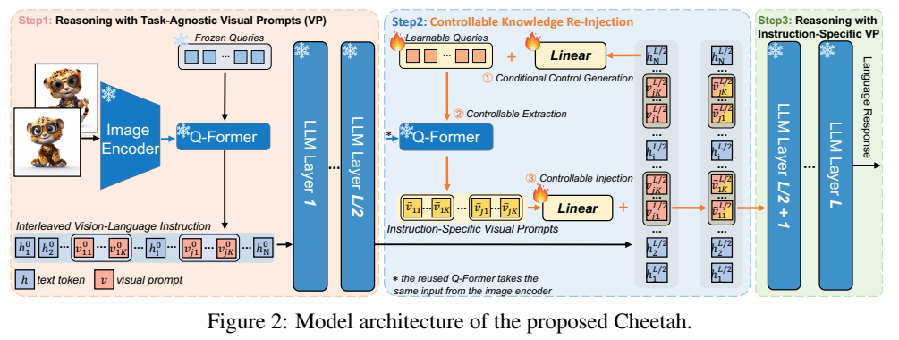
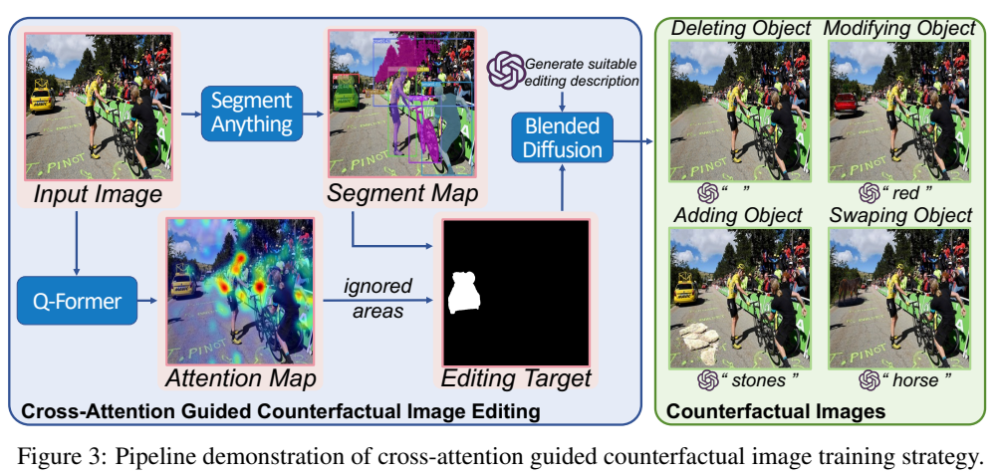
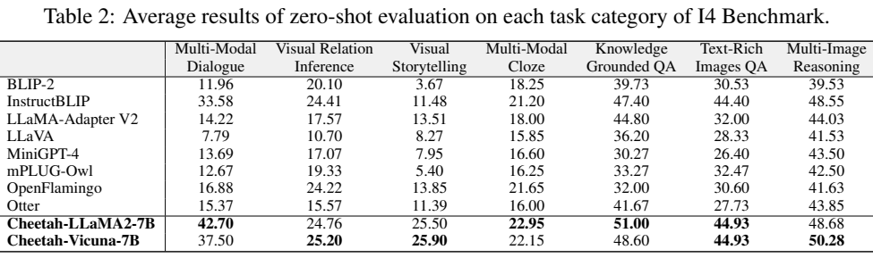
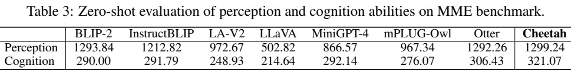
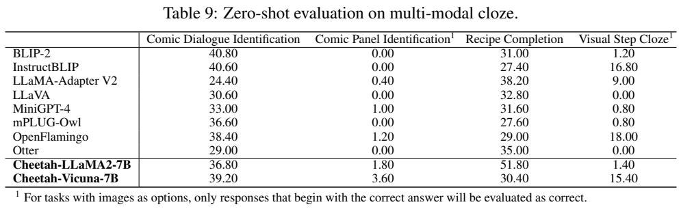
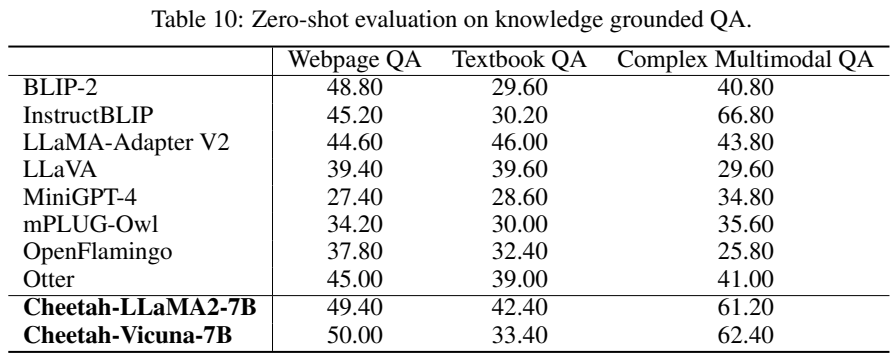
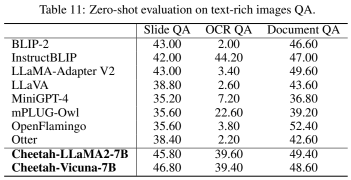
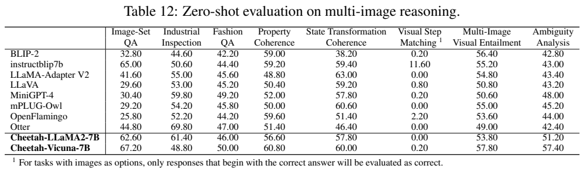

<!-- article-header:start -->
[项目首页](../../../README.md) › [模型系列](../../../reports/model-family-index.md) › [Cheetah](../README.md)
<!-- article-header:end -->

# Cheetah：让语言模型在中间层控制视觉信息重新提取

<!-- article-toc:start -->
<a id="article-toc"></a>

**本篇目录** · [论文定位](#paper-info) · [快速概览](#overview) · [整体架构](#architecture) · [核心原理](#principles) · [数据构建](#data) · [训练流程](#training) · [实验结果](#experiments)
<!-- article-toc:end -->

<a id="paper-info"></a>

## 1. 论文信息与模型定位

| 项目 | 内容 |
| --- | --- |
| 论文 | *Empowering Vision-Language Models to Follow Interleaved Vision-Language Instructions* |
| 作者 | Juncheng Li、Kaihang Pan、Zhiqi Ge、Minghe Gao、Hanwang Zhang、Wei Ji、Wenqiao Zhang、Tat-Seng Chua、Siliang Tang、Yueting Zhuang |
| 机构 | 浙江大学、新加坡国立大学、南洋理工大学 |
| 原文 | [arXiv:2308.04152v1](https://arxiv.org/abs/2308.04152v1)，2023 年 8 月 8 日，19 页 |
| 模型 | Cheetah-LLaMA2-7B、Cheetah-Vicuna-7B；EVA-CLIP ViT-G/14 与 BLIP-2 Q-Former |
| 新增模块 | CLORI（Controllable Knowledge Re-Injection），约 6.3M 可训练参数 |
| 训练与评测 | CAGIT 反事实图像训练；I4 交错图文基准与 MME |

Cheetah 的问题定位很具体：基于图片描述训练的视觉接口容易提取主体等显著内容，却可能忽略当前指令需要的细节。若用户给多张相互关联的图片，要求找区别、补全故事或结合教材图示回答问题，一次与任务无关的视觉压缩可能不足。作者让语言模型先读取基础视觉提示，再利用中间层的上下文表示控制 Q-Former 重读图像，把补充信息注入后续层。

本文研究的是交错图像和文本，不是视频帧压缩，也没有训练图像生成输出。扩散模型用于制作训练图像对。首次公开版本的结果与局限如下按原文逐项解释，不用之后的项目版本或通用模型宣传替代证据。

<a id="overview"></a>

## 2. 快速概览

| 环节 | 具体方案 | 作用 |
| --- | --- | --- |
| 第一次视觉提取 | 冻结 BLIP-2 Q-Former，产生任务无关的视觉提示 | 给语言模型初步图像上下文 |
| 条件生成 | 从语言模型第 16 层最后 token 的隐状态投影得到条件 | 将整段交错上下文与指令带回视觉提取器 |
| 第二次提取 | 条件加到一组新可学习查询，复用同一冻结 Q-Former | 提取第一轮漏掉且与当前问题相关的信息 |
| 重新注入 | 补充特征经投影，加到对应视觉位置的中间隐状态 | 后 16 层继续推理，避免重新跑完整语言模型 |
| 训练数据 | 根据低注意力对象制作原图/编辑图，监督说明差异 | 有目的地迫使接口读取原先忽略的细节 |

它的核心贡献是带反馈的视觉接口：语言模型并非被动接收固定视觉摘要，而是能用已有上下文告诉视觉模块继续找什么。模型保持主要骨干冻结，训练新增查询与两个投影层，因此新增可训练参数约占系统的 0.09%。这个比例不代表加载和推理只需要 6.3M 参数，冻结视觉与语言骨干仍然参与计算。

“单张 A100 约七小时”对应已对齐接口后的 CLORI 训练。作者另有 5M 图文对的投影对齐，以及 ChatGPT、SAM 和扩散模型的数据生成；不能把七小时写成包括所有预处理、对齐和基础模型预训练的总成本。

<a id="architecture"></a>

## 3. 整体架构



**读图：** 左侧冻结视觉编码器和 Q-Former产生基本提示，进入语言模型前半层；中间从最后位置的隐状态得到条件，用新查询再调用同一 Q-Former；下方将新视觉信息投影并加回对应视觉位置；右侧语言模型后半层输出回答。火焰只标新增查询和投影，雪花标主要骨干冻结。

每张图像被 EVA-CLIP ViT-G/14 编码为密集视觉特征。Q-Former 用固定数量查询访问特征，得到该图像的视觉提示，并将它插在交错图文序列对应的图像位置。语言模型前 16 层共同处理图片和文字，最后一个输入 token 的隐状态被作为条件的来源。它已可以汇总此前图片、描述和问题，因此比只给 Q-Former 一句问题具有更完整的上下文。

第二次提取继续使用相同图像特征和相同冻结 Q-Former，新增可学习查询与条件相加后输入。这里重新读取的是视觉特征，不是重新运行整套图像编码器。补充提示映射到语言隐状态维度，在第 16 层输出的视觉提示位置做残差相加，再进入第 17 层。两种语言骨干都为32层，实际注入点一致。

这个设计在一次语言模型前向过程中插入视觉反馈，避免生成完答案后再重跑完整模型。但它仍多执行一次 Q-Former，有额外计算；“同一次前向”不能理解成没有任何推理开销。因为只修改视觉位置，后续层需要通过注意力吸收补充信息，图文序列的组织仍影响最终推理。

<a id="principles"></a>

## 4. 核心创新与数学原理

原文用 $`h_N^{L/2}`$ 表示 $`L`$ 层语言模型中间层最后 token 的隐状态。条件生成、查询修改与注入可整理为以下与正文一致的记号：

```math
c=\mathrm{Linear}(h_N^{L/2}),\qquad Q'=Q+c,
```

```math
\overline V_j=\mathrm{QFormer}(Q',E(I_j)),\qquad
\widetilde V_j^{L/2}=V_j^{L/2}+\mathrm{Linear}(\overline V_j).
```

$`j`$ 指第 $`j`$ 张图，$`E(I_j)`$ 是视觉编码特征，$`Q\in\mathbb R^{K\times d}`$ 是新查询，条件 $`c`$ 广播加到每个查询。两个 Linear 分别将语言隐状态变为查询条件、将补充视觉提示变为语言隐状态。它不是将图像特征与问题文本仅拼接一次，而是在上下文已经被语言模型处理后再条件化视觉信息。

CLORI 的两个线性投影采用零初始化。特别是输出投影初始为零时，补充分支不改变原来的中间层表示，早期系统接近原骨干行为，训练再逐渐学会增加信息。这解释了其稳定性动机，但报告没有给出零初始化与其他初始化完整的定量对照，不把动机写成已经测得的严格因果结论。



**读图：** Q-Former 注意力图与 SAM 分割结果共同确定编辑目标，ChatGPT 生成合理编辑描述，Blended Diffusion 对局部进行删除、修改、添加或替换。产生的原图/编辑图用于差异描述监督，扩散模型在这里负责离线数据制作，不是 Cheetah 的输出解码器。

CAGIT 将 Q-Former 所有层和查询的跨注意力图取平均，得到全局注意力 $`A`$。再用分割掩码及 RoIAlign 插值，估计对象的平均注意力 $`\Phi(o_i)`$，选择相对低值对象进行编辑。原文把低注意力解释为原视觉提示较容易忽略的信息，这是一种训练目标选择启发，不意味着注意力大小已经严格度量视觉信息是否存在于全部特征中。

编辑前后只改变局部，监督答案描述其差异，模型需要利用另一张图片及问题寻找相关信息。论文没有给出独立的对比损失或像素重建损失，也没有提出把注意力分数直接当作监督标签训练语言模型；任务仍是生成差异文本。正式训练损失和 token 掩码细节未完整列出，不另造“反事实损失函数”。

<a id="data"></a>

## 5. 数据构建与处理

CAGIT 选择约 30K 含明显低注意力对象的图像，生成约 64K 反事实编辑图。四种编辑分别为修改属性、替换对象、删除对象、添加对象，添加只选择背景对象作为目标。ChatGPT 根据原图描述、对象类别和位置生成符合场景的编辑要求；Blended Diffusion 根据掩码与描述完成局部编辑，再用 CLIP 相似度过滤。论文未充分给出全部来源比例、过滤阈值和人工检查统计，不能断言所有编辑都正确或无噪声。

差异答案由编辑描述转换而来，省去重新人工标注每对图片。这里“annotation-free”指无需新增人工逐对差异标注，仍依赖现成模型、原有描述和自动生成监督。实际图片可能没有完全遵循编辑指令，或产生额外变化，这会影响目标文本与图像的匹配；CLIP 筛选能够提供过滤信号，但不是逐像素修改正确性的证明。

除了64K 编辑对，CLORI 训练还使用0.7M 图文样本，以保留基础图文描述能力。模型接口另用5M 图文对进行对齐，不能只列64K后宣称整个系统没有使用大量图文数据。本文也不把I4的大规模评测集合算进这部分训练。

I4-Full覆盖31任务、20场景，约477.72K指令对、1.77M图像，平均每条3.70图像和97.58词；I4-Core剔除两个难以获得或受版权限制的任务，覆盖29任务、19场景，约18.18K指令、62.81K图像，平均3.46图像和92.69词。作者每个任务手工设计10个提示模板，将不同任务统一成任务说明、具体图文上下文和目标回答。后续未特别说明时，I4 指Core。

<a id="training"></a>

## 6. 训练流程与目标

首先，因为 BLIP-2 原检查点没有直接与 LLaMA2/Vicuna 匹配的 Q-Former，作者复用与 FlanT5-XXL 配套的 Q-Former，并用5M 图文对微调最后线性映射以对齐新语言骨干。这个对齐阶段与后来的6.3M CLORI模块训练应分开。原文没有提供该阶段完整超参数与时间，因此七小时不能覆盖它。

随后保持视觉骨干、Q-Former和语言模型冻结，只更新新查询及两个投影层。训练数据为64K CAGIT对和0.7M图文数据，18K步，二者batch分别为24、64。AdamW的$`\beta=(0.9,0.999)`$，学习率$`2\times10^{-5}`$、weight decay0.05，warmup2K步，之后余弦衰减；报告称单张A100约7小时。

它不使用InstructBLIP式的大规模高质量多任务指令调优集来训练CLORI，但仍训练了带“描述两图差异”任务要求的自动构建样本，也依赖已预训练乃至指令调优的语言骨干。“无需高质量多模态指令数据”应按这些范围理解，不能说系统从未利用指令能力或从零训练。

推理时可以把多个图像与文字按上下文插入，CLORI在中间层补取信息后生成答案。论文未披露所有输入分辨率、最大图片数量和完整延迟对比，也没有报告独立删除CLORI、CAGIT或随机选择编辑区域的系统消融。现有结果支持整套方案具有竞争力，却不能把全部提升分别量化归给每个组件。

<a id="experiments"></a>

## 7. 实验设置与主要结果





**读图：** Table2是七类任务汇总，生成类用ROUGE-L，选择类用Accuracy，因此各列不能简单当成同一种正确率。Table3分MME感知与认知；这两种分数也不能直接用百分数解读。

I4 每任务最多500例进行测试。生成类按ROUGE-L评价，选择类按选项正确率；输出不是严格选项时，作者用TF-IDF距离将文字映射到选项。涉及图片作为选项的任务更严格，补充说明只将以正确答案开头的输出计为正确。这使成绩同时反映语义解题和输出格式遵从，而非纯视觉分类能力。

| I4 主表口径 | LLaMA2-7B版本 | Vicuna-7B版本 | InstructBLIP |
| --- | ---: | ---: | ---: |
| 多模态对话 | 42.70 | 37.50 | 33.58 |
| 多模态填空 | 22.95 | 22.15 | 21.20 |
| 知识支撑QA | 51.00 | 48.60 | 47.40 |
| 文字密集图像QA | 44.93 | 44.93 | 44.40 |
| 多图推理 | 48.68 | 50.28 | 48.55 |

v1主表存在一个应保留的核对问题：**Table2中“Visual Relation Inference”与“Visual Storytelling”两列的数值对应附录任务均值时，显示出互换关系**。例如LLaMA2版本附录Table7四项关系分21.02、42.05、14.10、24.81，均值约25.50，主表却把25.50列在Storytelling；附录Table8五项故事分均值约24.76，对应主表Relation列。本文不将有歧义的两列再当成精确类别结果，下面改看原附录逐任务成绩。









**读图：** 四张表分别覆盖填空、知识QA、文本丰富图片QA和多图推理，图片选项任务有脚注。逐任务结果比“所有任务均领先”的总括更能说明能力边界。

LLaMA2版本的Recipe Completion为51.80，高于表中对照；但Comic Panel Identification只有1.80，Vicuna也仅3.60。Vicuna的OCR QA39.40低于InstructBLIP44.20，DocumentQA48.60低于OpenFlamingo52.40；复杂多模态QA62.40低于InstructBLIP66.80。Vicuna多图工业检查48.80低于Otter69.80，图像选项的Visual Step Matching只有0.20。于是可以说多个类别汇总较强，却不能说31个任务的每项都解决或全面超过对照。

MME主表Cheetah感知1299.24、认知321.07，高于该表各模型总项；感知仅略高于BLIP-2的1293.84与Otter1292.26。附录细项中其计数96.67低于InstructBLIP143.33，OCR100低于LLaMA-AdapterV2的125，共识推理98.57低于InstructBLIP129.29。总体评分提升不意味着全部基础能力提升，表中仅写“Cheetah”，未明确拆分两个语言骨干，本文不擅自指定其版本。

最有依据的结论是：通过语言中间状态条件化视觉重读，加上有针对性的反事实差异监督，少量新增参数能改善交错图文任务表现。仍需注意I4类别表的内部不一致、图片选项与格式遵从的弱项、自动编辑数据噪声、缺少组件独立消融，以及七小时训练成本的明确范围。

<!-- article-footer:start -->
---

[← 上一篇：All-Seeing](../../all-seeing/arxiv-2308.01907/README.md) · [按发表时间浏览](../../../reports/paper-reading-guide.md#year-2023) · [下一篇：BLIVA →](../../bliva/arxiv-2308.09936/README.md)

[返回本篇目录](#article-toc) · [返回模型系列](../README.md)
<!-- article-footer:end -->
