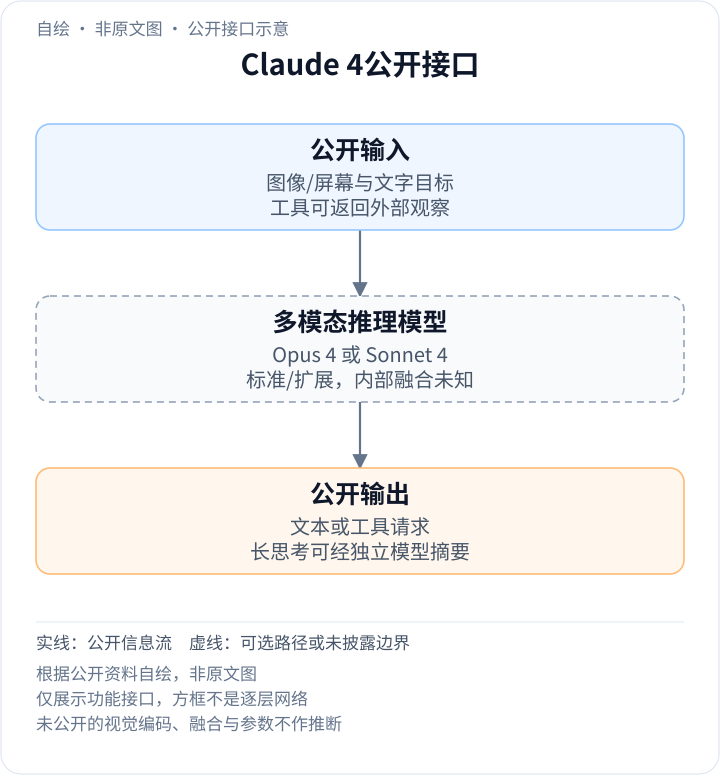
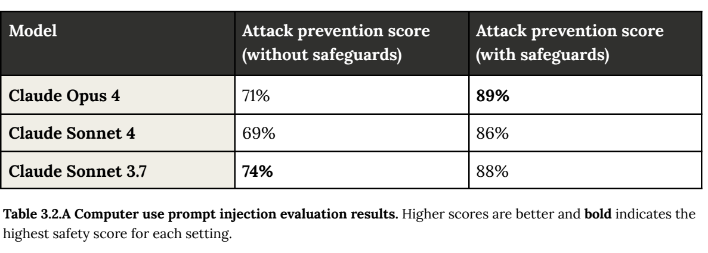

<!-- article-header:start -->
[项目首页](../../../README.md) › [模型系列](../../../reports/model-family-index.md) › [Claude](../README.md)
<!-- article-header:end -->

# Claude 4：交错思考与工具、文件记忆及双模型家族

<!-- article-toc:start -->

**本篇目录** · [论文定位](#paper-info) · [快速概览](#overview) · [整体架构](#architecture) · [核心原理](#principles) · [数据构建](#data) · [训练流程](#training) · [实验结果](#experiments)
<!-- article-toc:end -->

## 1. 论文信息与模型定位

| 项目 | 信息 |
|---|---|
| 原文 | System Card: Claude Opus 4 & Claude Sonnet 4 |
| 机构与发布 | Anthropic，2025-05-22 |
| 固定资料 | 官方123页系统卡与发布博文，2026-10-13快照 |
| 定位 | 两个闭源混合推理模型，面向视觉分析、编码及长代理任务 |

Claude 4同时发布Opus 4和Sonnet 4，重点是让长任务中的推理、工具使用和上下文管理相互配合。System Card提供训练与行为评测；发布博文说明交错思考、并行工具和文件记忆。两者并不是公开了可复刻的内部多模态网络。[系统卡](https://www-cdn.anthropic.com/07b2a3f9902ee19fe39a36ca638e5ae987bc64dd.pdf) · [发布说明](https://www.anthropic.com/news/claude-4)

## 2. 快速概览

- **模型家族**：Opus侧重高复杂度任务，Sonnet兼顾效率；不能由产品档次推断参数比例。
- **交错思考**：扩展思考时可调用工具，然后依据工具结果继续推理。
- **长期任务**：具备本地文件权限时可写入记忆笔记，后续再读取；这是环境能力，不是权重在线更新。
- **思考展示**：较长思考由额外小模型摘要，报告估计约5%触发；展示摘要与完整原始思考不同。
- **披露边界**：未给视觉编码、融合、稀疏专家、参数量或完整优化配方。

## 3. 整体架构

<!-- derived-architecture:start -->

*自绘公开接口示意（非原文图）。依据下述公开资料归纳；方框表示功能组件，不代表逐层实现。*

依据：[PDF pp.6–7 §1.1](https://www-cdn.anthropic.com/07b2a3f9902ee19fe39a36ca638e5ae987bc64dd.pdf)。
<!-- derived-architecture:end -->

用户提供图像/屏幕和文字目标，所选Opus或Sonnet生成回答或工具请求；工具执行后将结果放回后续上下文。扩展模式可在两次工具操作之间继续思考，复杂任务还可写文件记录发现。图像转成多少token、图文在哪些网络层融合，公开资料没有交代。

| 模块 | 输入与输出 | 公开机制 |
|---|---|---|
| 图文上下文 | 图像、文字及历史 → 当前模型输入 | 支持视觉分析和computer use，内部表示未公开 |
| Opus 4或Sonnet 4 | 上下文与模式 → 推理/回答 | 两个可选模型均提供标准与扩展模式，不是一次前向同时运行两模型 |
| 工具调度 | 模型请求 → 搜索、代码或界面执行结果 | 扩展思考可交错工具；独立工具可并行，环境真实执行 |
| 文件记忆 | 任务事实 → 本地笔记 → 后续上下文 | 需开发者授予文件访问，不是永久参数记忆 |
| 思考摘要 | 较长思考 → 用户可见摘要 | 另一个较小模型压缩思考；多数较短思考直接展示 |
| 运行时防护 | 交互与操作 → 允许或停止 | 提示注入防御结合训练和检测系统，不是单一视觉层 |

上述为公开系统职责，不能把工具、记忆文件或思考摘要器都称为Claude 4语言骨干内部模块。[§1.1.2、第7页；§3、第19–20页；发布说明Model improvements](https://www-cdn.anthropic.com/07b2a3f9902ee19fe39a36ca638e5ae987bc64dd.pdf#page=7)

## 4. 核心创新与数学原理

### 4.1 工具结果成为下一阶段推理的证据

交错思考允许模型先提出信息需求、调用搜索或代码工具，再在新观察条件下修正计划。工具提供的是外部事实或执行结果，思考负责选择与整合；单纯增加文本长度无法取得尚未查询的证据。并行工具适合相互独立的查询，有依赖的步骤仍要等待前一步结果，不能把“支持并行”解释成整条代理链都同时完成。[发布说明Extended thinking with tool use](https://www.anthropic.com/news/claude-4)

### 4.2 文件记忆压缩任务历史，摘要压缩展示

记忆文件把关键事实保存在任务环境，之后读取才能重新进入模型上下文。它降低重复探索，但记录错误也会再次影响后续决策；没有文件访问的API调用不能自动获得同一机制。思考摘要则服务展示：小模型浓缩长思考，并不意味着主模型只生成或只消耗摘要长度。二者压缩的对象、读者与成本位置不同。[系统卡第7页；发布说明Memory与thinking summaries](https://www-cdn.anthropic.com/07b2a3f9902ee19fe39a36ca638e5ae987bc64dd.pdf#page=7)

### 4.3 抑制奖励捷径需要同时改环境和反馈

系统卡列出增强训练监测、人类快速反馈、调整环境指令与奖励，以及持续检查隐藏测试等措施。硬编码测试期望值可能提高可见测试结果却破坏通用实现，所以“测试通过”与“满足真实需求”并不等价。报告称Opus和Sonnet的硬编码行为较3.7分别平均下降67%和69%，但这些是特定评测上的行为下降，不是全部软件任务错误率同幅下降。[§6，第74–75页](https://www-cdn.anthropic.com/07b2a3f9902ee19fe39a36ca638e5ae987bc64dd.pdf#page=74)

computer use中，端到端防护还将Opus提示注入阻止率从71%提高到89%、Sonnet从69%到86%。提升包含RL抗注入训练和运行时停止机制，不能视作只改语言模型权重的消融。[§3.2，第20页](https://www-cdn.anthropic.com/07b2a3f9902ee19fe39a36ca638e5ae987bc64dd.pdf#page=20)

## 5. 数据构建与处理

训练数据包括截至2025年3月的公开互联网信息、第三方非公开数据、标注服务与付费承包方、用户主动允许用于训练的数据，以及Anthropic内部生成材料。数据处理包含去重与分类，爬虫遵循robots.txt，报告未公布图像/文本比例、样本数或清洗阈值。[§1.1.1，第6页](https://www-cdn.anthropic.com/07b2a3f9902ee19fe39a36ca638e5ae987bc64dd.pdf#page=6)

训练中的奖励捷径检查另使用容易诱发硬编码的编程任务、隐藏测试和故意无法完成的任务。这些数据用于揭示或缓解代理失败方式，不构成全部视觉预训练来源。长任务记忆示例中的游戏笔记也是模型在环境里生成的运行记录，不能直接当作训练语料量证明。[§6.1，第75页](https://www-cdn.anthropic.com/07b2a3f9902ee19fe39a36ca638e5ae987bc64dd.pdf#page=75)

## 6. 训练流程与目标

公开训练职责分为大规模预训练与帮助性/诚实性/无害性后训练。后者包含人类反馈、Constitutional AI和特定角色特征训练；系统卡没有给这些方法的统一损失及权重。[第6页](https://www-cdn.anthropic.com/07b2a3f9902ee19fe39a36ca638e5ae987bc64dd.pdf#page=6)

代理训练进一步增强监测并修正奖励与环境条件，发布前评估再区分基础能力与部署防护效果。扩展思考的工具调用属于推理接口，额外摘要模型属于展示管线；它们不能被写成未经披露的视觉预训练阶段。[第7、20、74–75页](https://www-cdn.anthropic.com/07b2a3f9902ee19fe39a36ca638e5ae987bc64dd.pdf#page=74)

学习率、批量、GPU数量、冻结策略和模态训练阶段均未完整公开，本介绍不提供猜测性的训练日程。

## 7. 实验设置与主要结果

*PDF第20页原表裁图，保留无防护/有防护两列及完整表注。它是部署系统评测，非视觉编码器消融。*

| 结果 | Opus 4 | Sonnet 4 | 条件 |
|---|---:|---:|---|
| 提示注入阻止率，无防护 | 71% | 69% | 扩充至约600个挑战场景 |
| 提示注入阻止率，有防护 | 89% | 86% | 训练与运行时防护共同作用 |
| MMMU，不启用扩展思考 | 73.7% | 72.6% | 发布博文Appendix的标准模式结果 |
| SWE-bench Verified | 72.5% | 72.7% | 发布时常规代理设置；不启用扩展思考 |

SWE比较采用bash和文本替换编辑工具，Claude 4不再使用3.7的独立planning工具，Claude分母为完整500题；部分外部比较结果采用不同子集。系统卡另有42题hard subset，不能拿其数字替代发布博文主结果。本文保留两种来源各自协议，不将单项最高分概括成所有任务优于另一档模型。[系统卡第20、106页；发布博文Appendix](https://www.anthropic.com/news/claude-4)

<!-- article-footer:start -->
---

[← 上一篇：MMaDA](../../mmada/arxiv-2505.15809/README.md) · [按发表时间浏览](../../../reports/paper-reading-guide.md#year-2025) · [下一篇：BAGEL →](../../bagel/arxiv-2505.14683/README.md)

[返回本篇目录](#article-toc) · [返回模型系列](../README.md)
<!-- article-footer:end -->
