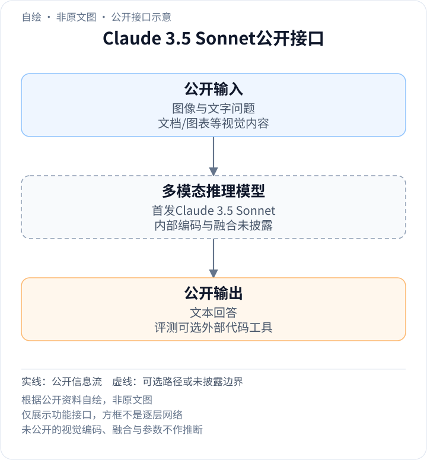
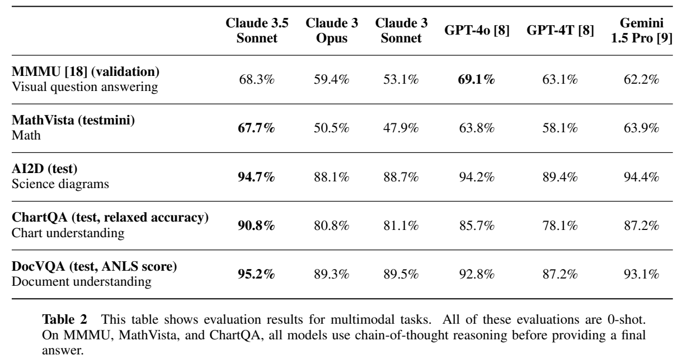

<!-- article-header:start -->
[项目首页](../../../README.md) › [模型系列](../../../reports/model-family-index.md) › [Claude](../README.md)
<!-- article-header:end -->

# Claude 3.5 Sonnet：视觉图表理解、长上下文与代理编码

<!-- article-toc:start -->

**本篇目录** · [论文定位](#paper-info) · [快速概览](#overview) · [整体架构](#architecture) · [核心原理](#principles) · [数据构建](#data) · [训练流程](#training) · [实验结果](#experiments)
<!-- article-toc:end -->

## 1. 论文信息与模型定位

| 项目 | 信息 |
|---|---|
| 原文 | Claude 3.5 Sonnet Model Card Addendum |
| 机构 | Anthropic |
| 发布 | 2024-06-20；本文固定为2026-10-13获取的官方PDF与发布博文 |
| 类型 | Claude 3模型卡增补，重点是更新能力与安全评测 |
| 模型定位 | 图文理解与文本生成，兼顾响应速度和复杂编码任务 |

Claude 3.5 Sonnet将Claude 3家族的中档产品推到更高能力水平：报告称它在所列视觉任务和多项文字任务中超过Claude 3 Opus，但没有公开一套可复现的新网络结构。本文介绍的是2024年6月首发版，不能把后来同名更新版的computer use等结果回填到这份增补报告。

主要依据[官方增补PDF](https://www-cdn.anthropic.com/fed9cc193a14b84131812372d8d5857f8f304c52/Model_Card_Claude_3_Addendum.pdf)；[发布博文](https://www.anthropic.com/news/claude-3-5-sonnet)补充200K上下文和产品接口。发布日期沿用官方家族记录的6月20日；缓存博文显示6月21日，读者应区分日期呈现差异和模型版本。

## 2. 快速概览

- **视觉能力**：MMMU 68.3%、MathVista 67.7%、ChartQA 90.8%、DocVQA ANLS 95.2，均采用报告列明的0-shot协议。
- **语言与代码**：HumanEval 92.0%；内部代理编码任务通过全部测试的比例为64%，前代Opus为38%。
- **长上下文**：发布资料给出200K窗口，报告测得200K针检索平均召回99.7%。窗口容量、检索成功和复杂长文推理是不同性质。
- **披露边界**：没有参数量、视觉编码器、patch/token预算、融合层位置、训练总量及优化器配方。

这篇报告的价值在于说明视觉、代理和长上下文的评价对象，而不是给出一份可直接复刻的开源训练说明。

## 3. 整体架构

<!-- derived-architecture:start -->

*自绘公开接口示意（非原文图）。依据下述公开资料归纳；方框表示功能组件，不代表逐层实现。*

依据：[PDF pp.1–3, Tables1–3](https://www-cdn.anthropic.com/fed9cc193a14b84131812372d8d5857f8f304c52/Model_Card_Claude_3_Addendum.pdf)。
<!-- derived-architecture:end -->

一次图表问答的可确认流程是：用户把图片与文字问题交给模型，模型利用图像条件生成文本答案。视觉表示怎样与语言状态融合、是否采用独立编码器以及怎样压缩视觉序列，报告都未说明；下表按公开功能划分组件，不代表内部逐层网络。[PDF第1–3页](https://www-cdn.anthropic.com/fed9cc193a14b84131812372d8d5857f8f304c52/Model_Card_Claude_3_Addendum.pdf#page=1)

| 模块 | 输入与输出 | 公开机制 |
|---|---|---|
| 图文输入 | 图像、文字问题 → 模型上下文 | 公开视觉理解接口，支持图表、文档和科学示意图任务 |
| 闭源多模态主干 | 图文上下文 → 回答状态 | 内部视觉编码、融合方式与模型规模没有披露 |
| 文本生成 | 回答状态与历史文字 → 最终答案 | 视觉任务最终交付文字，报告未描述图像或语音生成头 |
| 长上下文 | 文档与问题 → 检索或分析回答 | 200K输入窗口；针检索以目标信息召回测量读取能力 |
| 代理编码环境 | 模型命令 → 代码编辑、执行反馈 | 内部评测允许写、运行代码并自我修正；外部沙箱真实执行 |
| 测试评分器 | 完成代码 → 全部隐藏测试是否通过 | 评分程序属于评测环境，不是视觉模型内部组件 |

## 4. 核心创新与数学原理

### 4.1 视觉提升由任务协议界定

MathVista要求读懂视觉信息再进行数学推断，ChartQA包含图表数值与关系，DocVQA测文档问答。这些能力不会被一个“看图准确率”完整概括。原文Table 2把DocVQA标成ANLS，ChartQA标成relaxed accuracy，其余多为准确率，因此95.2与90.8不是可直接相减的同一种量。

全部视觉评测为0-shot，但MMMU、MathVista和ChartQA还使用先推理再给答案的CoT协议。0-shot只表示没有提供任务示例，不表示回答前没有额外推理token。MMMU的68.3低于表中GPT-4o的69.1，也提醒读者不要把“超过前代”写成所有指标全面第一。[Table 2，第2页](https://www-cdn.anthropic.com/fed9cc193a14b84131812372d8d5857f8f304c52/Model_Card_Claude_3_Addendum.pdf#page=2)

### 4.2 代理编码考察反馈利用，而非一次生成

评测给模型自然语言需求和实际开源代码库，允许搜索、阅读、编辑并运行代码，直到交付补丁。典型任务涉及3–4个文件，最多20个；模型看不到用于最终评分的测试，且沙箱没有互联网访问。这些条件把“能写出一段代码”扩展成“在执行反馈下完成真实修改”。

64%是最终补丁通过**全部**测试的任务比例，不是测试用例平均通过率。一个任务即使多数测试成功，只要还有必要测试失败便不计成功；因而不能将该结果与HumanEval函数级任务直接比较，也不能解释成没有工具的一次回答成功率。[第1页Agentic Coding、Table 3第3页](https://www-cdn.anthropic.com/fed9cc193a14b84131812372d8d5857f8f304c52/Model_Card_Claude_3_Addendum.pdf#page=3)

### 4.3 检索窗口与上下文理解分开测量

针检索在长文中植入指定信息，再检查能否返回它。报告的200K平均召回99.7%说明所采用针检索提示下的目标召回很强，但任务没有同等覆盖多证据综合、矛盾消解与长程序修改。长上下文同时增加可读材料和错误干扰，不能仅以窗口容量推断所有长任务的精度。

原文另用人类偏好比较真实任务，视觉指令遵循的win rate为61%，基线Opus按定义为50%。偏好、任务正确率和检索召回是互补证据，不能合并成一个统一准确率。[Table 5、Figure 1–3，第3–5页](https://www-cdn.anthropic.com/fed9cc193a14b84131812372d8d5857f8f304c52/Model_Card_Claude_3_Addendum.pdf#page=3)

## 5. 数据构建与处理

增补报告没有重新公开完整训练语料清单、图文数据量、去重阈值或模态配比。其“视觉处理更好”是评测结论，不能据此断言增加了某种OCR数据或更换视觉编码器。

可以确认的数据构建主要属于**评价**：视觉使用MMMU、MathVista、AI2D、ChartQA和DocVQA；代理编码问题取自真实开源PR，并保留最终隐藏测试；人评由不同任务说明引导评审比较回答。把这些评测集直接写成训练集会混淆证据用途。[第1–3页](https://www-cdn.anthropic.com/fed9cc193a14b84131812372d8d5857f8f304c52/Model_Card_Claude_3_Addendum.pdf#page=1)

发布博文提到外部专家反馈用于更新分类器与微调，但没有给这些样本的规模、清洗流程或损失权重。本文不把产品层Artifacts工作区、外部测试或未来Memory计划当成训练数据管线。[官方发布说明](https://www.anthropic.com/news/claude-3-5-sonnet)

## 6. 训练流程与目标

这份8页增补没有阶段训练表，也未列出冻结策略、学习率、批量大小、训练算力和最终损失公式。报告将能力提升与增量训练和elicitation技术联系起来，但没有足够细节区分各项贡献。[§3.3，第6页](https://www-cdn.anthropic.com/fed9cc193a14b84131812372d8d5857f8f304c52/Model_Card_Claude_3_Addendum.pdf#page=6)

因此可确认的流程边界是：模型训练与对齐完成后，进行能力测试、人类偏好测试和发布前检查；这些检查不能被替换成本文自造的SFT→RL阶段配方。报告也区分经过HHH对齐的生产模型与为了探测能力而获取的较少拒绝回答，二者不是相同训练/部署状态。[§3.2，第6页](https://www-cdn.anthropic.com/fed9cc193a14b84131812372d8d5857f8f304c52/Model_Card_Claude_3_Addendum.pdf#page=6)

没有公开实现支持时，本介绍不添加通用交叉熵公式来冒充报告的新训练目标，也不把监测分类器的结果写成主模型奖励函数。

## 7. 实验设置与主要结果

*原文Table 2，PDF第2页裁图；保留所有模型列、任务名称、指标单位及0-shot/CoT说明。*

| 任务 | Claude 3.5 Sonnet | Claude 3 Opus | 阅读条件 |
|---|---:|---:|---|
| MMMU validation | 68.3% | 59.4% | 0-shot，CoT |
| MathVista testmini | 67.7% | 50.5% | 0-shot，CoT |
| AI2D test | 94.7% | 88.1% | 科学图示问答 |
| ChartQA test | 90.8% | 80.8% | relaxed accuracy，CoT |
| DocVQA test | 95.2 | 89.3 | ANLS分数 |

结果支持首发3.5 Sonnet在这些视觉设置中显著改善，尤其是图表和视觉数学；无法据此区分数据、结构或训练策略的单独贡献，因为报告没有相应架构消融。针检索和内部代理编码采用不同数据与评分，不宜同视觉表直接平均。[PDF第2–3页](https://www-cdn.anthropic.com/fed9cc193a14b84131812372d8d5857f8f304c52/Model_Card_Claude_3_Addendum.pdf#page=2)

以上均为官方报告结果，本文没有运行模型或复现实验。

<!-- article-footer:start -->
---

[← 上一篇：VideoLLM-online](../../videollm-online/arxiv-2406.11816/README.md) · [按发表时间浏览](../../../reports/paper-reading-guide.md#year-2024) · [下一篇：video-SALMONN →](../../salmonn/arxiv-2406.15704/README.md)

[返回本篇目录](#article-toc) · [返回模型系列](../README.md)
<!-- article-footer:end -->
