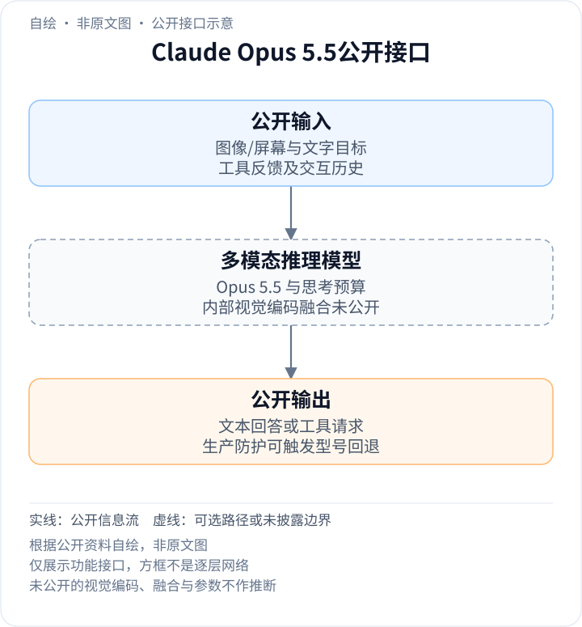
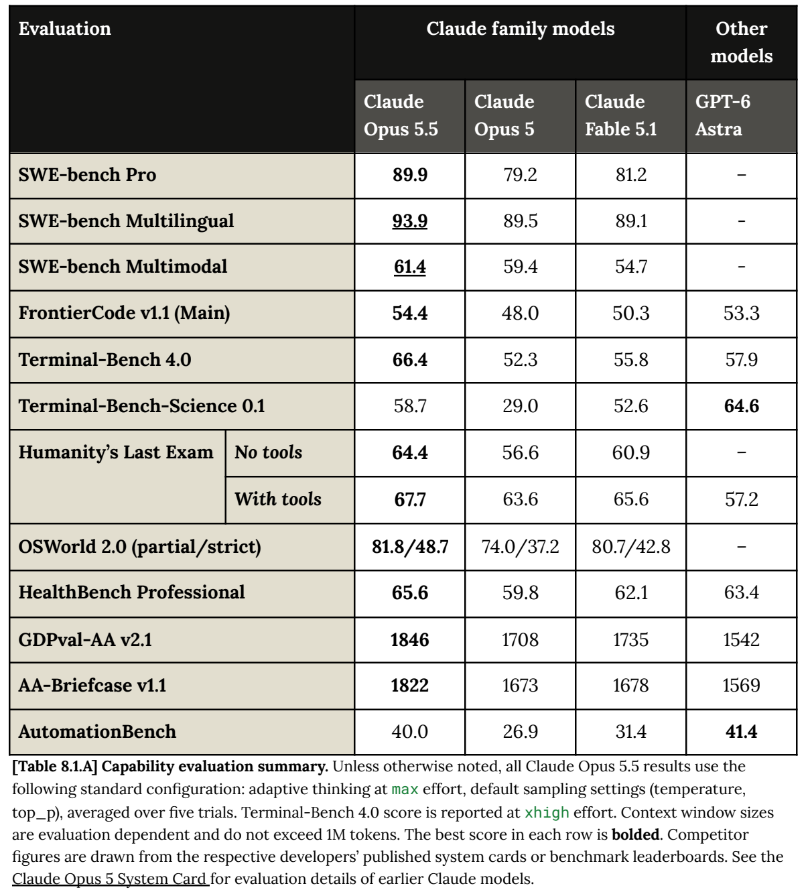

<!-- article-header:start -->
[项目首页](../../../README.md) › [模型系列](../../../reports/model-family-index.md) › [Claude](../README.md)
<!-- article-header:end -->

# Claude Opus 5.5：视觉工具协作、长任务评测与效率

<!-- article-toc:start -->
<a id="article-toc"></a>

**本篇目录** · [论文定位](#paper-info) · [快速概览](#overview) · [整体架构](#architecture) · [核心原理](#principles) · [数据构建](#data) · [训练流程](#training) · [实验结果](#experiments)
<!-- article-toc:end -->

<a id="paper-info"></a>

## 1. 论文信息与模型定位

| 项目 | 信息 |
|---|---|
| 原文 | Claude Opus 5.5 System Card |
| 发布 | Anthropic，2026-09-22 |
| 固定资料 | 官方230页PDF与发布博文，2026-10-13快照 |
| 定位 | 图文、代理编码、computer use和长周期知识工作，输出文本 |

Opus 5.5升级Opus 5，系统卡把视觉推理和计算机操作列为主要提升领域，同时强调不同推理预算、工具与生产防护会改变结果。本文以[官方PDF](https://www.anthropic.com/claude-opus-5-5-system-card)为主来源，避免仅依据发布页面互动图推断模型机制；[博文](https://www.anthropic.com/claude-opus-5-5)只补充发布与效率口径。

<a id="overview"></a>

## 2. 快速概览

- **视觉图表**：Chartography无工具64.4%，有容器及裁图工具89.0%，adaptive/max、平均5次。
- **计算机操作**：OSWorld 2.0部分得分81.8%，严格通过48.7%；两者代表不同完成程度。
- **知识与训练**：知识截止2026年6月，训练混合含公开/私有数据、被允许使用的用户反馈与合成数据。
- **效率**：发布说明的典型工作负载成本下降40%包含单价及token使用量，不等于模型参数缩小40%。
- **未知项**：未公开参数、专家数量、视觉编码器、融合层及完整后训练损失。

<a id="architecture"></a>

## 3. 整体架构

<!-- derived-architecture:start -->


*自绘公开接口示意（非原文图）。依据下述公开资料归纳；方框表示功能组件，不代表逐层实现。*

依据：[PDF pp.11–12 §§1.1/1.4–1.5](https://www.anthropic.com/claude-opus-5-5-system-card)。
<!-- derived-architecture:end -->

公开可确认的数据流是图像/屏幕和文字进入模型，模型输出文字或工具请求；工具可对图片裁剪、运行代码或执行界面动作，再把结果送回后续调用。生产系统还会以分类器干预部分高风险请求，并可能回退到其他模型；这属于部署系统组成，不应冒称Opus 5.5内部MoE路由。

| 模块 | 输入与输出 | 公开机制 |
|---|---|---|
| 图文上下文 | 图片、屏幕与目标 → 当前输入 | 视觉评测确认图文能力；编码、融合和token规格未披露 |
| Opus 5.5推理 | 上下文与effort → 回答或请求 | 能力评测通常adaptive/max；部分结果采用不同effort |
| 图像/代码工具 | 工具请求 → 新图或计算结果 | Chartography提供容器和裁图，取得更细证据 |
| computer use执行 | 鼠标/键盘请求 → 截图和任务状态 | OSWorld 2.0在真实Ubuntu虚拟机执行，最多500步 |
| 运行时上下文管理 | 累积截图与历史 → 压缩后上下文 | 该OSWorld设置超过100K时使用server-side compaction |
| 生产分类与回退 | 特定请求/行为 → 放行、阻断或其他模型 | CB阻断回Opus5，cyber阻断回Opus4.8；不等同内部专家层 |

Card明确一些评测关闭生产防护以研究基础模型，不能将不同部署状态的结果混为一个固定前向。[第11–12、199–200、205–206页](https://www.anthropic.com/claude-opus-5-5-system-card#page=12)

<a id="principles"></a>

## 4. 核心创新与数学原理

### 4.1 视觉再观察与专家范围评分

Chartography覆盖100项专业图表任务，包括生存曲线、蜡烛图、Sankey图等。不同图表读数精度不同，每题使用专家给定的可接受范围，不能套一个统一数字容差。工具设置提供图像文件、标准库及裁图，模型可把感知问题转换为局部观察和可计算问题。

无工具64.4%到有工具89.0%是同类思考配置下增加工具的结果，并未证明全部收益来自单一裁剪步骤。当前Card改用Gemini 3.5 Flash作为评分器，与早期Claude模型使用不同评分器的旧卡成绩不可直接拼接比较。[§8.13.1，第199–200页](https://www.anthropic.com/claude-opus-5-5-system-card#page=199)

### 4.2 部分完成与严格成功的数学差别

OSWorld 2.0的每个任务含加权检查点。按原文规则，可以用以下解释式区分指标，而非模型训练目标：

```math
S_{\mathrm{partial}}=\frac1N\sum_i\sum_j w_{ij}c_{ij},\qquad
S_{\mathrm{strict}}=\frac1N\sum_i\mathbf1[\forall j,\ c_{ij}=1],\quad\sum_jw_{ij}=1.
```

$`c_{ij}`$是任务$`i`$的检查点是否通过，$`w_{ij}`$为归一化权重。部分得分会奖励已完成子步骤，严格成功要求全部检查点达成，因此81.8%部分分不能写成81.8%任务全部成功。两种指标都按pass@1并平均5次运行。[第205–206页](https://www.anthropic.com/claude-opus-5-5-system-card#page=205)

该设置为108项任务、1080p、最多500步，并保留所有截图、在100K后压缩上下文。任务资源与harness更新使其与旧OSWorld分数不直接可比；更长动作预算也不能被忽略。

### 4.3 单模型能力、生产系统与经济效率分开

生产防护在部分任务中可能回退到其他型号。发布成绩说明在防护干预时cyber任务可由Opus4.8、biology等由Opus5接续，所以端到端完成与原模型独立完成需要区分。这是外部部署策略，不能把回退写成每token的稀疏专家选择。[§1.4–1.5，第12页；博文评测脚注](https://www.anthropic.com/claude-opus-5-5-system-card#page=12)

成本既受输入、输出和缓存各类token单价影响，也受一项任务实际消耗多少token影响。博文称典型负载成本下降40%、输出速度提高30%以上，属于其测试负载与默认配置，未披露足够硬件条件推算普适吞吐或FLOPs比；本文不把这些结果反推参数量。[发布说明Cost and speed](https://www.anthropic.com/claude-opus-5-5)

<a id="data"></a>

## 5. 数据构建与处理

Card列出公开互联网、公开和私有数据集、用户反馈/bug材料或明确允许用于训练的数据，以及其他模型生成的合成数据；处理采用去重与分类，ClaudeBot遵循robots.txt且不绕过登录和验证码。知识截止为2026年6月，但未公布每种模态数量与配比。[§1.1，第11页](https://www.anthropic.com/claude-opus-5-5-system-card#page=11)

专业图表数据与OSWorld任务资源在本文中是评测资料，不应直接写成训练集。OSWorld评测更新到2026年9月10日的任务文件及伴随应用；Card将更新前后的协议区别讲清，因此日期新旧会改变可比较性。[第199–200、205–206页](https://www.anthropic.com/claude-opus-5-5-system-card#page=205)

报告未提供图像分辨率训练日程、音频生成训练或视觉预训练总量。输出端明确为文本，不据代理能调用音频工具就声称原生全模态生成。

<a id="training"></a>

## 6. 训练流程与目标

预训练之后进行大量后训练与微调，使行为符合Claude constitution；Card没有在模型介绍部分给出完整的RLHF/AI反馈比例、训练损失、冻结表、学习率或总算力，本文不借前代配方补齐。[第11页](https://www.anthropic.com/claude-opus-5-5-system-card#page=11)

训练过程保存不同快照；除特别说明，结果来自最终快照。部分安全/能力段落会使用较早或替代快照，也可能关闭生产防护。因此记录一个成绩时，需要同时保留模型状态、effort、工具、评分器和防护条件，而不只写型号名称。[§1.4，第12页；Table 8.1.A，第174页](https://www.anthropic.com/claude-opus-5-5-system-card#page=174)

第8章多数汇总采用adaptive/max、默认采样、平均5次，Terminal-Bench 4.0例外采用xhigh。这个测试时计算设置不是训练阶段数量，也不说明运行时每个请求都使用相同思考长度。

<a id="experiments"></a>

## 7. 实验设置与主要结果



*PDF第174页原表裁图，保留模型列和adaptive/max、xhigh例外、5次平均等表注。*

| 任务 | Opus 5.5 | 对照与条件 |
|---|---:|---|
| Chartography，无工具/有工具 | 64.4% / 89.0% | Opus5为29.8% / 83.4%，同卡更新评分协议 |
| OSWorld 2.0，partial/strict | 81.8% / 48.7% | Opus5为74.0% / 37.2%，同一更新环境 |
| SWE-bench Multimodal | 61.4% | Opus5为59.4%，独立于OSWorld的任务 |
| HLE，无工具/有工具 | 64.4% / 67.7% | 与Chartography的64.4数值相同但不是同一指标 |
| Terminal-Bench 4.0 | 66.4% | xhigh effort，不能概括为全表统一max |

图表理解与GUI任务均有提升，但工具、预算及评分更新是解释结果的必要部分。Card没有独立视觉结构消融，也没有支持所有图像任务全面无误的证据。本文未运行模型或复现实验。[第174、199–200、205–206页](https://www.anthropic.com/claude-opus-5-5-system-card#page=200)

<!-- article-footer:start -->
---

[← 上一篇：Qwen3.8-Omni-Flash](../../qwen/document-2ea7273632dc/README.md) · [按发表时间浏览](../../../reports/paper-reading-guide.md#year-2026) · [下一篇：GPT-6.1 Sol →](../../gpt/document-0e63abfcb13e/README.md)

[返回本篇目录](#article-toc) · [返回模型系列](../README.md)
<!-- article-footer:end -->
