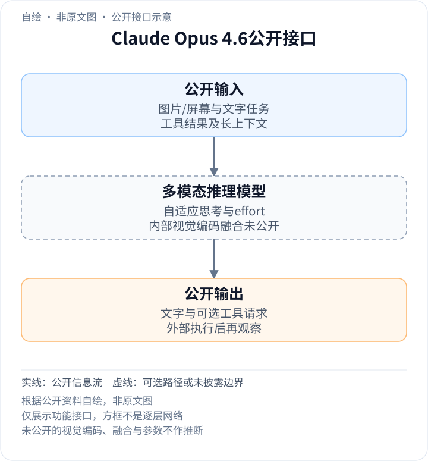
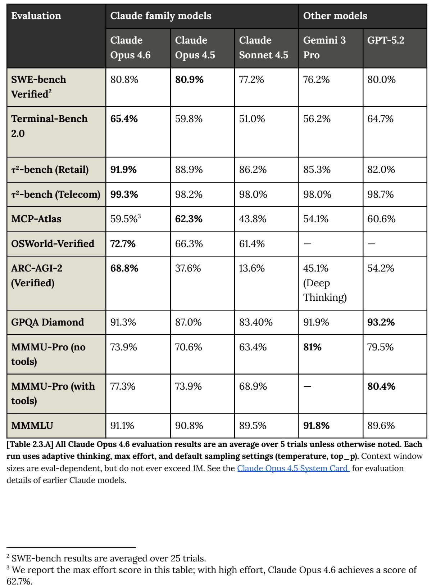

<!-- article-header:start -->
[项目首页](../../../README.md) › [模型系列](../../../reports/model-family-index.md) › [Claude](../README.md)
<!-- article-header:end -->

# Claude Opus 4.6：自适应思考、视觉再观察与长任务

<!-- article-toc:start -->

**本篇目录** · [论文定位](#paper-info) · [快速概览](#overview) · [整体架构](#architecture) · [核心原理](#principles) · [数据构建](#data) · [训练流程](#training) · [实验结果](#experiments)
<!-- article-toc:end -->

## 1. 论文信息与模型定位

| 项目 | 信息 |
|---|---|
| 原文 | Claude Opus 4.6 System Card |
| 发布 | Anthropic，2026-02-05 |
| 固定资料 | 213页官方卡，含2月6日勘误，2026-10-13获取 |
| 定位 | 图文理解、复杂知识工作、计算机操作与长上下文代理 |

Opus 4.6在扩展思考之上增加自适应模式，让任务条件与effort设置共同决定是否深入推理。本文以[System Card](https://www-cdn.anthropic.com/14e4fb01875d2a69f646fa5e574dea2b1c0ff7b5.pdf)的模型、训练及视觉评测为主，[发布博文](https://www.anthropic.com/news/claude-opus-4-6)补充1M beta窗口、上下文压缩等接口；不会把后者当作已公开内部网络。

## 2. 快速概览

- **自适应思考**：effort分low、medium、high、max，high为默认；模式控制推理深度，不是四个参数规模。
- **视觉工具收益**：MMMU-Pro从73.9%到77.3%，LAB-Bench FigQA从58.0%到78.3%，区别是是否允许裁图工具。
- **computer use**：OSWorld-Verified首尝试成功率72.7%，1080p、最多100动作步、平均5次运行。
- **长任务接口**：发布时提供1M上下文beta及compaction；压缩会用摘要替换旧上下文，不是无损无限记忆。
- **未知项**：参数、视觉塔、融合层、token网格及具体奖励函数未公开。

## 3. 整体架构

<!-- derived-architecture:start -->

*自绘公开接口示意（非原文图）。依据下述公开资料归纳；方框表示功能组件，不代表逐层实现。*

依据：[PDF pp.10–11 §1.1](https://www-cdn.anthropic.com/14e4fb01875d2a69f646fa5e574dea2b1c0ff7b5.pdf)。
<!-- derived-architecture:end -->

图像或屏幕与文字目标进入闭源模型，自适应思考依据任务和effort配置选择推理投入。需要更清楚的细节时，模型可在配备工具的评测中请求裁图，接收新的局部观察再继续回答。computer use则通过外部虚拟机执行鼠标/键盘动作。两种工具改变可读证据或环境状态，并未证明内部视觉塔更换。

| 模块 | 输入与输出 | 公开机制 |
|---|---|---|
| 图文输入 | 图片、屏幕与文字 → 多模态条件 | 具体像素处理和token预算未公开 |
| 自适应推理 | 任务与effort → 思考投入及回答 | 任务决定是否深入；四档effort改变选择倾向 |
| 局部裁图工具 | 模型请求与原图 → 局部图像 | 在FigQA、MMMU-Pro、CharXiv有工具设置中提供再观察 |
| computer use环境 | 操作请求 → 新截图与状态 | OSWorld在Ubuntu虚拟机执行；不是主干直接访问硬件 |
| 上下文压缩接口 | 较长交互 → 旧内容摘要 | 发布博文的API能力，可延长工作流但摘要可能丢细节 |
| 文本输出 | 观察及推理状态 → 答案/工具调用 | 模型最终输出与工具真实执行分开，内部结构未知 |

自绘图仅呈现公开接口。Card中的interpretability工具用于研究模型行为，不是推理前向必经层。[§1.1、§2.8、§2.19，第10–11、22、34–36页](https://www-cdn.anthropic.com/14e4fb01875d2a69f646fa5e574dea2b1c0ff7b5.pdf#page=34)

## 4. 核心创新与数学原理

### 4.1 自适应思考与effort形成任务相关预算

此前启用扩展思考是二元开关，新模式可根据任务决定是否使用。默认high在多数请求上启用，降低effort使其更有选择性；max不等于所有评测最优。例如MCP-Atlas在max为59.5%，high为62.7%。多花计算可能增加自检，也可能产生多余分支，质量、时间和成本应按任务测量。[第11、18页](https://www-cdn.anthropic.com/14e4fb01875d2a69f646fa5e574dea2b1c0ff7b5.pdf#page=18)

### 4.2 再观察把感知瓶颈与推理瓶颈分开

裁图工具提供局部图像，不只是让模型对同一低清表示“想更久”。复杂科学图中，局部标签、坐标和小曲线可能影响推断；工具允许把新的细节放回上下文。但裁剪位置若选错仍会丢证据，不能将工具收益当成无损视觉放大。

FigQA两设置都采用adaptive/max，成绩58.0%与78.3%；MMMU-Pro的73.9%与77.3%也固定相同思考配置。这样的对照支持额外视觉观察有用，却不能单独量化视觉编码器结构变化。[§2.19，第34–36页](https://www-cdn.anthropic.com/14e4fb01875d2a69f646fa5e574dea2b1c0ff7b5.pdf#page=34)

### 4.3 长窗口、压缩与操作成功使用不同指标

1M窗口允许读取更多材料，compaction把旧上下文替换为摘要以继续长会话；保留哪些事实会影响后续决策，因此压缩不保证逐字记忆。工具环境中的动作成功又受界面、工具协议和步数限制，不能由长文检索能力直接推断。

OSWorld的72.7%按每题首尝试成功计算，平均五次独立运行；100步预算为单题上限，不能解释成系统持续操作100步全部无误。Card勘误特别将OSWorld改名为OSWorld-Verified，避免与其他版本成绩混用。[第2、22页；发布说明Context compaction](https://www-cdn.anthropic.com/14e4fb01875d2a69f646fa5e574dea2b1c0ff7b5.pdf#page=22)

## 5. 数据构建与处理

模型混合数据包含截至2025年5月的公开互联网、第三方非公开材料、标注服务及承包方、用户主动允许用于训练的数据，以及内部生成数据。处理包括去重与分类，并说明公开爬取遵循robots.txt、不绕过登录或验证码。[§1.1.1，第10–11页](https://www-cdn.anthropic.com/14e4fb01875d2a69f646fa5e574dea2b1c0ff7b5.pdf#page=10)

系统卡另外讨论评测去污染，但将完整做法指向前代文档，并明确去污染不是精确科学。不能因为报告提到去重就断言所有评测都无污染；同样，视觉评测中的FigQA、MMMU-Pro和CharXiv是评估来源，不能自动视作训练语料。[§2.2，第17页](https://www-cdn.anthropic.com/14e4fb01875d2a69f646fa5e574dea2b1c0ff7b5.pdf#page=17)

本卡未披露图像/文字混合比例、训练数据量、视觉预处理尺寸或裁图工具轨迹的训练规模。

## 6. 训练流程与目标

预训练后经历大量后训练和微调，公开列出RLHF及AI反馈强化学习，目标为帮助性、诚实性和无害性；没有列出奖励各项权重、策略优化器或视觉支路冻结表。[第11页](https://www-cdn.anthropic.com/14e4fb01875d2a69f646fa5e574dea2b1c0ff7b5.pdf#page=11)

模型开发过程中会保存多个快照进行测试。除特殊说明，Card评测指向最终公开快照；部分安全测试还涉及不同运行防护条件，这些状态应与第2章能力评测区别。自适应模式是部署时可控推理行为，并非证实训练时按四个effort训练了四套独立模型。[第10–11、17–18页](https://www-cdn.anthropic.com/14e4fb01875d2a69f646fa5e574dea2b1c0ff7b5.pdf#page=10)

发布博文的agent teams与compaction提供代理组织和上下文接口，不能替代未知的神经网络训练阶段。

## 7. 实验设置与主要结果

*PDF第18页原表裁图，保留adaptive/max、5次运行以及SWE与MCP的必要脚注。*

| 多模态任务 | 无工具 | 裁图工具 | 协议 |
|---|---:|---:|---|
| LAB-Bench FigQA | 58.0% | 78.3% | adaptive/max；5次；专家基线77%来自原基准 |
| MMMU-Pro | 73.9% | 77.3% | Standard十选项与Vision格式平均；各5次 |
| CharXiv Reasoning | 68.5% | 77.4% | validation中1000题；5次 |

这些视觉结果支持局部再观察的作用，不能将有工具成绩与外部无工具模型直接等同条件比较。SWE-bench Verified为80.8%，略低于表中Opus 4.5的80.9%；MCP也受effort影响，说明“总体能力升级”不是每个指标单调提高。所有数字为官方报告，本文未独立复现。[第18、22、34–36页](https://www-cdn.anthropic.com/14e4fb01875d2a69f646fa5e574dea2b1c0ff7b5.pdf#page=34)

<!-- article-footer:start -->
---

[← 上一篇：Kimi K2.5](../../kimi/arxiv-2602.02276/README.md) · [按发表时间浏览](../../../reports/paper-reading-guide.md#year-2026) · [下一篇：MiniCPM-o 4.5 →](../../minicpm/document-9be303a31d11/README.md)

[返回本篇目录](#article-toc) · [返回模型系列](../README.md)
<!-- article-footer:end -->
