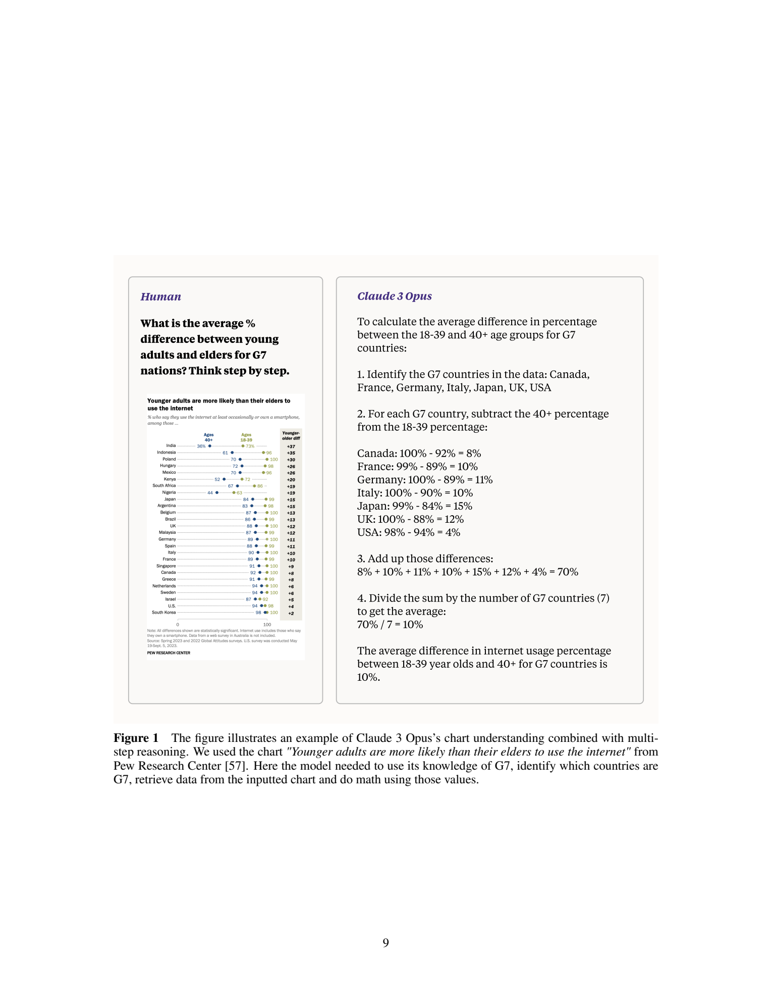
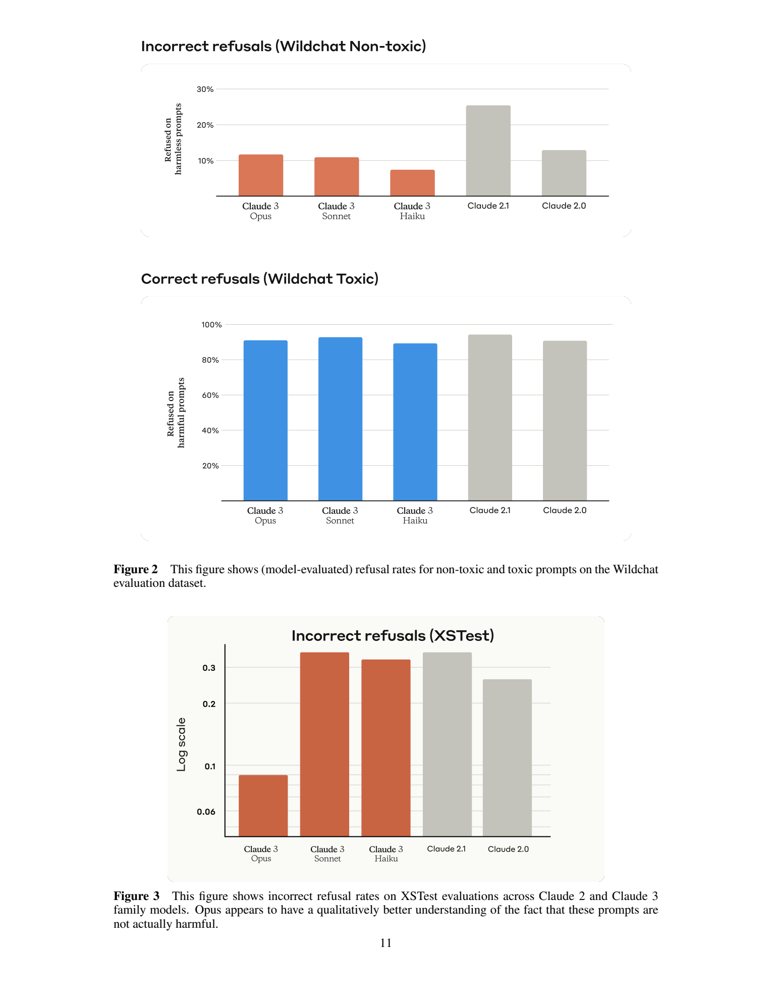
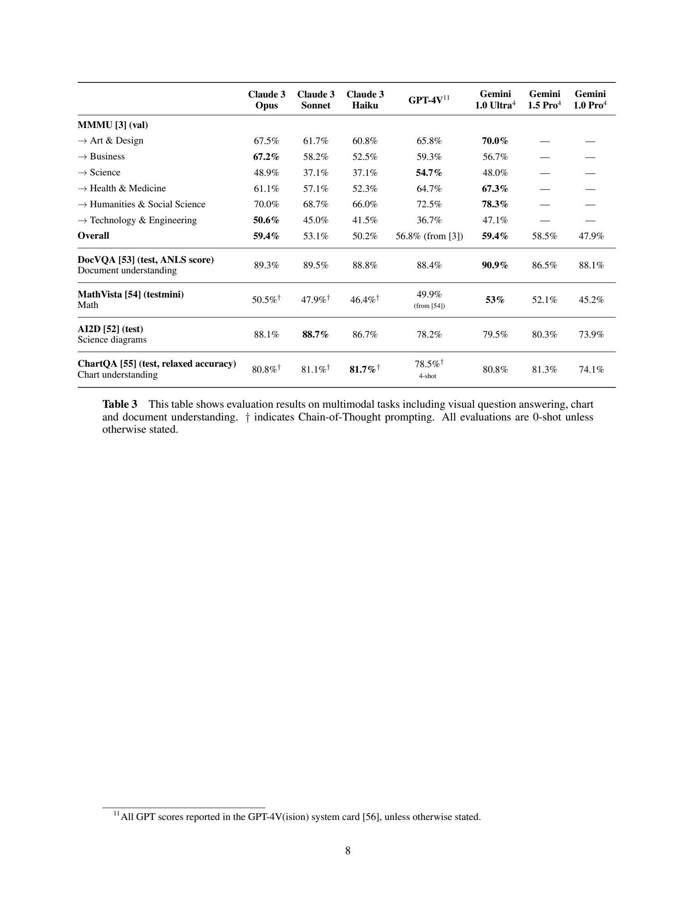
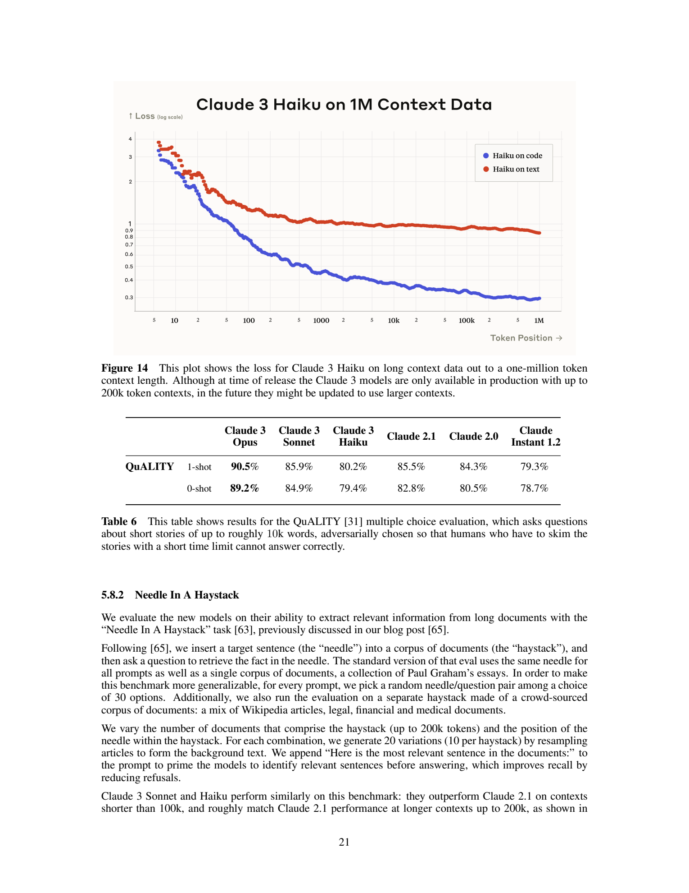

[返回 Claude 家族](../README.md) · [返回仓库](../../../README.md)

# Claude 3：视觉输入、行为对齐与长上下文能力的模型卡解读

> 本文解读 Anthropic 的 **The Claude 3 Model Family: Opus, Sonnet, Haiku**。采用官方 42 页 PDF 的本地快照，讨论的是 2024 年发布时的三个模型。材料类型为模型卡，公开重点是能力与行为评测；架构内部和完整训练配方的公开程度有限。

## 1. 论文信息与模型定位

| 项目 | 内容 |
|---|---|
| 题名与发布主体 | The Claude 3 Model Family: Opus, Sonnet, Haiku；Anthropic |
| 发表信息与采用版本 | 2024 年 3 月发布；本文采用官方 PDF 快照，版本由下载文件哈希固定 |
| 家族与型号 | Claude；Opus、Sonnet、Haiku 分别强调最高能力、能力与速度平衡、较低成本与速度 |
| 输入与输出 | 文本和图像输入，文本输出；报告也讨论视频帧输入，未披露独立的视频或音频生成路径 |
| 规模与资源 | 各型号精确参数量、视觉编码器规模、激活参数量未公开；没有开放模型权重 |
| 主要任务 | 对话、代码、数学、文档与图表问答、多语言任务、工具调用与长文本处理 |
| 上下文信息 | 发布时生产服务提供 200k Token 上下文；研究中另报告长至 1M Token 的损失实验 |
| 原始材料 | [官方模型卡 PDF](https://www-cdn.anthropic.com/de8ba9b01c9ab7cbabf5c33b80b7bbc618857627/Model_Card_Claude_3.pdf) |

Claude 3 的多模态定位主要是把图像信息加入语言任务：用户可以提供图表、文档或照片，再要求模型识别、推理并组织答案。输出仍是文本，因此“看见图像”“产生操作请求”和“工具实际完成操作”属于不同环节。模型卡将工具调用作为能力之一，却没有提供一个可由公开参数完整复建的视觉 Agent 架构。[原文 §1–2，PDF 第 1–3 页](https://www-cdn.anthropic.com/de8ba9b01c9ab7cbabf5c33b80b7bbc618857627/Model_Card_Claude_3.pdf#page=1)

## 2. 快速概览

Claude 3 的报告围绕三个问题展开：视觉输入能否与知识和推理结合，模型能否在帮助用户与恰当拒绝之间取得更好的行为表现，以及长上下文是否真正支持信息提取和理解。Opus 负责高难度推理，Sonnet 提供能力与速度的折中，Haiku 面向更快、更经济的任务，但三个型号都具备视觉输入能力。

其技术信息可以分成两个层面。训练层面，模型采用大规模预训练、人类反馈和 Constitutional AI，通过明确行为原则影响后训练；数据包括公开网络信息、第三方非公开资料、标注服务与内部生成数据。能力层面，报告展示多模态问答、图表理解、多语言、长上下文和错误拒绝等评测，强调这些能力应分别测量。

报告的意义在于展示一个商业模型家族如何被系统评估。它不能支持将性能归因于某个未公开的视觉连接器，也不能把 1M Token 的研究实验直接解释为发布时的产品输入上限。模型规模与单项分数也并不严格单调：较小型号在部分图表或编程指标上可以高于更大型号，需要按测试条件阅读。[原文 §1、§2.5–2.6、§5](https://www-cdn.anthropic.com/de8ba9b01c9ab7cbabf5c33b80b7bbc618857627/Model_Card_Claude_3.pdf#page=3)

## 3. 整体架构

公开材料能确认的功能链路是：用户提供图像与文本问题，模型利用视觉内容和上下文知识形成回答，然后逐 Token 输出文本。模型卡明确介绍了自回归式生成行为，但没有披露图像切块方式、视觉 Token 数、编码器结构、融合位置或注意力形式。因此，下文围绕报告实际展示的信息流解释，保留这些内部配置的未知状态。

> 来源：原文 **Figure 1**，PDF 第 **9** 页，整页原样渲染并保留图注。[原页](https://www-cdn.anthropic.com/de8ba9b01c9ab7cbabf5c33b80b7bbc618857627/Model_Card_Claude_3.pdf#page=9)。图中的统计图来自 Pew Research Center，原模型卡已注明其来源。

读图时依次看统计图、用户问题和模型回答。任务要求模型先根据知识确定哪些国家属于 G7，再从图中读取这些国家的数据，最后进行计算。这里同时涉及视觉读数、集合筛选和算术；只识别文字或只列出国家都不足以完成任务。这张图展示了能力链路，图中的问答框不能当成内部网络模块。

| 可确认环节 | 公开信息 | 尚未披露的实现细节 |
|---|---|---|
| 图像与文本输入 | 可接收表格、图表、照片等视觉内容及用户问题 | 图像缩放规则、切块粒度、视觉序列长度 |
| 多模态理解 | 通过视觉问答、科学图解、文档与图表任务评估 | 视觉编码器、连接器及与语言骨干的融合方式 |
| 序列生成 | 依据上下文及已生成内容逐 Token 生成回答 | 骨干层数、隐藏维度、总参数量 |
| 工具接口 | 可产生工具调用所需的指令表达 | 各评测任务是否调用外部工具及具体执行配置 |

同样地，输入视频帧意味着模型可以读到采样图像，并不自动证明存在专门的时间位置编码、动态帧率训练或端到端视频生成器。这些机制在该模型卡中均没有具体配置，不能用其他 VL 模型的设计替代。[原文 §2.1、§5.3，PDF 第 2、7 页](https://www-cdn.anthropic.com/de8ba9b01c9ab7cbabf5c33b80b7bbc618857627/Model_Card_Claude_3.pdf#page=7)

## 4. 核心创新与数学原理

模型卡没有提出可复现的新增网络算子，核心变化主要体现在多模态能力、行为训练和评价方法。Constitutional AI 的基本思路是把行为原则明确写成模型训练中的指导依据，使模型学习适当的回答和拒绝行为。Claude 3 延续了先前的大部分原则，并加入与残障人士权益相关的原则。报告没有逐项提供 Claude 3 的原则采样、奖励建模、强化学习更新或损失权重。[原文 §2.6、§4.1，PDF 第 3–4 页](https://www-cdn.anthropic.com/de8ba9b01c9ab7cbabf5c33b80b7bbc618857627/Model_Card_Claude_3.pdf#page=3)

> 来源：原文 **Figure 2、Figure 3**，PDF 第 **11** 页；[原页](https://www-cdn.anthropic.com/de8ba9b01c9ab7cbabf5c33b80b7bbc618857627/Model_Card_Claude_3.pdf#page=11)。原图中的拒绝率应结合数据子集解释。

Figure 2 分别观察有害和无害请求，Figure 3 观察本应回答的 XSTest 请求。对于无害请求，拒绝率下降通常意味着可用性提高；对于有害请求，相同方向并不表示更好的行为。因而，一个总体拒绝率不能替代分类评估。原文在 XSTest 上报告 Claude 2.1 的错误拒绝率为 35.1%，Opus 为 9%，体现的是该数据集中的过度拒绝减少，而不是任意请求都得到更正确的答案。

报告还用人类成对比较评估写作、代码和专家知识。其 Equation **(5.1)** 给出 Elo 分差与胜率的转换。若把分差记作基线分数减去被评模型分数，可写为：

$$
R=\frac{1}{1+10^{(E_{\mathrm{base}}-E_{\mathrm{model}})/400}}.
$$

这里 $R$ 是被评模型被偏好的概率，$E$ 是对应 Elo 分数；将分差的方向写清楚后，当前模型比基线高 100 分时，胜率约为 64%。这是评测信号的解释，不是 Claude 3 的训练目标。胜率也依赖任务集合、评判标准与评审人群，不能作为脱离任务分布的绝对能力值。[原文 §5.5、Equation (5.1)，PDF 第 12 页](https://www-cdn.anthropic.com/de8ba9b01c9ab7cbabf5c33b80b7bbc618857627/Model_Card_Claude_3.pdf#page=12)

对于事实正确性，报告进一步区分正确、错误和承认不知道三类输出。这个分类揭示了一个实用权衡：频繁说不知道可以降低错误率，也可能减少正确作答。训练效果应同时考察有多少问题被正确解决，以及剩余输出如何分布，不能只凭错误数降低就认定知识能力增加。[原文 §5.7，PDF 第 18–19 页](https://www-cdn.anthropic.com/de8ba9b01c9ab7cbabf5c33b80b7bbc618857627/Model_Card_Claude_3.pdf#page=18)

## 5. 数据构建与处理

| 数据用途 | 原文公开的信息 | 规模与处理边界 |
|---|---|---|
| 大规模预训练 | 截至 2023 年 8 月的公开网络信息、第三方非公开资料、标注服务和付费承包商数据、内部生成数据 | 精确 Token 数、图文比例、图像和视频数量未披露 |
| 清洗与过滤 | 使用去重、分类等处理 | 判重阈值、分类器、过滤后规模未披露 |
| 人类反馈 | 包括偏好回答选择、正确性与有用性等标准的评价，以及对抗测试 | 任务混合、偏好对数量、标注一致性统计未完整公开 |
| Constitutional AI | 行为原则指导模型对齐，增加残障权益相关原则 | 原则与训练样本之间的具体生成和混合配方未披露 |

报告明确区分训练数据来源类别与客户输入：其声明 Claude 3 没有使用通过免费用户、Claude Pro 或 API 客户提交的提示和模型输出进行训练。这是该模型卡对当时训练来源的描述，不应扩展为所有后续产品的永久政策。数据截止时间也不保证模型能正确记住截止前的每一条事实。[原文 §2.5–2.6、§4.2，PDF 第 3–4 页](https://www-cdn.anthropic.com/de8ba9b01c9ab7cbabf5c33b80b7bbc618857627/Model_Card_Claude_3.pdf#page=3)

评测数据的构造相对更具体。长上下文检索实验从 30 组目标句及问题中随机选择，将其放入不同背景文档和不同位置；背景既有 Paul Graham 文章，也有维基百科、法律、金融与医学文档。每个长度和位置组合产生 20 个变化版本，降低单一目标句或文档造成的偶然性。这个实验数据构造不能反推模型预训练中使用了多少类似材料。[原文 §5.8.2，PDF 第 21 页](https://www-cdn.anthropic.com/de8ba9b01c9ab7cbabf5c33b80b7bbc618857627/Model_Card_Claude_3.pdf#page=21)

## 6. 训练流程与目标

| 环节 | 原文明确的目标与做法 | 未公开的关键配置 |
|---|---|---|
| 预训练 | 从大规模、多样数据学习语言能力，包含预测词或 Token 的任务 | 模态混合、视觉端初始化、各阶段 Token 预算 |
| 人类反馈及原则对齐 | 学习有用、诚实及恰当的回答；使用 Constitutional AI 与强化学习相关方法 | 奖励函数、优化器、超参数、精确阶段安排 |
| 训练后评估 | 核验能力、行为及风险；结合自动评估与人工测试 | 不同检查如何与模型选择或额外训练循环关联 |

报告的自回归描述可以用一个阅读辅助目标解释：对上下文 $x$ 和目标回答 $y$，常见生成学习提高 $p_\theta(y_t\mid x,y_{<t})$。它要求模型根据已经看到的信息预测下一个 Token，文本输出的顺序性由此而来。但报告没有公开 Claude 3 的损失掩码、视觉输入的监督形式或各目标权重，因此不能把这个标准描述当成其完整训练公式。

人类反馈和 Constitutional AI 则影响哪些回答在后训练中被偏好。将“参考回答怎样表达”“回答是否有事实依据”“是否应拒绝请求”视作不同信号，可以理解报告为什么单独设置多类行为评测；其具体优化如何组合这些信号仍未披露。原文只确认使用 AWS 与 GCP 硬件，以及 PyTorch、JAX、Triton 等框架，未给出可计算训练成本的硬件数量、运行时间、学习率和总算力。[原文 §1、§2.6，PDF 第 1、3 页](https://www-cdn.anthropic.com/de8ba9b01c9ab7cbabf5c33b80b7bbc618857627/Model_Card_Claude_3.pdf#page=3)

## 7. 实验设置与主要结果

> 来源：原文 **Table 3**，PDF 第 **8** 页；[原页](https://www-cdn.anthropic.com/de8ba9b01c9ab7cbabf5c33b80b7bbc618857627/Model_Card_Claude_3.pdf#page=8)。下表按该原表摘录，分数以原表口径表示。

| 基准与指标 | Opus | Sonnet | Haiku | 对比与条件 |
|---|---:|---:|---:|---|
| MMMU val，准确率 | 59.4% | 53.1% | 50.2% | GPT-4V 56.8%；Gemini 1.0 Ultra 59.4% |
| DocVQA test，ANLS | 89.3% | 89.5% | 88.8% | Gemini 1.0 Ultra 90.9%；这里是字符串匹配指标 |
| MathVista testmini | 50.5% | 47.9% | 46.4% | 使用 CoT；Gemini 1.0 Ultra 53% |
| AI2D test | 88.1% | 88.7% | 86.7% | 0-shot；GPT-4V 78.2% |
| ChartQA test，relaxed accuracy | 80.8% | 81.1% | 81.7% | Claude 使用 CoT；GPT-4V 原表为 4-shot |

作者称视觉评测以 $T=0$ 采样为基础，并在表中单独标注 CoT 及例外的 shot 设置。AI2D 的部分图像被放大至长边 800 像素、保持比例；输入处理可影响分数。正文第 7 页的 AI2D 叙述与第 8 页表值存在差异，本文统一采用 Table 3，不混合两组数字。

这组结果显示 Opus 在 MMMU 和视觉数学上有较强表现，但文档和图表并非所有场景都由最大型号领先。Haiku 的 ChartQA 比 Opus 高 0.9 个百分点，Sonnet 的 DocVQA 与 AI2D 也略高于 Opus。不能由型号定位推出每行都严格随规模提升；不同指标、输入和提示条件也不能合并成一个“视觉总分”。

> 来源：原文 **Figure 14、Table 6**，PDF 第 **21** 页；[原页](https://www-cdn.anthropic.com/de8ba9b01c9ab7cbabf5c33b80b7bbc618857627/Model_Card_Claude_3.pdf#page=21)。图中损失、表中问答准确率分别支持不同结论。

Figure 14 展示 Haiku 在长至 1M Token 数据上的损失曲线，Table 6 展示 QuALITY 长文本理解，Opus 为 90.5%（1-shot）和 89.2%（0-shot），Sonnet 的 1-shot 为 85.9%，Haiku 为 80.2%。损失曲线说明长序列上的预测表现，问答表说明一个具体理解任务的准确率；它们不等价于 1M Token 范围内每项复杂任务都可靠。

另一个检索实验报告 Opus 在最长 200k Token 文档中达到超过 99% 的召回表现。作者为检索提示加入了先指出相关句子的引导，并改变目标句、位置和背景。这个条件必须与结果一起保留：简单目标句检索和跨文档综合推理是不同难度的任务。[原文 §5.8，PDF 第 20–22 页](https://www-cdn.anthropic.com/de8ba9b01c9ab7cbabf5c33b80b7bbc618857627/Model_Card_Claude_3.pdf#page=20)

纯文本推理也有评测设置差异。Opus 的 MATH 4-shot 为 61%，使用 32 次采样的多数投票后为 73.7%；GPQA Diamond 的 0-shot CoT 为 50.4%，5-shot CoT 多数投票为 59.5%。后者动用了额外采样预算，不能与单次回答直接比较。GPQA 的部分结果还取十轮评测平均，以缓解选项排序和随机采样带来的方差。[原文 §5.1、Table 1，PDF 第 5–6 页](https://www-cdn.anthropic.com/de8ba9b01c9ab7cbabf5c33b80b7bbc618857627/Model_Card_Claude_3.pdf#page=5)

该模型卡支持三个结论：Claude 3 家族具有真实的图文理解和推理能力；任务与提示条件对型号比较有明显影响；行为和长上下文需要分别评价。由于缺少模块消融和架构细节，性能提升无法进一步拆解成某种视觉编码器、数据配比或特定对齐算法的独立收益。
