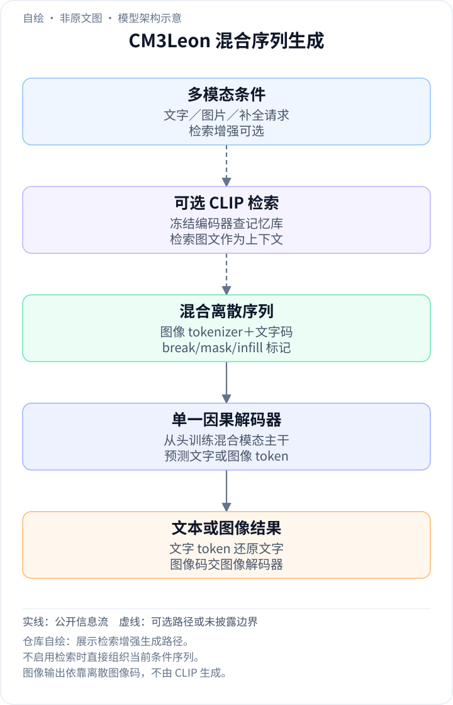
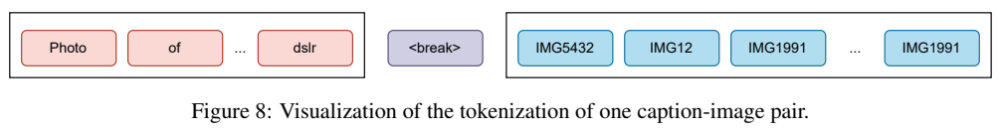
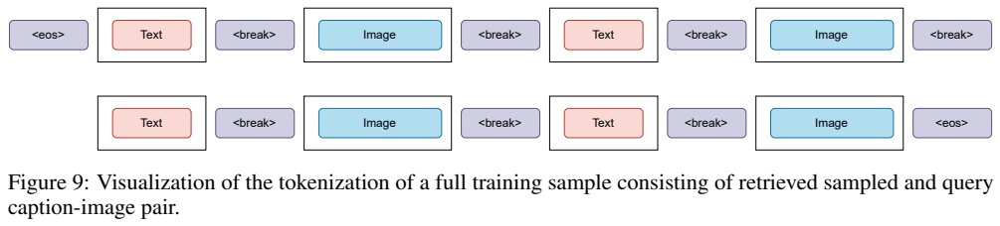
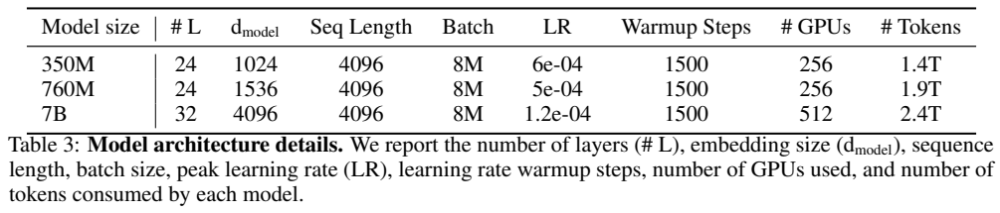
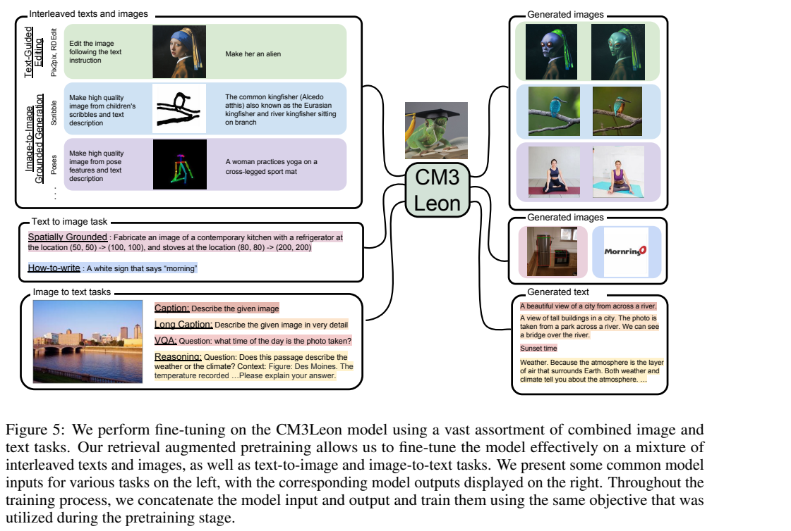
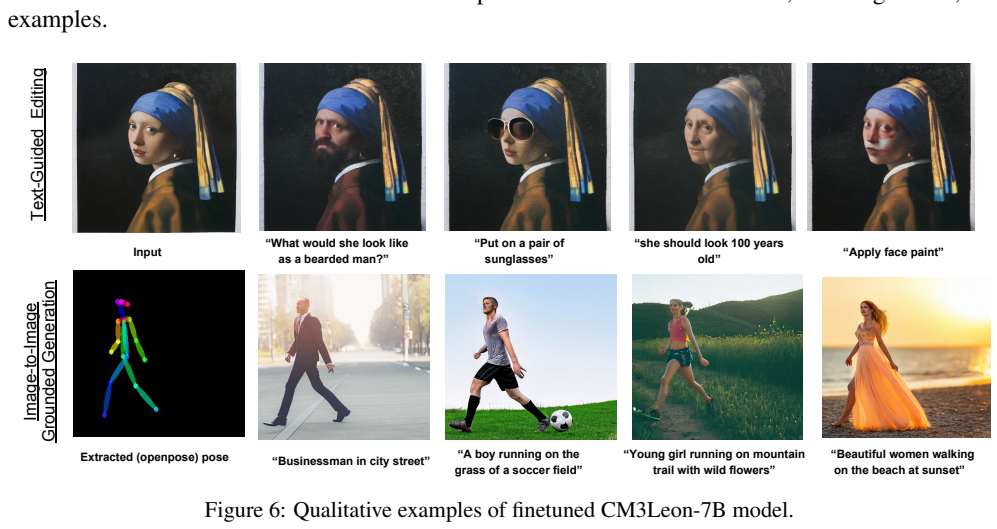
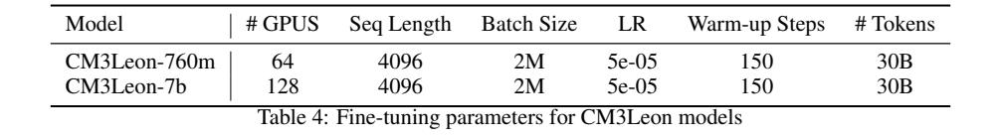
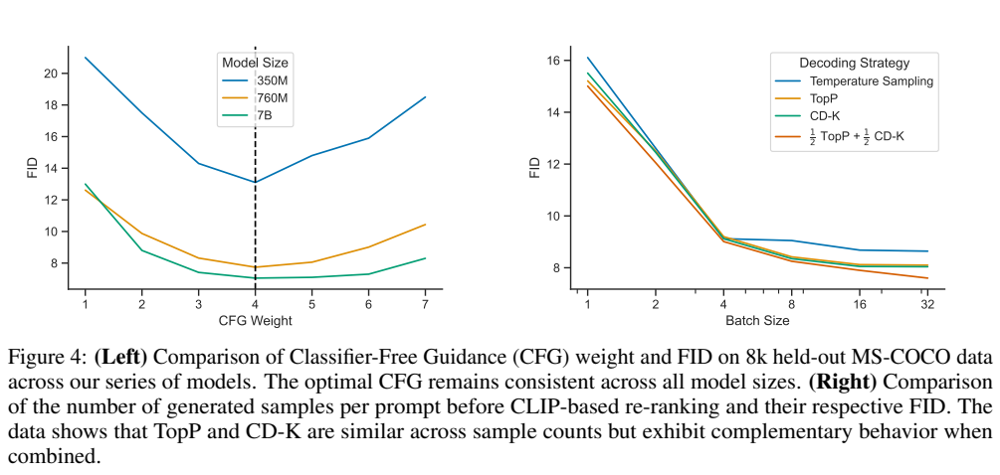
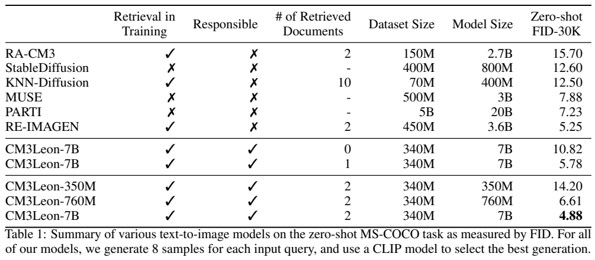

<!-- article-header:start -->
[项目首页](../../../README.md) › [模型系列](../../../reports/model-family-index.md) › [CM3Leon](../README.md)
<!-- article-header:end -->

# CM3Leon：检索增强的自回归模型如何统一图像生成与视觉问答

[返回 CM3Leon 系列](../README.md) · [返回仓库](../../../README.md)

<!-- article-toc:start -->
<a id="article-toc"></a>

**本篇目录** · [论文定位](#paper-info) · [快速概览](#overview) · [整体架构](#architecture) · [核心原理](#principles) · [数据构建](#data) · [训练流程](#training) · [实验结果](#experiments)
<!-- article-toc:end -->

<a id="paper-info"></a>

## 1. 论文信息与模型定位

| 项目 | 内容 |
|---|---|
| 原文 | *Scaling Autoregressive Multi-Modal Models: Pretraining and Instruction Tuning* |
| 作者与机构 | Lili Yu、Bowen Shi、Ramakanth Pasunuru、Armen Aghajanyan 等；Meta FAIR、YerevaNN |
| 本文依据版本 | arXiv:2309.02591v1，2023 年 9 月 5 日；19 页 PDF |
| 模型 | CM3Leon，读作 Chameleon；350M、760M、7B decoder-only Transformer |
| 模态 | 文字与离散图像 token 均可作为输入和输出；支持生成与补全 |
| 核心路线 | 大规模检索增强预训练，再进行混合任务监督微调；推理结合 CFG、CD-K 与候选重排 |
| 资源 | [固定版本论文](https://arxiv.org/pdf/2309.02591v1) · [论文使用的 Metaseq 训练框架](https://github.com/facebookresearch/metaseq) |

CM3Leon 的结构与后来同样读作 Chameleon 的模型名称容易混淆，本文只介绍这份 2023 年技术报告。它属于离散 token 的统一理解与生成路线：图像被量化为词表索引，模型像生成文字一样逐个生成视觉 token，再由图像 tokenizer 的解码端恢复图片。检索样例提供额外视觉概念上下文，CM3 补全目标使文字和图像都能位于待生成部分。[来源：原文 Abstract、第 2 节。](https://arxiv.org/pdf/2309.02591v1)

<a id="overview"></a>

## 2. 快速概览

| 核心信息 | 内容 |
|---|---|
| 图像表征 | 256×256 图片编码为 1024 个离散 token，视觉码本 8192；文字词表 56320 |
| 训练序列 | 长度 4096，文字与图像用 `<break>` 区分；检索图文对作为前缀 |
| 补全机制 | 将某个 span 替换为 mask，并把该 span 移到 infill 后；仍用下一 token 预测 |
| 最优生成结果 | MS-COCO 30K FID 4.88，条件是推理检索 2 个文档、每提示生成 8 张并用 CLIP 选优 |
| 不检索结果 | 同一 7B 的 FID 为 10.82；4.88 不能当成纯提示无检索单次采样表现 |
| 指令能力 | 文本编辑、边缘/姿态/分割图控制、空间布局、图中文字、描述与视觉问答 |

论文的主要结果依赖训练配方与推理解码共同作用。它证明自回归路线可以达到有竞争力的图像质量，但没有证明所有使用条件下都比扩散模型更快。其视觉理解训练数据也比大型语言模型的文字预训练小很多，生成结果亮眼并不意味着视觉问答全面领先。[来源：Table 1–2、Appendix C。](https://arxiv.org/pdf/2309.02591v1)

<a id="architecture"></a>

## 3. 整体架构

<!-- derived-architecture:start -->


*自绘模型架构示意（非原文图）。依据下述公开资料归纳；方框表示功能组件，不代表逐层实现。*

依据：[§2.1–2.3，PDF pp.3–4](https://arxiv.org/pdf/2309.02591v1)。
<!-- derived-architecture:end -->







*原文 Figure 8–9，PDF 第 13 页。红色文字 token 后接模态分隔符与蓝色图像 token；完整训练例包含多个检索图文对及目标图文对。Table 3 列出层数、宽度、训练长度和 token 预算。*

图像 tokenizer 来自 Make-a-Scene 相关工作，将 256×256 图像变成 1024 个视觉码本索引；文字使用基于 OPT 数据训练的自定义 tokenizer。模型在一个离散序列里接收两类 token，不像 CLIP+LLM 接口那样只把视觉特征作为输入而永不生成视觉 token。模态转换用 `<break>` 表示，补全另外使用 `<mask>` 与 `<infill>`。

主网络是单一 decoder-only Transformer。相对 OPT 类配置，它去除 bias、dropout 和 LayerNorm 的可学习参数，序列长度从 2048 增至 4096，使用可学习绝对位置嵌入。350M/760M/7B 分别为 24/24/32 层，隐藏维度 1024/1536/4096。权重以标准差 0.006、截断到 3 个标准差的正态初始化，输出层初始化为零；位置嵌入以标准差 0.0002 在零附近初始化。这是从头训练混合模态 decoder 的配置，不能写成只在某个现成 7B LLM 上训练小投影层。

检索器与生成器分工明确。CLIP ViT-B/32 的图像和文字编码器保持冻结，分别得到归一化表示；图文文档的表示取两部分平均，再通过最大内积检索从 memory bank 获取相关文档。检索样例的图像仍被图像 tokenizer 转成视觉 token，作为上下文进入 decoder。检索器帮助找到相似知识，生成器负责在条件下产生新序列；本文没有通过 CLIP 编码器直接输出最终图片。[来源：第 2.1、2.3 节、Appendix B。](https://arxiv.org/pdf/2309.02591v1)

<a id="principles"></a>

## 4. 核心创新与数学原理

CM3 将双向补全需求改写成单向因果生成。例如原序列为 `a chameleon <break> image`，可以把文字中的短语遮盖成 `a <mask> <break> image <infill> chameleon`，让 decoder 在看到图像后补文字；也可在文字提示后继续生成图像。对转换后的序列 $`\tilde x`$，原文以 $`-\log p(\tilde x)`$ 描述目标，按通常因果分解可展开为


```math
\mathcal L_{\mathrm{CM3}}=-\sum_t\log p_\theta(\tilde x_t\mid \tilde x_{\lt t}).
```


展开是本文解释，原文没有为它另编号。模型并不是一次并行恢复所有 masked 位置，而是把待恢复内容移到末尾再自回归生成。CM3Leon 修改了原先的检索增强版本：不额外提高最后目标图文对的 loss 权重，避免过分依赖检索条件；mask span 不跨 `<break>`，避免从图像序列任意中点开始恢复造成不希望的行为。

解码是另一项重要创新。原文 Eq. (1)–(2) 的 classifier-free guidance 同时运行文字条件流和以 mask 替代文字的“无文字条件”流：


```math
\ell_{cfg}=\ell_{uncond}+\alpha_c(\ell_{cond}-\ell_{uncond}).
```


两条流由同一网络产生 logits，CM3 训练自然支持 mask 条件，因此不需要为了获得这一流再训练一个独立弱模型。$`\alpha_c=1`$ 回到通常条件 logits，较大权重强化条件差异；在给定同一历史和标准 softmax 情况下，其概率可解释为 $`p_{cfg}(v)\propto p_{cond}(v)^{\alpha_c}/p_{uncond}(v)^{\alpha_c-1}`$。后者是从 logits 式推导的说明，不能误作报告的新 Eq.。

CD-K 则对比“有文字条件”与“无文字条件”的 log-probability：允许候选中的分数为 $`\log p_{EXP}(v)-\log p_{AMA}(v)`$，不在候选集中为负无穷。在这篇报告中 EXP 与 AMA 是同一模型不同条件，不是大模型与小模型的组合。原有 contrastive decoding 用 $`\alpha`$ 倍最大条件概率筛候选，作者发现过严会趋向贪心，于是在 Eq. (3) 改用第 $`k`$ 大概率：


```math
\mathcal V_k(h)=\{v:p_{EXP}(v\mid h)\ge
\alpha\,p_{EXP}^{(k)}(h)\}.
```


这不是简单“取 top-k token”：阈值由第 k 大值再乘 $`\alpha`$，可以保留超过 k 个候选。可信候选约束防止条件/无条件比值偏向两边都极不可能的 token；较宽候选集允许更多多样性。Top-p 与 CD-K 产生互补样例，混合候选后做 CLIP 重排继续降低 FID。采样策略、guidance 和重排都影响最终结果，不能把架构本身与解码优化混成一个原因。[来源：第 2.2、3.1 节、Eq. (1)–(3)。](https://arxiv.org/pdf/2309.02591v1)

<a id="data"></a>

## 5. 数据构建与处理

预训练使用 Shutterstock 的授权图文数据，Table 1 列为 340M 图文规模，正文报告约 3B Shutterstock 文字 token。3B 是文字语料量，不是包含检索重复、图像 token 及多遍训练的累计处理量；7B 模型训练累计为 2.4T 混合模态 token，两个数并不矛盾。“授权数据”针对预训练来源，后续指令训练还使用多种公开任务集，不能概括为所有阶段均只有 Shutterstock。

检索需兼顾相关、多模态完整性与多样性。模型使用图像和文字查询各获取文档，训练时从检索结果随机选三个样例，再与当前图文对组成上下文，约使可用序列 token 增为四倍。为减少几乎相同文档，跳过过于相似或已检索的候选，实际只使用 relevance score 不超过 0.9 的样例；查询还随机丢弃 20% token 作正则与多样化。训练使用三个检索样例，不代表最终评测一定也用三个，Table 1 的最佳推理配置是两个。





*原文 Figure 5–6，PDF 第 7 页。上方把编辑、结构控制、空间布局、图中文字和图像到文字都格式化成图文序列；下方是编辑与姿态控制的定性结果，不能替代全测试集的定量成功率。*

指令阶段包含四类生成数据。编辑沿用 InstructPix2Pix 方法并做专有面部过滤；结构控制用 ControlNet 的处理代码提取边缘、HED、姿态、深度、法线、分割及草图等条件；空间控制用 COCO、OpenImages、Object365 的框布局；how-to-write 使用 OCR 检测到的图中文字训练标牌与文字生成。使用 ControlNet 处理代码生成条件图，不等于 CM3Leon 架构内含扩散 ControlNet 模块。

固定版本的正文和附录数据数有差异：正文编辑约 600K，Table 5 写 127K；正文 OCR 约 200K，Table 5 写 300K。本文不擅自将其中一组宣称为统一精确总量。附录结构条件列出 edge/seg/HED/depth/normal 各 1M、pose 142K、scribble 500K，空间布局 3M。图像到文字则有 COCO caption 591K、Flickr30K 144K、Image Paragraph 14K、Localized Narratives 164K、VQA2 1.3M、VizWiz 92K、OKVQA 26K、ScienceQA 6K，使用多种提示模板。

在 ScienceQA 中，一些答案含解释与最终选项，其他 caption 或问答使用短长格式不同的指令。模型把这些目标统一为 token 序列，不为每个任务另设一个生成头。公开任务集训练与“测试时不放示例”应区分：训练含 COCO/VQA2/VizWiz/OKVQA，不能把这些 SFT 后的 0-shot 分数描述为从未见过该任务数据。[来源：第 2.1、4 节、Table 5，PDF 第 3、6–8、18 页。](https://arxiv.org/pdf/2309.02591v1)

<a id="training"></a>

## 6. 训练流程与目标

| 预训练模型，Table 3 | 层数/隐藏宽度 | 累计混合 token | 峰值 LR | batch（token） | GPU 数 |
|---|---|---:|---:|---:|---:|
| 350M | 24/1024 | 1.4T | $`6\times10^{-4}`$ | 8M | 256 |
| 760M | 24/1536 | 1.9T | $`5\times10^{-4}`$ | 8M | 256 |
| 7B | 32/4096 | 2.4T | $`1.2\times10^{-4}`$ | 8M | 512 |

三种模型都使用长度 4096 与 1500 warmup step。batch 的 8M 是每批 token 数量级，不能读成 800 万张图片。760M 与 7B 在一遍训练后恢复训练，Figure 3 中验证 perplexity 的小反弹源于学习率突然提高，后续仍下降；这说明报告所用预算下尚未饱和，但不是无限缩放必然有效的证明。



*原文 Table 4，PDF 第 16 页。SFT 使用 760M 与 7B 两种档位，每种处理约 30B token；批量 2M 是 token 批量，与每 GPU 搜索的 4/8/16 样本数不是同一单位。*

SFT 将任务输入与输出连接后继续采用 CM3 目标。760M/7B 分别用 64/128 张 80GB A100，长度 4096、batch 2M token、LR $`5\times10^{-5}`$、warmup 150 step、累计约 30B token。作者在验证集上从 LR $`10^{-5},3\times10^{-5},5\times10^{-5},10^{-4}`$ 及每 GPU batch 4/8/16 选择设置，并以 3/0.3 阈值进行数据上/下采样；固定版本没有给出该采样阈值对应的完整可复算概率公式。

报告没有采用冻结 LLM 加投影的路线，也没有披露 LoRA 或 DPO 阶段。其重点是继续更新统一生成模型，使原始图文建模能力适应多种任务。论文没有完整列出优化器 beta、weight decay 与全部学习率调度细节，本文不根据其他模型推填。训练计算对比使用等效 A100 小时，不代表用户单张设备上的生成时长。[来源：第 2.4、4 节、Appendix B.2、E.1。](https://arxiv.org/pdf/2309.02591v1)

<a id="experiments"></a>

## 7. 实验设置与主要结果





*PDF 第 6 页。左侧在 8K 验证图像上调 CFG，右侧横轴是每提示生成的候选数，不是训练 batch；Table 1 明确列出推理检索文档数，4.88 对应两份检索上下文。*

文生图主要在 MS-COCO 30K 上用 FID 评测，越低越好。7B 在推理无检索/1 文档/2 文档时为 10.82/5.78/4.88；在两个文档条件下，350M 为 14.20、760M 为 6.61、7B 为 4.88。所有 CM3Leon 主表结果每个输入生成 8 个样本，再用 CLIP 选择最佳，不能拿它们与自己的单次无重排结果直接比较。表中 Parti-20B 为 7.23、RE-IMAGEN 为 5.25；不同系统训练来源、模型规模与推理条件不同，这不是只改变一个结构的严格消融。

作者在 Figure 2 用等效 A100 训练小时展示更好的 FID/计算关系，提出比可比系统少约五倍训练计算的结论。这个结论针对图中的特定方法与目标质量，不能泛化为所有自回归模型都比扩散训练便宜五倍。附录 Figure 10 记录 7B 生成 256×256 的 BF16 延迟 11.8 秒、INT8 9.1 秒；MUSE 3B 表中为 0.5 秒，LDM 50 步在 512×512 为 3.7 秒。分辨率、实现与硬件条件不同，但至少说明低训练成本不自动意味着低采样延迟。

图像到文字的 Table 2 更适合谨慎解读：SFT-CM3Leon-7B 的 COCO CIDEr 61.6、VQA2 accuracy 47.6、VizWiz 37.6、OKVQA 23.8、Image Paragraph CIDEr 10.5、VisDial NDCG 22.6。Flamingo-9B 对应已有列为 79.4/51.8/28.8/44.7/—/48.4。CM3Leon 在 VizWiz 更高，但 caption、VQA2、OKVQA、VisDial 明显较低。约 3B 的文字语料能提供一定视觉语言能力，不足以支持“理解全面超越 Flamingo”。

编辑与结构控制主要展示定性图：文字编辑分别用 image CFG 1.5、text CFG 7.5，姿态控制单一 CFG 3。姿态一致、背景可改、长 caption 和简单 reasoning 的例子证明模型具有这些接口，但论文没有统一量化所有编辑/布局任务的成功率。FID 也不直接测量文字是否逐字正确、每个空间约束是否满足或指令遵循程度。

CM3Leon 提供的技术经验，是离散图像序列不仅能文生图，还能通过因果补全、检索上下文和任务混合连接理解与生成。最强结果需要清楚附带检索、采样和重排条件；数据统计差异、SFT 已见任务以及自回归采样成本是阅读这份报告时必须保留的实际边界。[来源：第 3–4 节、Table 1–2、Figure 2、4、10，Appendix C。](https://arxiv.org/pdf/2309.02591v1)

<!-- article-footer:start -->
---

[← 上一篇：PointLLM](../../pointllm/arxiv-2308.16911/README.md) · [按发表时间浏览](../../../reports/paper-reading-guide.md#year-2023) · [下一篇：ImageBind-LLM →](../../imagebind-llm/arxiv-2309.03905/README.md)

[返回本篇目录](#article-toc) · [返回模型系列](../README.md)
<!-- article-footer:end -->
