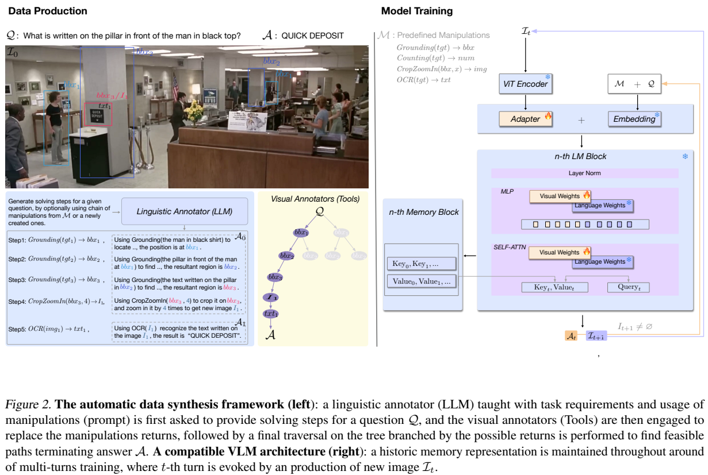
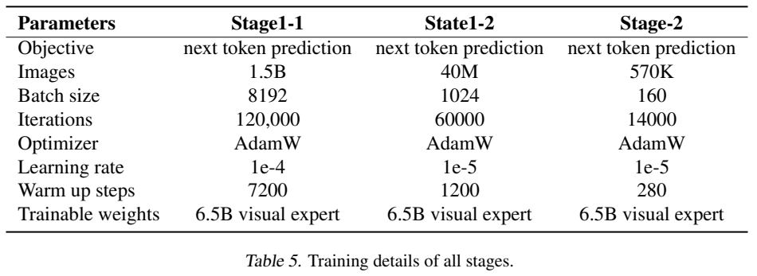
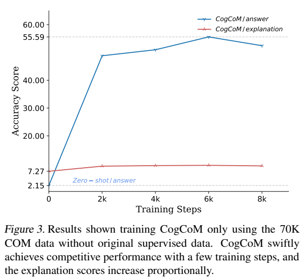
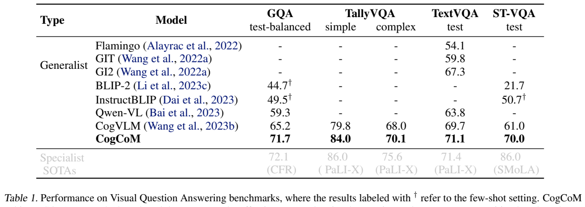
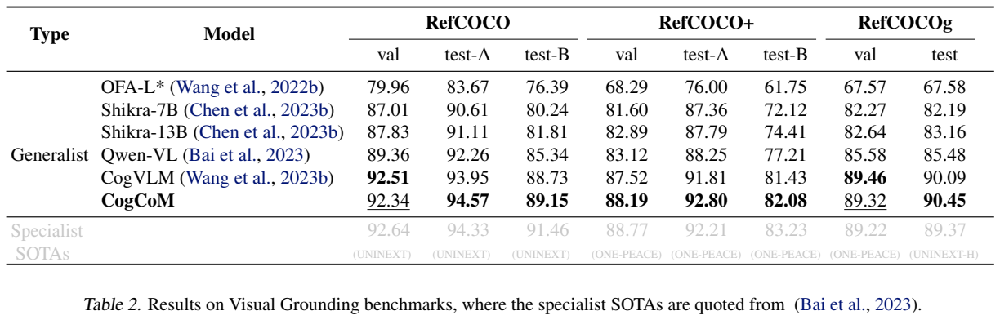
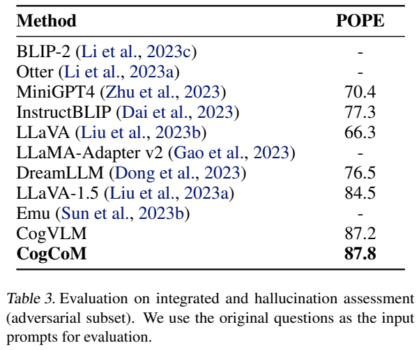

<!-- article-header:start -->
[项目首页](../../../README.md) › [模型系列](../../../reports/model-family-index.md) › [CogCoM](../README.md)
<!-- article-header:end -->

# CogCoM：通过定位、裁剪与放大建立可追踪的视觉操作链

<!-- article-toc:start -->

**本篇目录** · [论文定位](#paper-info) · [快速概览](#overview) · [整体架构](#architecture) · [核心原理](#principles) · [数据构建](#data) · [训练流程](#training) · [实验结果](#experiments)
<!-- article-toc:end -->

## 1. 论文信息与模型定位

**论文**：*CogCoM: Train Large Vision-Language Models Diving into Details through Chain of Manipulations*。Ji Qi、Ming Ding、Weihan Wang 等作者来自清华大学与智谱 AI。本文依据 [arXiv:2402.04236v1](https://arxiv.org/abs/2402.04236v1)，发表于 2024 年 2 月；[代码与数据仓库](https://github.com/THUDM/CogCoM)。

CogCoM 是沿用 CogVLM 架构的约 17B 视觉语言模型。它让模型在回答细节问题时生成 Chain of Manipulations（CoM）：先定位目标，再读取文字、计数，必要时裁剪并放大区域，把新图像重新送入模型。目的在于让答案伴随可检查的视觉依据，尤其适用于小文字、参照关系和细粒度计数。

需要区分训练数据制作与模型推理。数据制作调用 GPT-4、GroundingDINO 和 PaddleOCR；模型学习操作描述及定位、识别能力，图像裁剪放大由外部执行流程实现。论文并未把每个名为 OCR 或 Grounding 的生成步骤都定义成推理时必须再次调用上述标注工具。（PDF 第 2–4 页）

## 2. 快速概览

| 项目 | 论文方案 |
|---|---|
| 视觉编码器 | 4B EVA2-CLIP-E |
| 语言骨干 | Vicuna-7B-v1.5 |
| 深度融合 | LLM 内加入约 6.5B 视觉专家参数；两层 SwiGLU MLP 连接视觉与语言 |
| 关键机制 | 操作链与跨轮 KV 记忆，裁剪产生新图像后继续推理 |
| 操作示例 | Grounding、OCR、Counting、Calculate、CropZoomIn |
| 数据 | 主文称约 70K 操作链；标准对齐混合数据约 570K |
| 核心结果 | GQA 71.7、TextVQA 71.1、ST-VQA 70.0；POPE 对抗子集 F1 87.8 |

论文报告了聊天、VQA 和定位用途的不同训练配置，不能把所有表格视为一个未经任务训练的检查点成绩。操作链能暴露错误发生在哪一步，但生成了坐标与文字解释并不自动保证这些内容真实。（PDF 第 5–7 页）

## 3. 整体架构

*裁图保留原图图例。左半是训练链的制作：语言标注器提出步骤，视觉工具补入结果，遍历分支选出可到达答案的路径。右半是模型：新图像进入编码器，当前轮注意力访问历史 Key/Value；蓝色冻结模块与橙色更新模块应结合训练表理解。*

基本模块与 CogVLM 相同：视觉编码器得到图像特征，两层 MLP 将其投影至语言空间；语言骨干的注意力和前馈层增加视觉专用权重，便于视觉 token 与文本 token 深度交互。CoM 的主要架构扩展是保留各层历史 KV，使一次推理可以跨越原图及若干裁剪图。

当生成 CropZoomIn 时，系统根据预测区域裁剪当前图，并以双三次插值放大。随后用预设提示要求模型关注历史内容与新图。模型不必把所有原图、裁剪图一次性拼成静态输入；但记忆仍会增长，超过预设阈值时截断。论文没有给出这个阈值的精确值。（PDF 第 4 页）

## 4. 核心创新与数学原理

CoM 把一步定义为 $`(f_i,\mathrm{desc}_i)`$：$`f_i`$ 是操作，描述说明它如何使用当前视觉信息。操作的返回值可以是框、文字、数字或图像。框与文字还可成为下一步操作的输入，使推理拥有显式依赖。例如“定位黑衣男子 → 定位其前方柱子 → 裁剪柱子文字 → 识别文字”比直接猜测办公室常见标语更容易核验。（PDF 第 2–3 页）

原文跨轮注意力为：

$$
\mathrm{att}(X)=\mathrm{softmax}\!\left(\frac{Q_tK_t'{}^T}{\sqrt d}\right)V_t',
\quad K_t'=\mathrm{trunc}([K_0;\ldots;K_t]),\quad
V_t'=\mathrm{trunc}([V_0;\ldots;V_t]).
$$

当前查询读取累积的历史键和值，保留“这张放大图来自之前哪个目标”的上下文。这是原文机制公式，不是额外引入的强化学习或多步奖励目标。放大通过重新采样增加模型看到的局部像素占比，不能凭插值创造原图不存在的信息。（PDF 第 4 页）

数据生成的另一项关键设计是**对工具返回分支做深度优先搜索**。定位一个短语可能得到多个框；继续操作不同框，会形成不同路径。作者依据最后一个操作能否返回已知答案，筛出正路径，并在小区域上插入裁剪放大。例如当前图面积与框面积的比值 $`r\ge36`$ 时，可以插入两倍放大；论文把它作为启发式规则，不是由训练学习的最优阈值。（PDF 第 4、13 页）

答案匹配筛选提供了终点约束，但不能证明每个中间框都完美，也不能排除偶然得到正确答案的路径。作者也明确指出工具定位粗糙、斜文字 OCR 失败及描述多样性不足的问题。（PDF 第 9、15 页）

## 5. 数据构建与处理

语言标注器使用 GPT-4-turbo，调用时间为 2023 年 9–12 月，提示中加入操作说明与五个人工示例。生成步骤时，操作返回先用变量占位，随后用 GroundingDINO 和 PaddleOCR 获得实际视觉内容；计数、计算和裁剪可从这些基础内容派生。最后把操作级链按产生新图像的位置切分为多轮训练样本。（PDF 第 3–4、15–16 页）

主文称从 TextVQA、ST-VQA、TDIUC 构造约 70K CoM 链。附录 Table 4 分列 TextVQA 13,766 条、ST-VQA 3,959 条、TDIUC-count 54,523 条，按分项合计 72,248；另外还列出 TDIUC-absurd 的 11,677 条隐式推理链。这类“无答案问题”的链由 GPT-4V 产生，不要求每一步都含显式视觉操作。应保留主文的近似口径与附录分项，而不能把所有数据都写成精确 70,000 条同类型操作链。（PDF 第 14 页）

标准对齐数据把 CoM 与 MultiInstruct、LLaVAR、ShareGPT4V 混合，约 570K 样本，分别补充指令遵循、文字识别和详细描述。在 CoM 问题前随机加入启动提示，告诉模型可以选择使用操作。VQA 专用配置还混合 13 个公开 VQA 训练集与 GPT-4V 生成数据；定位专用配置使用高质量定位问答数据。论文没有公布所有混合来源的精确比例。（PDF 第 5、7 页）

## 6. 训练流程与目标

*Table 5 把预训练的两个子阶段与对齐阶段分开。Images 是数据资源规模，Iterations × Batch size 是实际样本曝光量，两者不能直接当成“完整遍历一次数据”。表中三个阶段都以 next-token prediction 为目标。*

| 阶段 | 数据规模 | 批量 | 迭代 | 学习率 / warmup |
|---|---:|---:|---:|---|
| 图文预训练 | 1.5B | 8,192 | 120,000 | 1e-4 / 7,200 步 |
| 带定位的生成 | 40M | 1,024 | 60,000 | 1e-5 / 1,200 步 |
| 标准对齐 | 570K | 160 | 14,000 | 1e-5 / 280 步 |

第一阶段清理 LAION-2B 与 COYO-700M；随后利用带定位问答训练名词短语与坐标的关联。框坐标归一化为 000–999。三个阶段都使用 AdamW，训练表注明更新约 6.5B 视觉专家；模型保留预训练视觉编码器与语言权重，架构图还标示连接器参与更新。对齐学习率 warmup 后线性下降。（PDF 第 4–5、15 页）

目标仍是自回归预测，但 CoM 的监督回答包含中间操作、结果和跨图像轮次。可以将其理解为把完整操作轨迹当作生成目标，扩大模型接受监督的内容。原文未提出过程奖励模型、DPO 或在线强化学习，也未披露 GPU 型号/数量、全部训练耗时和精确记忆长度；这些不能补成常见配置。

## 7. 实验设置与主要结果

*Table 1 区分通用模型与任务专家，并标出少样本成绩。Figure 3 的蓝线是答案成绩，红线是解释成绩；蓝线后期有所回落，不能只根据文字说明认定最后一步一定最佳。*

| 测试 | CogVLM | CogCoM |
|---|---:|---:|
| GQA test-balanced | 65.2 | 71.7 |
| TallyVQA simple / complex | 79.8 / 68.0 | 84.0 / 70.1 |
| TextVQA test | 69.7 | 71.1 |
| ST-VQA test | 61.0 | 70.0 |

按原表 GQA 增加 6.5 分；正文写 5.97，与表中四舍五入数据不一致。结果优于表列通用基线，但某些专用模型更高，例如 ST-VQA 专家 86.0，因此不应称全面超过所有模型。（PDF 第 5–6 页）

*定位表每个数据集分多个切分，应逐列比较；POPE 单列按正文为对抗子集 F1，不能读作全部幻觉问题的准确率。*

定位采用预测框与真值框 IoU > 0.5 的正确率。CogCoM 在 RefCOCO test-A 达 94.57、RefCOCO+ test-A 达 92.80、RefCOCOg test 达 90.45；RefCOCO val 和 RefCOCOg val 略低于 CogVLM。POPE 对抗子集 F1 从 87.2 到 87.8，改善较小，且只衡量对象存在性问答。（PDF 第 7 页）

作者另建 AutoCoM-test 检查过程，正文称 885 条正链，附录 Table 4 却列 4,609 个 QA、8,612 条链，数量口径未解释。过程指标把操作、目标与返回值离散化，再结合编辑距离与 BLEU；原文把标准编辑距离正向加入 accuracy，未清楚说明是否转成相似度，解释成绩难以仅凭该式复现。70K 链单独训练实验报告答案分由零样本 2.15 提高到 55.59；正文称最佳在 8K 步，Figure 3 的峰值却画在 6K 左右。本文保留这些限制，不补造统一版本，也未实际训练或运行模型。

<!-- article-footer:start -->
---

[← 上一篇：检测与 OCR 增强多模态模型](../../enhancing-multimodal-large-language-models-with-vision-e94f5590857f/arxiv-2401.17981/README.md) · [按发表时间浏览](../../../reports/paper-reading-guide.md#year-2024) · [下一篇：MobileVLM V2 →](../../mobilevlm/arxiv-2402.03766/README.md)

[返回本篇目录](#article-toc) · [返回模型系列](../README.md)
<!-- article-footer:end -->
