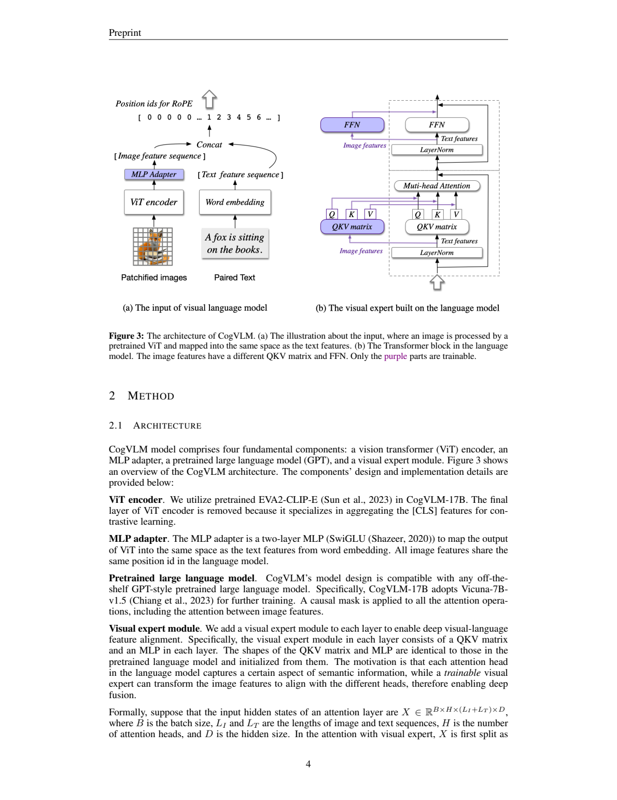
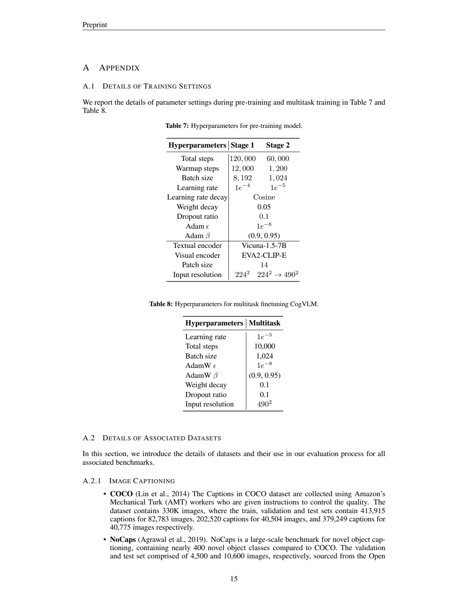
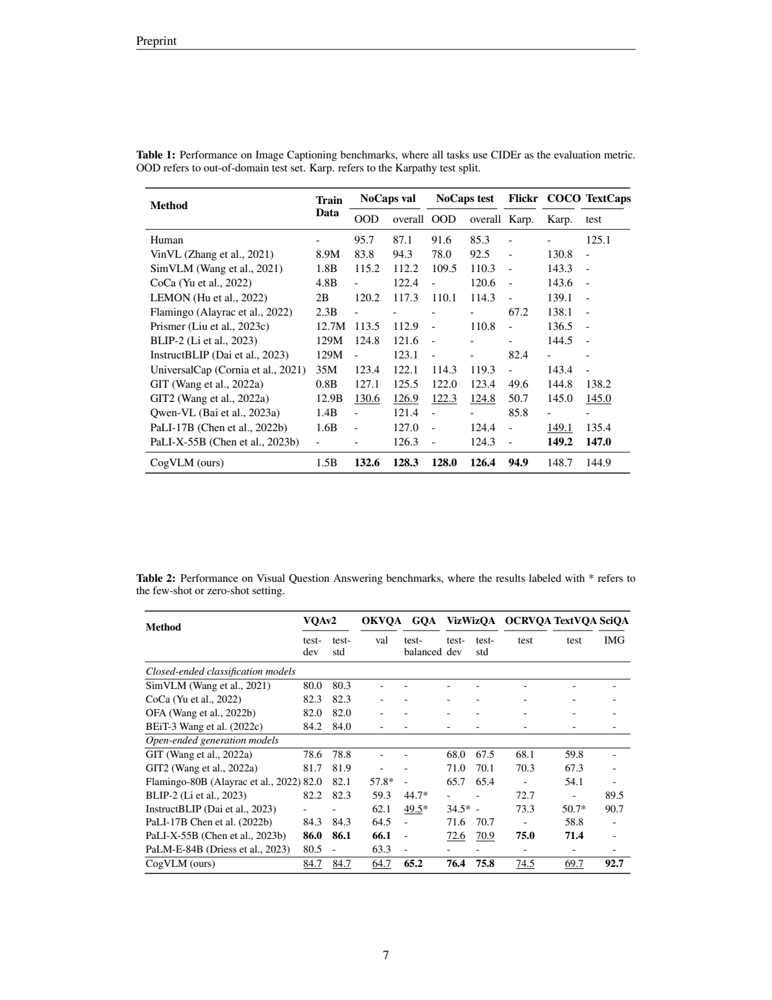
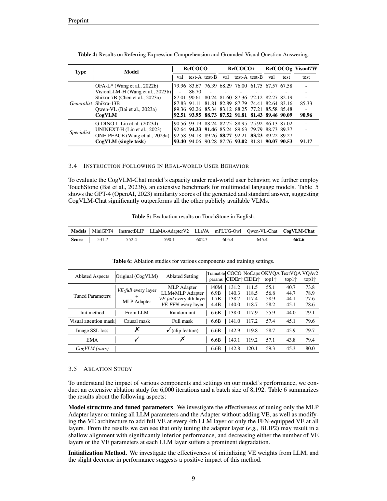

# CogVLM：在语言模型每一层加入视觉专家，实现深层图文融合

## 1. 论文信息与模型定位

| 项目 | 内容 |
| --- | --- |
| 论文 | *CogVLM: Visual Expert for Large Language Models* |
| 作者与机构 | Weihan Wang、Qingsong Lv、Wenmeng Yu、Wenyi Hong 等；智谱 AI、清华大学 |
| 原文 | [arXiv:2311.03079v1](https://arxiv.org/abs/2311.03079v1)，2023 年 11 月 6 日，18 页 |
| 主体模型 | CogVLM-17B，采用 Vicuna-7B-v1.5 与 EVA2-CLIP-E |
| 发布形态 | 基础模型、CogVLM-Chat、CogVLM-Grounding；任务专门微调与统一多任务配置需区分 |
| 关键设计 | 视觉 token 在每层使用单独的 QKV 和 FFN，文字 token 使用原语言模型路径 |

CogVLM 希望解决输入端对齐的局限：仅把图像特征投影到词嵌入空间，后续每层仍用为文字训练的参数处理视觉特征，可能限制图文融合。它在每层加入视觉专用参数，让视觉表示沿整个语言模型逐层适应，同时在预训练阶段冻结原文字参数。

这一设计的价值不是只增加模型规模，而是把新增容量用于视觉 token，并保留文字路径。需要明确边界：**冻结原语言参数时，纯文本输入沿原模型计算，具有行为保持的结构依据；CogVLM-Chat 的 SFT 会更新原语言模型，这个保证不能自动延伸到 Chat 检查点。**原文提到基于 ChatGLM-12B 的28B中文版本，但注明不包括在本报告实验中，本文不补入其数据和成绩。

## 2. 快速概览

| 选择 | 具体实现 | 含义 |
| --- | --- | --- |
| 视觉编码 | EVA2-CLIP-E，去掉最终层 | 获取适合传递局部视觉信息的特征 |
| 输入适配 | 两层 SwiGLU MLP | 将视觉特征映射到语言嵌入维度 |
| 深层融合 | 每层视觉专用 QKV 与 FFN | 图像与文字分别变换，但在共同注意力中交互 |
| 预训练 | 先描述，再混合描述与指代表达定位，最后提高分辨率 | 从一般图文语义过渡到空间关系与细节 |
| 对齐 | 约500K VQA对，ViT冻结，其他参数训练 | 获得自由指令对话能力 |
| 区域表达 | 文本生成归一化边界框 | 用统一序列接口处理位置与对象说明 |

它不是按任务选择专家的传统稀疏 MoE。路由由 token 类型确定：视觉 token 使用视觉参数，文字 token 使用语言参数；二者仍彼此注意。由于每个 token 不同时走两套等形状变换，论文称在对应 token 变换中不需要把 FLOPs 加倍。这个结构论证不等于整个多模态系统与原纯文本模型拥有完全相同运行成本：还要计算 ViT、适配器和新增视觉序列，也要存储专家权重。

论文的实验需要沿检查点分类阅读。NoCaps、Flickr描述有零样本设置；多项VQA采用任务训练集微调；Table3又报告统一多任务检查点；对话表现采用CogVLM-Chat。不能把这些不同配置的最好结果全部归到一个无需训练的聊天模型。

## 3. 整体架构

**读图：**左图视觉特征经MLP与文字嵌入拼接，图像特征共享同一个语言位置ID；右图紫色QKV和FFN属于可训练视觉专家，白色分支为原语言模型参数。注意力操作仍将两类特征放在同一序列，专家不是各自孤立的两个解码器。

视觉编码器移除末层，是因为作者认为该层更偏向对比学习的全局CLS聚合，而传入语言模型需要局部图像信息。MLP采用SwiGLU激活，把视觉维度转换到语言空间。所有图像特征使用同一位置ID，使文字位置不因大量视觉patch而逐个后移；图像内部空间信息主要由视觉编码器提供，不能据此称模型完全没有位置信息。

在每个Transformer层，输入按图像与文字位置拆分，分别计算查询、键和值，然后重新拼成联合序列进行注意力。视觉token的FFN也是单独一套参数。视觉专家形状与语言层对应参数一致，并由原语言参数初始化，使其从已有表示变换出发进行视觉适应。

全序列采用因果掩码，包括图像token之间的注意力。这与常见图像patch双向交互不同，不过ViT已先做视觉编码，因此语言模型中的视觉token并非未经上下文的原始像素块。专家路径让更深层视觉特征可以更新，同时文字路径在预训练中保持固定；图文交互产生于共同注意力，而不是简单增加一个最终投影。

CogVLM-17B中的17B是整个系统规格，不能与Vicuna-7B语言骨干或可训练专家规模混用。正文预训练可训练参数约6.5B，较短消融表约6.6B；本文分别保留其报告口径，不据四舍五入差异虚构另一个模型。

## 4. 核心创新与数学原理

设某层视觉和文字隐状态分别为$X_I,X_T$，原文Eq.(2)将查询、键、值写为

$$
Q=\mathrm{concat}(X_IW_I^Q,X_TW_T^Q),\quad
K=\mathrm{concat}(X_IW_I^K,X_TW_T^K),\quad
V=\mathrm{concat}(X_IW_I^V,X_TW_T^V).
$$

下标$I$对应视觉专家，$T$对应原语言模型。投影分开而注意力合并，因此文字问题可以读取视觉键值，视觉位置也可以按因果规则读取已在其之前的信息。用显式掩码重写原文Eq.(1)的含义为

$$
\mathrm{Attention}=\mathrm{softmax}
\left(\frac{QK^\top}{\sqrt D}+M_{\mathrm{causal}}\right)V.
$$

原文用$\mathrm{Tril}$表示下三角遮挡操作；此处$M_{\mathrm{causal}}$是等价解释记号，允许位置取0、未来位置取负无穷，不能把遮挡理解为将未来分数置零后仍参与softmax。$D$按原文注意力缩放维度使用。

FFN则保持按模态独立：

$$
\mathrm{FFN}(X)=\mathrm{concat}
\bigl(\mathrm{FFN}_I(X_I),\mathrm{FFN}_T(X_T)\bigr).
$$

若输入没有图像，则不存在视觉token分支；当原语言权重固定时，文字计算路径与原模型一致。这是其保留纯文字能力的机制依据，并非本文提供了一个覆盖所有NLP任务的完整无退化实测表。SFT放开语言权重后，纯文字行为可能发生变化，不能继续套用同一推论。

空间定位仍采用语言生成目标。坐标归一化到000–999，输出如`[[x0, y0, x1, y1]]`，只在答案部分计算下一token损失。因此模型把定位表述为条件序列生成，而不是独立检测头回归框的IoU损失。离散坐标方便与自然语言组合，但生成格式、数值顺序和对象歧义都可能成为失败来源。

## 5. 数据构建与处理

预训练图文来自LAION-2B、COYO-700M。作者删除失效URL、不合适内容、噪声描述、带政治偏向的图片以及长宽比大于6或小于1/6的图，保留约1.5B。这里公开的是来源与过滤类型，没有给出所有分类器阈值、去重明细或训练集逐图清单，不能只据来源公开就断言全部数据可完整复现。

视觉定位预训练数据从LAION-115M子集出发，用spaCy提取描述中的名词，再由GLIPv2预测对象框，筛选为40M图像；作者保证超过75%的图至少含两个框。它让模型接触“名词—区域”关联，但自动提取的名词可能歧义，检测框也可能错误，不能视作40M人工逐区域精确标注。

Chat对齐约500K VQA对，来自LLaVA-Instruct、LRV-Instruction、LLaVAR以及内部数据。作者特别指出仅语言GPT-4生成的LLaVA标注会有错误，并人工检查修正。报告未逐项披露这些数据在最终混合中的占比，也不能由约500K推算所有对话是否彼此去重。

Grounding版本继续使用Flickr30K Entities、RefCOCO系列、Visual7W、VisualGenome和Grounded CoT-VQA等高质量区域数据，组织成四类：带框描述、给框生成指代语、给描述找框、带区域引用的问答。任务可以相互转换，例如带框描述变成“描述此区域”或“某对象在哪里”。作者也承认转换可能丢失指代上下文：“另一个人”离开原句后可能无法区分两个框，因此数据数量增加并不自动保证监督清晰。

## 6. 训练流程与目标

**读图：**Table7是两阶段预训练，Table8是多任务微调，不能把后者的10K步当成Chat SFT的8K步。分辨率由224平方提高至490平方，patch14使视觉序列显著变长，这也增加实际计算。

第一阶段只做图像描述文本预测，120K步、batch8192、学习率$10^{-4}$、warmup12K，图像224×224。第二阶段混合描述与REC，60K步、batch1024、学习率$10^{-5}$、warmup1200；末30K步升至490×490。预训练表报告余弦调度、weight decay0.05、dropout0.1、Adam的$\beta=(0.9,0.95)$、$\epsilon=10^{-8}$。主要骨干固定，训练视觉专家与适配器；总预训练成本报告约4096 A100×天。

1.5B是数据池规模，训练步数乘batch是曝光次数，两者不可互换成固定若干epoch。REC按问答输出归一化框，只对答案计算下一token损失；描述阶段对文字部分计算损失。作者尝试预测下一位置CLIP特征的视觉自监督，但短消融没有显示稳定收益，主方案未据此增加新的视觉重建目标。

CogVLM-Chat SFT采用8K步、batch640、主学习率$10^{-5}$、warmup50；ViT固定，其他参数可训练，原语言模型使用主学习率的10%，即$10^{-6}$。这一更新策略与预训练冻结原文字参数不同。多任务generalist配置另为10K步、batch1024、490×490，AdamW$\beta=(0.9,0.95)$、weight decay0.1、dropout0.1。本文把两类微调设置分开，避免形成不存在的统一训练表。

模型推理采用开放词汇文字生成，也可产生对象框。经典任务表现包含专门微调检查点，聊天版本需要以其对应评价判断；本文没有运行模型，也不从论文示例推断部署时延或显存需求。

## 7. 实验设置与主要结果

**读图：**描述表统一CIDEr，但NoCaps分val/test、域外/overall；VQA表分开放生成与闭集分类，星号标少样本或零样本对照。CogVLM多项VQA已使用任务训练集，不能把与带星号方法的差值当成同配置零样本优势。

NoCaps val overall为128.3、test overall126.4，Flickr Karpathy94.9；原文将NoCaps和Flickr作为零样本描述评测。COCO与TextCaps经过相应微调，CIDEr分别148.7、144.9：COCO略低于PaLI-X149.2，TextCaps也低于PaLI-X147.0和GIT2的145.0。因此它在描述任务有竞争力，但不是每个数据集均最佳。较高CIDEr也不代表每个细节都真实或比人类更可靠。

| VQA指标 | CogVLM任务微调 | PaLI-X-55B |
| --- | ---: | ---: |
| VQAv2 test-dev / test-std | 84.7 / 84.7 | 86.0 / 86.1 |
| OKVQA val | 64.7 | 66.1 |
| VizWiz test-dev / test-std | 76.4 / 75.8 | 72.6 / 70.9 |
| OCRVQA test | 74.5 | 75.0 |
| TextVQA test | 69.7 | 71.4 |

GQA test-balanced65.2，ScienceQA的IMG子集92.7。后者不是全部ScienceQA平均，也不是本文无微调零样本成绩。统一多任务检查点Table3的VQAv2为83.4、OKVQA58.9、NoCaps126.2，低于对应单任务84.7、64.7、128.3；尤其OKVQA下降5.8，说明多任务共享仍有折中。TextCaps val从149.8到151.3则提升，不应把单任务和多任务成绩混为一行。

**读图：**Table4明确分Generalist与Specialist，Table5为Chat的TouchStone评分，Table6是6K步消融。下表数值明显低于主实验，并非另一个正式发布模型的完整最终成绩。

Grounding统一模型RefCOCO val/test-A/test-B为92.51/93.95/88.73，RefCOCO+为87.52/91.81/81.43，RefCOCOg test90.09、Visual7W90.96，优于表中统一模型对照。专门微调后虽多项更高，但RefCOCO test-B90.28仍低于UNINEXT-H91.46，RefCOCO+ val87.76低于ONE-PEACE88.77，不能说每个split均最高。Chat在英文TouchStone的GPT-4评分662.6，高于Qwen-VL-Chat645.4；这是该评价中的相对表现，不是所有真实用户请求的可靠率。

短消融采用6K步、batch8192。完整视觉专家的NoCaps120.1、VQAv2 80.0，只有MLP适配器为111.5、73.8，更新原LLM加适配器为118.5、78.9；每四层加专家为117.4、77.6，仅FFN专家为118.7、78.6，支持逐层视觉专用参数的价值。但同时改变了参数容量，不能将差距全部归为某一形式的融合。随机初始化NoCaps117.9低于120.1；full视觉mask117.2低于因果mask120.1，是该缩短训练设置下的结果。

视觉自监督、EMA等消融并非所有列都同向改善：例如加入视觉自监督TextVQA45.9高于主项45.3，而NoCaps119.8略低于120.1。应理解为整体取舍，不能用一个“无效”词抹掉各任务变化。论文展示深层视觉专家、定位预训练和分阶段对齐的价值，同时保留专门微调范围、数据噪声、多任务折中以及Chat更新原语言权重的边界。
