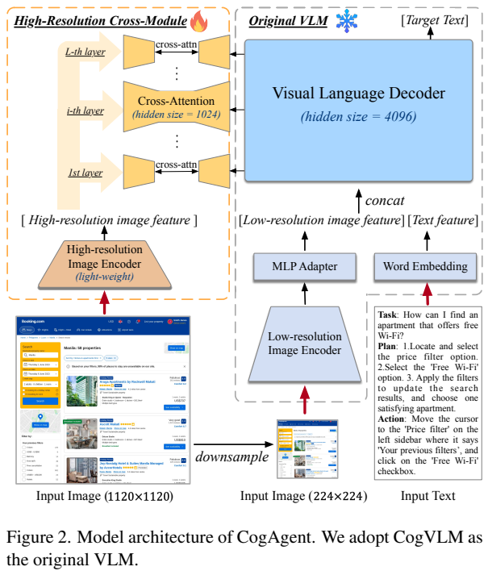
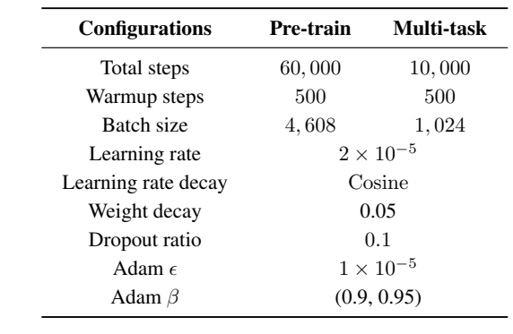
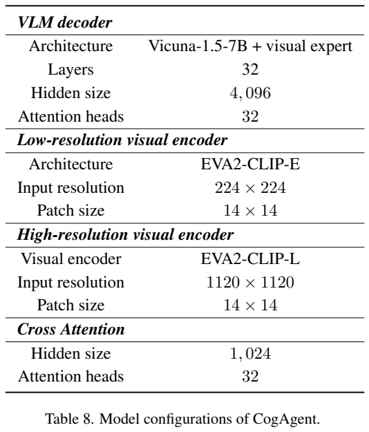
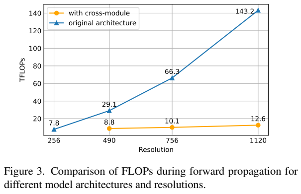
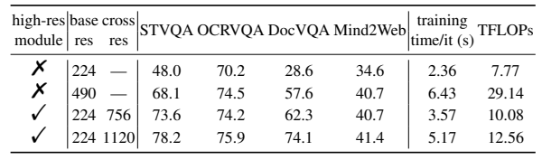
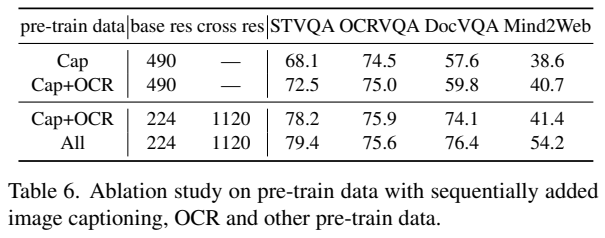

# CogAgent：通过高分辨率视觉理解操作图形界面

## 1. 论文信息与模型定位

| 项目 | 信息 |
|---|---|
| 原题 | CogAgent: A Visual Language Model for GUI Agents |
| 作者与机构 | Wenyi Hong、Weihan Wang、Qingsong Lv 等；清华大学、智谱 AI |
| 固定来源 | [arXiv:2312.08914v1](https://arxiv.org/abs/2312.08914v1)，2023-12-14，27 页 |
| 模型与项目 | CogAgent-18B；[THUDM/CogVLM](https://github.com/THUDM/CogVLM) |
| 输入与输出 | 界面截图、任务和动作历史 → 文本回答、计划、下一步动作及坐标 |

CogAgent 在 CogVLM-17B 上增加高分辨率视觉分支，重点解决网页、手机界面中的小字、图标与可点击区域识别。18B 指整套视觉语言模型的规模，语言骨干是 Vicuna-1.5-7B。论文既保留一般视觉问答能力，也将视觉定位和操作建议组织成语言生成任务。本文依据固定 v1 介绍，不将后续 CogAgent 版本的功能归入本报告。

## 2. 快速概览

核心取舍是保留一条昂贵但短的低分辨率视觉语言通路，再用较窄的交叉注意力读取高分辨率细节。224×224 图像产生 256 个 patch；1120×1120 图像产生 6400 个 patch。6400 个细粒度特征不直接拼进语言模型自注意力序列，而作为每层交叉注意力的键和值。

数据方面，模型结合 OCR、视觉定位、网页截图与 DOM 配对，以及人工界面操作标注。结果方面，Mind2Web 的总体单步成功率为 58.2，AITW 的动作匹配分数为 76.88。两者测量下一步动作与标注的匹配程度，不能直接解释为完成整项订票、购物等任务的成功率。模型输出坐标仍不够精确，报告也明确指出该版本不能处理多图输入。

## 3. 整体架构

*原文 Figure 2，PDF 第 4 页；配图展示架构图；相关公式见本节说明。右侧蓝色通路保留低分辨率 CogVLM，左侧橙色通路向每个解码层补充高分辨率信息。图中的冻结与训练标志对应分阶段训练中的设计，不能理解为所有阶段始终冻结右侧。*

同一截图缩放为两个尺寸，分别送入 EVA2-CLIP-E 和 EVA2-CLIP-L。前者约 4.4B 参数，用于低分辨率语义；后者约 0.30B 参数，用于高分辨率细节。两者 patch 均为 14×14。低分辨率特征经 MLP 映射到语言模型空间，和文字特征拼接，进入带视觉专家的 CogVLM 解码器。

解码器有 32 层、4096 隐藏维、32 个自注意力头。新增交叉注意力隐藏维为 1024，同样有 32 个头，每头 32 维；原解码器每头 128 维。查询来自正在处理低分辨率图像和文字的解码器状态，键和值来自高分辨率视觉编码器。这样既可重复调用细节，也避免让语言模型对 6400 个图像 token 做完整自注意力。交叉注意力输出需回到解码器隐藏空间才能作残差相加；1024 是注意力内部维度，不代表解码器残差被改成 1024 维。

## 4. 核心创新与数学原理

原文式 (1)–(2) 将每层注意力写为：

$$
X_i'=\operatorname{MSA}(\operatorname{LN}(X_i))+X_i,
\qquad
X_i^{out}=\operatorname{MCA}(\operatorname{LN}(X_i'),X_{hi})+X_i'.
$$

MSA 是带视觉专家的自注意力，MCA 是多头交叉注意力。交叉注意力通过可学习投影构造 Q、K、V：高分辨率特征承担外部记忆，解码器状态提出当前需要读取的问题。标准注意力中的 softmax 加权使每个低分辨率或文字位置可以选择相关的小字与图标，而不是预先将细节压成一组固定摘要。

设低分辨率长度为 $L_{lo}$，高分辨率长度为 $L_{hi}$，文字长度为 $T$。原文式 (3)–(4) 给出的**注意力交互部分**复杂度为：

$$
C_{cross}=O((L_{lo}+T)L_{hi}\cdot1024+(L_{lo}+T)^2\cdot4096),
$$
$$
C_{direct}=O((L_{hi}+T)^2\cdot4096).
$$

将 $L_{lo}=256,L_{hi}=6400$ 代入，原文附录式 (13) 的运算量比值为：

$$
\frac{C_{direct}}{C_{cross}}
=\frac{6400+T}{256+T}\frac{4(6400+T)}{6400+4(256+T)}.
$$

这解释了节省来自两处：参与自注意力的序列更短，交叉注意力内部宽度仅为原来的四分之一。这里按主导交互项作比值，忽略投影、前馈、视觉编码等费用；它不是完整模型的严格运行时间公式。固定文字长度时，新增交叉交互项对高分辨率 token 数呈线性，但视觉编码器自身仍有注意力计算，不能据此宣称整个系统严格线性。本文使用实现参数对应的明确式 (13)，不依赖附录中额外的近似化步骤。

另一项创新是把 GUI 能力分解到可训练的视觉任务：识字、框定位、界面元素与结构对齐、行动计划。坐标归一化到 000–999 的表示用于预训练定位，允许语言模型生成几何信息；具体动作格式也会根据 GUI 数据集改变，手机例子采用小数归一化坐标，不能把所有输出格式混为一套。

## 5. 数据构建与处理

| 来源与规模 | 构建方式与目标 |
|---|---|
| 80M 合成文字数据 | 将语言预训练文本绘制到图像，变化字体、字号、颜色、方向和 LAION 背景，学习文字转录 |
| 18M 自然图像 OCR | 从 COYO、LAION 提取含文字图像，以 PaddleOCR 生成文字和框；自动标签可能有错 |
| 9M 学术文档数据 | 使用 arXiv LaTeX 文档构造页图与 Nougat 风格文本，涵盖公式和表格 |
| 40M 定位图像、115M 框 | LAION 图像上的视觉 grounding 数据，框坐标转成归一化文本，多框用分号区分 |
| CCS400K 网页 | 400K Common Crawl 网页截图，以 Playwright 获取可见 DOM 元素及框，产生约 140M REC/REG 问答 |

140M 是由网页元素展开的定位或描述任务数量，不是独立截图数量。REG 从区域预测 DOM 内容，REC 从 DOM 描述预测区域；DOM 用于训练监督，并不意味着模型在部署时必须读取 HTML。另有过滤后的 LAION-2B、COYO-700M 图文数据，过滤损坏、NSFW 和低质量样本等；报告没有给出全部来源的最终混合比例。

文字增强包含腐蚀、噪声、模糊、压缩、弹性形变，自然 OCR 另使用旋转和翻转。GUI 微调包含超过 2K 人工截图，分两轮标注：先列出按钮、可点击区域、读图问题、具体操作需求，再补充回答、框及操作方法。Mind2Web、AITW 的轨迹也转成自然语言监督，GPT-4 帮助改写计划与动作。附录示例给教师提供了未来轨迹，让它组织计划，属于利用已知轨迹生成监督文本，不能当作教师自行在真实界面完成任务的证据。

## 6. 训练流程与目标

*PDF 第 11 页的 Tables 7–8 列出优化和结构参数；表头、共享参数行及模型配置均保留。预训练与多任务微调采用不同步数和 batch size，共享表中列出的学习率与优化器设置。*

继续预训练共 60K 步，batch size 4608。前 20K 步仅训练新增高分辨率交叉模块，约 646M 可训练参数，占模型约 3.5%；随后 40K 步解冻视觉专家。数据课程先学习简单文字与图文描述，再加入复杂文档、定位、网页任务。微调为 10K 步、batch size 1024，并解冻模型全部参数，联合使用 GUI 与视觉问答数据。

两阶段学习率均为 $2\times10^{-5}$，500 步 warmup，余弦衰减，weight decay 0.05，dropout 0.1，Adam $\beta=(0.9,0.95)$、$\epsilon=10^{-5}$。作为自回归模型，其任务可用标准监督目标解释：

$$
\mathcal L=-\sum_t\log p_\theta(y_t\mid I,q,h,y_{<t}),
$$

其中 $I$ 为截图、$q$ 为任务、$h$ 为历史。该式是本文对语言生成训练的标准表达，不是报告额外定义的新损失。坐标、计划、动作类型和待输入文字都通过目标序列学习；正文没有披露 GUI 强化学习、在线环境奖励或独立坐标回归损失，不能自行添加。

## 7. 实验设置与主要结果

Table 1 将统一多任务模型与分别在数据集上训练的模型分列。CogAgent 的统一模型获得 VQAv2 83.7、OK-VQA 61.2、OCR-VQA 75.0、TextVQA 76.1、ST-VQA 80.5、ChartQA 68.4、InfoVQA 44.5、DocVQA 81.6。不同任务分别用 VQA 分数、精确匹配或 ANLS，数值不能简单平均。也不能称所有模型中全部最优：例如任务专用 PaLI-X 的 VQAv2 为 86.0、InfoVQA 为 49.2，统一 Qwen-VL 的 OCR-VQA 为 75.7。Table 2 单列的 MM-Vet 零样本评估为 52.8，POPE adversarial F1 为 85.9。

| GUI 基准与协议 | CogAgent | 对照与限制 |
|---|---:|---|
| Mind2Web cross-task，step SR | 62.3 | LLaMA2-70B 55.8 |
| Mind2Web cross-website，step SR | 54.0 | LLaMA2-70B 51.6 |
| Mind2Web cross-domain，step SR | 59.4 | LLaMA2-70B 55.7 |
| Mind2Web overall | 58.2 | LLaMA2-70B 54.4；CogAgent 与多数基线选择 top-50 候选，GPT-4 使用 top-10 |
| AITW overall matching | 76.88 | Auto-UI unified 74.27，提升 2.61 个百分点 |

Mind2Web 在训练集上继续微调后测试，要求候选目标元素和操作同时匹配。它使用外部候选生成模型，截图输入不等于完全无候选辅助。AITW 同时微调五个子集，GoogleApps 因数据过大下采样到 10%；总体提高，但 General 子集 65.38 低于 Auto-UI 的 68.24。作者对不匹配案例抽样人工复核，42% 被认为是另一种正确动作。这提示单步标注无法覆盖多条路径，但不能据此直接上调整个测试集分数。

*PDF 第 8 页保留 FLOPs 曲线、架构消融与数据消融。读图时应区分横轴图像尺寸、前向 FLOPs，以及表中另外测量的训练每步时间。*

Table 5 中，原架构 490 分辨率为 29.14 TFLOPs、A800 上每步 6.43 秒；双分支 224/1120 为 12.56 TFLOPs、5.17 秒，DocVQA 从 57.6 到 74.1。实际每步时间的比例明显小于 FLOPs 比例，说明理论交互项节省不会等比例成为端到端加速。数据消融在同样 224/1120 架构下，从 Caption+OCR 换成全部数据，Mind2Web 从 41.4 到 54.2；OCR-VQA 则从 75.9 变为 75.6，收益有任务差异。消融使用缩短训练、Mind2Web top-10，不能将其分数直接与主实验 top-50 比较。本文仅核验报告与原图，未运行或复现模型。
