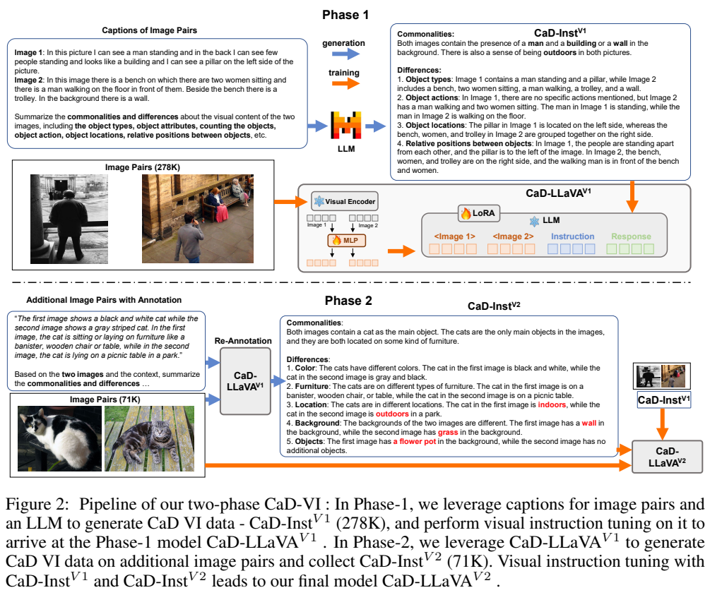
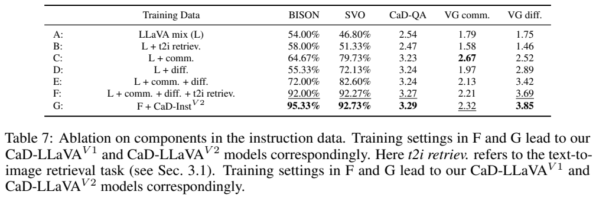
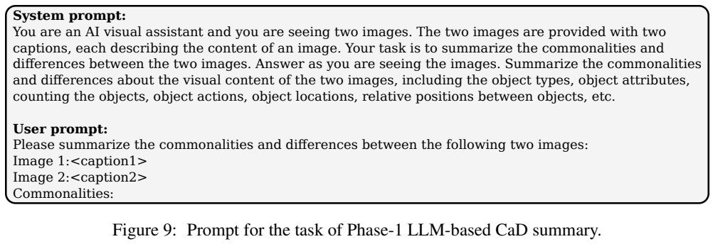
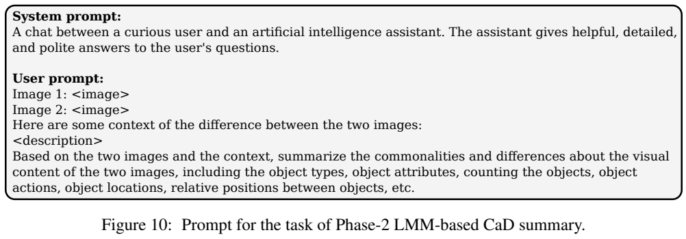
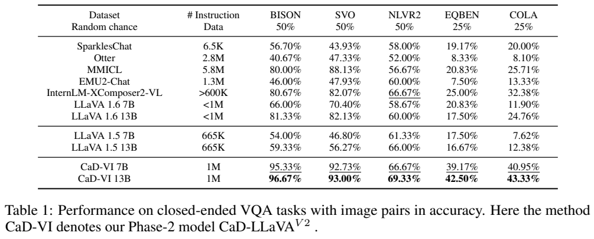

<!-- article-header:start -->
[项目首页](../../../README.md) › [模型系列](../../../reports/model-family-index.md) › [Comparison Visual Instruction Tuning](../README.md)
<!-- article-header:end -->

# Comparison Visual Instruction Tuning：同时学习图像的共同点与差异

<!-- article-toc:start -->

**本篇目录** · [论文定位](#paper-info) · [快速概览](#overview) · [整体架构](#architecture) · [核心原理](#principles) · [数据构建](#data) · [训练流程](#training) · [实验结果](#experiments)
<!-- article-toc:end -->

## 1. 论文信息与模型定位

**论文**：*Comparison Visual Instruction Tuning*，Wei Lin、Muhammad Jehanzeb Mirza、Sivan Doveh、Rogerio Feris 等，机构包括 JKU Linz、TU Graz、IBM Research、Weizmann、Tel Aviv University 与 MIT-IBM Watson AI Lab。本文依据 [arXiv:2406.09240v1](https://arxiv.org/abs/2406.09240v1)，2024 年 6 月；[项目页面](https://wlin-at.github.io/cad_vi)与[CaD-Inst 数据集](https://huggingface.co/datasets/wlin21at/CaD-Inst)。

本文主要贡献是比较视觉指令的数据生成方法 CaD-VI、349K 图像对训练集 CaD-Inst，以及开放问答基准 CaD-QA。示范模型 CaD-LLaVA 建立在 LLaVA-1.5 的 7B/13B 版本上。它针对单图指令训练较少教授的能力：判断两图哪些内容相同、哪些不同，并正确把属性、动作与相应图像绑定。

## 2. 快速概览

| 内容 | 实际设计 |
|---|---|
| 两阶段数据 | 描述文本生成 278K 比较标注；第一阶段模型看图重标注 71K 图像对 |
| 比较维度 | 对象类型、属性、数量、动作、位置、相对位置，按内容选择 |
| 指令格式 | 先回答共同点与差异，再依据一段描述选择相应图像 |
| 基座 | Vicuna-1.5、CLIP ViT-L/14@336、两层 MLP |
| 更新参数 | 连接器与 LLM 的 LoRA；视觉编码器冻结 |
| 最终训练资源 | 665K LLaVA 数据 + 278K + 71K，约 1.014M 指令样本 |
| 评测 | 五个封闭式比较任务、CaD-QA、单图及双帧 SEED |

“349K”指图像对训练资源，不是语言模型规模，也不能直接理解为 698K 个彼此不重复的图像。两阶段模型名称描述训练流程，第一阶段的 13B 模型又充当第二阶段的标注器。（PDF 第 2–7、15 页）

## 3. 整体架构

*蓝色箭头表示数据生成，橙色箭头表示训练。上半先从两份图像描述生成结构化比较；下半的标注模型则真正接收图像与既有差异描述。中间视觉编码器、MLP 和 LoRA 标记显示模型基本架构沿用 LLaVA。*

同一视觉编码器分别处理两张图，MLP 将它们映射至语言空间。视觉序列按图像顺序与文本指令拼接，语言模型自回归生成回复。没有另建对象匹配网络、像素差分模块或跨图专用注意力层；跨图关系依靠语言模型在同一上下文中学习。

这使比较能力的来源更容易判断：论文主要改变监督数据的任务内容，并通过两轮数据制作让模型逐渐从“读文字比较”转向“看图比较”。第一阶段语言标注器没有看到图像，后续模型训练却只得到图像 token，不提供那些描述文本，迫使模型依据视觉输入完成回答。（PDF 第 4–5 页）

## 4. 核心创新与数学原理

设两图为 $x_{V1},x_{V2}$，视觉编码器 $\phi_V$，连接器 $\phi_M$。原文令

$$
v_k=\phi_M(\phi_V(x_{Vk};\theta_V);\theta_M),\quad k\in\{1,2\},
$$

并以两图特征、指令和已有回复预测下一 token。训练目标是回复部分的条件语言建模损失：

$$
\mathcal L_{\mathrm{CLM}}=-\sum_i\log p(x_R^i\mid V_1,V_2,x_I,x_R^{<i}).
$$

两式来自论文，显示本文没有新建对比学习距离或专门的图像差异损失。共同点、差异及图像选择通过回答文本统一进入这个监督目标。（PDF 第 5 页）

核心设计有两层。第一，比较不只列“哪里不同”，还要求提取共同点，帮助建立可比较的对象与属性集合；第二，用六个维度引导结构化回答，而不强迫每个样本包含全部维度。图像选择的第二轮把这些长篇比较重新约束到具体图像，减少把两图内容混淆的可能。

*表中 comm.、diff. 与 t2i retriev. 是三种训练任务。共同点和差异联合后，加入文本到图像选择可明显提升 BISON/SVO；但单独共同点训练在 VG comm. 上仍最高。应按各列分析互补性，不能写成联合训练所有任务均最优。*

仅训练检索任务的 BISON/SVO 为 58.00/51.33；共同点加差异为 72.00/82.60；再加检索为 92.00/92.27。这支持生成式比较与辨别式绑定互补。第二阶段再加入重标注数据后达到 95.33/92.73，数据迭代的增益随任务而异。（PDF 第 9 页）

## 5. 数据构建与处理

第一阶段从 Localized Narratives 的 873K 图文资源中选择 278K 图像对。资源覆盖 COCO、Flickr30K、ADE20K、Open Images，描述来自口述转录，平均 36.5 词。作者用两段描述中重叠名词的数量衡量配对相似程度，覆盖相似与较不相似的场景；CLIP 相似度用于附录分布分析，不是主文所述配对规则。

Mixtral 8×7B Instruct v0.1 只读两份描述，生成平均 157 词的共同点与差异，其中共同点约 40 词、差异约 117 词。没有给它少样本输出示例，以保持描述多样性。描述可能漏掉可见细节，语言模型还可能补出未经图像证实的关系；作者将这视为需要第二阶段缓解的粗略代理。（PDF 第 4–5、11–12 页）

第二阶段使用 Scene-Difference 的 71K 相似图像对及原有非结构化差异标注。第一阶段 CaD-LLaVA-13B 同时读取图像与原标注，重写为共同点与差异，形成平均 156 词的 CaD-Inst V2。新标注包含直接视觉证据，但仍是自动生成，不能称逐条人工确认没有幻觉。最终混合两阶段数据与 LLaVA-1.5 的 665K 样本。（PDF 第 5–6、11、15 页）

CaD-QA 则采用 Visual Genome 图像与 SVIT 详细描述，选择描述重叠至少八个名词的图像对。Mixtral 先生成比较摘要，再生成多轮问答，每组随机选一个问答。实际统计为 7,520 对，答案平均 26 词，其中 2,916 个问题只询问两图中的一张，以检查图像身份绑定。主文近似写 7.5K/7.6K，本文以明确统计为准。（PDF 第 6 页）

## 6. 训练流程与目标

*Figure 9 展示用文字描述生成比较标注的提示，Figure 10 展示使用真实图像进行重标注的提示。训练一轮、LoRA rank/alpha 与设备配置来自正文和附录训练说明，见下文；应与数据生成时的采样设置区分。*

实验从 LLaVA-1.5 第一阶段预训练权重开始，按照其指令微调流程训练。视觉编码器冻结，连接器更新，语言基座冻结但训练 LoRA 适配器。批量 128、训练一轮；LLM LoRA 学习率 1e-4，连接器 2e-5；LoRA rank 128、alpha 256，使用四张 A100-80G。第二阶段按相同指令训练方式使用扩大后的数据。论文没有完整列出优化器、调度、最大训练上下文和精确训练耗时，不能据“沿用 LLaVA”补作本文公开配置。（PDF 第 5、14–15 页）

数据制作的 Mixtral 使用 8-bit 推理，批量 16、最多生成 750 token；第二阶段标注器与 VQA 推理采用 temperature 0、最多 256 token、单 beam。这些限制影响生成答案长度，但不等于训练序列长度。开放问答评价也使用 Mixtral，裁判只读问题、参考答案和预测，以 0–5 分判断语义匹配；裁判没有直接验证图像。（PDF 第 7、14–17 页）

## 7. 实验设置与主要结果

*BISON/SVO/NLVR2 的随机机会为 50%，EQBEN/COLA 为 25%。后两者要求两次图文匹配都正确。表列 Instruction Data 是混合资源规模，不能直接说明不同模型训练计算相同。*

| 任务 | LLaVA-1.5 13B | CaD-VI 13B |
|---|---:|---:|
| BISON | 59.33 | 96.67 |
| SVO | 56.27 | 93.00 |
| NLVR2 | 66.00 | 69.33 |
| EQBEN | 16.67 | 42.50 |
| COLA | 12.38 | 43.33 |

这里使用的是具体子集：BISON 150、SVO 1,500、EQBEN 120、COLA 210，NLVR2 150；不是所有任务的完整官方测试集。摘要中“最高 17.5%”应理解为作者对表列已有最佳系统的特定比较，不能概括为所有任务均提升同一幅度。（PDF 第 6、12–14 页）

开放式 CaD-QA 中，13B 的裁判分从 2.65 到 3.34；但 COLA 差异描述 1.31 仍低于 InternLM-XComposer2-VL 的 1.36。生成数据与评价均使用 Mixtral，加上参考答案来自描述代理，结果支持该评价口径下的改善，尚不能取代直接人工看图判断。（PDF 第 7 页）

SEED 单图测试从 68.83 到 69.11，说明该测试中未明显遗忘原能力；双帧视频分为 43.09，高于本模型单帧 40.16，但仅输入两帧，不是长视频理解验证。数据消融还表明原 Scene-Difference 标注已能大幅提高比较任务，本文的结构化重标注再提供补充增益。适用边界仍是两图比较，三图以上群体关系未在本文系统验证。本文未运行权重或重评测。

<!-- article-footer:start -->
---

[← 上一篇：SliME](../../slime/arxiv-2406.08487/README.md) · [按发表时间浏览](../../../reports/paper-reading-guide.md#year-2024) · [下一篇：RoboPoint →](../../robopoint/arxiv-2406.10721/README.md)

[返回本篇目录](#article-toc) · [返回模型系列](../README.md)
<!-- article-footer:end -->
