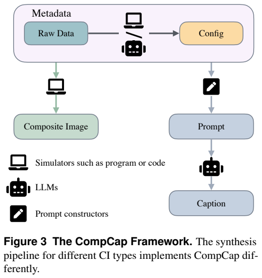
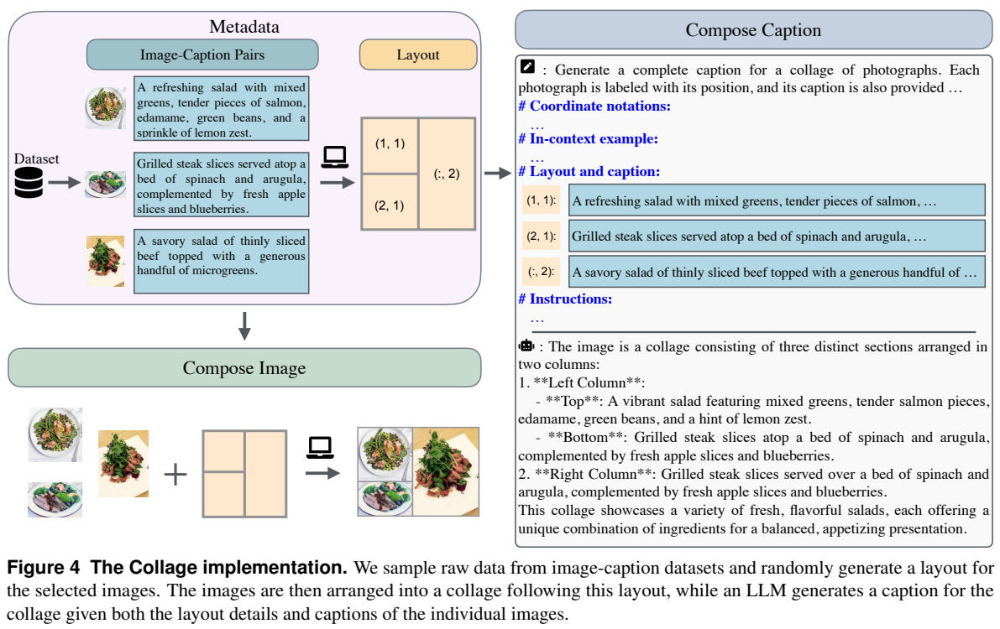
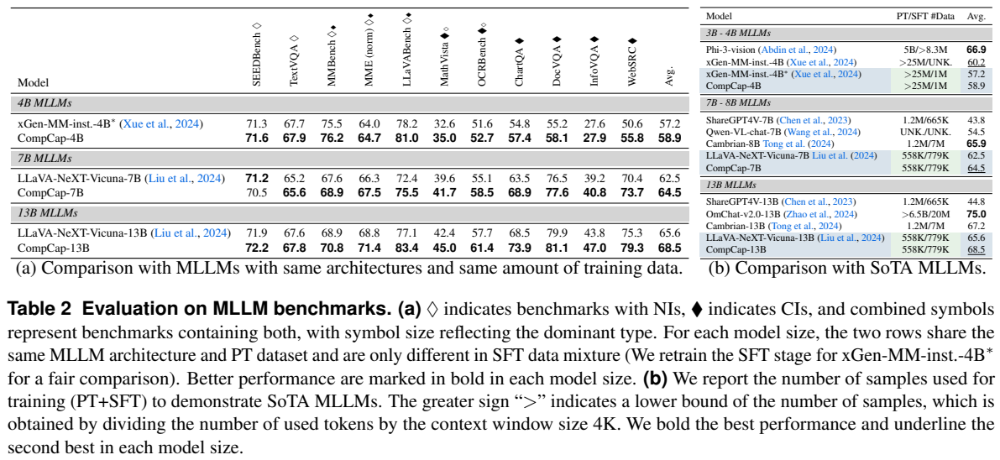
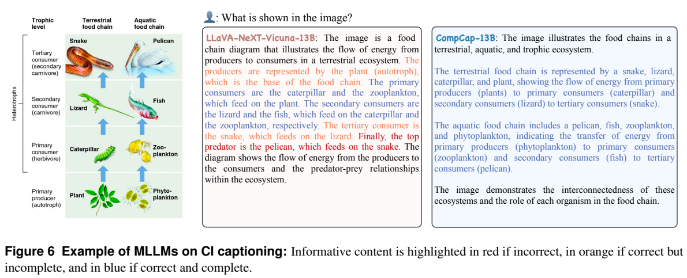
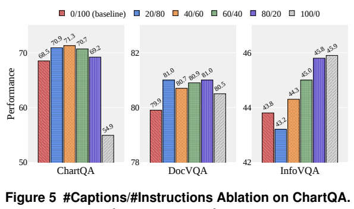
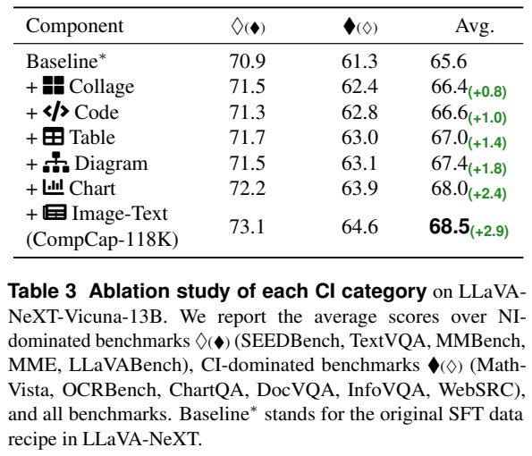

<!-- article-header:start -->
[项目首页](../../../README.md) › [模型系列](../../../reports/model-family-index.md) › [CompCap](../README.md)
<!-- article-header:end -->

# CompCap：用可控合成图像与复合描述增强多模态理解

<!-- article-toc:start -->

**本篇目录** · [论文定位](#paper-info) · [快速概览](#overview) · [整体架构](#architecture) · [核心原理](#principles) · [数据构建](#data) · [训练流程](#training) · [实验结果](#experiments)
<!-- article-toc:end -->

## 1. 论文信息与模型定位

原论文为 **CompCap: Improving Multimodal Large Language Models with Composite Captions**，作者包括 Xiaohui Chen、Satya Narayan Shukla、Mahmoud Azab 等，机构涉及 Meta、Tufts University 和 Georgia Tech。本文依据 [arXiv 2412.05243v1](https://arxiv.org/pdf/2412.05243v1)，该版本提交于 2024 年 12 月 6 日。来源 PDF 与逐页文本保存在仓库缓存中。

CompCap 是一种数据构建与训练方法，没有另造一种图文融合网络。它针对复杂拼图、图表、文档、表格、代码截图和流程图：先从结构化信息生成图像，再用同一份信息生成详细描述，使监督文本覆盖布局、实体、关系和数据。实验将这类描述混入现有模型的指令微调，分别形成基于 xGen-MM 的 4B 模型，以及基于 LLaVA-NeXT 的 7B、13B 模型。因此，“CompCap 13B”应理解为经过该数据方案训练的基线模型，而不是独立预训练的基础模型。

## 2. 快速概览

论文的切入点是：复杂图像中的知识并不总能被通用描述数据充分表达。仅用一个视觉模型给真实图像补写描述，还可能遗漏关系或继承视觉识别错误。CompCap 从拼图布局、图表数据、Mermaid 图、源代码和原始表格等中间表示出发，协调生成图像与文字，把监督内容建立在可访问的生成信息上。

数据集共 **117,879** 个图像—描述样本，覆盖六类内容。Table 1 的分类数量经过取整：拼图约 50K、图像与文字组合约 37K、图表约 22K、图解约 3K、代码约 2K、表格约 4K；这些近似值不应替代精确总数。描述明显长于一般短图像标题，例如图解描述平均约 2,044 字符，图表约 1,468 字符，拼图约 913 字符。

在保持各基线训练样本总量一致的设置中，11 项评测的平均分分别提高 1.7、2.0 和 2.9 个分数点。收益在复杂图像任务上较突出，但并非每项指标都提高，也不意味着超过所有同期模型。另一组实验显示，全用描述替代问答指令会明显降低 ChartQA，支持“描述与指令互补”的定位。

## 3. 整体架构

*原论文 Figure 3，PDF 第 4 页；仅保留原文流程图区域。*

Figure 3 应从中间的输入信息向图像与文字两条分支阅读。对于图表，原始数据和样式参数交给绘图库生成图像，数值、坐标轴、图例等交给语言模型形成描述；对于代码，源代码一侧渲染成截图，另一侧保留代码并生成解释。两个输出共享信息来源，而不是先生成图片后让另一个视觉模型重新猜测全部内容。

拼图分支稍有不同：底层图片来自已有数据集，系统检索相关图片、安排布局，再将单图描述和坐标提供给语言模型。它同时考验每个子图的内容以及多图之间的位置关系。图像—文字组合既包括图上叠加文本，也包括类似文档的纯文字页面。最终六条数据分支统一成图像与自然语言描述对，送入既有多模态模型。

模型端没有新增专用图表预测头或工具调用模块。4B 实验使用 xGen-MM v1.5；7B 和 13B 使用论文指定的 LLaVA-NeXT/Vicuna 配置。视觉编码、连接器和语言模型仍来自这些基线。CompCap 的关键变量是训练样本的组成及其信息密度，不能把效果直接归因于新的注意力结构。

## 4. 核心创新与数学原理

核心设计是让生成信息成为可核查的共同条件。若用解释性记号表示，可写成 $I=R(z,s)$、$C=G(z,m)$：$z$ 是内容，$s$ 是渲染样式，$m$ 是布局或其他元数据，$R$ 生成图像，$G$ 生成描述。这是帮助理解流程的记号，并非论文提出的新损失函数。它揭示了两个不同控制项：改变样式可以增加视觉变化，保留内容来源则便于检查描述是否忠实。

拼图检索在附录 A.1 给出具体相似度：将锚点与候选图片的 DINOv2 特征余弦相似度，加上两者文字描述的 CLIP 特征余弦相似度。即

$$s(a,b)=\cos(v_a^{\mathrm{DINO}},v_b^{\mathrm{DINO}})+\cos(t_a^{\mathrm{CLIP}},t_b^{\mathrm{CLIP}}).$$

这里第二项比较的是文字描述，不能误写成图文交叉相似度。系统先取前 20 个候选，再随机抽样，并结合宽高比过滤，使拼图既有关联，又不总重复同一组最相似图片。实体拼图还通过关键词检索让多个子图包含共同实体。

*Figure 4，PDF 第 5 页。左侧展示检索和布局，右侧展示坐标、原描述与输出描述。*

读 Figure 4 时应将输出中的“左上”“右列”等位置词与布局逐一对照。坐标信息把原本分散的单图标题变为关系监督，但自动描述仍有错误可能：图示右列的生成文字出现了重复其他子图食物描述的现象。因此，共享元数据降低重新感知的困难，并不保证每句生成文本都正确。

训练仍属于文本自回归监督：模型给定图像和提示，预测描述或指令答案。可用通用形式 $-\sum_t\log p_\theta(y_t\mid I,x,y_{<t})$ 解释目标，但论文没有提出特殊的对比损失、几何损失或跨图关系分类目标。长描述的作用是增加可预测内容与关系监督，而不是通过新增数学约束强制视觉推理正确。

## 5. 数据构建与处理

拼图支持随机、相似、共同实体三种选择方式。布局包含行列数在 1–4 范围内的网格、合并单元格，以及按行或列排列的自动布局。OpenCV/PIL 控制留白、边距和背景。Llama 3.1-70B 根据布局坐标和原图片描述生成复合描述，并进行格式处理及去重。

图像—文字数据控制文本叠加位置、透明度、字体和颜色，也生成 Wikipedia 文字页面以及 12 种手写字体的 SVG 页面；背景可采用模糊的 COCO 图片或 Augraphy 模拟的纸张、墨迹噪声。图表使用 Plotly，覆盖单组、分组、堆叠柱图、折线图、饼图和地图。数据来源包括 UniChart、DVQA 及地图统计材料；Llama 3.1-405B 根据数据和元信息描述数值、图例与趋势。未标具体数值的柱形描述保留近似性，不应假定语言监督总包含精确读数。

图解以 Mermaid 为中间表示，约 2K 来自许可允许的 GitHub 材料、约 1K 为生成并检查可渲染的样本；使用 53 种样式并通过浏览器截图。描述模型主要读取图结构，避免把样式当成关系。代码覆盖 C、C++、Ruby、R、Python、Java、JavaScript、CSS、SQL，先按主题生成代码，再用 Carbon 的 29 种主题、14 种字体渲染；文字由源代码和解释组成。生成代码不等于经过执行正确性检验。表格从 UniChart 的表数据出发，以 Matplotlib 控制单元格、边框和对齐，描述结合 Markdown 原表与分析。

这些处理扩充了视觉外观，但部分来源、工具和大语言模型具有各自偏差。渲染有效性、格式过滤和可读性检查，与语义全面正确是不同层次。论文没有报告逐条人工审阅全部 117,879 个样本的结果。

## 6. 训练流程与目标

实验直接使用已有预训练检查点进行监督微调，没有重复完整基础模型预训练。引入 CompCap 时，对原指令样本下采样以保持训练总样本数，从而避免仅因“多喂了一批数据”形成不公平比较。4B 原始发布训练数据未公开，作者重建了带星号的基线；正文称约 782K 图像样本加 221K 纯文本样本，附录写成约 781K 加 211K，版本内部并不一致，因此本文保留“约 1M”的口径。

Table 8 给出三种模型均训练 1 个 epoch，AdamW、学习率 $2\times10^{-5}$、余弦衰减、权重衰减 0。4B 使用批量 64 和 8 张 A100；7B、13B 使用批量 128 和 32 张 A100。表中列出的视觉 token 配置分别为 128/SigLIP 与 2,880/CLIP，并采用可变分辨率处理。论文没有完整交代每个模块是否冻结、峰值显存或总墙钟时间，不能据基线习惯补齐。

描述样本与原指令的混合策略也有影响。附录 Table 11 中，均匀混合的 7B、13B 平均分为 64.5、68.5，高于先集中描述以及两种改变混合比例的调度。这里的“余弦采样”指数据比例调度，与上面的学习率余弦衰减不同。模型没有训练专门的推理过程奖励；性能改善来自更丰富的监督文本及其混合安排。

## 7. 实验设置与主要结果

*Table 2，PDF 第 7 页。4B 星号行是作者重建基线；结果包含不同任务指标，平均分不等于统一准确率。*

作者使用 VLMEvalKit 与 LMMs-Eval 评估自然图像和复杂图像任务。以下数字逐列对应原表，仅挑选能说明变化的指标。

| 配置 | 平均分 | MathVista | OCRBench | ChartQA | DocVQA | InfoVQA | WebSRC |
|---|---:|---:|---:|---:|---:|---:|---:|
| xGen-MM 4B 重建基线* | 57.2 | 32.6 | 51.6 | 54.8 | 55.2 | 27.6 | 50.6 |
| CompCap 4B | 58.9 | 35.0 | 52.7 | 57.4 | 58.1 | 27.9 | 55.8 |
| LLaVA-NeXT 7B 基线 | 62.5 | 39.6 | 55.1 | 63.5 | 76.5 | 39.2 | 70.4 |
| CompCap 7B | 64.5 | 41.7 | 58.5 | 68.9 | 77.6 | 40.8 | 73.7 |
| LLaVA-NeXT 13B 基线 | 65.6 | 42.4 | 57.7 | 68.5 | 79.9 | 43.8 | 75.3 |
| CompCap 13B | 68.5 | 45.0 | 61.4 | 73.9 | 81.1 | 47.0 | 79.3 |

13B 的 ChartQA 从 68.5 提升到 73.9，WebSRC 从 75.3 到 79.3，说明该设置在图表及网页理解上具有收益。但 7B 的 SEED 从 71.2 降至 70.5，不能表述成全基准提高。原发布 xGen-MM 4B 的平均分为 60.2，高于 CompCap 4B 的 58.9；合理的受控结论是相对重建基线 57.2 提升，而不是超过原发布模型。同期其他模型也在部分任务或整体平均上更强。

*原文第 8 页：Table 3 展示逐次增加数据类型的消融，Figure 5 展示描述与指令比例实验，Figure 6 展示食物链描述案例。*

Table 3 从 13B 基线的平均 65.6 开始，依次加入拼图、代码、表格、图解、图表、图像—文字数据，最终达到 68.5；自然图像组平均由 70.9 到 73.1，复杂图像组由 61.3 到 64.6。这是按顺序累计加入的结果，受数据量及前置类型影响，不能当成六个互相独立的收益大小排名。

Figure 5 则只改变训练集 ChartQA 部分的描述/指令组成。ChartQA 从纯指令的 68.5，在描述占 40% 时达到 71.3；全部变成描述时降至 54.9。DocVQA、InfoVQA 的曲线不同，说明任务对监督形式的需求不同。该实验的 18,317 条图表描述来自给真实图表补写描述的模型，须与主要 CompCap 元数据合成管线区分。

论文另用“先描述、再由语言模型回答”与直接图像问答作诊断，仅对描述足以回答的问题统计分数接近程度，并将差值小于 0.2 定义为一致。复杂图像中约 58% 的问题被判为仅靠描述不可回答，而自然图像约 12%；这种诊断说明描述信息有缺口，但不证明缺口是所有推理失败的唯一原因。Figure 6 的食物链案例提供关系描述改善的直观例子。综合这些证据，CompCap 是一种有效补充复杂视觉监督的方案，实际收益仍取决于底座、混合比例与生成描述质量。

<!-- article-footer:start -->
---

[← 上一篇：NVILA](../../vila/arxiv-2412.04468/README.md) · [按发表时间浏览](../../../reports/paper-reading-guide.md#year-2024) · [下一篇：InternVL 2.5 →](../../internvl/arxiv-2412.05271/README.md)

[返回本篇目录](#article-toc) · [返回模型系列](../README.md)
<!-- article-footer:end -->
