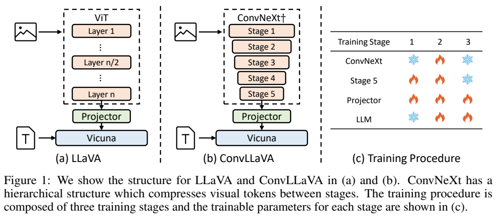
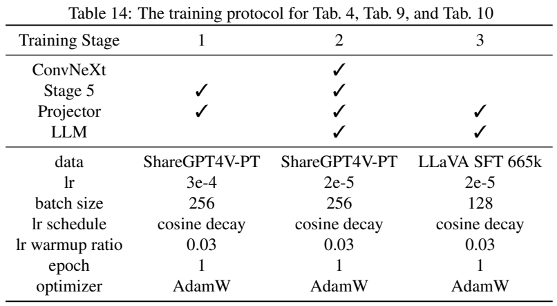
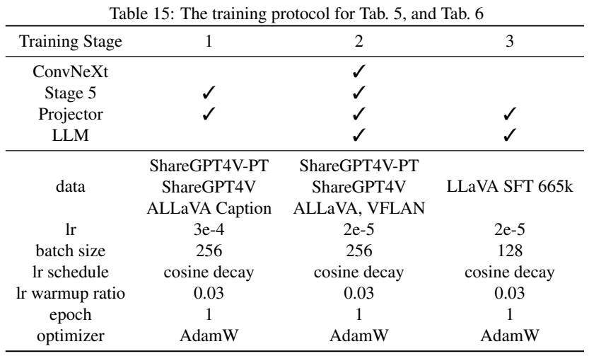
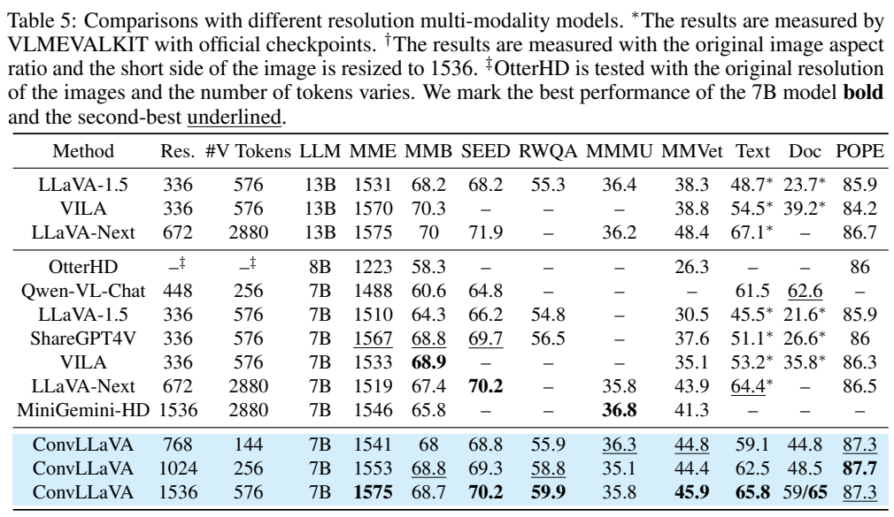
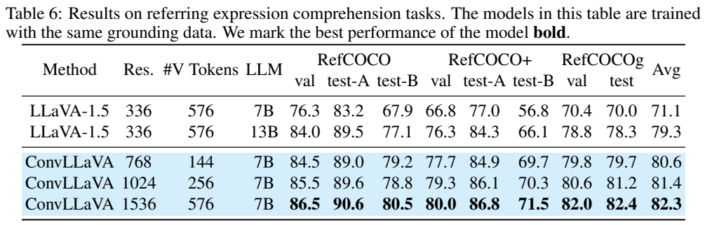

<!-- article-header:start -->
[项目首页](../../../README.md) › [模型系列](../../../reports/model-family-index.md) › [ConvLLaVA](../README.md)
<!-- article-header:end -->

# ConvLLaVA：用分层卷积压缩高分辨率视觉输入

<!-- article-toc:start -->

**本篇目录** · [论文定位](#paper-info) · [快速概览](#overview) · [整体架构](#architecture) · [核心原理](#principles) · [数据构建](#data) · [训练流程](#training) · [实验结果](#experiments)
<!-- article-toc:end -->

## 1. 论文信息与模型定位

| 项目 | 信息 |
|---|---|
| 原题 | ConvLLaVA: Hierarchical Backbones as Visual Encoder for Large Multimodal Models |
| 作者与机构 | Chunjiang Ge、Sijie Cheng、Ziming Wang 等；清华大学、阿里巴巴 |
| 来源 | [arXiv:2405.15738v1](https://arxiv.org/abs/2405.15738v1)，2024-05-24，17 页 |
| 官方项目 | [alibaba/conv-llava](https://github.com/alibaba/conv-llava) |
| 定位 | 以单个五阶段 ConvNeXt 取代 ViT 的高分辨率图文理解模型；语言骨干 Vicuna-7B |

ConvLLaVA 关注视觉编码器与语言模型之间的计算分配：提高图像分辨率有助于读小字，但把更多视觉 token 交给语言模型会显著增加代价。论文通过分层卷积逐步压缩特征，研究如何在输入清晰度与输出 token 数之间取得平衡。它主要进行图像理解、问答与定位，没有将图像生成纳入模型目标。

## 2. 快速概览

模型的两项关键改动是更新预训练 ConvNeXt 的视觉特征，以及增加第五阶段压缩模块。四阶段 ConvNeXt 每个空间方向缩小 32 倍；五阶段进一步变为 64 倍。因此，1536×1536 图像可转成 24×24=576 个视觉 token，与 LLaVA 常用 336 分辨率 ViT 的 token 数相同。768 与 1024 分辨率版本分别输出 144 和 256 个 token。

更少的 token 并不保证无损。低预算消融中，在同样 768 分辨率下压缩为 144 个 token，DocVQA 比 576 个 token 时下降 9.1 分。论文的价值在于展示：通过更高输入分辨率、合适训练数据与可学习压缩，仍可用较短序列保留有用细节，而不是宣称图像冗余总能无代价删除。

## 3. 整体架构

*原文 Figure 1，PDF 第 3 页图表区域裁切。左图是 ViT 方案，中图是逐阶段缩小特征的 ConvNeXt，右图的火焰与雪花分别表示三个训练阶段中的更新与冻结。视觉阶段和训练阶段是两种不同的编号。*

系统仍由视觉编码器、两层 MLP projector、Vicuna-7B 构成。原文用 $z=h(g(x))$ 表达视觉编码 $g$ 与映射 $h$，随后将 $z$ 和文字嵌入沿序列维拼接，交给语言模型自回归生成答案。变化集中在 $g$：采用 LAION-2B 对比预训练的 ConvNeXt-L，原始四阶段 block 数为 3、3、27、3，并增加包含 6 个 ConvNeXt block 的第五阶段。

图像先经 4×4 不重叠卷积下采样，随后阶段之间在空间上缩小 2 倍、扩展通道。第五阶段再缩小空间尺度，获得 64 倍的总空间步长。与切块方案相比，它以整图逐级处理特征，不需要另附一组低分辨率全局视图，也没有第二套辅助视觉编码器。

## 4. 核心创新与数学原理

原文给出 depthwise convolution 的运算量 $O(k^2CN)$，其中 $k=7$ 为卷积核边长、$C$ 为通道数、$N$ 为特征位置数；ViT 自注意力包含 $O(4C^2N+2CN^2)$。固定网络宽度与卷积核时，卷积及逐点前馈的空间计算随位置数线性增长，而全局注意力存在 $N^2$ 交互项。这里讨论的是视觉编码器；后面的语言模型仍有自注意力，不应把整套系统描述为严格线性复杂度。

对尺寸可整除总步长的图像，token 数的直观关系为：

$$
N_{32}=\frac{HW}{32^2},\qquad N_{64}=\frac{HW}{64^2},
\qquad \frac{N_{64}}{N_{32}}=\frac14.
$$

这是根据网络下采样结构作出的计数解释，不是论文新增损失公式。64 倍是每个空间方向的缩小比例，面积对应 4096 个输入像素量级；它不是把 token 数只减少 64 倍。1536 分辨率四阶段模型会产生 2304 个 token，五阶段则为 576 个。若只考虑视觉 token 间的语言自注意力交互，长度减至四分之一可将该项降到十六分之一，但文字、投影、前馈与编码器成本仍存在，不能直接当作总加速倍数。

第二项机制是分辨率适配。预训练 ConvNeXt-L 原先在 256 分辨率训练、320 分辨率微调，直接冻结后用于 768 甚至 1536 输入，会改变感受野相对图像的比例与特征分布。论文先用高质量图文描述更新后部视觉阶段，再冻结视觉模块进行指令微调。卷积在设计上具有平移等变和尺寸适应性，使网络可接收非正方形特征图；但边界、padding、下采样及数据分布会影响实际表现，这并不意味着任意尺寸都获得相同质量。

## 5. 数据构建与处理

主模型使用三阶段数据：初始化用 ShareGPT4V-PT、ShareGPT4V 与 ALLaVA captions，约 2M 样本；视觉语言预训练加入 ALLaVA 的更多内容和 VFLAN 的 190K 开源子集，合计约 2.9M；指令微调使用 LLaVA 665K 数据。前两阶段并非相互独立、完全不重叠的数据集，不能把数目相加当作独立图像数。报告沿用已有数据集，没有提供新的完整抓取与过滤管线。

小规模机制消融与最终主模型的数据不同。冻结视觉编码器的比较用 LLaVA LCS-558K 初始化加 665K 指令数据；更新编码器实验在中间加入 ShareGPT4V-PT；五阶段早期消融用 ShareGPT4V-PT 初始化新增阶段和 projector。最终主模型扩大训练数据后取得更高结果，因此 Table 4 和 Table 5 不能只归因于分辨率不同。

默认图像预处理是补成正方形、缩放和中心裁剪。任意纵横比测试取消 padding 和中心裁剪，把短边放到 1536，并保持原比例；该协议通常增加 token 数。因而 576 是 1536×1536 正方形输入的数目，不是所有保持比例图像的固定上限。定位实验另在相同 grounding 数据上训练模型，报告没有完整披露这部分数据的精确规模和混合比例。

## 6. 训练流程与目标

*PDF 第 17 页原始训练表。Table 14 对应较小数据消融，Table 15 对应最终 Tables 5–6；数据栏明确区分了两个配方。*

| 训练阶段 | 更新模块 | 学习率 / batch size |
|---|---|---|
| 初始化 | 新增第五阶段、projector；冻结原 ConvNeXt 与语言模型 | $3\times10^{-4}$ / 256 |
| 视觉语言预训练 | projector、语言模型及后部视觉阶段；正文指定调最后三个视觉阶段 | $2\times10^{-5}$ / 256 |
| 指令微调 | projector、语言模型；冻结包括第五阶段在内的视觉编码器 | $2\times10^{-5}$ / 128 |

各阶段均训练 1 epoch，AdamW、余弦学习率、warmup ratio 0.03。Figure 1 对 ConvNeXt 的训练标记概括为更新，细粒度可训练范围须结合正文，不能解释成预训练阶段从第一层到最后一层全部更新。第五阶段 3、6、9 层的消融无全面单调优势，最终采用 6 层；从第三视觉阶段开始更新与更早更新表现接近，作者选择前者以减少可训练参数。

训练使用语言建模目标，可用标准定义表示：

$$
\mathcal L_{LM}=-\sum_t\log p_\theta(y_t\mid h(g(I)),q,y_{<t}).
$$

该式是对原文所述语言建模损失的解释，不是报告编号的新公式。论文没有单独训练重建图像的压缩损失；第五阶段的信息保留依靠下游文本监督形成。作者报告 768 版本在两台 A800 机器上训练约 18 小时，但未在此段明确每台 GPU 数，不应将其写成仅两张 A800。

## 7. 实验设置与主要结果

*PDF 第 8 页保留综合问答、OCR 与定位主表。Table 5 的 DocVQA“59/65”对应正方形与保持比例两种测试输入，不能当作两个随机重复实验。*

| 指标 | ConvLLaVA 768 | 1024 | 1536 | LLaVA-1.5-13B |
|---|---:|---:|---:|---:|
| 视觉 token 数 | 144 | 256 | 576 | 576 |
| MMBench | 68.0 | 68.8 | 68.7 | 68.2 |
| SEEDBench | 68.8 | 69.3 | 70.2 | 68.2 |
| MM-Vet | 44.8 | 44.4 | 45.9 | 38.3 |
| TextVQA，无 OCR 提示 | 59.1 | 62.5 | 65.8 | 48.7 |
| DocVQA，正方形输入 | 44.8 | 48.5 | 59.0 | 23.7 |
| POPE | 87.3 | 87.7 | 87.3 | 85.9 |

测试采用 VLMEvalKit，TextVQA 问题中不提供 OCR token，与部分原始 LLaVA 报告协议不同；部分对照分数由官方 checkpoint 重测。模型对 OCR 的提升最清晰，但规模或分辨率并不带来所有指标单调提高：1536 的 MMBench 低于 1024；MMMU 35.8 也低于表中 MiniGemini-HD 的 36.8、LLaVA-1.5-13B 的 36.4。因此正文“超过更大模型”应理解为多项任务上的结果，而非全部项目均优。

分辨率适配消融进一步支持训练的重要性：四阶段 ConvNeXt-L 768 从冻结到更新后，TextVQA 53.7→60.0，DocVQA 29.8→40.2；同时维持 576 token。相同 768 分辨率增加第五阶段后，DocVQA 降至 31.1，说明压缩也会丢失细节；将五阶段输入提高到 1536 后为 42.5。这些是较小数据配方的消融数值。

主模型保持纵横比、短边 1536 时，DocVQA 59.0→65.0，但 SEEDBench 70.2→68.9、TextVQA 65.8→64.6；短边再提高到 1664，DocVQA 达 65.7，另两项继续下降。定位 Table 6 在相同 grounding 数据训练下，1536 版本八个 split 平均 82.3，对照 LLaVA-13B 为 79.3。论文尚未证明在视频、交错多图等场景的普遍收益，也承认 7×7 卷积核与原四阶段层数配置未必适合极高分辨率。以上为原文分析与图表核验，未实际运行模型。

<!-- article-footer:start -->
---

[← 上一篇：Libra](../../libra/arxiv-2405.10140/README.md) · [按发表时间浏览](../../../reports/paper-reading-guide.md#year-2024) · [下一篇：Meteor →](../../meteor/arxiv-2405.15574/README.md)

[返回本篇目录](#article-toc) · [返回模型系列](../README.md)
<!-- article-footer:end -->
