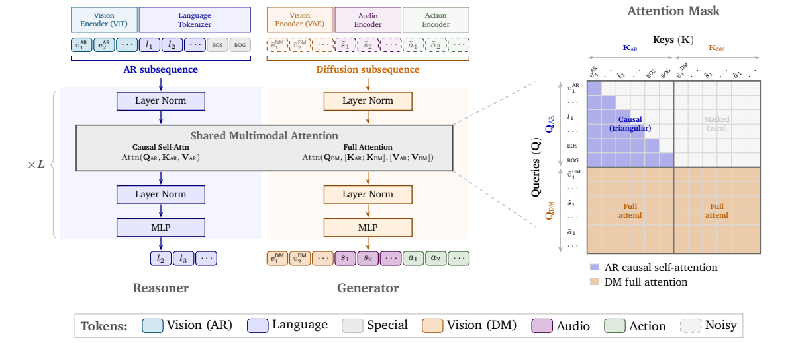
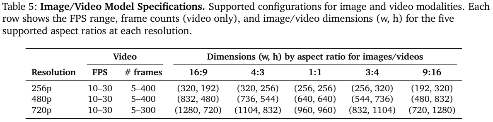
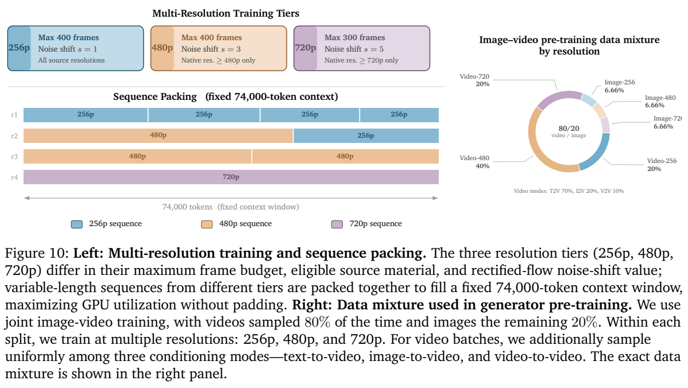
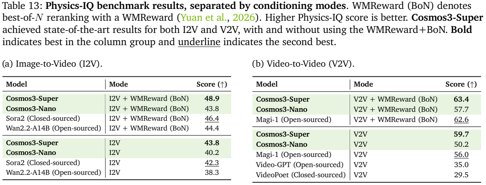
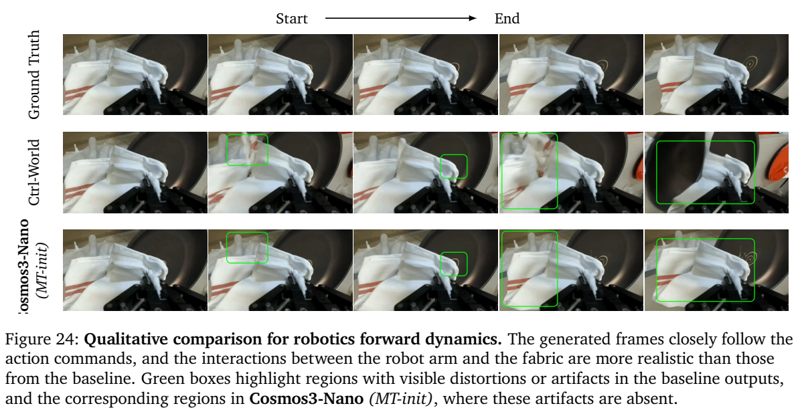
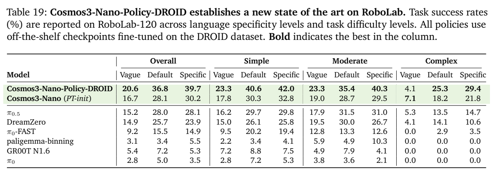

<!-- article-header:start -->
[项目首页](../../../README.md) › [模型系列](../../../reports/model-family-index.md) › [Cosmos](../README.md)
<!-- article-header:end -->

# Cosmos 3：以双路径 Transformer 统一理解、世界生成与动作预测

<!-- article-toc:start -->
<a id="article-toc"></a>

**本篇目录** · [论文定位](#paper-info) · [快速概览](#overview) · [整体架构](#architecture) · [核心原理](#principles) · [数据构建](#data) · [训练流程](#training) · [实验结果](#experiments)
<!-- article-toc:end -->

<a id="paper-info"></a>

## 1. 论文信息与模型定位

**Cosmos 3: Omnimodal World Models for Physical AI** 是 NVIDIA 的全模态世界模型报告。本文依据 [arXiv 2606.02800v1](https://arxiv.org/pdf/2606.02800v1) 的 138 页原文。arXiv 版本标记为 2026 年 6 月 1 日，封面日期为 6 月 3 日；下文所有页码均为该 PDF 页码。

Cosmos 3 希望把物理智能所需的几类能力放进同一框架：解释当前场景、生成可能的未来图像和视频、同步生成声音、根据动作预测环境变化，以及根据观察反推或生成动作。它既包含输出文字的 Reasoner，也包含生成连续潜变量的 Generator。定位是供机器人、自动驾驶和物理场景数据生成进一步适配的基础模型，不是只做看图聊天的 VLM，也不是已被证明可精确替代物理引擎的仿真器。[原文第 5–7 页](https://arxiv.org/pdf/2606.02800v1#page=5)

报告训练 Edge、Nano、Super 三种尺度，MoT 双路径型号约为 4B、16B、64B；对应单路径骨干约为 2B、8B、32B。本文介绍报告中的基础模型和专用后训练分支，区分 Cosmos3-Super-Text2Image、Cosmos3-Super-Image2Video、Cosmos3-Nano-Policy-DROID。报告当时发布 Nano 和 Super，Edge 拟后续发布，不能把家族所有分支的成绩都归给同一检查点。

<a id="overview"></a>

## 2. 快速概览

| 内容 | 技术要点 |
|---|---|
| 统一形式 | 自回归 AR 子序列负责文字理解推理，扩散 DM 子序列负责视频、音频、动作生成 |
| 计算骨干 | Mixture-of-Transformers：每层两套参数，生成路径通过联合注意力读取理解路径 |
| 视觉编码 | 理解用 ViT；生成用冻结的 Wan2.2 视频 VAE，时间压缩 4 倍、空间有效压缩 32×32 |
| 音频表示 | 冻结音频 VAE，48kHz 立体声、hop 1,920，得到每秒 25 个 token |
| 动作统一 | 位姿变化和抓取状态组成动作向量，以具身领域专用投影映射到共享潜空间 |
| 目标 | Reasoner 下一 token 预测；Generator 对连续潜变量做 rectified flow matching |
| 数据课程 | 广泛预训练 → 引入动作和控制信号的中训练 → 独立领域专用后训练 |
| 重要验证 | 物理视频评测、人工原子问题评分、动作适配、真实机器人与模拟闭环成功率 |

理解该报告的关键是把“同一架构支持不同模式”和“一个现成检查点已经在所有模式上达到专用最优”区分开。专用后训练不改变基本结构，却会改变动作接口、生成分辨率、时长和推理配置。

<a id="architecture"></a>

## 3. 整体架构

**各模态先进入适合其任务的编码空间。** 理解路径的 ViT 使用 16×16 patch，经过两层 MLP 合并 2×2 token 并投影到 Transformer，还使用 DeepStack 特征和帧间文字时间戳。生成路径使用 Wan2.2-TI2V-5B 的视频 VAE，4 倍时间压缩和 16×16 空间压缩后再做 2×2 合并。ViT 在 Reasoner 训练时与骨干联合训练，生成用视频 VAE、音频 VAE保持冻结。[原文第 7 页](https://arxiv.org/pdf/2606.02800v1#page=7)

**序列由 AR 前缀和 DM 后缀组成。** AR 放置文字以及 ViT 编码的视觉信息，以 EOS、BOG 分界；DM 放置 VAE 视频、音频和动作。DM 内先排列干净条件 token，再排列待去噪 token。文生图、文生视频、图生视频、视频延续和控制视频转 RGB，只需改变哪些 token 是已知条件，哪些是生成目标。



**读图方式：** 左半图蓝色是 Reasoner，橙色是 Generator，分别拥有归一化、注意力投影和 MLP 参数。两者在注意力计算中交换条件信息，不是所有参数完全共享。右半掩码的左上区域为 AR 的因果三角，右上为零，意味着 AR 不读取带噪生成目标；下面两个区域允许 DM 读取全部 AR 和 DM。图为直观展示画出干净输出，实际生成训练预测的是 flow velocity。[原文第 9–12 页](https://arxiv.org/pdf/2606.02800v1#page=9)

这一 MoT 不是按 token 学习选择若干专家的稀疏 MoE。这里的路径归属由 AR/DM 功能确定，两套网络分别处理理解和生成，Nano、Super 的单路径骨干仍是稠密模型。

| 型号 | 单路径初始化 | 层数 | 隐藏维度 | 注意力头/KV 头 | FFN 维度 |
|---|---|---:|---:|---:|---:|
| Edge | 内部从零训练的 2B 骨干 | 28 | 2,048 | 16/8 | 9,216 |
| Nano | Qwen3-VL-8B | 36 | 4,096 | 32/8 | 12,288 |
| Super | Qwen3-VL-32B | 64 | 5,120 | 64/8 | 25,600 |

各型号 head dimension 为 128。Edge 的语言骨干移除 QK normalization，并使用 ReLU-squared；这些差异属于 Edge，不能同时归给 Nano、Super。[原文第 14 页](https://arxiv.org/pdf/2606.02800v1#page=14)

| 模块 | 输入与输出 | 公开机制 |
|---|---|---|
| 理解视觉入口 | 图像/视频 → AR视觉表示 | 16×16 ViT patch、2×2合并MLP、DeepStack及帧间文字时间戳。 |
| 生成媒体入口 | 视频/音频 → 连续潜变量 | 视频VAE时间压缩4倍、空间总压缩32×32；VAE训练中冻结。 |
| 动作接口 | 领域动作向量 → 共享潜空间 | 领域专用线性输入/输出投影，主干共享；相对位姿和当前抓取状态分开处理。 |
| Reasoner | AR前缀 → 文字和语义条件 | 独立归一化、投影、MLP；因果注意力只读AR。 |
| Generator | 干净条件和噪声目标 → 速度 | 独立参数塔双向读取DM及全部AR条件，多步去噪生成连续模态。 |

[模块依据：v1 §2.1–2.4，PDF第7–8、11–12页](https://arxiv.org/pdf/2606.02800v1)。

<a id="principles"></a>

## 4. 核心创新与数学原理

### 4.1 非对称双塔注意力与条件复用

 原文式 7、8 为：

```math
O_{\mathrm{AR}}=\mathrm{Attn}_{\mathrm{causal}}(Q_{\mathrm{AR}},K_{\mathrm{AR}},V_{\mathrm{AR}}),
\qquad
O_{\mathrm{DM}}=\mathrm{Attn}_{\mathrm{full}}(Q_{\mathrm{DM}},[K_{\mathrm{AR}};K_{\mathrm{DM}}],[V_{\mathrm{AR}};V_{\mathrm{DM}}]).
```

文字生成需要保留因果顺序，连续媒体去噪则需要查看整个目标的空间和时间关系。非对称掩码使两种规则并存：Generator 接受 Reasoner 的语义条件，Reasoner 不受每一步噪声状态反向污染。推理时固定条件的 Reasoner 输出因此可以只算一次并缓存；这与近似跳过若干扩散层的缓存方法不同，是由结构保证的不变条件复用。[原文第 11、47 页](https://arxiv.org/pdf/2606.02800v1#page=11)

两塔共享的是注意力运算所允许的信息通道，而非所有参数。每层都分别产生AR与DM的Q/K/V，DM才在键值轴合并两条流；因此改变噪声状态不会改变Reasoner的隐藏态。缓存成立依赖固定的AR条件，若文字提示或理解视觉发生变化，应重新计算对应条件，不能把旧缓存无条件跨请求复用。 [§2.3.1–2.3.2，第11–12页](https://arxiv.org/pdf/2606.02800v1)

### 4.2 干净条件与带噪目标如何定义任务

 原文把干净潜变量 $`x_0`$ 与高斯噪声 $`\epsilon`$ 连接：

```math
x_\sigma=\sigma\epsilon+(1-\sigma)x_0,\qquad v^*=\epsilon-x_0.
```

模型 $`v_\theta(x_\sigma,\sigma,c)`$ 预测沿这条路径的速度，用掩码 MSE 拟合 $`v^*`$，不对干净条件帧计算目标损失。用本文整理的记号，可以将多模态目标写为 $`\sum_m\lambda_m\mathbb E\Vert M_m\odot(v_{\theta,m}-v_m^*)\Vert ^2`$；这是对原文叙述的汇总，不是其额外编号公式。中训练中动作损失乘 10，以补偿归一化动作向量较小的逐元素误差，不能直接把它理解成“动作采样占比扩大十倍”。[原文第 27、30 页](https://arxiv.org/pdf/2606.02800v1#page=27)

前向、逆向和policy任务的关键差别是哪些量保持干净、哪些量需要被去噪：已知动作可约束未来视频，已知前后视频可约束动作，两者同时带噪则联合预测。图4将动作放在相邻视觉状态之间，明确它描述哪次状态转移；不能把任意同时间戳的动作向量与视频帧随意配对。 [Figure4、§2.3，第11页](https://arxiv.org/pdf/2606.02800v1)

### 4.3 多模态位置的物理时间对应

 视频、音频和动作每秒 token 数不同，如果只按序列位置递增，碰撞声和碰撞画面会在位置编码中错位。Cosmos 3 扩展 3D MRoPE：视频使用时间、高、宽坐标；音频与动作的空间坐标为零，只保留时间。原文式 9 为 $`\delta_t=\mathrm{TPS}_{\text{base}}/\mathrm{TPS}`$，其中基准 TPS 为 $`24/4=6`$。所以 25 TPS 音频相邻位置间隔为 $`6/25`$，不同模态相同现实时间能占据相同坐标范围。模型还在 AR 与 DM 间加入固定 15,000 的时间位置间隔，缓解最初帧的过饱和和棋盘伪影；这不是额外 15,000 个输入 token。[原文第 12–14 页](https://arxiv.org/pdf/2606.02800v1#page=12)

序列拼接顺序和位置坐标承担不同职责：前者区分AR、干净条件和生成目标，后者对齐真实时间。视频还有高宽坐标，而音频和动作仅以时间参与位置关系。这样同步信号不必具有相等token数量；时间对齐也不能替代正确的数据同步标注或动作状态对应。 [§2.4，第12页](https://arxiv.org/pdf/2606.02800v1)

### 4.4 共享动作语义与领域专用尺寸

 位姿伪动作由连续状态计算 $`\Delta T_t=T_{t-1}^{-1}T_t`$，包括 3D 平移与 6D 旋转表示；抓取状态直接记录当前值，而非时间差。相机和车辆为 9 维，单臂机器人为 10 维，双臂为 20 维，第一人称头手运动为 57 维。领域 $`k`$ 使用专用线性层 $`z=W_{\text{in}}^{(k)}x+b_{\text{in}}^{(k)}`$，并以专用输出层还原原领域动作空间；骨干共享，接口不强求维度一致。[原文第 8–9 页](https://arxiv.org/pdf/2606.02800v1#page=8)

由此产生三种条件分解：前向动力学给定动作生成未来视觉状态；逆向动力学给定视觉转变推断动作；policy 联合生成动作与未来视频。以条件概率表述分别是 $`p(v_{\text{future}}\mid v_{\text{past}},a)`$、$`p(a\mid v_{\text{past}},v_{\text{future}})`$、$`p(a,v_{\text{future}}\mid v_{\text{past}},l)`$。这组概率写法是帮助理解的概念表达，原文实际通过干净/带噪 token 配置训练，不是另设三套任务骨干。

原文刻意绕开PID等底层控制器细节，用相对位姿表达跨领域可比较的运动。抓取状态使用当前值，是因为它描述操作状态而非必须发生的位移；对它同样取差会丢失“持续闭合”这类信息。领域投影保留输入尺寸差异，因此统一接口并不意味着相机、车辆和双臂机器人拥有相同动作自由度。 [§2.1.3、Figure3，第8页](https://arxiv.org/pdf/2606.02800v1)

<a id="data"></a>

## 5. 数据构建与处理

**Reasoner 数据约 2,420 万条。** Table 3 中预训练为 22,002,013 条，SFT 为 2,171,673 条；图文和视频行统计媒体样本，纯文字行统计对话，单位并不完全一致。预训练 OCR 占 42.9%、2D grounding 占 16.5%；SFT 的视频样本比例提高至约一半，覆盖机器人、驾驶和智能基础设施。原文另称 SFT 混合加入 80 万轻量指令样本，不能把这句话与 Table 3 简单相加后宣称精确去重总数。[原文第 15–19、27 页](https://arxiv.org/pdf/2606.02800v1#page=15)

质量处理先做“完整对话”的联合语义去重：同时考虑媒体与指令回答，避免删掉同一图片下不同任务。聚类后余弦相似度超过 0.95 的近重复被移除，去重删去 4.23%。再由 Gemma-4-31B-it 分别给忠实性、完整性、正确性打 1–5 分，三个维度都必须通过门槛。主预训练用门槛 2，SFT 用门槛 5；相应保留率为 78% 和 46%。这些是 AI 审阅流程统计，不是人工保证全部标注正确。

物理领域监督有具体落地方式：把 3D 场景物体转换为相机坐标下的结构化框；从模拟器位置、深度、可见性和可行空间计算答案；驾驶数据标注决策时刻与因果链；机器人动作 CoT 把物体、可供性点、运动理由和二维末端路点组织成可检查轨迹。视频时间定位数据包括约 55K 视频、743K 事件三元组。此类数据把感知输出接近行动接口，同时不等于已执行真实控制。

**Generator 视觉数据从大量原始候选中筛选。** 预训练保留 767M 图片和约 347.7M 视频片段，原始候选约 7.8B 图片、3B 视频。先场景切分、去黑边和标准化编码，再用图像/视频 embedding 聚类去重，进行 47 类语义分组与质量、伪影过滤。中训练提高分辨率与质量要求，加入罕见物理场景、文本渲染、动作和控制视频。原文使用结构化 JSON caption 覆盖主体、背景、光照、关系、摄影与时间变化，分别微调两个 Qwen3-VL-8B 作为图片和视频标注器。[原文第 20–23 页](https://arxiv.org/pdf/2606.02800v1#page=20)

合成数据由五类来源组成：刚体物理交互 PhyxSim、机器人 RobotSim、驾驶 DriveSim、数字人 SynHuman、仓库 Warehouse。它们通过 Isaac Sim、Omniverse 等生成可控长尾场景；部分来源还提供深度、分割、相机或物理状态。原文概览表与个别公开数据卡存在不同规模口径，例如 RobotSim 概览为 208,022，公开 v1.0 说明为 386,270 RGB 片段；本文不将这些数字当作同一阶段的训练采样总量。[原文第 96–104 页](https://arxiv.org/pdf/2606.02800v1#page=96)

**音频处理强调真实视听因果对齐。** 预训练约 138.9M 视频有可用音轨，中训练保留约 18.8M：12.8M 非语音和 6M 口型同步语音。先用 SAM-Audio 分离语音，再用 SyncNet 检验有脸和口型同步，用语音/音乐检测判断旁白及后配音乐；可见演奏乐器的声音应保留。音轨一旦经过去语音或去音乐，就重新写 caption，防止文字仍描述已被删除的声音。[原文第 23–24 页](https://arxiv.org/pdf/2606.02800v1#page=23)

**动作中训练有 8.4M episodes、61.3K 小时。** 第一人称运动占 67.4%、车辆 16.3%、机器人 8.7%、相机运动 7.5%。动作逐维归一化到约 [-1,1]，多视角组成画布，保留空闲步数以便采样平衡。通用中训练包含失败和空闲片段；DROID 专用策略后训练则使用社区的空闲过滤和失败演示移除，两个阶段的处理不同。[原文第 24–25、32 页](https://arxiv.org/pdf/2606.02800v1#page=24)

<a id="training"></a>

## 6. 训练流程与目标

先训练 Reasoner，再以其权重初始化 Generator。Reasoner 的预训练从一开始联合更新语言骨干、projector、ViT，无单独冻结骨干的 projector 对齐阶段；以 NTP 训练两轮，最大序列 16K，单样本图片最多 2,048 token、视频最多 8,192 token。语言/projector 峰值 LR 为 $`5\times10^{-5}`$，ViT 为 $`5\times10^{-6}`$；AdamW 为 (0.9,0.999)，WD 0.05，10% warmup 后余弦降至峰值 0.1 倍。SFT 运行 8,200 步、全局 batch 512，LR 降至 $`10^{-5}`$ 与 $`10^{-6}`$，warmup 1,000，Adam 系数 (0.9,0.95)、WD 0.1。SFT 以 1:4 采样预算混入预训练样本，维持一般能力。[原文第 26–27 页](https://arxiv.org/pdf/2606.02800v1#page=26)





**读图方式：** 三种颜色分别表示 256p、480p、720p；变长视频组成固定 74,000 token 的打包序列，避免补齐到最长样本。较高分辨率会用更少帧，720p 上限为 300，低两档最多 400。右图显示图片 20%、视频 80%，视频档位为 20%/40%/20%。具体模式依据正文为 T2I/T2V/I2V/V2V = 20%/56%/16%/8%；图注同时使用“uniformly”措辞，与图中视频内 70/20/10 不一致，本文沿用明确的图内及正文比例，不把它改成均匀采样。

Generator 预训练只更新生成专用参数，Reasoner 塔冻结。所有连续模态用 rectified flow：图片、音频、动作使用 logit-normal 噪声采样，视频使用 mode sampling；分辨率越高，noise shift 越大。预训练 shift 为 1/3/5，中训练为 3/5/10。FusedAdamW LR $`10^{-4}`$、系数 (0.9,0.99)、WD 0.05，梯度裁剪 1，文字 dropout 10% 以支持 CFG。[原文第 27–30 页](https://arxiv.org/pdf/2606.02800v1#page=27)

| Generator 阶段 | Nano | Super | 补充条件 |
|---|---:|---:|---|
| 预训练 | 31.05T token，1,024 GB200 | 17.86T token，2,048 GB200 | 图像、视频、音频 |
| 中训练 | 2.4T token，1,024 GB200 | 1.9T token，2,048 GB200 | 增加动作与控制转移 |

中训练流比例为图像 10%、视频 32%、视频+音频 8%、动作 25%、通用控制转移 20%、驾驶转移 5%。这些是训练流混合权重，与原始数据条数或不同帧尺寸下 token 占比不是一回事。训练采用 HSDP 与 Ulysses context parallelism、变长注意力和按 rank 同步的数据流选择；后者避免高分辨率视频与图片计算量差异造成集群等待。[原文第 30、37–44 页](https://arxiv.org/pdf/2606.02800v1#page=30)

专用后训练分别开展：文生图为 20K 步广泛 SFT 加 2K 步高质量 refinement；图生视频为约 10K 步、50B token，针对 480p、189 帧。DROID 策略从 Nano 中训练版本恢复，重新初始化动作接口，动作参数 LR 为其他参数五倍，训练预测 **32 个未来绝对关节位置**及辅助 RGB；LR 为 $`2\times10^{-4}`$。它接受本体状态和三视角 540×640 画布，以 15Hz 控制 Franka Panda，已不同于通用中训练的相对位姿伪动作。[原文第 30–32 页](https://arxiv.org/pdf/2606.02800v1#page=30)

基础视听生成默认 50 步、guidance 6、shift 10；DROID policy 为 4 步、guidance 3、shift 5，并跳过视频潜变量解码，报告部署于两块 RTX Pro 6000。不能把后者的推理速度归给 50 步、720p 世界视频生成。部分主训练未给出精确总步数/全局 batch，仍应以已披露 token 与硬件范围为准，不反算缺失时长。[原文第 32、73 页](https://arxiv.org/pdf/2606.02800v1#page=32)

<a id="experiments"></a>

## 7. 实验设置与主要结果

**理解、媒体生成和闭环动作分别评测。** Reasoner 使用 VLMEvalKit，共 48 个基准。Super 的一般/机器人/智能基础设施/驾驶组均分为 73.7/57.8/62.6/79.3，Nano 为 69.6/55.1/61.0/76.0。一般组仍低于 Gemini 3.1 Pro 的 77.5，机器人组也低于其 58.2；Super 的 DocVQA 90.4 低于 Qwen3-VL-32B 的 96.0。因此“物理领域整体增强”不能改写成所有 VLM 基准均领先。[原文第 51–53 页](https://arxiv.org/pdf/2606.02800v1#page=51)

图像生成用结构化提示改写，统一 1024² 输出。UniGenBench 包括原始 600 条与新增物理场景 570 条，由 Gemini 3.1 Pro 判断测试点。专用 Super-Text2Image 总分采用 Table 11 的 **91.36**，基础 Super 为 87.33；后训练段落的 91.26 与表有出入。中文渲染 CVTG-102ch GNED 为 32.02，低于 Qwen-Image-2512 的 46.33，说明总体语义指标领先并不等于多语言文字渲染领先。Artificial Analysis 文生图位置来自专用检查点加 agentic harness，日期为 2026-05-28，不是当前永久排名。[原文第 31、54–56 页](https://arxiv.org/pdf/2606.02800v1#page=54)

PAIBench-G 在 720p、16:9、189 帧、每提示五个 seed 下评测，Super T2V/I2V 为 80.0/82.8，Nano 为 79.4/82.7。此表使用 Qwen2.5-VL-72B-Instruct 裁判，与公开榜单另一裁判协议有差异。RBench 则为 121 帧、单 seed，Nano 58.4%，Super 58.1%。这些分数不能混成统一的视频“准确率”。[原文第 56–57 页](https://arxiv.org/pdf/2606.02800v1#page=56)



**读表方式：** 左侧为单图条件 I2V，右侧为三秒视频条件、续生成五秒的 V2V。两侧又分别列直接生成和 WMReward best-of-N。Super 的 I2V 43.8、V2V 59.7，奖励重排后为 48.9/63.4。重排数字包含多候选推理，不是单次生成结果；视频条件比单图包含更多运动证据，不能将两个模式差值全部归因于模型改进。Physics-IQ 比较实际物理过程的空间、时间与像素一致性，它仍不是长期因果仿真的完备测试。

人工 Cosmos-HUE 对 100 提示每个生成五个视频，逐项回答 Yes/No/Unclear；两人独立标注，分歧交第三人。Unclear 保留在分母但不算通过，按全部问题观测计分。Super T2V/I2V 为 89.3/89.6，真实视频参考为 93.6/94.4；Veo-3.1 为 91.3/89.7。HWB 人体操作专用任务 Super 为 71.9。SoundBench 音画评测 Super/Nano AVQ 为 7.31/7.34，低于 Seedance-1.5-Pro 的 7.64；Cosmos 更强的是语义声音与事件对齐，低层声音保真仍有提升空间。[原文第 59–62、109–111 页](https://arxiv.org/pdf/2606.02800v1#page=59)

**动作中训练的主要证据来自匹配适配预算的对照。** 相同模型、数据和训练预算下，从中训练 MT-init 初始化比无动作中训练的 PT-init 更易适配：机器人前向动力学 Super PSNR 从 22.69 到 26.04，Nano 从 23.24 到 25.52。PSNR 是短期像素重建代理，不等于控制成功率。相机轨迹也由另一个估计器从生成视频恢复，因此评价含姿态估计误差。[原文第 65–67 页](https://arxiv.org/pdf/2606.02800v1#page=65)





**读图表方式：** 上半逐行对比真实帧、Ctrl-World、Nano MT-init，绿色框是原文标出的局部伪影差异，只作定性展示。下半表则是真正闭环的 RoboLab-120 任务成功率，分别测试模糊、默认、具体指令；Nano-Policy-DROID 总成功率为 20.6%/36.8%/39.7%，具体指令条件下 $`\pi_{0.5}`$ 为 28.1%、DreamZero 按表为 23.9%。这不是所有任务近乎完成，而且复杂任务的模糊指令条件下，MT-init 的 4.1% 低于 PT-init 的 7.1%。原文“所有粒度和难度均超过”的叙述存在例外，本文保留表中差异。

LIBERO-10 适配每个检查点 500 rollouts，MT-init 在 500 步为 24.6% 而 PT-init 为 0%；到 2,000 步分别为 97.4%/95.2%，最明显优势是早期收敛。RoboArena 真实机器人第一名记录为 2026-05-30 的双盲成对比较排名，与 RoboLab 成功率是不同指标。[原文第 68–70 页](https://arxiv.org/pdf/2606.02800v1#page=68)

消融揭示统一训练也有取舍：PushT 三模式联合训练将逆向动作 MSE 从 $`1.11\times10^{-3}`$ 降至 $`3.09\times10^{-4}`$，policy coverage 从 74.1% 到 77.3%，但前向 PSNR 从 27.13 降至 26.22；合成数据混合改善多数物理类别，却在 Human 类仍下降。Cosmos 3 的有力结论是共享物理与动作先验能支持多任务适配，评测尚不足以证明任意新环境中的长期精确仿真或无需后训练的通用机器人控制。[原文第 103–108 页](https://arxiv.org/pdf/2606.02800v1#page=103)

<!-- article-footer:start -->
---

[← 上一篇：π0.7](../../pi/arxiv-2604.15483/README.md) · [按发表时间浏览](../../../reports/paper-reading-guide.md#year-2026) · [下一篇：世界动作模型 →](../../pretrained-to-imagine-fine-tuned-to-act-the-rise-of-wor-28acd80eab47/document-28acd80eab47/README.md)

[返回本篇目录](#article-toc) · [返回模型系列](../README.md)
<!-- article-footer:end -->
