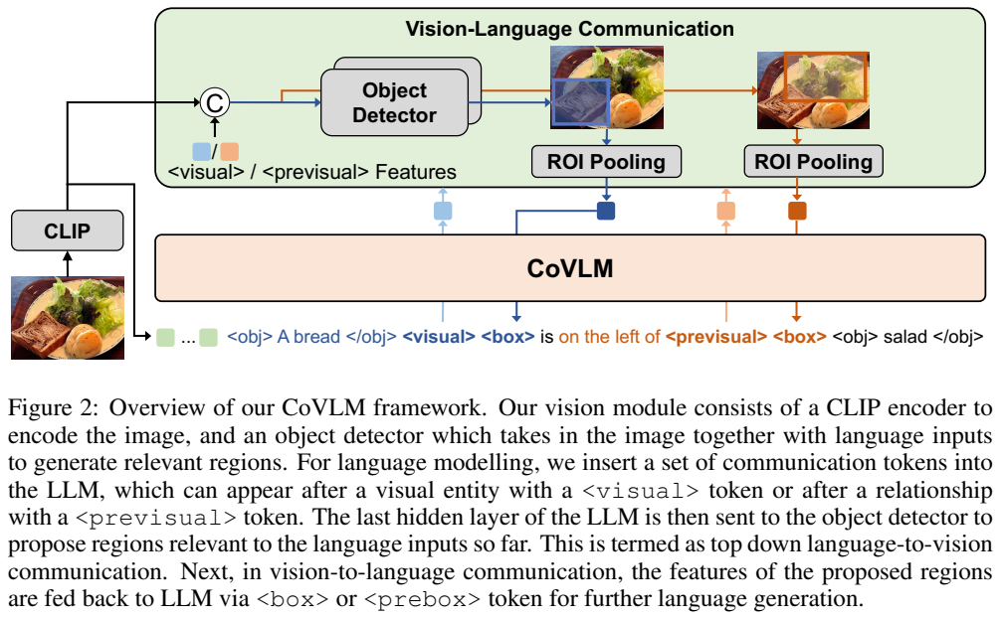
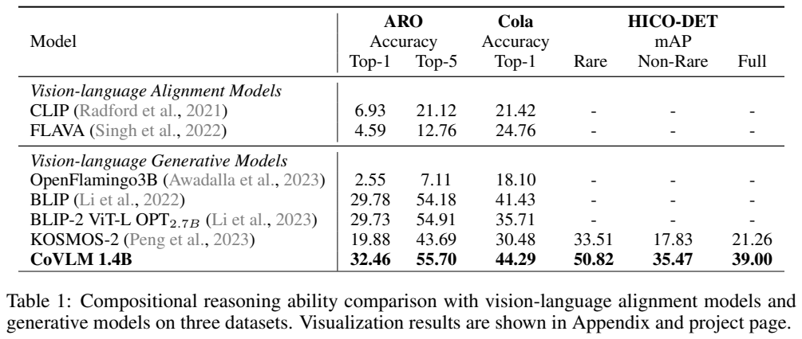
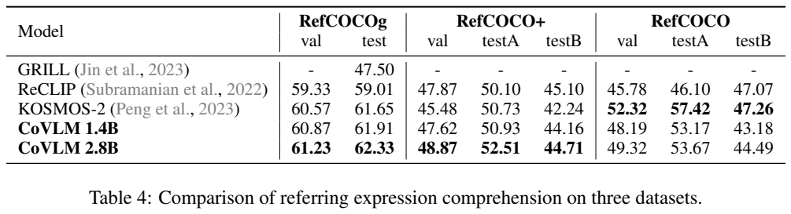
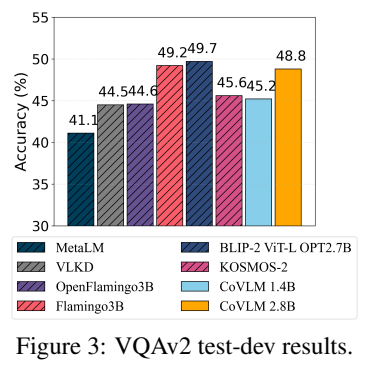
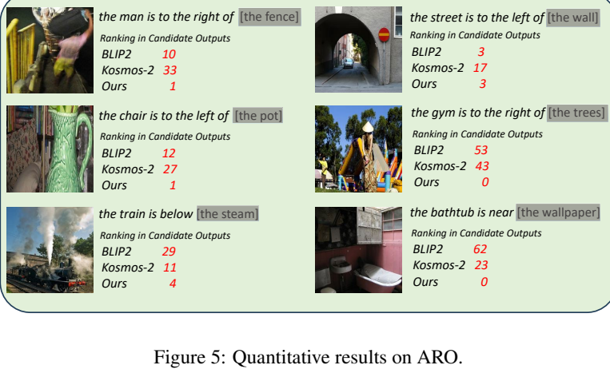
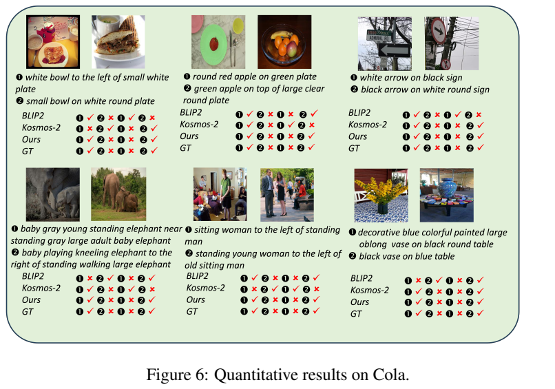
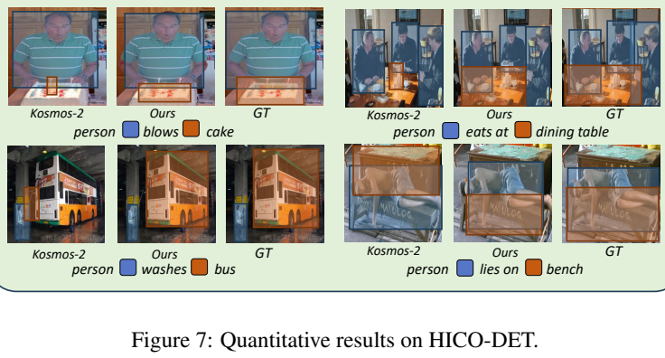

<!-- article-header:start -->
[项目首页](../../../README.md) › [模型系列](../../../reports/model-family-index.md) › [CoVLM](../README.md)
<!-- article-header:end -->

# CoVLM：通过通信解码组合视觉实体与关系

<!-- article-toc:start -->

**本篇目录** · [论文定位](#paper-info) · [快速概览](#overview) · [整体架构](#architecture) · [核心原理](#principles) · [数据构建](#data) · [训练流程](#training) · [实验结果](#experiments)
<!-- article-toc:end -->

## 1. 论文信息与模型定位

原论文为 **CoVLM: Composing Visual Entities and Relationships in Large Language Models Via Communicative Decoding**，作者 Junyan Li、Delin Chen、Yining Hong、Zhenfang Chen、Peihao Chen、Yikang Shen、Chuang Gan，来自 UMass Amherst、Wuhan University、UCLA、MIT-IBM Watson AI Lab 等机构。本文依据 [arXiv 2311.03354v1](https://arxiv.org/pdf/2311.03354v1)，提交日期为 2023 年 11 月 6 日；[项目页面](https://vis-www.cs.umass.edu/CoVLM)列于原文首页。

CoVLM 面向实体与关系的组合理解：不只判断图中有“人”和“马”，还要判断人究竟坐在马身上，还是坐在旁边的双轮马车上。其 1.4B、2.8B 命名对应 Pythia 语言底座规模，模型还包含视觉编码器和检测模块，不能视为完整系统的精确总参数量。论文评估以零样本关系推理、指代表达定位与视觉问答为主，并没有将它定位为涵盖视频、音频和任意图像生成的全模态系统。

## 2. 快速概览

一般的图文模型先接收整幅图像表示，随后连续生成文字。CoVLM 在生成中插入通信 token，让语言状态可以再次驱动检测器寻找相关区域，并把区域特征回传到后续生成。关键是“关系后、对象名称前”的视觉查询：写到“面包在……左边”时，系统先检查候选区域，再决定后面的对象。

系统由 CLIP ViT-L/14、线性视觉映射、Pythia 和类似 YOLOX 的语言条件检测器组成。预训练使用超过 97M 条自动定位的图文对，以及 The Pile 纯文本，联合优化语言建模和检测任务。没有额外的任务指令微调仍可迁移到论文测试的定位与关系任务，但各评测还使用了特定提示和候选评分步骤。

1.4B 模型的 ARO Top-1 为 32.46、Cola 为 44.29、HICO-DET Full mAP 为 39.00。它在论文列出的关系组合比较中表现突出；另一方面，RefCOCO 的若干分割低于 KOSMOS-2，2.8B 的 VQAv2 自动分数 48.8 也低于 BLIP-2 的 49.7。因此，其证据支持关系组合能力改善，而非所有视觉任务全面领先。

## 3. 整体架构

*Figure 2，PDF 第 4 页；裁图保留了架构图及模块说明。蓝色和橙色箭头对应不同解码时刻的视觉查询。*

CLIP 首先提取全图 patch 特征，经线性层映射到 Pythia 的语言嵌入空间，置于文字序列前。与一次性图像前缀不同，通信模块还接收语言模型当前最后一层的隐藏状态，将其广播到视觉网格上，与各位置特征拼接。检测器据此预测边界框及置信度，经过非极大值抑制保留候选区域。

每个区域的表示来自该区域覆盖的视觉 patch 特征的平均池化，再输入语言模型。论文使用的 ROI 特征提取并非将每个框重新裁图、重新跑完整 CLIP；它是在已有特征上聚合，因此也受原视觉网格分辨率限制。

通信词表的角色如下。

| token | 作用 |
|---|---|
| `<obj>`、`</obj>` | 标记实体表达的起止 |
| `<visual>` | 实体生成后，切换至视觉检测该实体 |
| `<box>` | 将上述区域特征送回语言模型 |
| `<previsual>` | 关系生成后、下一个实体生成前，查询相关候选区域 |
| `<prebox>` | 将候选对象区域特征回传，辅助生成对象描述 |

Figure 2 展示“面包在沙拉左边”。先定位面包，随后读到“在左边”这一关系时，模型用已有语言与区域上下文驱动第二次检测，再生成“沙拉”。图中的示意序列对回传标记有所简化；完整 token 定义以正文 §3.2 为准。检测和语言两条分支可以按解码需要反复交互。

## 4. 核心创新与数学原理

主要创新是把局部视觉查询嵌入语言解码，而不是仅在回答结束后附加坐标。实体标记建立文字与区域的对应；前置查询允许尚未输出的对象由视觉证据约束。它特别适合相同对象在图中出现多次，或者仅看实体名称容易被常见搭配误导的情形。

用解释性记号表示检测器输入：设全图特征 $`F\in\mathbb R^{N\times N\times D}`$、当前语言状态 $`h_t\in\mathbb R^D`$，则将 $`h_t`$ 广播到所有网格位置并构造 $`U_t=[F;\mathrm{Broadcast}(h_t)]`$，其最后一维为 $`2D`$。检测器产生候选框与分数，区域 $`b`$ 的回传特征为 $`r_b=\vert P(b)\vert ^{-1}\sum_{p\in P(b)}F_p`$。这些公式重述正文操作，属于本介绍的说明性表达；原文没有以它们定义新的注意力定理。

候选排序依赖条件语言概率。指代表达定位中，先保留最高置信框，以及置信度超过最高值一半的其他框；随后把每个框的特征置入 `<prebox>`，计算表达的困惑度，选择最低者。相应的通用困惑度可写成 $`\exp[-T^{-1}\sum_t\log p(y_t\mid I,r_b,y_{\lt t})]`$。这个二次评分步骤意味着最终预测并不总是检测器最高分框。

HICO-DET 还比较“人正在做某动作”与“人没有做某动作”两种短语的困惑度：若肯定短语更低，就判定动作存在，再定位主体与对象。它不是一个单独经过 HICO 标签监督的动作分类头，也不是无需提示设计的开放式自动动作发现。

训练总目标在附录给出：语言建模损失加上权重 **0.025** 的检测损失。论文未展开检测损失各子项和完整系数，不能补写具体的 GIoU/分类损失配方。正文也没有通信 token 单独移除的定量消融；作者对通信机制的解释主要由总体比较与案例支持。

## 5. 数据构建与处理

预训练图文数据来源包括 COCO、CC3M、CC12M、Visual Genome、SBU 与 LAION400M 子集，合计超过 97M 对。自动定位管线先使用 GroundingDINO 将图片区域和标题词语关联：框最高相似度阈值为 0.35，对应词阈值为 0.25，再对同一词的重叠框进行 NMS。

单个名词常不足以表达对象，例如检测器可能只关联“人”，遗漏“头上戴帽子的”修饰。系统使用 spaCy 依存分析，按语言规则递归扩展匹配词，把符合条件的修饰成分纳入表达。这个处理增加了表达复杂性，但定位和依存分析都是自动标注，论文没有提供全部数据的人工正确率。

最后把表达转成通信序列。若一个表达对应单个框，可用“实体表达→后置视觉查询”，或“前置视觉查询→实体表达”两种形式；句中第一个表达采用后置形式，其余随机选择。数据因而同时训练“说完再定位”与“先看再命名”。纯文本 The Pile 同时参与训练，保留语言建模信号。超过 97M 是构建数据池规模，不等于训练遍历的实际样本总数或 epoch 数。

## 6. 训练流程与目标

两种配置分别从 Pythia-1.4B、Pythia-2.8B 和 CLIP ViT-L/14 的公开检查点初始化。正文明确预训练对完整模型进行微调，不能把 CLIP 或语言底座写成冻结。新通信 token、视觉映射和检测器共同组成训练系统。

附录 A.1 报告训练 20K 步；定位图文数据批量 2,304，The Pile 数据批量也为 2,304。AdamW 学习率为 $`10^{-4}`$，动量参数 $`(0.9,0.999)`$；LLM 和 CLIP 不使用权重衰减，检测器权重衰减为 0.05。语言与检测损失的权重如上。论文未披露完整学习率调度、训练硬件数量、实际耗时及全部图像预处理参数。

预训练后直接进行任务迁移，无论文所述的目标任务指令微调。零样本在此指不针对评测任务再训练，但并非没有数据重合风险：COCO 等图像来源既出现在预训练材料中，也用于某些评测；论文没有列出逐图去重审计。评测时的专用提示、通信标记插入和困惑度排序也是系统的一部分。

## 7. 实验设置与主要结果

*Table 1，PDF 第 7 页。ARO 和 Cola 为准确率，HICO-DET 为 mAP，三组列不能混作同一种指标。*

ARO 使用 23,937 张测试图片，要求根据主体与关系预测对象；对齐模型在 890 个候选对象拼成的标题中排序。Cola 的多对象设置使用 420 张测试图片，要求两幅实体类似、关系不同的图像均与正确描述匹配，生成模型按标题困惑度排序。HICO-DET 使用 9,658 张测试图片、600 类人—物交互，既要求识别关系，也要求定位人物及交互对象。

| 模型 | ARO Top-1 | ARO Top-5 | Cola Top-1 | HICO Rare | HICO Non-Rare | HICO Full |
|---|---:|---:|---:|---:|---:|---:|
| BLIP | 29.78 | 54.18 | 41.43 | — | — | — |
| BLIP-2 ViT-L OPT2.7B | 29.73 | 54.91 | 35.71 | — | — | — |
| KOSMOS-2 | 19.88 | 43.69 | 30.48 | 33.51 | 17.83 | 21.26 |
| CoVLM 1.4B | 32.46 | 55.70 | 44.29 | 50.82 | 35.47 | 39.00 |

与 KOSMOS-2 相比，HICO Full 提高 17.74 个 mAP 分数点、Cola 提高 13.81 个准确率百分点；ARO 相对该表最强 BLIP 的 Top-1 提高 2.68 点。摘要的“约 20%/14%/3%”是粗略表述，不能读成统一的相对增长率。与任务专用监督模型相比，Table 3 中 CoVLM 的 Rare 为 50.82，高于所列监督方法，但 Full 39.00 低于监督 RLIPv2 的 45.09。

*Table 4 比较指代表达理解结果；Figure 3 报告 VQAv2 test-dev 自动准确率。两者均来自 PDF 第 9 页。*

CoVLM 2.8B 的 RefCOCOg val/test 为 61.23/62.33，RefCOCO+ val/testA/testB 为 48.87/52.51/44.71；其中 RefCOCO+ testB 仍低于 ReCLIP 的 45.10。RefCOCO val/testA/testB 为 49.32/53.67/44.49，均低于 KOSMOS-2 的 52.32/57.42/47.26。因此不能照正文笼统宣称全部 RefCOCO+ 分割最佳。

Figure 3 显示 VQAv2 自动分数：CoVLM 1.4B 为 45.2、2.8B 为 48.8，BLIP-2 为 49.7，Flamingo3B 为 49.2。作者另从 1,000 个随机样本进行人工评估，CoVLM 2.8B 为 57.11、BLIP-2 为 56.62；该小规模人工结果与自动全测试指标口径不同，也不能据此认定总体问答已经领先。

*PDF 第 15 页：Figure 5 展示 ARO 候选排名，Figure 6 展示 Cola 配对，Figure 7 展示 HICO-DET 主体和对象框。*

读底部躺在长椅上的例子，应检查橙色对象框是否落在承载人物的长椅，而非背景中的另一个长椅；这说明关系条件查询的预期作用。中部例子展示细粒度属性和位置改变后的配对。它们是选取的可视化，不等于全数据的错误类型统计。论文尚未充分处理对象—属性组合与空间事件组合，也未量化通信往返的推理时延。CoVLM 提供的是一个把局部视觉证据反馈到生成过程的架构方向，仍受到候选区域质量与语言评分可靠性的约束。

<!-- article-footer:start -->
---

[← 上一篇：SALMONN](../../salmonn/arxiv-2310.13289/README.md) · [按发表时间浏览](../../../reports/paper-reading-guide.md#year-2023) · [下一篇：GLaMM →](../../glamm/arxiv-2311.03356/README.md)

[返回本篇目录](#article-toc) · [返回模型系列](../README.md)
<!-- article-footer:end -->
