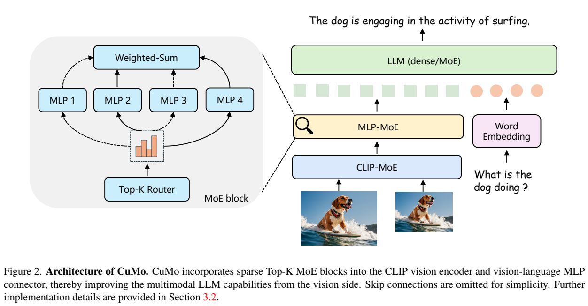
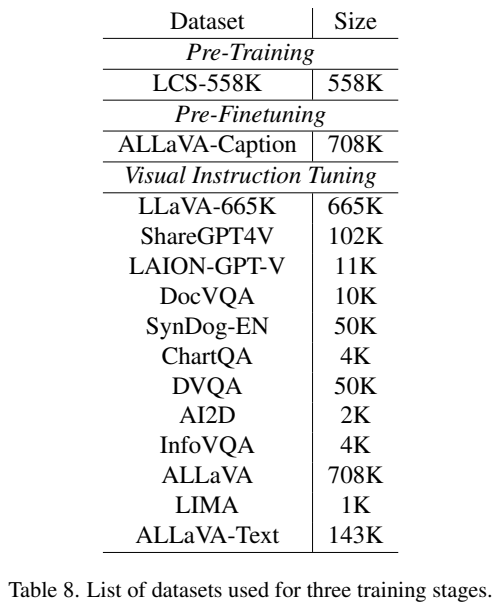
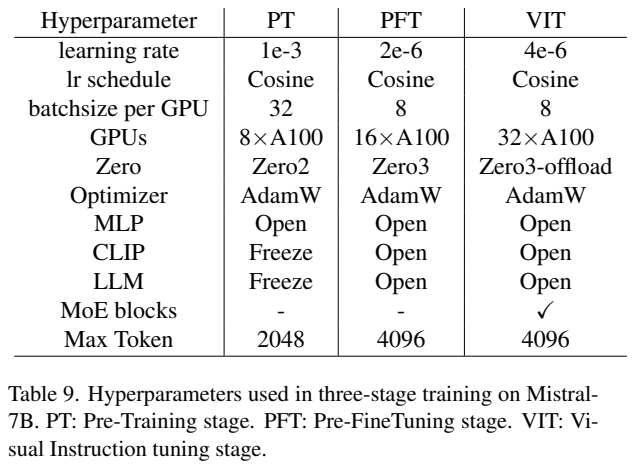
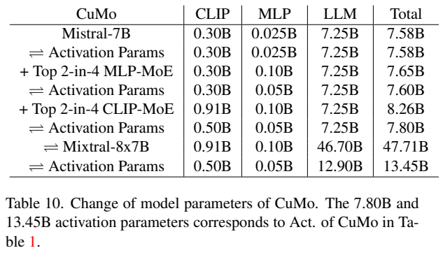
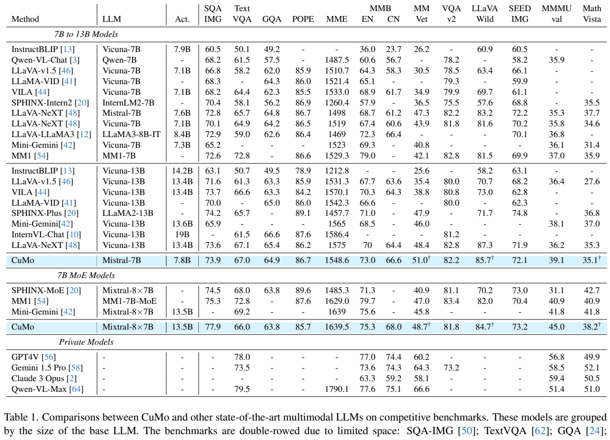

<!-- article-header:start -->
[项目首页](../../../README.md) › [模型系列](../../../reports/model-family-index.md) › [CuMo](../README.md)
<!-- article-header:end -->

# CuMo：从稠密检查点扩展视觉编码器和连接器专家

<!-- article-toc:start -->

**本篇目录** · [论文定位](#paper-info) · [快速概览](#overview) · [整体架构](#architecture) · [核心原理](#principles) · [数据构建](#data) · [训练流程](#training) · [实验结果](#experiments)
<!-- article-toc:end -->

## 1. 论文信息与模型定位

| 项目 | 信息 |
|---|---|
| 原题 | CuMo: Scaling Multimodal LLM with Co-Upcycled Mixture-of-Experts |
| 作者与机构 | Jiachen Li、Xinyao Wang、Sijie Zhu 等；SHI Labs（Georgia Tech、UIUC）、ByteDance |
| 来源版本 | [arXiv:2405.05949v1](https://arxiv.org/abs/2405.05949v1)，2024-05-09，14 页 |
| 官方项目 | [SHI-Labs/CuMo](https://github.com/SHI-Labs/CuMo) |
| 定位 | 在视觉编码器和视觉语言连接器加入稀疏 MoE 的图文理解模型；骨干为 Mistral-7B 或 Mixtral-8×7B |

CuMo 将扩容重点放到视觉侧。它先训练普通稠密模块，再把对应 MLP 权重复制到多个专家中，让路由器逐 token 选出少数专家计算。最终模型没有将 Mistral 临时扩造成语言 MoE：语言骨干可保持稠密，也可直接使用已经大规模预训练的 Mixtral。这一区别决定了“协同 upcycling”实际发生在哪些模块。

## 2. 快速概览

方法包含三步：先对齐连接器；再用高质量图像描述预热整套稠密模型；最后同时扩展 CLIP 的前馈层和连接器为 Top-2-in-4 MoE，进行指令微调。复制专家比从零初始化稳定，负载平衡与 router z-loss 辅助路由训练。

Mistral 版本总参数约 8.26B、每 token 激活约 7.80B；Mixtral 版本总参数约 47.71B、激活约 13.45B。激活参数少于总参数有助于限制运算量，但模型权重、路由、通信和批处理仍有成本，不能把“7B 类别”解释为只有 7B 权重或与普通 7B 模型同样内存。

## 3. 整体架构

*原文 Figure 2，PDF 第 2 页原文图表裁图。视觉经过 CLIP-MoE 和 MLP-MoE，随后与文字嵌入进入语言模型。左侧示意每个 token 只调用部分专家，图为简化展示而省略残差。*

基础模块是预训练 CLIP ViT-L、两层 MLP 连接器和 Mistral-7B。CuMo 保留 CLIP 的注意力与残差，在各 transformer block 中将原 MLP 替换为带路由的专家集合；连接器则由一个两层 MLP 扩展成多个两层 MLP 专家。输出通道和原模块一致，因而无需改变后续语言模型的输入接口。

最终模型另使用 S2 风格多分辨率视觉特征，选择 1× 与 3× 的组合，并在通道维拼接特征以保持 token 数与低分辨率输入一致。保持 token 数不等于减少视觉编码器调用次数；多尺度本身需要额外视觉计算。报告没有在这份固定版本中完整列出其切块、重采样与输入像素配置，不能仅凭倍率补写具体分辨率。

## 4. 核心创新与数学原理

对输入 $X\in\mathbb R^{N\times C_{in}}$，原文式 (2) 的路由器先计算：

$$
W=\operatorname{softmax}(\operatorname{Linear}(X))\in\mathbb R^{N\times S}.
$$

每个 token 选 $S$ 个专家中的 $K$ 个，输出为原文式 (4) 所述的加权和：

$$
y_n=\sum_{s\in\mathcal S_n}w_{n,s}\operatorname{MLP}_s(x_n),
\qquad |\mathcal S_n|=K.
$$

这里按 token 重写原式记号，便于区分不同 token 的专家集合。固定采用 $S=4,K=2$，每次运行两套 MLP；CLIP 自注意力并未被改成稀疏注意力。扩大专家数也不会缩短视觉序列。

权重细节需谨慎：原文式 (3) 写成 $W_K=\operatorname{softmax}(\operatorname{TopK}(W))$，即对已经 softmax 的选中值再次 softmax。这与通常直接归一化选中概率并不等价。本文保留其路由与加权机制描述，不在未核验代码的情况下将式 (3) 静默改写成标准概率重归一化实现。

Co-upcycling 将训练好的稠密 MLP 复制为多个专家，路由器从头学习。假设初始化时专家完全相同、路由权重和为 1，则加权输出仍等于原 MLP 输出，这是本文对稳定起点的解释；后续不同 token、路由和梯度使专家逐渐分化。复制权重本身不会立即增加知识或证明专家具有语义分工。

原文式 (5) 的目标为：

$$
\mathcal L=\mathcal L_{ce}+0.1\mathcal L_b+0.01\mathcal L_z.
$$

$\mathcal L_{ce}$ 是下一 token 的语言交叉熵；负载平衡项避免少量专家吸收几乎所有输入，router z-loss 约束路由器数值尺度、帮助稳定训练。报告引用 ST-MoE，但未在本文展开两项辅助损失的全部定义，因此这里不伪造它们的原文公式。稠密 Mistral 没有语言 MoE 路由器；语言侧辅助损失适用于带路由器的 Mixtral 版本。

## 5. 数据构建与处理

预训练仅使用 LCS-558K。稠密预热阶段使用 ALLaVA-Caption 708K。指令阶段汇合 LLaVA-665K、ShareGPT4V、LAION-GPT-V、DocVQA、SynDog-EN、ChartQA、DVQA、AI2D、InfoVQA、ALLaVA、LIMA 与 ALLaVA-Text，统一改成视觉指令格式。OCR、图表、文档与通用对话共同训练，LIMA 等文本资料用于保留指令交互能力。

*PDF 第 13 页的原始数据、优化与参数表。Table 8 列出各来源数量，Table 9 展示模块开放状态，Table 10 区分总参数与激活参数，图表区域裁切保留各表标题和单位。*

原文的指令样本总数存在差异：正文称约 1.65M；Table 8 逐项相加为约 1.85M，包括 143K ALLaVA-Text 和 50K DVQA。报告未解释差额是否来自去重或实际采样，本文不将其中一个数当作精确、无争议的训练记录。SynDog-EN 和 DVQA 各抽取 50K，作者称使用过多合成样本可能损害零样本表现。这里“训练数据公开”描述的是此轮多模态适配所用来源，不代表 CLIP、Mistral、Mixtral 的原始预训练语料全部公开。

## 6. 训练流程与目标

| 阶段 | 模块与结构 | 附录 Table 9 配置 |
|---|---|---|
| PT：对齐 | 只训练稠密连接器；CLIP、LLM 冻结 | LR $10^{-3}$，8×A100，每 GPU batch 32，max token 2048 |
| PFT：预热 | CLIP、连接器、LLM 均更新，尚未扩成 MoE | LR $2\times10^{-6}$，16×A100，每 GPU batch 8，max token 4096 |
| VIT：指令 | 对视觉侧复制专家并加入路由器，全部模块更新 | LR $4\times10^{-6}$，32×A100，每 GPU batch 8，max token 4096 |

使用 AdamW 与余弦学习率；分布式配置依次为 ZeRO-2、ZeRO-3、ZeRO-3-offload。正文 §4.1 却称最终模型全参数学习率降为 $2\times10^{-6}$，与附录最终 $4\times10^{-6}$ 不一致。上表采用明确标注主结果的附录配置，同时保留差异；报告没有足够信息解释是哪一次训练改变了该值。

消融主要用 558K/665K 的较小配方，部分采用 batch 128、$2\times10^{-5}$ 或 $2\times10^{-6}$ 学习率。它们不能与最终三阶段、扩大数据、多尺度模型的分数直接归因对比。这里的预热是正式梯度训练，不是优化器 warmup 的同义词；原文没有给出主模型总训练步数、精确 epoch、warmup 比例或完整训练 FLOPs，不宜补写。

## 7. 实验设置与主要结果

*原文主结果 Table 1，PDF 第 5 页。Act. 列为激活参数；以语言骨干规模分组，不是所有模型具有相同总参数和训练量。带 † 项是三次 GPT API 相关评估的平均值。*

| 指标 | CuMo Mistral | CuMo Mixtral | LLaVA-NeXT Mistral |
|---|---:|---:|---:|
| SQA-IMG | 73.9 | 77.9 | 72.8 |
| TextVQA | 67.0 | 66.0 | 65.7 |
| MMBench EN | 73.0 | 75.3 | 68.7 |
| MM-Vet | 51.0 | 48.7 | 47.3 |
| MMMU val | 39.1 | 45.0 | 35.3 |
| MathVista | 35.1 | 38.2 | 37.7 |
| SEED-IMG | 72.1 | 73.2 | 72.2 |

采用 greedy decoding，遵循 LLaVA 系列评估设置；LLaVA-Wild 使用 gpt-4-0613，MathVista 的答案处理使用 gpt-3.5-turbo。数值支持在多项指令任务上的提升，但并非全面胜出：Mistral 版 MathVista 和 SEED-IMG 低于表中相同语言骨干的 LLaVA-NeXT；Mixtral 版 TextVQA、MM-Vet 反而低于自己的 Mistral 版。不能把更大模型理解为每项能力单调增长。

机制消融显示，连接器 Top-2-in-4 从零训练时 SQA 从 72.8 降到 68.1，复制初始化后为 73.7；MM-Vet 从 29.3 到 32.3，加辅助损失到 33.1。单独解冻 CLIP 和增加视觉 MoE 都有贡献，不能把所有收益归为专家数量。把 Mistral 扩成 8×7B 的消融 MM-Vet 为 35.7，改用预训练 Mixtral 为 40.0，支持语言专家初始化的重要性。

Figure 5 在 MME 测试输入上展示各层的专家使用比例较均匀，说明没有明显单专家垄断，却不足以证明专家已形成明确语义类别。原文定性例子仍出现把人物位置说错的幻觉。论文没有完整报告吞吐、延迟与通信消融；“少量激活参数增加”有参数表支持，实际部署效率仍需实测。本文核验了原文与图片，未运行模型。

<!-- article-footer:start -->
---

[← 上一篇：InternVL 1.5](../../internvl/arxiv-2404.16821/README.md) · [按发表时间浏览](../../../reports/paper-reading-guide.md#year-2024) · [下一篇：GPT-4o →](../../gpt/document-9ee9863086d5/README.md)

[返回本篇目录](#article-toc) · [返回模型系列](../README.md)
<!-- article-footer:end -->
