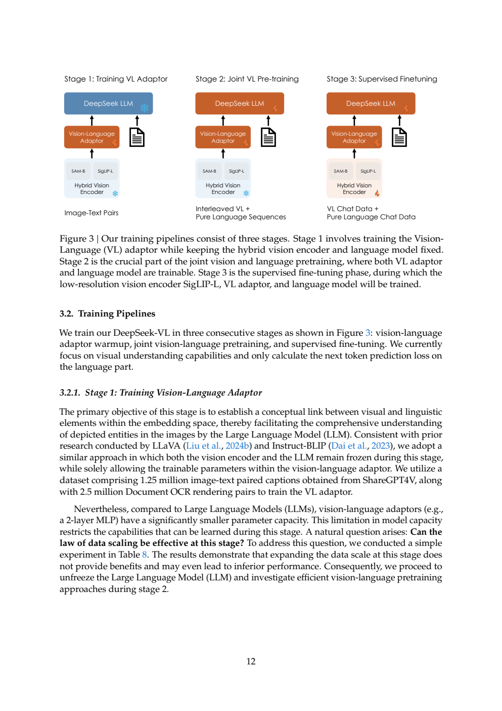
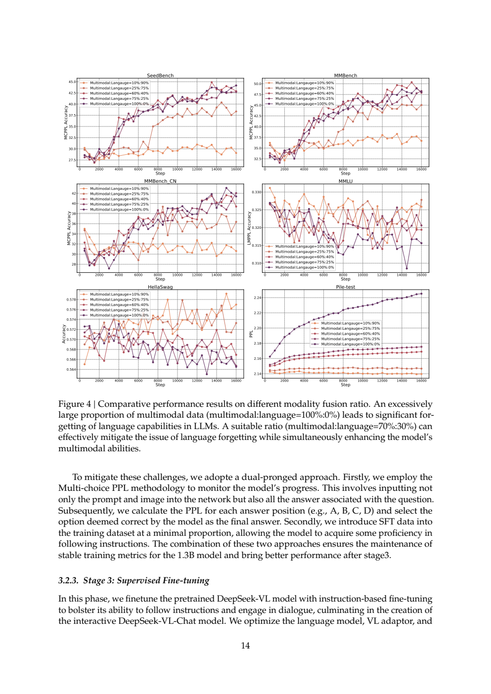
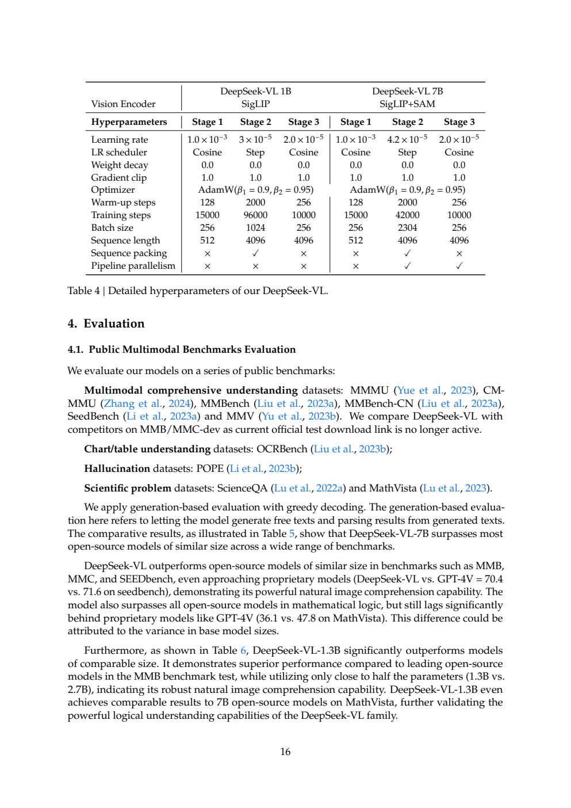
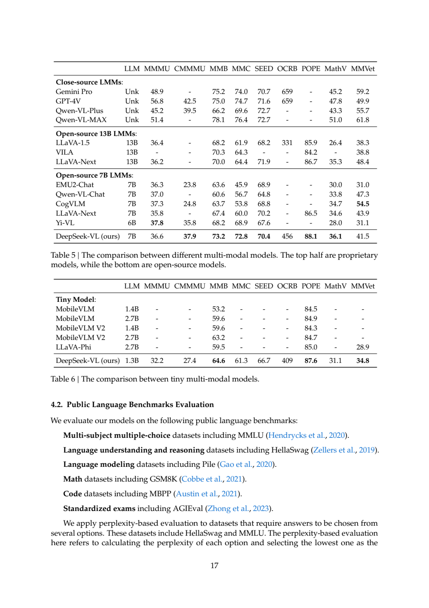

# DeepSeek-VL：双视觉编码器与保留语言能力的联合预训练

## 1. 论文信息与模型定位

**论文**：*DeepSeek-VL: Towards Real-World Vision-Language Understanding*，Haoyu Lu、Wen Liu、Bo Zhang 等，DeepSeek-AI，2024 年 3 月。本文依据 [arXiv:2403.05525v1](https://arxiv.org/abs/2403.05525v1)；[官方仓库](https://github.com/deepseek-ai/DeepSeek-VL)。

DeepSeek-VL 面向图像与文字理解，提供 1.3B 和约 7B 语言骨干版本。它围绕三个问题设计：真实文档与网页的数据覆盖、固定视觉 token 预算下的高分辨率细节，以及多模态训练后语言能力的保留。本文的双编码器配置用于 7B；Table 4 明确小模型只使用 SigLIP，不能把所有家族成员都写成 SigLIP+SAM。

模型可以输出文字、代码和结构化内容，但本文没有图像生成解码器，也没有把视频、音频或机器人控制作为已验证的统一输入输出。报告中的“具身”例子是依据图片给出文字方案。（PDF 第 1、4、10、16 页）

## 2. 快速概览

| 项目 | 7B 方案 |
|---|---|
| 语义分支 | SigLIP-L，384 × 384 |
| 细节分支 | SAM-B 图像编码器，1024 × 1024 |
| 视觉序列 | 两分支在通道维融合，576 个视觉 token |
| 语言骨干 | DeepSeek-LLM，基于已完成约 2T 文本 token 训练的检查点继续训练 |
| 联合预训练比例 | 最终约 70% 纯语言、30% 多模态，并使用模态 warmup |
| 训练阶段 | 连接器对齐 → 联合预训练 → 指令微调 |
| 代表成绩 | MMBench-dev 73.2、中文 dev 72.8、OCRBench 456、MathVista 36.1 |

报告中 1B/1.3B、7B/6.7B 是不同精度的家族称谓，不能把它们当成四个独立模型。语言骨干规模也不等于包含视觉模块后的总参数量。（PDF 第 11、16–17、22 页）

## 3. 整体架构

*这张训练流程图也展示了基本架构：SAM-B 与 SigLIP-L 并行编码，再经 VL Adaptor 进入 LLM。蓝色表示冻结，橙色表示更新；第三阶段的视觉模块更新主要针对 SigLIP-L，SAM-B 仍冻结。*

SigLIP-L 提供与文本对齐的语义特征，输出 24 × 24 × 1,024。SAM-B 处理更高分辨率，先输出 64 × 64 × 256，再插值为 96 × 96 × 256，经过两个 stride=2 的卷积变成 24 × 24 × 1,024。两分支都对应 576 个空间位置，在特征维拼接为每位置 2,048 维。（PDF 第 10 页）

连接器的混合 MLP 先用独立的一层映射调整两个分支的特征分布，再拼接，经后续 MLP 映射至语言输入空间。原文部分段落重复描述 SAM 特征处理，但并不是串联两个 SAM 编码器。融合沿通道进行，因此不会把视觉序列变成 1,152 个 token。

语言模型沿用 DeepSeek-LLM 的 RMSNorm、SwiGLU 和 RoPE。选择已有语言预训练检查点继续联合训练，避免从零学习所有文字知识。小模型语言初始化约训练过 500B 文本 token，7B 初始化约 2T；这些是基座训练经历，不是本次新增 VL 预训练数据量。（PDF 第 10–11 页）

## 4. 核心创新与数学原理

双视觉路径试图结合“知道物体是什么”的语义特征与“看清具体位置和文字”的细节特征。固定 576 个 token 限制语言模型侧的序列成本，但高分辨率分支仍有自身的编码计算，不能据此声称 1024 图像与低分辨率图像总成本完全相同。

为直观说明融合，可写为 $z_i=\mathrm{MLP}_{\mathrm{joint}}([\mathrm{MLP}_s(s_i);\mathrm{MLP}_h(h_i)])$，其中 $s_i,h_i$ 是对齐网格位置上的两分支特征。这是对原文架构的解释记号，论文没有提出这个独立数学损失。Table 10 显示混合 MLP 的平均分 55.9，高于共享 MLP 55.2、完全独立 MLP 54.5，但并非每列最优；例如共享 MLP 的 OCRBench 更高。（PDF 第 21–22 页）

另一项创新是把**保留语言能力当作多模态训练的显式约束**。若只用多模态数据，图文基准提高时，语言模型对原始文本分布的建模会恶化。最终方案不仅混入语言数据，还先用纯语言训练，再逐渐下降语言比例至目标值。原文没有给出 warmup 比例随步骤变化的精确函数，因此不补成线性公式。（PDF 第 13、20 页）

*上部是视觉选择任务，下部是语言任务。Pile-test 的 PPL 越低越好；观察 100% 多模态曲线，可以看到视觉提升与语言退化同时发生。图注把最终比例写成 multimodal:language=70%:30%，与正文及 Table 1 相反；本文依据后两处采用 language:multimodal=70%:30%。*

作者还把全局训练步骤按模态分组，避免同一个 batch 中快速文本样本等待慢速图像样本，报告效率改善约 20%。它改变数据调度，不是减少语言损失权重。针对小模型不稳定的选择题输出，采用候选答案困惑度而非只检查生成字母，并混入少量 SFT 数据，以减少格式遵循对模型选型的干扰。（PDF 第 14、20 页）

## 5. 数据构建与处理

预训练覆盖交错图文、图像描述、图表、网页代码和 OCR。Table 1 的比例为交错图文 15.2%、描述 11.1%、表格图表 2.1%、Web Code 0.4%、场景与文档 OCR 类 1.2%，另有 70% 纯文本。比例是训练混合口径，不能解释为各资源原始文件数的比例。（PDF 第 6–7 页）

网页与绘图代码数据用于从视觉反推结构。作者处理约 1.46M Jupyter notebook，收集图与其之前的代码，得到约 2M 配对，再筛选单图、至少五行代码的约 1.1M 样本。OCR 侧收集约 1.4M arXiv 文章源码与 PDF，用 Nougat 相关预处理形成图像文本对；清理 860K 英文与 180K 中文电子书，并把教育材料用不同 HTML 模板渲染成图片。公开场景文字资源补充自然环境中的文字识别。（PDF 第 6–8 页）

SFT 使用任务分类体系而不仅是学术问答混合。类别覆盖识别、转换、分析、常识/逻辑推理、评价、多图与安全，依据真实使用案例选择指令。Table 2 列自建数据 10.5%、通用多模态 35.5%、图表 4.1%、网页代码 2.0%、纯文本 SFT 47.9%。分类体系能指导覆盖范围，不能单凭某类存在就证明该类任务已可靠解决。本文版本没有给出全部 SFT 的精确样本总数。（PDF 第 8–9 页）

## 6. 训练流程与目标

第一阶段只训练连接器，视觉编码器和 LLM 冻结；使用 ShareGPT4V 的 1.25M 图文配对与 2.5M 文档 OCR 配对。第二阶段冻结视觉编码器，更新连接器及语言模型，联合学习纯文本与图文。第三阶段更新语言模型、连接器和 SigLIP-L，SAM-B 因显存限制继续冻结；只监督回答及特殊 token，屏蔽系统和用户提示。（PDF 第 12–15 页）

*训练表左右分别是小模型与 7B。需要逐列对照 learning rate、steps、batch 和 sequence length；小模型联合预训练步数更长，并不意味着它比 7B 使用更多计算。*

| 7B 配置 | 连接器 | 联合预训练 | SFT |
|---|---:|---:|---:|
| 学习率 | 1e-3 | 4.2e-5 | 2e-5 |
| 调度 | Cosine | Step | Cosine |
| warmup 步数 | 128 | 2,000 | 256 |
| 总步数 | 15,000 | 42,000 | 10,000 |
| batch size | 256 | 2,304 | 256 |
| 表列 sequence length | 512 | 4,096 | 4,096 |

小模型联合阶段学习率 3e-5、96,000 步、batch 1,024；两规模其他阶段表列配置相同。采用 AdamW，$\beta_1=0.9,\beta_2=0.95$，权重衰减 0、梯度裁剪 1.0。联合阶段使用 sequence packing；7B 联合阶段与 SFT 使用流水线并行。第一阶段表列 512 与视觉序列 576 的总输入计数关系未明确说明，本文不将其解释为“包含视觉 token 的统一总长度”。（PDF 第 16 页）

训练只在语言部分计算 next-token prediction；可理解为最大化给定视觉与文字上下文后的目标文字概率，没有生成图像 token 的联合目标。基础设施使用 HAI-LLM 与三维并行。原文称 7B 在 64 个 A100 处理单元、每单元八张卡上耗时五天，不能简写成 64 张 A100；小模型称 16 个处理单元七天。报告没有进一步分列各阶段设备小时。（PDF 第 12、15 页）

## 7. 实验设置与主要结果

*MMB/MMC 使用 dev 切分，因为当时官方 test 下载不可用；OCRBench 是原始分数，不能与百分比列直接平均。上表 LLM 列表示语言骨干规模，部分对手含额外大型视觉组件。*

7B 的 MMMU/CMMMU 为 36.6/37.9，MMBench/中文 dev 为 73.2/72.8，SEED 70.4，OCRBench 456，POPE 88.1，MathVista 36.1，MMVet 41.5。它在多项同量级比较中领先，但 MMMU 低于 Yi-VL 的 37.8、MMVet 低于 CogVLM 的 54.5；MathVista 与 GPT-4V 的 47.8 仍有差距。小模型为 MMMU 32.2、MMBench 64.6、OCRBench 409、MathVista 31.1。（PDF 第 16–17 页）

语言评测采用任务相应口径：MMLU/HellaSwag 用困惑度选择，GSM8K/AGIEval 用生成解析。7B Chat 的 HellaSwag 68.4 与 DeepSeek-LLM Chat 68.5 接近，MMLU 从 49.4 到 52.4、AGIEval 从 19.3 到 27.8；GSM8K 却从 63.0 到 55.0。因此“保留语言能力”应理解为减轻整体退化，不能写成所有语言任务无损。（PDF 第 17–18 页）

100 个自建问题的人工评测覆盖七类任务，报告整体表现优于所比较开源模型，但逻辑推理仍显著落后 GPT-4V。样本规模与自建任务范围限制其泛化结论。训练消融 Table 9 的平均分从缺少联合预训练的 57.4 到完整三阶段 62.4，支持联合阶段的价值；扩大单纯连接器训练则没有稳定收益。本文按原报告核验，未复训或执行模型评测。
