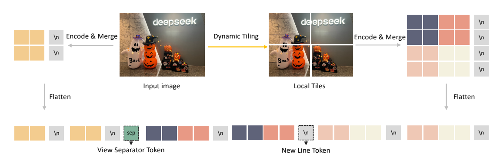
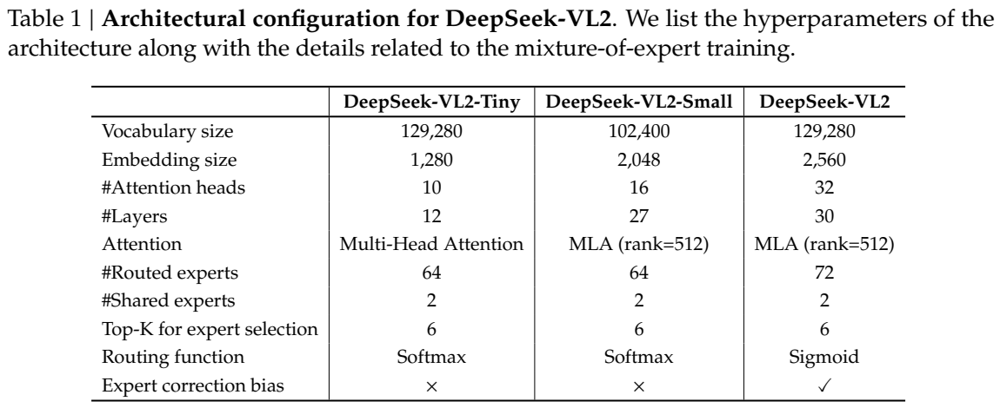
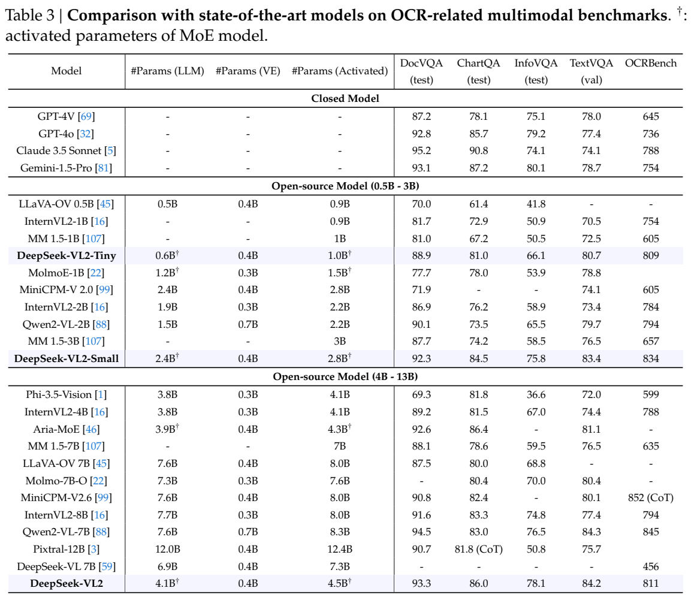
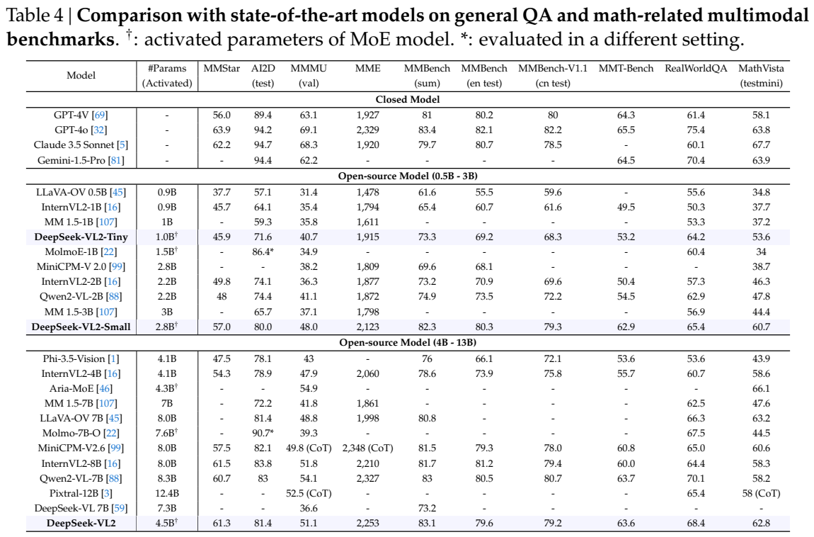
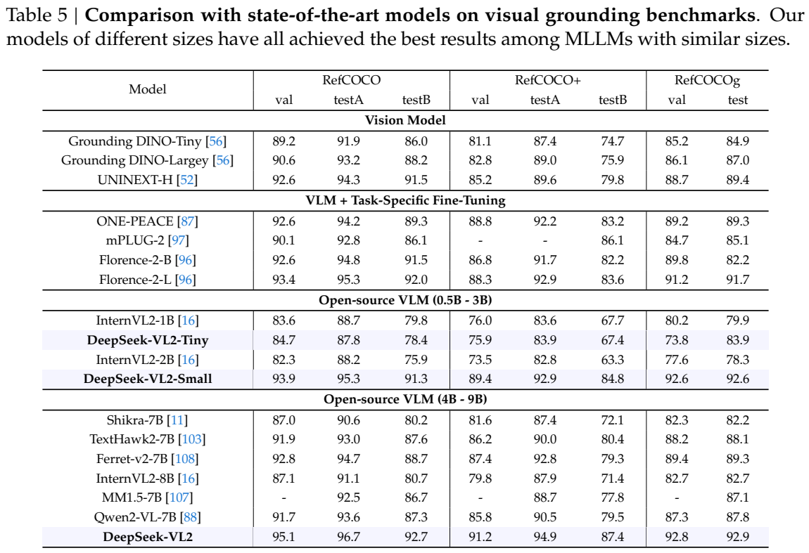

<!-- article-header:start -->
[项目首页](../../../README.md) › [模型系列](../../../reports/model-family-index.md) › [DeepSeek](../README.md)
<!-- article-header:end -->

# DeepSeek-VL2：结合动态切图与稀疏专家的视觉语言模型

<!-- article-toc:start -->
<a id="article-toc"></a>

**本篇目录** · [论文定位](#paper-info) · [快速概览](#overview) · [整体架构](#architecture) · [核心原理](#principles) · [数据构建](#data) · [训练流程](#training) · [实验结果](#experiments)
<!-- article-toc:end -->

<a id="paper-info"></a>

## 1. 论文信息与模型定位

技术报告 **DeepSeek-VL2: Mixture-of-Experts Vision-Language Models for Advanced Multimodal Understanding** 由 DeepSeek-AI 发布，核心作者包括 Zhiyu Wu、Xiaokang Chen、Zizheng Pan、Xingchao Liu、Wen Liu，项目负责人为 Wen Liu。本文采用 [arXiv 2412.10302v1](https://arxiv.org/pdf/2412.10302v1)，提交于 2024 年 12 月 13 日；[代码与模型仓库](https://github.com/deepseek-ai/DeepSeek-VL2)为报告指定的公开入口。

该系列以图像理解和文字生成作为主要接口，覆盖一般问答、OCR、文档/表格/图表、视觉定位及多图对话。相对 DeepSeek-VL，变化集中于可变高分辨率视觉处理、MoE 语言底座及数据管线。报告没有给出视频或音频模型的训练、评测，图像到代码的能力也不等于直接生成图像。

| 配置 | 语言底座总参数 | 语言底座激活参数 | 系统激活参数约数 | 语言注意力 |
|---|---:|---:|---:|---|
| VL2-Tiny | 3B | 0.57B | 1.0B | 普通多头注意力 |
| VL2-Small | 16B | 2.4B | 2.8B | MLA，潜在秩 512 |
| VL2 | 27B | 4.1B | 4.5B | MLA，潜在秩 512 |

系统激活参数还包含约 0.4B 的视觉编码部分，与语言底座总参数不可互换。报告结论将 3B/16B/27B 称为总规模，这与训练表中的 LLM 参数口径相近；做显存规划时仍需考虑视觉模块、连接器、缓存与实现开销。

<a id="overview"></a>

## 2. 快速概览

视觉端使用单一 SigLIP-SO400M-384 编码器，把高分辨率图片按宽高比分成至多 9 个局部 tile，再加入一个全图缩略 tile。这样保留细节的同时避免把完整超大图片放入一次全局注意力。连接器将每块视觉网格由 729 个表示压缩为 196 个，加入行分隔与全局/局部分隔标记后投影到语言空间。

语言端每次选择 6 个路由专家，并使用 2 个共享专家；稀疏计算降低每 token 激活的参数，但全部专家权重仍需要存放。Small 和 VL2 的 MLA 将 KV 信息压缩成潜在表示；Tiny 并不采用 MLA，标准 VL2 才采用 Sigmoid 路由与专家修正偏置。

训练分对齐、约 800B token 的视觉语言预训练和监督微调。对齐时冻结语言模型，同时更新视觉编码器和连接器；后两阶段更新全部模块。标准 VL2 的 DocVQA 93.3、ChartQA 86.0、MathVista 62.8，以及较强的指代表达定位，是报告的主要量化证据。它相对前代明显提高，但 OCRBench 标准版 811 低于 Small 的 834，部分复杂推理指标也低于更大的同期模型。

<a id="architecture"></a>

## 3. 整体架构

总体仍是 LLaVA 风格的视觉编码器—连接器—解码式语言模型。前代使用 SigLIP 与 SAM-B 的两种固定分辨率表示，VL2 改为一个 SigLIP 编码器共享处理全图及局部块。输入图片先等比例调整，再填充到候选网格；模型选择填充面积最小的候选。





*Figure 3 展示视觉序列构造，Table 1 列出三种语言底座的配置；两者均来自 PDF 第 5 页。*

Figure 3 左边的缩略图产生全局概览，右边的各色 tile 表示局部细节。局部编码后按原二维位置重新组织，行末标记避免将所有块误解为无布局的独立图片；绿色分隔符则区分全局和局部视图。处理最终输出一条视觉序列，并由两层 MLP 映射到相应语言维度。

Table 1 需按列阅读。Tiny/Small/VL2 的隐藏宽度为 1,280/2,048/2,560，层数为 12/27/30，路由专家为 64/64/72，共享专家均为 2，Top-K 均为 6。Tiny 与 Small 使用 Softmax 路由；标准 VL2 使用 Sigmoid，并启用专家修正偏置。正文对 MLA 和偏置作了系列层面的概述，本文以配置表区分具体版本。

多图输入存在明确策略变化：图像数 **大于 2** 时，为控制上下文长度关闭动态切图。因而多图能力不能直接视为每张图都沿用最大局部细节预算。报告训练上下文长度为 4,096，结尾也说明单次对话只能容纳少量图片。

<a id="principles"></a>

## 4. 核心创新与数学原理

动态切图的候选集合由原文给出：

```math
C_R=\{(384m,384n)\mid m,n\in\mathbb N,1\le m,n,mn\le9\}
```

选出适配图片宽高比的网格后，产生 $`mn`$ 个局部 tile 和 1 个全局 tile。每块经 SigLIP 得到 $`27\times27`$ 个、维度 1,152 的表示；连接器使用 $`2\times2`$ pixel shuffle，按报告配置形成 $`14\times14`$ 个压缩 token。27 到 14 涉及边界处理，但该报告未具体解释边界填充实现，不能把它写成无边界的严格二分。

原文视觉序列长度公式为

```math
L_v=210+1+14m(14n+1).
```

210 来自全局块的 196 个视觉 token 与 14 个行末标记；1 是视图分隔 token；局部网格有 $`14m`$ 行、每行 $`14n`$ 个表示加一个行末标记。例如按该公式，$`m=n=3`$ 时为 2,017 个 token。这个数是由公开公式推导的配置例子，不是实测所有图片都使用的长度。切图数量影响视觉编码量、语言上下文及显存，不能只看激活参数比较推理成本。

MoE 的原理可用说明性表达 $`f(x)=\sum_{j\in S(x)}g_j(x)E_j(x)+\sum_{j\in H}E_j(x)`$ 表示：$`S`$ 是所选 6 个路由专家，$`H`$ 是共享专家集合。该式仅概述稀疏/共享分支，报告没有给出完整路由权重归一化及各层实现的数学定义。标准 VL2 用专家偏置影响选择以改善负载平衡，实际训练仍保留较小辅助损失；不能称作完全没有负载相关辅助损失。

MLA 将历史 token 的 KV 信息存入低维潜在向量，再利用投影恢复注意力需要的表示。用 $`c_t=W_Dh_t`$ 解释压缩动作即可，但报告未逐项推导旋转位置部分、矩阵吸收过程或实测缓存压缩倍率。由底座技术获得的效率方向，与本报告是否实际测出统一端到端加速比是不同问题：报告并没有提供覆盖所有版本、分辨率与批量的推理吞吐对照表。

<a id="data"></a>

## 5. 数据构建与处理

对齐阶段使用 ShareGPT4V，约 1.2M 条描述和对话。预训练视觉语言与纯文本约为 70%/30%；纯文本来自语言底座预训练语料。交错图文包括 WIT、WikiHow、OBELICS 的 30% 随机样本、中文 Wanjuan 以及内部采集，不能将整个数据集表述为全部公开。

描述数据质量不一致，团队使用内部 captioner 重写，提示结合 OCR 线索、拍摄或地点等元信息及原标题。随后使用 DeepSeek Chat 按文字写作质量评分，过滤重复或低质量描述。文字流畅评分有助于控制语言质量，但报告没有证明其能独立核实每个视觉事实。

OCR 来源包括 LaTeX OCR、12M RenderedText 和内部文档数据，重点为中英文。其他材料覆盖一般 VQA、PubTabNet/FinTabNet/Docmatix、网页到代码、图到 Python、以及用箭头、框、圆圈、涂画标出的视觉提示问答。DeepSeek V2.5 用于改善部分网页与绘图代码数据。文档、多轮对话、文化知识、教材题等还含内部数据。

定位通过特殊 token 区分表达和框列表：`<|ref|>表达<|/ref|><|det|>[[x1,y1,x2,y2],...]<|/det|>`。坐标归一化为 0–999，并加入查询对象不存在的负样本；grounded conversation 用 `<|grounding|>` 请求在回答中附区域。微调还加入中文定位查询，以及参考图中用矩形/椭圆标出对象、要求在第二幅图找到同类对象的样本。

微调重写较短、OCR 较差或存在幻觉的问答，数学和逻辑数据补充过程并规范答案放在末尾。不过作者发现 Tiny 更适合简洁响应，不能把“大量长思维过程”写成三种版本共同最优策略。报告披露了数据类别与处理原则，没有完整样本数量、全部过滤阈值或各数据源占比。

<a id="training"></a>

## 6. 训练流程与目标

对齐阶段更新视觉编码器与 MLP，冻结语言模型；预训练和 SFT 解锁全部参数。各阶段的预测损失只在文字 token 上计算；SFT 更具体地只监督助手答案及特殊 token，屏蔽系统与用户提示。它是图像条件下的自回归监督，而非直接优化像素重建。可用通用交叉熵 $`-\sum_{t\in A}\log p_\theta(y_t\mid I,x,y_{\lt t})`$ 表示答案位置集合 $`A`$，这是对训练目标的解释，不是报告新增公式。

| 参数 | Tiny | Small | VL2 |
|---|---|---|---|
| 对齐/预训练学习率 | $`5.4\times10^{-4}`$ | $`4.2\times10^{-4}`$ | $`4.5\times10^{-4}`$ |
| SFT 学习率 | $`3.0\times10^{-5}`$ | $`1.4\times10^{-5}`$ | $`2.0\times10^{-5}`$ |
| 三阶段 token 数 | 2.0B/798.5B/19.5B | 2.0B/808.9B/20.0B | 2.0B/796.5B/19.5B |
| 三阶段批量 | 256/2304/64 | 256/2304/64 | 256/3360/64 |

以上据 Table 2。视觉编码器学习率乘数均为 0.1；AdamW $`(0.9,0.95)`$、权重衰减 0.1、梯度裁剪 1.0、上下文 4,096。对齐用余弦调度，预训练在总步数 50% 与 75% 处各除以 $`\sqrt{10}`$，SFT 使用常数学习率。后两阶段使用序列打包。Tiny/Small 的辅助损失权重为 0.001，VL2 为 0.0001；VL2 专家偏置修正只在预训练阶段使用 0.001 的步长。

HAI-LLM 训练系统按视觉层细分流水线，平衡不同数据并行 rank 的 tile 数，并分别处理纯文本和带图批次，结合张量与专家并行。三种配置分别在 16/33/42 个节点、每节点 8 张 A100 上用 7/10/14 天完成。报告结尾给出单卡部署显存 10/40/80GB，但没有完整部署精度、上下文与批量协议，应作为原报告声明而非通用显存保证。

<a id="experiments"></a>

## 7. 实验设置与主要结果



*Table 3，PDF 第 11 页。DocVQA、ChartQA、InfoVQA 为 test，TextVQA 为 val；OCRBench 为原始总分。*

| 模型 | DocVQA | ChartQA | InfoVQA | TextVQA | OCRBench |
|---|---:|---:|---:|---:|---:|
| DeepSeek-VL2-Tiny | 88.9 | 81.0 | 66.1 | 80.7 | 809 |
| DeepSeek-VL2-Small | 92.3 | 84.5 | 75.8 | 83.4 | 834 |
| DeepSeek-VL2 | 93.3 | 86.0 | 78.1 | 84.2 | 811 |
| Qwen2-VL-7B | 94.5 | 83.0 | 76.5 | 84.3 | 845 |
| GPT-4o | 92.8 | 85.7 | 79.2 | 77.4 | 736 |

标准版在 ChartQA 上高于所列 Qwen2-VL-7B，但 DocVQA、TextVQA 和 OCRBench 仍略低；InfoVQA 低于 GPT-4o 的 79.2。Tiny 的 DocVQA 也低于 Qwen2-VL-2B 的 90.1。InfoVQA 测试有专门预算：候选局部网格上限从 9 扩到 **18**，不能把该结果描述成所有任务固定 9 块条件下得到。



*Table 4，PDF 第 12 页。MMBench、英文、中文与 v1.1 是不同列；MME 为总分。*

| 配置 | MMMU val | MathVista testmini | MMStar | MME 总分 | MMBench en test | MMBench v1.1 |
|---|---:|---:|---:|---:|---:|---:|
| VL2-Tiny | 40.7 | 53.6 | 45.9 | 1915 | 73.3 | 68.3 |
| VL2-Small | 48.0 | 60.7 | 57.0 | 2123 | 82.3 | 79.3 |
| VL2 | 51.1 | 62.8 | 61.3 | 2253 | 83.1 | 79.2 |
| Qwen2-VL-7B | 54.1 | 58.2 | 60.7 | 2327 | 83.0 | 80.7 |
| GPT-4o | 69.1 | 63.8 | 63.9 | 2329 | 83.4 | 82.2 |

相对 DeepSeek-VL 7B，标准版 MMMU 从 36.6 到 51.1、英文 MMBench 从 73.2 到 83.1，使用更少激活参数而不是更少总权重。VL2 的 MathVista 高于该表 Qwen2-VL-7B，但 MMMU 低于它及 GPT-4o；Small 的 MMBench v1.1 79.3 略高于标准版 79.2，规模增大并非每列单调增长。表中部分其他模型用 CoT 或不同设置标注，比较时须保留这些配置差异。



*Table 5，PDF 第 17 页。这里展示 RefCOCO、RefCOCO+、RefCOCOg 各分割；不与自然语言问答分数混用。*

标准版 RefCOCO val/testA/testB 为 95.1/96.7/92.7，RefCOCO+ 为 91.2/94.9/87.4，RefCOCOg val/test 为 92.8/92.9；这些列在表中表现强。Small 的 RefCOCOg 为 92.6/92.6。Tiny 则不是全分割最佳，例如 RefCOCO testA 87.8 低于 InternVL2-1B 的 88.7，RefCOCOg val 73.8 低于其 80.2，应避免重复原表标题的过强概括。

报告还提供多图故事、梗图、视觉定位与 grounded conversation 的定性案例，但没有对每项演示给出独立统计基准，也没有动态切图、MLA、MoE、数据改写逐个隔离的组件消融。因此不能从总体提升精确分配每项技术贡献。报告自身指出模糊图、未见对象、有限多图上下文及推理能力仍待改善；现有证据最有力地支持高分辨率感知、OCR 和定位的进步。

<!-- article-footer:start -->
---

[← 上一篇：Apollo](../../apollo/arxiv-2412.10360/README.md) · [按发表时间浏览](../../../reports/paper-reading-guide.md#year-2024) · [下一篇：QVQ-72B-Preview →](../../qwen/document-b615730dc322/README.md)

[返回本篇目录](#article-toc) · [返回模型系列](../README.md)
<!-- article-footer:end -->
