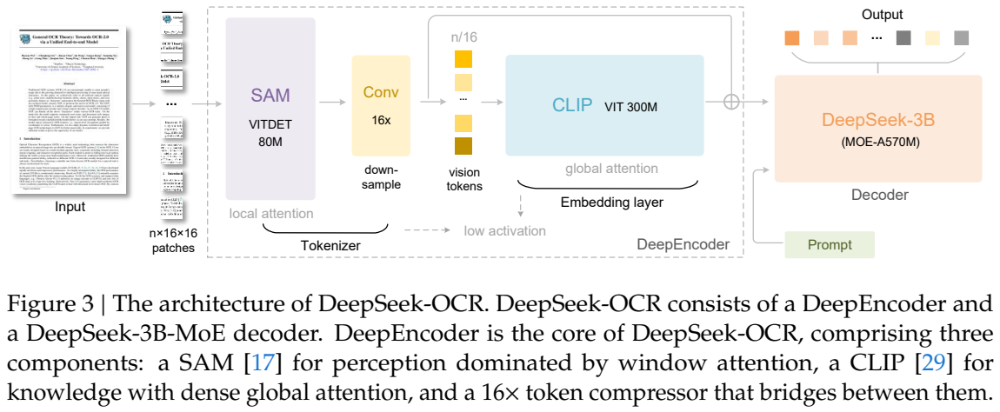
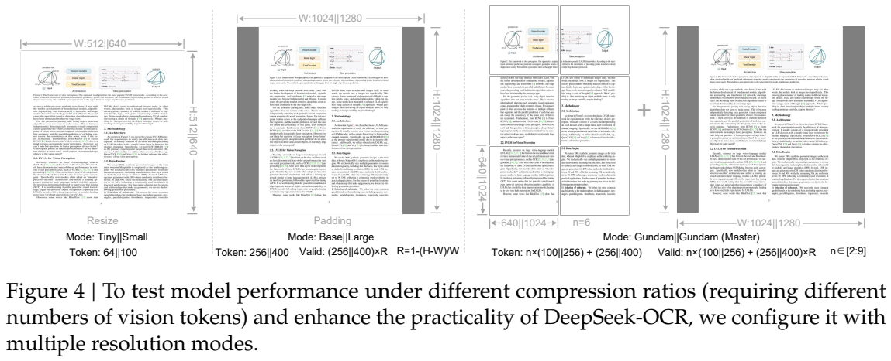
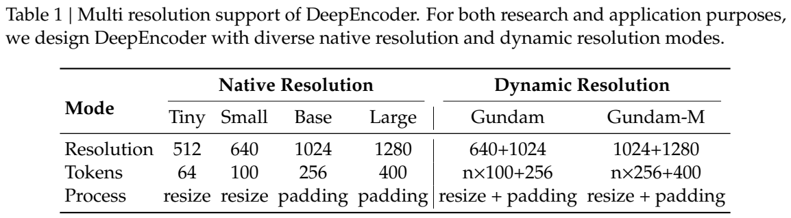
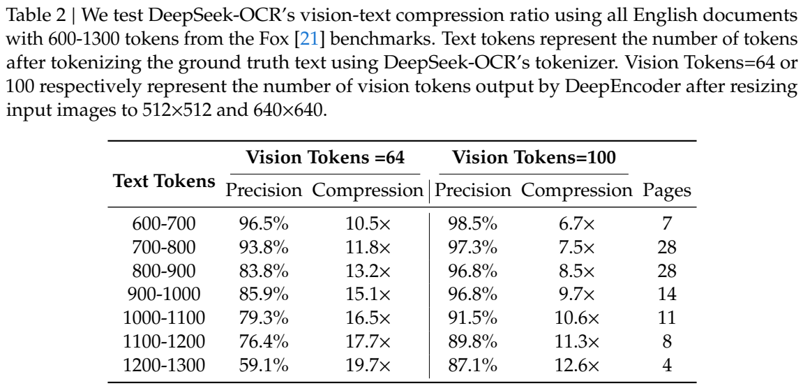
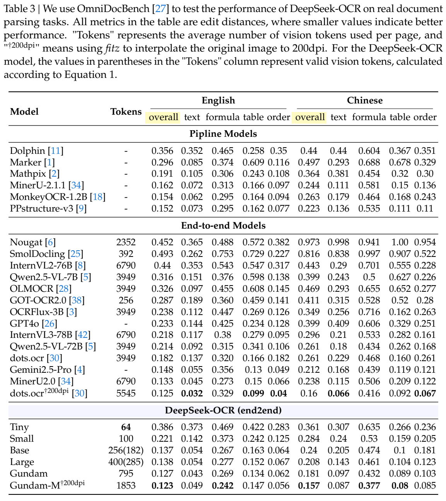

<!-- article-header:start -->
[项目首页](../../../README.md) › [模型系列](../../../reports/model-family-index.md) › [DeepSeek](../README.md)
<!-- article-header:end -->

# DeepSeek-OCR：用少量视觉 token 读取文档与探索光学上下文压缩

<!-- article-toc:start -->
<a id="article-toc"></a>

**本篇目录** · [论文定位](#paper-info) · [快速概览](#overview) · [整体架构](#architecture) · [核心原理](#principles) · [数据构建](#data) · [训练流程](#training) · [实验结果](#experiments)
<!-- article-toc:end -->

<a id="paper-info"></a>

## 1. 论文信息与模型定位

| 项目 | 信息 |
|---|---|
| 原题 | DeepSeek-OCR: Contexts Optical Compression |
| 作者与机构 | Haoran Wei、Yaofeng Sun、Yukun Li；DeepSeek-AI |
| 固定来源 | [arXiv:2510.18234v1](https://arxiv.org/abs/2510.18234v1)，2025-10-21，22 页 |
| 官方项目 | [deepseek-ai/DeepSeek-OCR](https://github.com/deepseek-ai/DeepSeek-OCR) |
| 模型组成 | 约 380M DeepEncoder + DeepSeek-3B-MoE 解码器；解码器激活约 570M |
| 定位 | 文档 OCR、版面与结构解析，同时作为视觉压缩文字的初步实验平台 |

DeepSeek-OCR 研究一个具体问题：文档内容若先以图像表示，能否用远少于文本 token 的视觉 token 恢复文字？模型主要服务于文档数据生产，没有经过独立 SFT 聊天阶段，不能把它等同于通用视觉聊天助手。570M 是解码器的激活参数口径，不是包含视觉编码器在内的全部模型规模。

<a id="overview"></a>

## 2. 快速概览

设计核心是串联的 DeepEncoder：高分辨率图像先经以窗口注意力为主的 SAM，再通过卷积缩短 token 序列，最后交给 CLIP 的全局注意力整合语义。低分辨率 Tiny、Small 模式仅产生 64、100 个视觉 token；复杂文档可采用多个局部视图加全局视图。

Fox 的 100 页英文文档实验中，100 个视觉 token 对约 900–1000 文本 token 的解码 precision 为 96.8%；64 个视觉 token 对 1200–1300 文本 token 时为 59.1%。这支持有损视觉表征能承载大量文字，但不能证明通用对话上下文可无损缩短十倍。报告结论明确将文本图像交错预训练和 needle-in-a-haystack 等上下文测试留给后续工作。

<a id="architecture"></a>

## 3. 整体架构



*原文 Figure 3，PDF 第 5 页原文图表裁图。读取方向为 SAM → 卷积压缩 → CLIP → MoE 解码器；图中的 16× 指视觉 token 数减少，而不是每个空间方向缩小 16 倍。*

SAM-base 约 80M，patch size 为 16，承担细粒度视觉感知。CLIP-large 约 300M，承担后续全局特征整合；其原始图像 patch embedding 被移除，因为输入已经是前一模块的特征。两者之间使用两层卷积，kernel 3、stride 2、padding 1，特征通道从 256 扩展到 1024。每层空间边长缩小 2 倍，两层合计 4 倍，面积和 token 数合计缩小 16 倍。

1024×1024 图像先形成 64×64=4096 个 patch，再压缩成 16×16=256 个 token，随后才进入 CLIP 全局注意力。SAM 被描述为“以窗口注意力为主”，不能据此删去所有全局交互、宣称整个编码器严格线性。串联设计便于将不同模块分配到流水线训练阶段，也不同于两套编码器各自输出后再融合的并联方案。

语言解码器有 12 层，每 token 激活 64 个 routed experts 中的 6 个，以及 2 个 shared experts。它根据视觉序列与提示自回归输出文字、坐标、Markdown、HTML 表格、SMILES 或几何结构。Deep parsing 会在文档解析后，对其中图片再次调用模型，属于二次解析流程；不能把包含二次调用的全部图表内容理解为一次前向就同时完成。

| 模块 | 输入与输出 | 公开机制 |
|---|---|---|
| SAM-base感知 | 高分辨率页面 → patch特征 | patch16、窗口注意力为主；先保留细节，参数约80M |
| 卷积压缩 | 64×64×256 → 16×16×1024（1024图像例） | 两层3×3、stride2、padding1卷积；token数量缩为1/16 |
| CLIP-large知识编码 | 压缩视觉序列 → 全局语义表示 | 移除原图patch embedding，直接处理SAM压缩输出，约300M |
| DeepSeek-3B MoE解码器 | 视觉表示与提示 → OCR/结构化文本 | 12层、每token6路由+2共享专家，自回归生成目标格式 |
| 多分辨率与deep parsing | 页面或局部视图 → 选择的视觉预算/二次解析结果 | 原生分辨率与动态裁剪并存；文中图片的细解析可再次调用模型 |

<a id="principles"></a>

## 4. 核心创新与数学原理

### 4.1 光学上下文压缩：比较视觉预算与文字恢复能力

报告将压缩率定义为文本真值经模型 tokenizer 编码后的 token 数与视觉 token 数之比：

```math
R=\frac{N_{text}}{N_{vision}}.
```

这是原文评价定义的数学表达。它不比较文件字节、图像像素数或 KV cache 的实际显存。一个视觉 token 是连续向量，不与一个离散文字 token 具有相同的信息容量；“十倍 token 压缩”不是信息论上十倍无损文件压缩。

原文式 (2) 将解码抽象为 $`\hat X=f_{dec}(Z)`$，其中 $`Z\in\mathbb R^{n\times d_{latent}}`$，输出表示为 $`\hat X\in\mathbb R^{N\times d_{text}}`$、$`n\le N`$。它表达视觉序列到较长文字序列的非线性映射，而非矩阵可逆变换。识别错误、格式变化、采样与训练先验都可能影响恢复结果。

研究问题是：把较长文档渲染成图像后，少量连续视觉向量能否驱动语言解码器恢复足够准确的文字？这条路径同时依赖像素可读性、编码容量和语言先验。高压缩率必须与恢复质量曲线一起读；若小字被渲染或缩放抹去，解码器更流畅的语言输出也不能证明它看到了原文。[§2.2–3.1，PDF第4–5页](https://arxiv.org/pdf/2510.18234v1#page=4)。

### 4.2 多分辨率预算：区分真实序列和有效内容区域

对保持纵横比、补齐成正方形的 Base/Large 输入，原文式 (1) 可简化为：

```math
N_{valid}=\left\lceil N_{actual}\frac{\min(w,h)}{\max(w,h)}\right\rceil.
```

这是按内容占正方形的面积比例估计有效视觉 token。表中的 256（182）、400（285）分别表示实际数量与该口径的有效数量，不能只拿有效数当作真实运算序列长度。正文也没有证明 padding 对应 token 在全部模块中都被跳过计算。

Tiny/Small直接resize到512/640，分别给64/100个token，可能改变原图纵横比例；Base/Large补齐到1024/1280，分别给256/400个token，保留内容比例但分配部分位置给padding。动态模式再加局部视图，增加密集区域的采样预算。位置编码插值让同一编码器适应多个网格，不等于新增一个针对每种分辨率的独立模型。[§3.2.2、Table1，PDF第6页](https://arxiv.org/pdf/2510.18234v1#page=6)。

### 4.3 先压缩再全局交互：降低后段注意力的成本

卷积压缩的计算意义可作如下解释：若进入全局注意力的序列由 $`n`$ 缩为 $`n/16`$，同维度的 token 两两交互项由 $`n^2`$ 降为 $`(n/16)^2`$，对应该项约 256 倍减少。此处是本文对结构的局部运算量推导，未计 SAM、卷积、投影、前馈和解码器生成，不能当作系统实测 256 倍加速。OCR 输出仍需逐 token 生成，视觉输入短不意味着较长输出也被消除。

串联次序很关键：先在较大的网格上提取局部细节，再让CLIP在短序列上聚合全局信息。若先做完整全局注意力再压缩输出，前段的二次方交互开销已经发生，无法获得相同的结构性节省。代价是压缩器需要在有限向量中保留文字和布局；后段再强也无法保证恢复所有被前段舍弃的信息。[§3.2.1，PDF第5–6页](https://arxiv.org/pdf/2510.18234v1#page=5)。

<a id="data"></a>

## 5. 数据构建与处理

| 类型 | 原文数据引擎 |
|---|---|
| PDF 文档 | 30M 页、近 100 种语言；中英文约 25M，其余约 5M，使用 fitz 提取粗文字标注 |
| 精细版面标注 | 中英文各 2M 页，结合 PP-DocLayout、MinerU、GOT-OCR2.0 等产生检测与识别交错监督；其他语言约 600K flywheel 样本 |
| Word 与自然场景 OCR | 3M Word 数据增强公式和 HTML 表格；LAION、Wukong 自然图像中英文各 10M，以 PaddleOCR 标注 |
| OCR 2.0 | pyecharts/matplotlib 生成 10M 图表并以 HTML 表格监督；PubChem SMILES 经 RDKit 生成 5M 化学结构；1M 平面几何解析样本 |
| 通用视觉与文字 | 描述、检测、grounding 等通用视觉占模型训练数据 20%；内部纯文字占 10%；OCR 占 70% |

精细文档标签把版面类别、归一化到 1000 bins 的框与段落文字交错起来；粗标注与细标注使用不同提示。多个监督版本可能来自同一文档页，表中规模不能相加为完全独立原始页面数。自动标签与模型 flywheel 提升生产规模，也可能继承教师的 OCR 和版面错误，报告没有给出所有样本的人工审核比例。





*PDF 第 6 页展示直接缩放、保留比例 padding、局部块与全局视图组合。Table 1 的 token 数是模型选择输入模式后的预算，不是原始文件文本长度。*

Tiny/Small 直接缩放到 512/640 正方形，以避免小预算用于空白；Base/Large 采用 1024/1280 的保持比例 padding。Gundam 使用 $`n`$ 个 640 局部块加 1024 全局视图，输出 $`100n+256`$ token，通常 $`n=2\ldots9`$；原图宽高均小于 640 时 $`n=0`$，退化为 Base。Gundam-M 使用 1024 局部块加 1280 全局视图，预算为 $`256n+400`$，通过后续继续训练获得，不与其他五种模式从一开始完全共同训练。

<a id="training"></a>

## 6. 训练流程与目标

先独立训练 DeepEncoder，接上一个小语言模型进行下一 token 预测，使用 OCR 1.0、OCR 2.0 与 LAION 抽取的 100M 通用数据。训练 2 epochs，batch 1280，序列长度 4096，AdamW、余弦退火、学习率 $`5\times10^{-5}`$。

再训练完整 DeepSeek-OCR，使用 70/20/10 的 OCR、通用视觉、纯文字混合，序列长度 8192。SAM 与卷积压缩器作为视觉 tokenizer 放在 PP0 并冻结；CLIP 放在 PP1，继续更新；12 层解码器各 6 层放在 PP2、PP3。采用 20 个节点、每节点 8 张 A100-40G，PP=4、DP=40、global batch 640，AdamW、基于步数的调度、初始 LR $`3\times10^{-5}`$。完整模型阶段的总步数、训练 token 总量及具体学习率下降节点未公开，不能由每日吞吐反推出总训练量。Gundam-M 在已有模型上以额外抽取的 6M 数据继续训练。

下一 token 目标可用标准形式说明：

```math
\mathcal L=-\sum_t\log p_\theta(y_t\mid E(I),p,y_{\lt t}),
```

这是本文对原文训练框架的标准解释，报告没有额外定义独立的图像重建损失或强化学习奖励。即使训练采用带目标文本的监督，这也不等于报告中的独立聊天 SFT 阶段；作者明确说没有该阶段，部分能力要用 completion prompt 激活。

<a id="experiments"></a>

## 7. 实验设置与主要结果



*PDF 第 10 页包含 Fox 压缩实验的 token 区间、precision、压缩率和样本页数。最后一个高压缩区间只有 4 页，应保留样本量这一条件。*

Fox 实验筛选 600–1300 文本 token 的 100 页英文文档，采用模型约 129K 词表的 tokenizer，提示为不含版面的 Free OCR。100 个视觉 token 在 600–700 区间为 98.5% precision、6.7× 压缩，在 900–1000 区间为 96.8%、9.7×，在 1200–1300 区间为 87.1%、12.6×；64 个视觉 token 对应最后区间为 59.1%、19.7×。报告没有在正文展开 precision 的全部计算公式，不能将它直接解释为“97% 页面逐字完全正确”或“97% 长上下文问答正确”。原文称格式差异会影响分数，这是解释性判断，没有另给经格式修正后的完整新分数。



*PDF 第 11 页是 OmniDocBench 主表，所有指标为编辑距离，越低越好；括号为有效视觉 token 估计，†200dpi 表示另外的输入渲染条件。*

| 模型/模式 | 平均实际视觉 token | 英文 overall ED | 中文 overall ED |
|---|---:|---:|---:|
| GOT-OCR2.0 | 256 | 0.287 | 0.411 |
| DeepSeek-OCR Small | 100 | 0.221 | 0.284 |
| Base | 256 | 0.137 | 0.240 |
| Large | 400 | 0.138 | 0.208 |
| Gundam | 795 | 0.127 | 0.181 |
| MinerU2.0 | 6790 | 0.133 | 0.238 |
| Gundam-M，200dpi | 1853 | 0.123 | 0.157 |
| dots.ocr，200dpi | 5545 | 0.125 | 0.160 |

Small 以少于 GOT 的 token 得到更低 ED，Gundam 对 MinerU2.0 也有整体优势。但更高预算不保证每项更好：Base 的英文 overall 略优于 Large；Gundam-M 的英文 text ED 0.049 高于 Gundam 的 0.043，表格等项则改善。Gundam-M 平均 1853 token，不能把其最优整体数值与“少于 800 token”混用。

文档类别差异明显：Tiny 的新闻报纸 ED 0.94，Gundam 为 0.122，Gundam-M 为 0.099；幻灯片 Tiny 为 0.116、Gundam 为 0.085，所需预算较低。报告声称单张 A100-40G 可生产每日 200K+ 页，160 卡约 33M 页，这是作者生产吞吐描述，未给出覆盖全部模式、输出长度与精度条件的受控延迟表。

“遗忘”设计是将更老文字渲染为更低清晰度图像的研究设想。当前实证集中在 OCR 恢复和文档解析，没有证明跨轮对话推理、无限上下文或无成本显存节省。本文根据固定技术报告及原图进行核验，未运行模型或复现生产吞吐。

<!-- article-footer:start -->
---

[← 上一篇：OmniVinci](../../omnivinci/arxiv-2510.15870/README.md) · [按发表时间浏览](../../../reports/paper-reading-guide.md#year-2025) · [下一篇：VITA-E →](../../vita/arxiv-2510.21817/README.md)

[返回本篇目录](#article-toc) · [返回模型系列](../README.md)
<!-- article-footer:end -->
