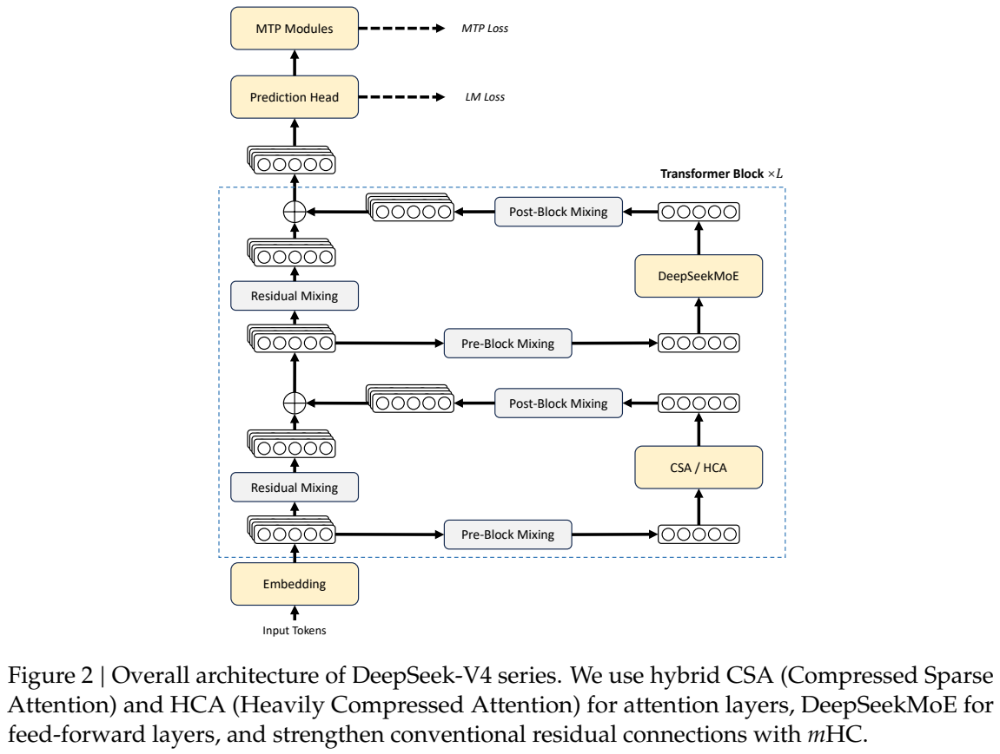
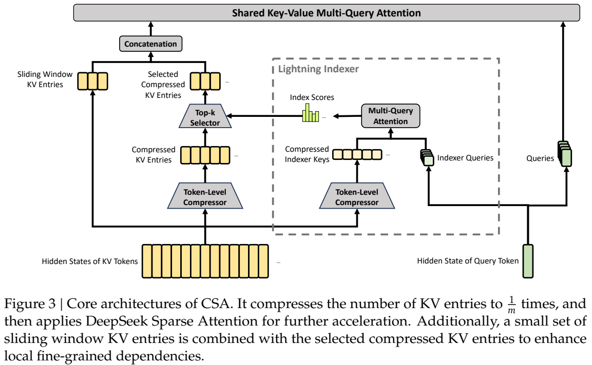
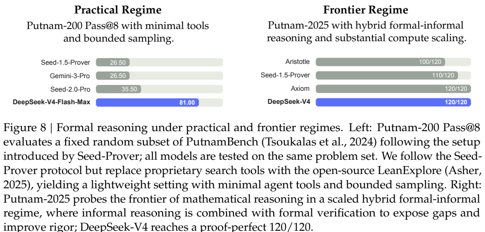
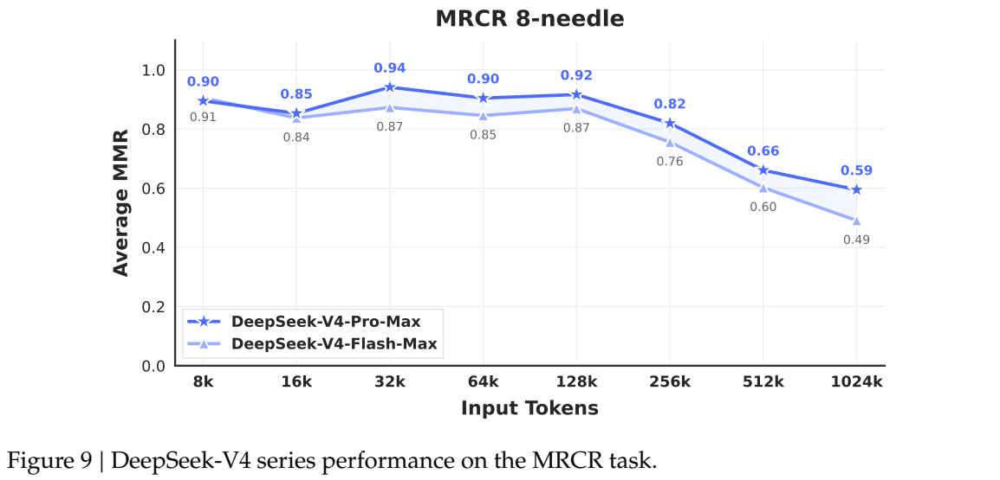

<!-- article-header:start -->
[项目首页](../../../README.md) › [模型系列](../../../reports/model-family-index.md) › [DeepSeek](../README.md)
<!-- article-header:end -->

# DeepSeek-V4：压缩混合注意力与百万 token 推理

<!-- article-toc:start -->

**本篇目录** · [论文定位](#paper-info) · [快速概览](#overview) · [整体架构](#architecture) · [核心原理](#principles) · [数据构建](#data) · [训练流程](#training) · [实验结果](#experiments)
<!-- article-toc:end -->

## 1. 论文信息与模型定位

原文为 DeepSeek-AI 的 **DeepSeek-V4: Towards Highly Efficient Million-Token Context Intelligence**，本文固定使用恢复的 [arXiv 2606.19348v1](https://arxiv.org/pdf/2606.19348v1)，共 58 页。目录中的早期模型卡 PDF 链接失效，当前介绍以官方模型卡随后指向的完整技术报告为依据，来源与文件哈希记录在本目录。

报告发布的是 DeepSeek-V4 系列预览版本，包括 Pro 与 Flash 两个 MoE **语言模型**，均支持百万 token 上下文。Pro 总参数 1.6T、每 token 激活 49B，Flash 总参数 284B、激活 13B。主要目标是降低长上下文推理的计算量和 KV 缓存，支持更长推理与 agent 工作流。[原文第 1、4–5 页](https://arxiv.org/pdf/2606.19348v1#page=1)。

**范围边界：这份报告不是视觉语言模型训练报告。** 原文没有视觉编码器、图像 token、音频前端或多模态训练配方，第 45 页把加入多模态能力列为后续方向。因此它可作为同厂家基础语言模型技术路线的资料保留，但不能把另一个实验性多模态端点的能力反推到这里。

## 2. 快速概览

| 配置 | DeepSeek-V4-Flash | DeepSeek-V4-Pro |
| --- | --- | --- |
| 总参数 / 激活参数 | 284B / 13B | 1.6T / 49B |
| 层数 / 隐藏维度 | 43 / 4096 | 61 / 7168 |
| MoE 专家 | 1 共享＋256 路由专家，选 6 个 | 1 共享＋384 路由专家，选 6 个 |
| 预训练 token | 32T | 33T |
| CSA 压缩 / top-k | 4 / 512 | 4 / 1024 |
| HCA 压缩 | 128 | 128 |
| 滑动窗口 | 128 token | 128 token |
| mHC 残差宽度倍率 | 4 | 4 |
| 推理模式 | Non-think、Think High、Think Max | 同左 |

三个主要变化是 CSA/HCA 混合注意力、流形约束超连接 mHC，以及大部分矩阵采用 Muon 优化器。后训练另采用“领域专长模型 SFT＋GRPO → 多教师 on-policy 蒸馏”的过程，最终合并方式替换了此前的混合 RL 阶段。[原文第 24–33 页](https://arxiv.org/pdf/2606.19348v1#page=24)。

报告估计，在百万上下文条件下 Pro 单 token 推理 FLOPs 约为 V3.2 的 27%，KV 缓存约为 10%；Flash 约为 10% 与 7%。这里 FLOPs 采用等效 FP8 口径，是架构与精度下的计算估计，不是相同硬件上端到端时延必然降低相同比例。

## 3. 整体架构

**如何读图：** 输入从底部 Embedding 向上，经过多层 CSA/HCA 注意力与 DeepSeekMoE，再到预测头和 MTP 模块。每个主模块周围的 Pre-Block、Residual、Post-Block Mixing 是 mHC 对多路残差流的处理，不是额外的视觉分支。预测头的 LM Loss 与 MTP Loss 分别监督当前语言预测和额外未来 token 预测。

Flash 前两层使用纯滑动窗口注意力，之后交错 CSA 与 HCA；Pro 前两层为 HCA，之后同样交错。两者全部 Transformer 块使用 MoE，前三个 MoE 层用基于输入 token ID 的 Hash 路由。其余路由保留细粒度专家与共享专家设计，亲和度函数由 Sigmoid 改为 $\sqrt{\operatorname{Softplus}(\cdot)}$，采用无辅助损失负载平衡，并保留很小的序列级平衡项。[原文第 7、24–25 页](https://arxiv.org/pdf/2606.19348v1#page=7)。

注意力采用共享 Key/Value 的 MQA：压缩条目同时作为 key 与 value，多头 query 共享这些条目。输出先按组投影到中间维度，再汇合，降低直接高维输出投影成本。query 和 KV 在注意力前使用 RMSNorm；末 64 维采用部分 RoPE，并对输出做相应逆位置变换，处理共享 KV 带来的位置影响。

缓存系统区分压缩后的 CSA/HCA KV 与固定容量的状态缓存。后者保存滑动窗口及尚不足一个压缩块的尾部 token；不能把未压缩尾部直接丢弃。磁盘前缀复用又提供完整滑窗缓存、周期检查点和不存滑窗三种选择，在存储与重算之间权衡。这个工程层面对百万上下文实用性同样重要。[原文第 21–24 页](https://arxiv.org/pdf/2606.19348v1#page=21)。

## 4. 核心创新与数学原理

**CSA：先压缩，再挑选。** 每 4 个 token 生成一个压缩 KV 条目，随后轻量 Lightning Indexer 计算相关性，选择 top-k 条目用于主要注意力。CSA 的两个投影分支覆盖当前块与前一块，压缩条目由相邻共 $2m$ 个 KV 加权形成，但相邻窗口重叠，所以最终序列长度是原来的 $1/m$，不是 $1/(2m)$。这有助于保留块边界信息。[原文第 9–10 页](https://arxiv.org/pdf/2606.19348v1#page=9)。

**如何读图：** 左下历史 token 经压缩器形成 KV；中间索引分支产生分数，Top-k Selector 保留候选；左侧另一路保留近期未压缩滑窗，最后与选中压缩 KV 合并。索引器只负责选择，最终表示由上方主注意力计算。它没有把全部历史改成一个固定向量。

**HCA：更高压缩率上的稠密注意力。** HCA 每 128 个 token 压成一个条目，不使用 CSA 的重叠压缩和 top-k。原文式（22–23）可写成

$$
S_{im':(i+1)m'-1}=\operatorname{Softmax}_{row}(Z_{im':(i+1)m'-1}+B),\qquad
C_i^{Comp}=\sum_{j=im'}^{(i+1)m'-1}S_j\odot C_j.
$$

$Z$ 是可学习的压缩权重，$B$ 是位置偏置，逐元素乘积让不同特征维度采用不同权重。模型仍对全部此前压缩条目做注意力，因此不能把 HCA 称为完全线性注意力。CSA 提供较细的相关信息选择，HCA 提供更廉价的广域覆盖；滑窗补充本块及近期细节，并保持因果性。[原文第 11–13 页](https://arxiv.org/pdf/2606.19348v1#page=11)。

**mHC：扩大残差路径，并约束混合矩阵。** 把残差状态扩为 $X_l\in\mathbb R^{n_{hc}\times d}$，原文式（1）为

$$
X_{l+1}=B_lX_l+C_lF_l(A_lX_l).
$$

$A_l$ 把多路状态混成层输入，$C_l$ 把层输出分回多路，$B_l$ 混合残差。它使残差宽度扩为四路，同时层内部隐藏宽度仍为 $d$。关键是约束 $B_l$ 非负且行列和均为 1，即双随机矩阵。由 $\|B_l\|_1=\|B_l\|_\infty=1$ 可得 $\|B_l\|_2\le1$，这里是对原文稳定性结论的简要解释；它限制残差混合放大，不代表整个含非线性网络全局收缩。实现对指数化矩阵做 20 次 Sinkhorn 行列归一化；输入映射为 Sigmoid，输出映射为两倍 Sigmoid。[原文第 7–8 页](https://arxiv.org/pdf/2606.19348v1#page=7)。

**Muon：以矩阵几何处理更新。** 对梯度动量矩阵近似正交化，再缩放更新 RMS，区别于 AdamW 的逐元素自适应。若 $M=U\Sigma V^\top$，Newton–Schulz 迭代尝试将更新变为接近 $UV^\top$，控制不同奇异方向的尺度。这里没有把权重本身正交化，也没有声称所有参数用同一优化器。

**Algorithm 1 的优化步骤：** 算法先积累动量，再用带 Nesterov 的混合 Newton–Schulz，缩放后执行权重衰减及更新。正交化共 10 次：前 8 次系数为 $(3.4445,-4.7750,2.0315)$，后 2 次为 $(2,-1.5,0.5)$。Embedding、预测头、RMSNorm 及 mHC 静态偏置/门控继续使用 AdamW。注意力已有 Q/KV 归一化，因此本报告未使用 QK-Clip。 [原文](<https://arxiv.org/pdf/2606.19348v1#page=14>)。

**多教师 OPD：学习学生实际走到的状态。** 领域专长模型是独立训练的完整教师，和单个 MoE 层中的路由专家不同。原文式（29）为

$$
\mathcal L_{OPD}(\theta)=\sum_{i=1}^{N}w_iD_{KL}(\pi_\theta\|\pi_{E_i}).
$$

学生生成自己的轨迹，再对相应领域教师做反向 KL 对齐，覆盖学生部署时可能出现的状态。反向 KL 的方向是学生到教师，不能改写成教师采样的普通 SFT。报告使用完整词表 logits，而非仅对采到的 token 估计 KL，以降低梯度估计方差；具体教师权重 $w_i$ 未公开。[原文第 32–34 页](https://arxiv.org/pdf/2606.19348v1#page=32)。

## 5. 数据构建与处理

预训练沿 V3 资料体系升级，覆盖数学、代码、网页、长文档和多语言内容。网页过滤批量自动生成及模板内容，减少低多样性资料；长文重点收集科学论文、技术报告等具有独特学术信息的来源。中间训练加入 agent 数据以增强代码任务。原文没有给出每类数据比例、来源数量及过滤阈值，所以这里保留类别与流程，不能补成精确配方。[原文第 24 页](https://arxiv.org/pdf/2606.19348v1#page=24)。

分词器在 V3 基础上增加少量上下文构造特殊 token，词表维持 128K。继承 token splitting 和 Fill-in-Middle，并按来源适当打包以减少截断；与 V3 不同，预训练使用样本级注意力 mask，避免同一 packed 序列中的不相关样本互相读取。

后训练按数学、代码、agent、指令跟随等领域建立高质量 SFT 与 RL 数据。容易验证的题使用规则或测试用例；难验证的任务使用 rubric 引导数据及生成式奖励模型 GRM，actor 也学习判断能力，而非只拟合固定标量评分器。报告未公布这些集合规模与每领域轮次。OPD 最终使用超过十个教师，把专长合并到单个学生。

工具调用使用 DSML 特殊 token 和 XML 格式，目标是减少转义失败。agent 情境保留跨工具及用户轮次的推理历史，一般聊天在新用户轮次丢弃以前推理；因此依赖框架是否真正使用 tool 消息，不能在所有 agent 接法中假定行为一致。Quick Instruction 则用特定 token 触发搜索判断、查询生成、标题、来源权威性等辅助任务，复用已有 KV，避免另一个小模型重新 prefill。[原文第 29–32 页](https://arxiv.org/pdf/2606.19348v1#page=29)。

## 6. 训练流程与目标

| 预训练设置 | Flash | Pro |
| --- | --- | --- |
| 最大 batch | 75.5M token | 94.4M token |
| 峰值学习率 | $2.7\times10^{-4}$ | $2.0\times10^{-4}$ |
| 最终学习率 | $2.7\times10^{-5}$ | $2.0\times10^{-5}$ |
| token 总量 | 32T | 33T |
| 长度扩展 | 4K → 16K → 64K → 1M | 同左 |
| MTP 权重 | 大部分训练 0.3，学习率衰减时改 0.1 | 同左 |

Flash 前 2,000 步线性 warmup，主体保持峰值学习率，末期余弦衰减；Pro 调度基本相同。Muon 动量为 0.95、权重衰减 0.1，更新 RMS 调到 0.18；AdamW 的 $\beta_1=0.9,\beta_2=0.95,\epsilon=10^{-20}$、权重衰减 0.1。序列平衡损失权重 0.0001，无辅助损失平衡偏置更新速度 0.001。[原文第 25–26 页](https://arxiv.org/pdf/2606.19348v1#page=25)。

Flash 先训练 1T token 的稠密注意力阶段，在 64K 长度引入稀疏注意力，先短暂预热索引器再联合训练。Pro 的初期稠密阶段更长，但具体 token 数没有公布。预测目标保留语言建模与深度 1 的 MTP；报告没有完整展开所有损失归一化实现，因此以上为实际公开配置，而不是重新设计的损失。

稳定性处理包括 SwiGLU 线性项裁到 $[-10,10]$、门控项上界 10。出现 loss spike 时短暂回滚并激活 Anticipatory Routing：提前用历史参数算路由，当前参数算主干，解耦两者同步更新。该模式本身增加约 20% 时延，但仅在需要时启用，作者报告整体开销很小；其理论原因仍未充分解释。[原文第 26 页](https://arxiv.org/pdf/2606.19348v1#page=26)。

后训练先各领域 SFT，再 GRPO，之后使用 OPD 汇合。Non-think、High、Max 通过不同长度惩罚和训练窗口形成，Max 还加入特定系统指令；没有公布这些惩罚系数。后训练引入 MXFP4 QAT，作用于 MoE 专家权重与 CSA 索引 QK 路径，训练使用 FP32 主权重和可适配 FP8 框架的模拟量化，rollout/推理使用原生 FP4。它不是“所有网络参数均 FP4”。索引分数由 FP32 改 BF16，top-k 选择器约快两倍，在相应测试中保留 99.7% KV 召回率。[原文第 33–35 页](https://arxiv.org/pdf/2606.19348v1#page=33)。

工程上通过专家分波次重叠通信与计算、TileLang 融合算子、确定性 kernel、矩阵粒度 ZeRO 和 token 级 WAL 支撑训练。中断后的 rollout 从持久化 token 继续，避免从头重生成偏向较短序列。报告提到 NVIDIA GPU 与 Ascend NPU 验证，但没有披露整个预训练的设备数、总 GPU 小时与精确成本。

## 7. 实验设置与主要结果

Base 模型在统一内部评测下比较，Table 1 中 Flash 的 13B 激活参数已经在很多知识和长文项目超过 V3.2 的 37B，例如 MMLU-Pro 68.3 对 65.5，LongBench-V2 44.7 对 40.2；Pro 对应 73.5、51.5。也存在退步，Flash 的 BigCodeBench 56.8 低于 V3.2 的 63.9，不能概括为每项全胜。[原文第 27–28 页](https://arxiv.org/pdf/2606.19348v1#page=28)。

| 后训练评测 | Pro-Max | Flash-Max | 条件与意义 |
| --- | --- | --- | --- |
| SimpleQA-Verified | 57.9 | 34.1 | 知识能力仍明显受规模影响 |
| GPQA Diamond | 90.1 | 88.1 | 更大推理预算拉近差距 |
| HLE | 37.7 | 34.8 | 不含额外工具版本 |
| LiveCodeBench | 93.5 | 91.6 | 推理模式，不等于 Base 分数 |
| SWE Verified | 80.6 | 79.0 | 内部 agent 框架，bash＋文件编辑 |
| Terminal Bench 2.0 | 67.9 | 56.9 | 原始数据集，非 Verified 子集 |
| MRCR 1M | 83.5 | 78.7 | Table 7 汇总指标，与下图8-needle端点不同 |
| CorpusQA 1M | 62.0 | 60.5 | 跨语料问答 |

知识与推理评测温度为 1.0，Non-think/High/Max 窗口分别为 8K/128K/384K；代码 agent 上限 500 步、512K 上下文。Codeforces 的 rating 基于 14 场比赛、114 道题，每题生成 32 个候选再抽取 10 次提交序列估计，不是普通单次 pass@1。部分对照 API 请求失败的单元格保留为空，不能填作 0。[原文第 36–39 页](https://arxiv.org/pdf/2606.19348v1#page=36)。

**如何读图：** Figure 8 左侧是在轻量工具和有限采样下的 Putnam-200 pass@8，Flash-Max 为 81%；右侧是更大计算预算的非形式/形式混合证明，120/120 是该验证流程结果，不能写成无工具单次回答准确率。Figure 9 横轴为输入长度，纵轴为 MRCR **8-needle** 平均 MMR；Pro 从 128K 的 0.92 降至 1024K 的 0.59，Flash 为 0.87 → 0.49。这说明“支持百万 token”不等于百万长度保持短文准确率，也解释其端点不能直接替换 Table 7 的 MRCR 汇总值。

与闭源模型对比亦有明确差距。Table 6 的 Pro-Max 在 SimpleQA-Verified 57.9 低于 Gemini-3.1-Pro 的 75.6，MRCR 1M 83.5 低于 Opus 的 92.9，Terminal Bench 67.9 低于 GPT-5.4 的 75.1。报告在部分数学、代码和工具项目展示竞争力，尚不足以证明所有能力达到同一前沿水平。

内部真实任务测试需特别区分胜率和不败率：30 项中文白领任务中总胜率 53%、平局 10%、负率 37%，作者所称 63% 是**不败率**。功能写作对 Gemini 的 62.65% 胜率来自 3,170 例，困难指令及多轮写作则落后 Opus 4.5，45.9% 对 52.0%。搜索比较中 Agentic Search 对 RAG 胜率 61.7%，代价为平均 16.2 次工具调用、更多输入输出 token，不能仅由 token 数推断整体工具成本。[原文第 41–44、55、57–58 页](https://arxiv.org/pdf/2606.19348v1#page=41)。

这份报告展示了架构压缩、稳定优化和后训练汇合如何共同支持长文本智能；残差约束并非全部稳定性的理论答案，百万上下文也仍有检索衰减。本文没有运行模型，没有将内部人类评价当作独立复现，也没有把未来多模态计划写成已验证的视觉能力。

<!-- article-footer:start -->
---

[← 上一篇：Qwen3.6-27B](../../qwen/document-e122aca8cc58/README.md) · [按发表时间浏览](../../../reports/paper-reading-guide.md#year-2026) · [下一篇：π0.7 →](../../pi/arxiv-2604.15483/README.md)

[返回本篇目录](#article-toc) · [返回模型系列](../README.md)
<!-- article-footer:end -->
