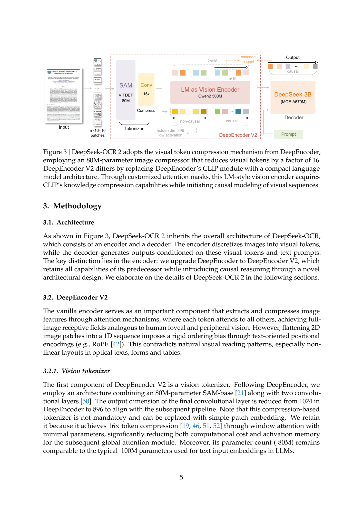
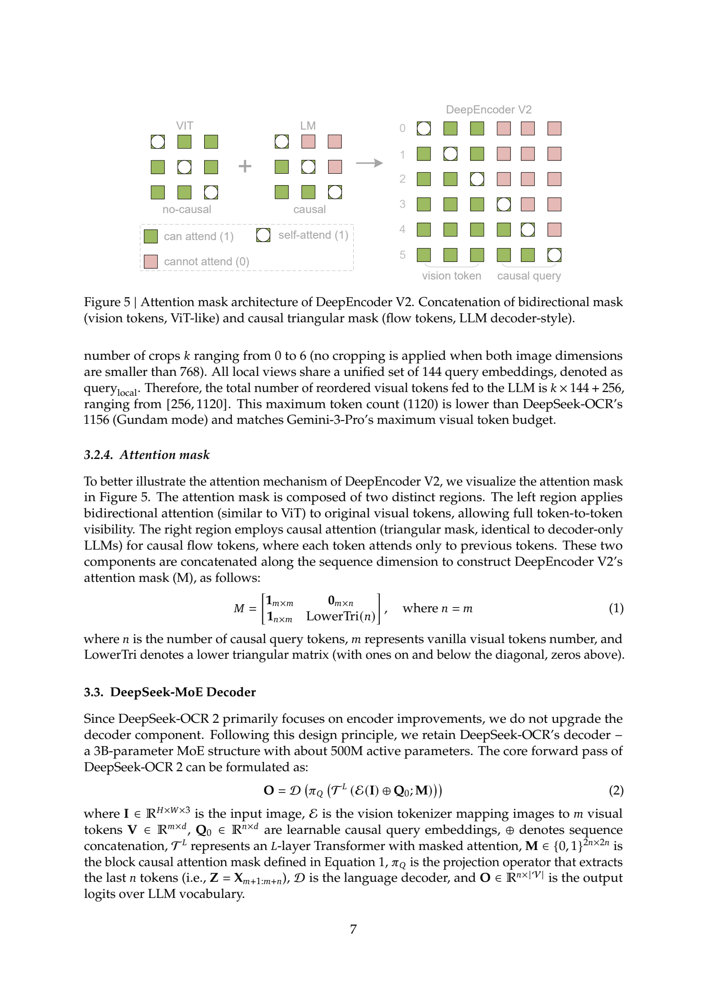
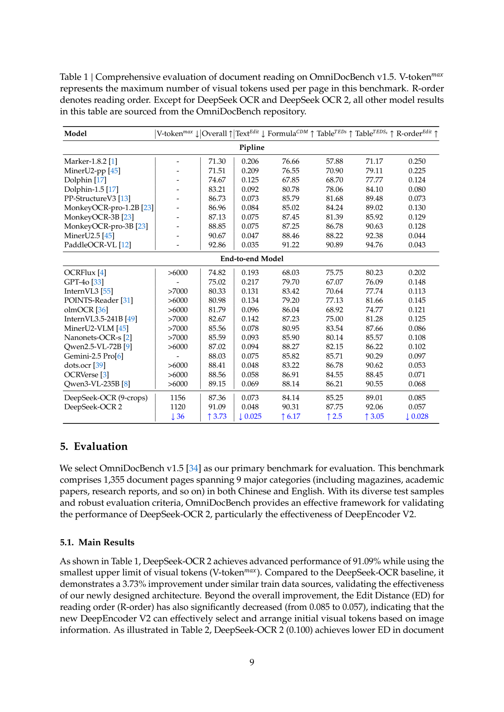
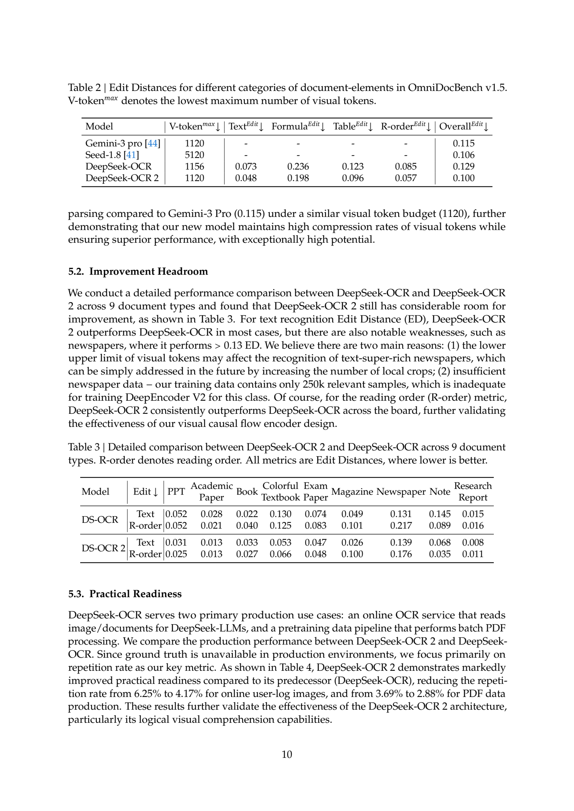

# DeepSeek-OCR 2：以 Visual Causal Flow 改善文档阅读顺序

## 1. 论文信息与模型定位

| 项目 | 信息 |
|---|---|
| 论文 | DeepSeek-OCR 2: Visual Causal Flow |
| 作者与机构 | Haoran Wei、Yaofeng Sun、Yukun Li；DeepSeek-AI |
| 家族 | DeepSeek，文档解析 / OCR 分支 |
| 本文版本 | 官方仓库 PDF，2026-10-08 获取的 15 页快照 |
| 核心模块 | DeepEncoder V2：SAM-conv tokenizer 与 Qwen2-0.5B 风格视觉编码器 |
| 解码器 | 沿用 DeepSeek-OCR 的 3B MoE，正文称约 500M 激活参数 |
| 输入输出 | 文档图像与文本提示输入，结构化文本等内容输出 |
| 原始资源 | [技术报告](https://github.com/deepseek-ai/DeepSeek-OCR-2/blob/main/DeepSeek_OCR2_paper.pdf)、[代码与权重入口](https://github.com/deepseek-ai/DeepSeek-OCR-2) |

这篇报告研究的重点是视觉编码器如何组织文档信息。对于多栏文章、表格和公式，把所有图像 patch 按左上至右下的固定顺序展平，不一定符合实际阅读逻辑。DeepSeek-OCR 2 在原有高压缩图像表示上增加可学习的因果查询，让输入解码器的表示更适合按语义顺序阅读。

它的主要实验场景是文档解析。论文把“两级一维因果结构通向二维理解”作为探索方向；不能把文档指标提升扩大成已经解决通用二维推理，也不能把未来统一音频、文本与图像编码的设想写成已发布的全模态能力。[来源：PDF 第 3、11 页。](https://raw.githubusercontent.com/deepseek-ai/DeepSeek-OCR-2/main/DeepSeek_OCR2_paper.pdf#page=3)

## 2. 快速概览

| 问题 | 本文设计 | 已提供的证据 |
|---|---|---|
| 固定扫描顺序不匹配复杂版式 | 用因果查询重新组织视觉信息 | 阅读顺序编辑距离由 0.085 降到 0.057 |
| 高分辨率文档视觉 token 很多 | 保留 SAM-conv 的 16 倍 token 压缩 | 每图送入解码器 256–1120 个视觉 token |
| 编码器缺少顺序建模 | 原视觉 token 双向注意力，查询 token 因果注意力 | 明确的 block attention mask |
| 训练成本与数据吞吐 | 先训练编码器，再增强查询，最后冻结编码器训练解码器 | 三阶段训练参数与硬件设置 |
| OCR 成绩与实际产线质量差异 | 除标准评测外，报告生产重复率 | 明确说明生产数据没有完整 ground truth |

主结果在 OmniDocBench v1.5 上从 87.36 提高到 91.09，增加 **3.73 个百分点**。论文文字使用“3.73% improvement”，本文依据表中相减关系表述为百分点，避免把它与相对增幅混淆。提升主要与新编码器方案同时出现，但数据采样也有调整，不能视为所有组件都已单独做过严格消融。

## 3. 整体架构

*原文 Figure 3，PDF 第 5 页原页渲染。读取顺序为图像 → SAM 与卷积压缩 → LM 风格视觉编码 → 只选取因果查询输出 → DeepSeek MoE 解码。保留图注及周围说明。*

第一部分是视觉 tokenizer。它沿用约 80M 参数的 SAM-base 加两层卷积，将原始视觉 token 数压缩 16 倍；最后卷积输出维度由上一代的 1024 调为 896，以对接后续模块。这里主要减少 token 数与激活量，不是将图像先转成离散自然语言词汇。

第二部分是 DeepEncoder V2 的 LM 风格编码器。它以 Qwen2-0.5B-base 初始化，将压缩后的视觉 token $V$ 与可学习查询 $Q_0$ 前后拼接。视觉部分保持全局双向交互，查询部分可以读全部视觉表示及此前查询，不能读未来查询。输出时只截取查询对应的后半段表示，供解码器使用。

第三部分是沿用的 DeepSeek 3B MoE 解码器。保留解码器有助于突出编码器改动；但整个训练系统仍包含联合优化阶段，因此“沿用结构”不等于“全部解码器权重始终冻结”。图中标注 MOE-A570M，而 §3.3 正文约称 500M，本文保留正文的近似说法，不把这个近似描述当作精确参数审计。

还有一个关键边界：编码器内部序列是 $[V;Q_0]$，长度约为压缩视觉 token 数的两倍；送到解码器时只保留 $Q$ 部分。该设计没有把新增查询全部额外加到解码器的上下文中，但编码器本身仍需承担对拼接序列的计算。视觉 token 上限接近上一代，不代表总编码开销完全相同。[来源：PDF §3.1–3.3，第 5–7 页。](https://raw.githubusercontent.com/deepseek-ai/DeepSeek-OCR-2/main/DeepSeek_OCR2_paper.pdf#page=5)

## 4. 核心创新与数学原理

### 4.1 一张图中的两种注意力规则

*原文 Figure 5、Equation 1–2，PDF 第 7 页原页。绿色表示可见，粉色表示不可见；右下角查询区域是含对角线的下三角。*

设视觉 token 数为 $m$，查询数为 $n$，本文选择 $n=m$。原文 Equation 1 的可见性矩阵为

$$
M=\begin{bmatrix}
\mathbf 1_{m\times m}&\mathbf 0_{m\times n}\\
\mathbf 1_{n\times m}&\operatorname{LowerTri}(n)
\end{bmatrix},\qquad n=m.
$$

左上块让图像区域全局交互；右上为零，避免视觉 token 通过读入未来查询间接破坏因果约束；左下让每个查询都能检查整张图；右下让查询 $q_i$ 只能参考 $q_{\leq i}$。$M$ 是 0/1 可见性矩阵，实际注意力实现需把禁止位置屏蔽，例如转成加性 $-\infty$，不能把原文的 0 当成普通的零分数后继续 softmax。

用解释性标准注意力形式表示，$A=\operatorname{softmax}(QK^\top/\sqrt d+B_M)V$，其中 $B_M$ 在允许位置为 0，禁止位置为 $-\infty$。这个式子用于说明 Equation 1 怎样约束注意力，并非论文额外提出的损失函数。

### 4.2 因果查询形成新表示，而非显式排序索引

原文 Equation 2 可以重述为

$$
O=\mathcal D\!\left(\pi_Q\left(\mathcal T^L([\mathcal E(I);Q_0];M)\right)\right).
$$

$\mathcal E$ 将图像 $I$ 编成视觉表示，$\mathcal T^L$ 是受 $M$ 约束的多层编码器，$\pi_Q$ 取出查询输出，$\mathcal D$ 进行文本解码。文本提示在实际条件生成中同样参与解码，但该式集中表达图像路径。

“重排序”在这里是查询对视觉信息的学习性重组。模型没有输出一个保证每个原 patch 恰好出现一次的排列矩阵；查询可以融合多个区域，也可能重复关注同一处。因此不能把该机制解释成一个显式的版面排序算法，更不能仅凭因果 mask 断定每个查询已经获得可解释的人类眼动轨迹。

查询是预先存在的可学习输入，不是编码器逐个采样生成的文本 token。因果约束规定信息依赖方向；不意味着必须为每个查询重新运行一次完整的自回归采样循环。真正输出文本的自回归过程位于后面的 MoE 解码器。

### 4.3 查询容量与局部裁剪

对宽高为 $W,H$ 的输入，原文给出压缩后视觉数量 $WH/(16^2\times16)$。1024×1024 全局图得到 256 个查询，768×768 局部图得到 144 个查询；局部视图共享一套 query embeddings，全局视图使用另一套。

若局部裁剪数 $k\in[0,6]$，送入解码器的视觉数量为

$$
N_{\mathrm{visual}}=256+144k\in[256,1120].
$$

例如六个局部图加一个全局图是 $256+6\times144=1120$。这是视觉 token 数，不包含文字提示和最终答案。原文说明两边都小于 768 时不做局部裁剪。有限容量控制成本，也为密集报纸等场景留下性能瓶颈。[来源：PDF §3.2，第 6–7 页。](https://raw.githubusercontent.com/deepseek-ai/DeepSeek-OCR-2/main/DeepSeek_OCR2_paper.pdf#page=6)

## 5. 数据构建与处理

数据源大体沿用 DeepSeek-OCR：OCR 1.0、OCR 2.0 和一般视觉数据，OCR 占训练混合的 80%。这里的“一般视觉数据”说明训练不只含字符转录，但报告的核心验证仍是文档解析，不能用训练类别名称替代一般视觉能力评测。

本版本改动包括两项。其一，对 OCR 1.0 按文字、公式、表格采用 3:1:1 的平衡采样。这个比例是 OCR 1.0 内部的内容采样设置，不是全部数据中 60% 文字、20% 公式、20% 表格的全局比例。其二，合并语义接近的布局标签，例如 figure caption 与 figure title，减少相近类别的标注碎片。

前期训练使用 768×768 和 1024×1024 两个 dataloader，后期通过多裁剪整合为一个。局部视图承担细节，全局视图提供版面上下文。论文没有公开完整去重策略与各数据集逐项数量；第一阶段约 100M 图文对是作者按 8K sequence packing 描述的样本规模，不能直接用 batch×steps 替代得到唯一图片数。

报纸样本约 250K，作者将其不足视为报纸表现不佳的可能原因。由于还存在视觉预算限制，这只是解释性假设；没有单独增加报纸数据的实验，就不能把弱点全部归因于训练数量。[来源：PDF §4.1、第 8 页；§5.2、第 10 页。](https://raw.githubusercontent.com/deepseek-ai/DeepSeek-OCR-2/main/DeepSeek_OCR2_paper.pdf#page=8)

## 6. 训练流程与目标

| 阶段 | 参数更新范围 | 设置与作用 |
|---|---|---|
| 1：编码器预训练 | tokenizer 与 LM 风格编码器，接轻量解码器联合训练 | AdamW；学习率 1e-4 → 1e-6；batch 640；40K iterations；8K packing；160 A100 |
| 2：查询增强 | 冻结 SAM-conv，联合更新 LM 编码器和 DeepSeek 解码器 | batch 1280；15K iterations；学习率 5e-5 → 1e-6；多裁剪；四阶段 pipeline parallel |
| 3：解码器专门训练 | 冻结整个 DeepEncoder V2，只更新 DeepSeek 解码器 | 继续训练 20K iterations；学习率 1e-6 → 5e-8；提高数据消费速度 |

第一阶段，tokenizer 从旧 DeepEncoder 初始化，LM 编码器从 Qwen2-0.5B-base 初始化。通过轻量解码器的下一个 token 预测，训练视觉压缩、表示提取和查询组织能力；阶段结束只保留编码器，不把这个辅助解码器作为最终系统输出模块。

第二阶段接入最终的 DeepSeek-3B-A500M，使用 160 张每张 40GB 的 GPU、40 个数据并行副本，每副本四张卡。pipeline 的 PP0 为视觉 tokenizer，PP1 为 LM 编码器，PP2–3 为 DeepSeek 的语言层。不同模块的优化范围与第一阶段不同，是训练流程中的实质变化。

第三阶段冻结编码器，让语言解码器在固定的新视觉表示上继续适应。作者称相同 global batch 下训练速度超过翻倍，但没有给出一套完整吞吐曲线；本文保留该条件，避免把它解释成最终推理速度翻倍。

原文明确第一阶段使用 language modeling / next-token prediction。可用 $-\sum_t\log p(y_t\mid I,p,y_{<t})$ 解释其条件生成目标，其中 $p$ 是提示；报告没有逐阶段公布独立辅助 loss、排序真值监督或 RL 奖励。因果查询从任务监督中学习组织信息，并非由人工 patch 排序标签直接训练。[来源：PDF §4.2，第 8 页。](https://raw.githubusercontent.com/deepseek-ai/DeepSeek-OCR-2/main/DeepSeek_OCR2_paper.pdf#page=8)

## 7. 实验设置与主要结果

*原文 Table 1，PDF 第 9 页原页。除两代 DeepSeek-OCR 外，其他模型成绩取自 OmniDocBench 仓库；不能假定全部由作者在同一硬件与提示下重新运行。*

OmniDocBench v1.5 包含 1355 页中英文文档、九类内容。Overall 越高越好，Text Edit 和阅读顺序 Edit Distance 越低越好。Table 1 的 R-order 列标题误标上箭头，但改善行与 Table 2–3 明确指向编辑距离下降；本文按编辑距离语义解释。

| 指标 | DeepSeek-OCR | DeepSeek-OCR 2 | 变化 |
|---|---:|---:|---|
| 最大视觉 token | 1156 | 1120 | 少 36 个，不是平均每页 token 数 |
| Overall | 87.36 | 91.09 | +3.73 个百分点 |
| Text Edit Distance | 0.073 | 0.048 | -0.025 |
| Formula CDM | 84.14 | 90.31 | +6.17 |
| Table TEDS | 85.25 | 87.75 | +2.50 |
| Reading-order Edit Distance | 0.085 | 0.057 | -0.028 |

这些指标共同支持在接近的视觉预算下，文本、公式、表格和阅读顺序有所改善。但主表中 PaddleOCR-VL 的 Overall 是 92.86，高于 91.09；因此不能宣称超过所有 OCR 管线。最大视觉 token 只是一项表示预算，也不等价于系统运行时间或总 FLOPs。

*原文 Table 2–3，PDF 第 10 页原页。Table 2 比较文档元素的编辑距离，Table 3 按文档种类拆开结果。*

Table 2 的整体编辑距离从 0.129 降至 0.100；Gemini-3 Pro 为 0.115，Seed-1.8 为 0.106。这是特定文档基准的解析指标，不能外推为这些模型在所有多模态任务中的总体排名。

Table 3 显示阅读顺序九类均改善，但文字识别仍有退化：Book 的 ED 从 0.022 升至 0.033，Newspaper 从 0.131 升至 0.139。密集信息与压缩预算之间存在取舍，这些反例应与总分一起阅读。作者提出未来增加局部裁剪与报纸数据的方向，尚未提供这两项改动后的结果。

生产评测 Table 4 中，线上图片重复率由 6.25% 降至 4.17%，预训练 PDF 产线由 3.69% 降至 2.88%。由于产线没有完整真值，重复率是可观测质量指标，不能称为生产 OCR 准确率。这份报告最有价值的实验证据是文档顺序和解析质量改善；广义二维因果推理、统一全模态编码器及每个组件的单独贡献仍属于后续验证问题。
